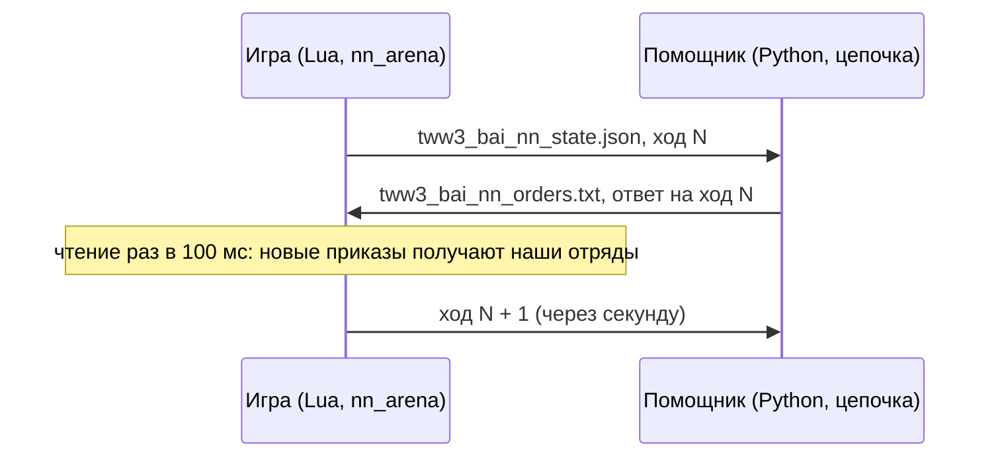
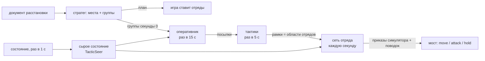

# bridge

[← Назад](README.md) · [Документация](../README.md) · [Приложения](../architecture/apps.md)

Мост к нейросети: нашей стороной настоящего боя командует помощник вне игры (`bridge/companion/`, в контейнере
`snake-ai-trainer`): стратег расставляет, цепочка оперативник → тактики → сеть отряда ведёт бой. Игра и помощник
общаются через файлы в папке игры. Код: `bridge/lua/apps/bridge/`. Как запустить и смотреть:
[смотреть бой сети](../launch/watch.md).



## Как это работает

- На каждом **решении** (`decide_ms`, по умолчанию 1 с времени боя) игра пишет состояние всех
  отрядов обеих сторон со следующим **номером хода**.
- Помощник строит из него вход каждого уровня цепочки (`bridge/companion/unit_input.py`, `tactic_input.py`,
  `operative_input.py`, `strategist_input.py`) теми же формулами, что симулятор
  ([ниже](#вход-сети-отряда-один-в-один-с-симулятором)). То, чего не увидел бы человек, скрывается там же: игра пишет
  всё, вход помощника прячет лишнее.
- Помощник отвечает приказами на этот ход. Игра читает файл раз в 100 мс времени боя
  (`poll_ms`) и отдаёт каждому нашему отряду его приказ.
- **Повторно отдаётся только изменившийся приказ**: другой вид, другая цель, бег вместо шага или
  точка дальше 5 м от прежней. Иначе отряд каждую секунду заново начинал бы путь.
- **Нет ответа к следующему решению** — действуют прежние приказы; событие `nn_miss`.
  Опоздавший ответ (на прежний ход) всё равно берётся; `lag` в событии говорит, насколько он опоздал.
- **Бегущие, разбитые и погибшие отряды приказов не получают**: ими управляет игра. Помощник помечает их `out` и не
  пишет для них строки, а мост не берёт приказ из ответа на состояние, в котором отряд был не в строю (`down_at`;
  считается в `skipped`). Без этого «стоять»-заполнитель доставался отрядам, собравшимся между состоянием и ответом, и
  останавливал их: первый приказ после 42 из 102 сборов в одной проверке.
- **Собравшийся отряд продолжает свой приказ.** Движок теряет приказ побежавшего отряда; симулятор
  его хранит, и отряд продолжает его в тот же миг, как соберётся. Поэтому мост хранит приказ, который
  был у отряда в момент бегства, и отдаёт его снова сразу, как отряд снова в строю (проверка на
  каждом опросе; событие `nn_rally`, считается в `nn_regiven`); атака на цель, которой больше нет,
  становится «стоять», как в симуляторе. Без этого отряд стоит до следующего ответа.
- **Приказ, потерянный движком, отдаётся снова.** Движок забывает приказ атаки (или движения)
  отряда после схватки, в которую того втянуло: отряд стоит там, где схватка кончилась, а мост
  считает приказ действующим и тот же приказ не отдаёт (в боях: наш лорд под приказом атаки
  пращников в 80–170 м простоял 92 с после того, как отбился от вражеского лорда, в другой раз 14 с).
  Поэтому отряд под приказом атаки в ближнем бою, чья цель дальше `STALL_M` = 20 м (между центрами),
  или под приказом движения, чья точка дальше `STALL_POINT_M` = 15 м, который стоит — не идёт, не
  в рукопашной, не стреляет, не теряет здоровье — `STALL_AFTER` = 3 решения, получает приказ снова
  (`services.order_stalled`; атаку стрелка ведёт его надзор). Событие `nn_stall`; `nn_stalls` в итоге.
- **ATTACK с нулевым боезапасом — рукопашная атака.** Новый приказ сразу вызывает
  `melee(true)`, `attack_unit(враг, false, true)`. Если боезапас закончился при действующей
  атаке, мост на следующем решении убирает стрелковый надзор и отдаёт эту же атаку врукопашную,
  даже при неизменном ATTACK или ответе KEEP. Дальше действуют обычные `nn_rally` и `nn_stall`.
  Каждый такой приказ отмечается `nn_empty_melee`.

### Стрелки

Помощник отвечает со строкой **`mode chain`** (`companion --chain`, событие `nn_mode`): мост исполняет приказ помощника
и от себя добавляет только то, без чего игра ломается ([таблица](#правила-моста-под-цепочкой)). Правила ниже, помеченные
«без `mode chain`», в коде моста есть, но работают только для ответа без этой строки.

- **Стрелку, который уже стреляет по своей цели, она снова не отдаётся.** В игре любой приказ
  сбрасывает прицеливание стрелка: отряд, стрелявший в предыдущие 3 с, стоящий с врагом в
  досягаемости, получив приказ атаки, стреляет в 0,35 / 0,26 следующих 10 с (стрелы / пращи) против
  0,47 / 0,42 без приказа (04.10.2026). На цели (`services.on_target`): стоит
  (не идёт, не в рукопашной), цель движка (поле строки `t`) — этот отряд, и он стреляет сейчас или
  стрелял за последние `FIRE_RECENT` = 3 решения (флаг стрельбы между залпами гаснет на 1–3 с: 104
  из 116 разрывов). Тогда:
  - атака на этот отряд движку ничего не отдаёт (статус `kept`, событие `nn_aim_kept`); одна сменившаяся отметка бега
    тоже не отдаётся;
  - атака на цель в рукопашной в досягаемости (стрельба по выбору) не останавливает стрелка,
    который уже стреляет стоя (`services.firing`; событие `nn_duty` `free_kept`);
  - когда движок ушёл с этой цели (другая цель, нет стрельбы `FIRE_RECENT` решений), приказ
    отдаётся по-настоящему (событие `nn_duty` `engine_off`).
- **Цель в рукопашной — стрельба по выбору.** В игре стрелок с явной целью, в которую он не может попасть (цель в
  рукопашной с нашими, не видна), стоит и другую цель не берёт: в одном бою 722 отрядо-секунды с целью в рукопашной и
  149 со свободной целью в досягаемости. Поэтому приказ атаки на цель, которая стоит в рукопашной в досягаемости
  стрелка (центр к центру), отдаётся как стрельба по выбору, а не как явная цель (`services.fire_freely`):
  `halt()` + `fire_at_will(true)`, цель выбирает игра, как у её собственных стрелков. Приказанная цель отдаётся снова,
  когда она вышла из рукопашной, не раньше чем через `FREE_MIN` = 10 решений (событие `nn_duty`).
- **Стрелок без цели получает явную цель** (`nn_reaim`). Под ATTACK или HOLD мост считает
  решения, когда отряд в строю с боезапасом, не в рукопашной, не стреляет и у движка нет
  подходящей цели. Через `REAIM_AFTER_CHAIN` = 10 решений под цепочкой (без `mode chain` — `REAIM_AFTER` = 3:
  повторный приказ сбрасывает прицел, а свежему нужно 3–8,5 с до первого выстрела, проба `losrange`) выбирается цель:
  у атаки — только её цель, если она видна и в досягаемости; у «стоять» — ближайший видимый живой, не разбитый враг в
  45° от фронта; бегущего — только если стоящих в досягаемости нет (как `choose_target` симулятора). Дальность — строго
  между центрами. Стрелка, который идёт к своей приказанной цели (цель атаки дальше дальности), мост не трогает — так
  стрелок симулятора идёт под атакой, пока цель не окажется в дальности. При отсутствии врага счёт сбрасывается; смена
  целей помощника счёт не сбрасывает. Явный `attack_ranged` обходит `fire_freely`, даже если враг ещё в рукопашной:
  `melee(false)`, `fire_at_will(true)`, `attack_unit(враг, true, бег)` задают движку цель для разворота и стрельбы. Для
  HOLD бег выключен. Уже стреляющий отряд и его действующая цель между залпами сохраняются. Если движок не принял цель,
  повтор — только через следующий срок.
- **Без `mode chain`: стрелок без дела отпускается** (`services.missile_duty`): стрелок с приказом атаки, который стоит
  без дела (не идёт, не в рукопашной, не стреляет, есть боезапас) `RELEASE_AFTER` = 10 решений, стреляет по выбору
  (`nn_duty` `release`, потом `resume`). Под цепочкой выключено: в симуляторе такого правила нет, а при 4 решениях мост
  отпускал джезайлы раньше, чем они успевали выстрелить (бой цепочки М3, 08.11;
  [план дыр](../../../sim/evidence/diag_mem/plan.md), «Н-прямой-огонь»).
- **Без `mode chain`: стоящий стрелок наводится сам** (`services.hold_target`, `hold_guard`): раз в решение мост даёт
  каждому стоящему стрелку ближайшего стоящего видимого врага в пределах дальности (`HOLD_REACH_M` = 0) как цель атаки
  шагом; стрелок, который пошёл к цели `HOLD_WALK` = 2 решения, останавливается и стреляет по выбору `FREE_MIN`
  решений (событие `nn_hold`: `aim`, `none`, `halt`, `keep`). Причина: остановленный стрелок игры с огнём по выбору
  сам берёт цель, часто чуть дальше дальности, держит её и стоит (8 боёв: с врагом в дальности стреляли в 40 % секунд
  под «стоять» против 98 % под приказом атаки; один отряд пращников простоял 155 с с полным боезапасом). Под цепочкой
  «стоять» = стоп + стрельба по выбору, как у стоящего стрелка симулятора, который по выбору не поворачивается.

### Правила моста под цепочкой

| Правило моста | Что делает | Под цепочкой | В симуляторе |
|---|---|---|---|
| сплочение (`nn_rally`) | отряд, вернувшийся после бегства, получает свой прежний приказ | остаётся | то же: приказ переживает бегство |
| упавшему — нет приказа | «стоять»-заполнитель отряду, бегущему в отвеченном состоянии, не отдаётся | остаётся | бегущий не управляется |
| уже стреляет по цели (`nn_aim_kept`) | атака на цель, по которой стрелок уже стреляет, не отдаётся (сброс прицела) | остаётся | приказа нет — стреляет дальше |
| цель в рукопашной (`fire_freely`) | атака стрелка на цель в рукопашной в дальности — как стрельба по выбору | остаётся: в игре с такой целью стрелок стоит без дела | стрельба по выбору бьёт и в рукопашную (`allow_fire_at_will_into_melee`) |
| отпустить без выстрела (`nn_duty release / resume`) | 10 решений без выстрела — стрельба по выбору, потом цель снова | **выключено** | нет |
| наведение стоящего стрелка (`nn_hold`, `hold_guard`) | «стоять» стрелка → атака ближайшего в дальности | **выключено**: «стоять» = стоп + стрельба по выбору | стоящий стрелок по выбору не поворачивается |
| восстановление цели (`nn_reaim`) | стрелок без цели у движка — даётся цель | через 10 решений (не 3); у атаки — только её цель, у «стоять» — только враг в 45° от фронта | стрелок по выбору всегда стреляет в своей дуге; движок игры может остаться без цели навсегда — нужно |
| цель ушла от движка (`engine_off`) | стрелок перестал стрелять по приказанной цели — приказ отдаётся по-настоящему | остаётся: это приказ помощника | — |
| брошенный приказ (`nn_stall`) | стоит 3 решения вдали от цели / точки — тот же приказ снова | остаётся: игра бросила приказ помощника | приказ не бросается |
| пустой стрелок (`nn_empty_melee`) | без боезапаса под атакой — атака в рукопашную | остаётся | не проверено |
| режим застрельщиков выключен (`nn_skirmish`) | игра сама отводит стрелков — выключено | остаётся (по умолчанию; сборка `--skirmish game` — не трогать) | такого режима нет |

## Приказы

Приказы отдаются проверенными вызовами [orders](orders.md):

| Приказ | Вызовы движка |
|---|---|
| `hold` | `halt()`, `fire_at_will(true)`; без `mode chain` стрелку затем цель выбирает мост ([стрелки](#стрелки)) |
| `move` | `fire_at_will(true)`, `goto_location(точка, бег)` |
| `withdraw` | `fire_at_will(true)`, `goto_location(точка, true)` — бегом из боя |
| `attack` | стрелок с боезапасом: `attack_ranged(uc, враг, бег, true)` — `melee(false)`, `fire_at_will(true)`, `attack_unit(враг, true, бег)`; остальные, включая стрелка с боезапасом 0: `attack_melee` — `melee(true)`, `attack_unit(враг, false, бег)` — бегом или шагом, как в приказе; действующая атака переключается при исчерпании боезапаса |
| восстановление цели ATTACK / HOLD | `nn_reaim`: явный `attack_ranged` после срока без подходящей цели, даже по врагу в рукопашной; HOLD — шагом |
| `keep` | ничего: действует прежний приказ; отряд, у которого приказа ещё не было, стоит как взят |
| `hold` / `move` / `withdraw` с `face` и / или `width` | `fire_at_will(true)`, один `goto_location_angle_width(место, фронт, ширина, бег)` — у `hold` на своём месте, у `move` / `withdraw` в точке; не заданная часть — от отряда: фронт — его направление сейчас (у `move` — на точку), ширина — `ordered_width()`. Событие `nn_formation` |

Все отряды нашей стороны с начала боя под управлением скрипта (`take_control`). До первого ответа
они стоят и стреляют по своему выбору.

**Способности.** Строка ответа `ability <отряд> <ключ> [<цель>]` применяется один раз и сразу, рядом с приказом
отряда. Цепочка сейчас способностей не просит (её список пуст); путь в мосте готов:

- отряд должен стоять (не бежит, не разбит, не погиб) и `unit:can_perform_special_ability(key)`
  должна ответить «да»; тогда `uc:perform_special_ability(key, unit)` — на самого лорда (на себя:
  вызов проверен в бою);
- с целью (заклинание: бомбардировка или проклятие на врага, усиление на своего) —
  `uc:perform_special_ability(key, отряд-цель)`, цель — скрипт-имя любого отряда любой стороны; так
  кастуют маги в бенчмарках самой игры; цель не найдена — `unknown_target`;
- каждая просьба пишется в журнал (`nn_ability`: `used`, `not_ready`, `down`, `unknown_unit`,
  `unknown_target`, `error`; у заклинания ещё `tg` — цель и `w` — свои ветра магии перед кастом);
- в состоянии есть `abilities_used` (последнее применение каждой способности, мс боя) и у каждого
  отряда обеих сторон `fx`: фазы, действующие на нём сейчас, как их показывает его карточка (CCO
  `ActiveEffectList.At(i).PhaseRecordContext.Key`, проверено в бою). Помощник считает таймеры от применения и паспорта
  (действует `active_s`, снова готова через `recharge_s`; `sim/config/abilities.json`, `exchange.ability_timers`) и
  верит карточке больше, чем счёту: применение, чьей фазы нет на лорде через 1,5 с, не сработало (снова
  готова). Способность врага показывается действующей, пока её фаза на отряде и отряд виден.
- раз в решение, только изменения: `nn_ability_ready` (`can_perform_special_ability` каждой своей
  активной способности) и `nn_effects` (действующие на отряде фазы).

**В игре** (запуск `20261001-105336`: арена `whole_emp_v_skv`, ×3, 240 с боя, нормальная сложность):

| Что | Итог |
|---|---|
| Применения | 6 просьб, 6 `used`, отказов 0, ошибок Lua нет: Stand Your Ground в 1,2, 111,2, 221,2 с; Foe Seeker в 2,1, 88,2, 176,2 с |
| Карточка нашего Генерала (`fx`) | фаза появляется к следующему состоянию (≤ 1 с) и исчезает через 18 с (Stand Your Ground: 2,0 → 20,0 с) и 25 с (Foe Seeker: 3,0 → 28,0 с) — `active_s` паспортов |
| Перезарядка | счёт помощника попросил снова через 86 с (Foe Seeker, паспорт 25 + 60) и 110 с (Stand Your Ground, 18 + 90) после первого применения; каждое сработало |
| `can_perform_special_ability` | **true весь бой**, и пока действует, и на перезарядке: значит «у лорда есть», а не «готова». Поэтому мост не может отказать в применении на перезарядке; готовность решают счёт помощника и карточка |
| Карточки врага | читаются: Strength in Numbers видна на каждом отряде скавенов с 1 с |
| Пассивные на карточке | Hold the Line видна у Генерала; Single Entity и Scurry Away не видны никогда (условные) |

## Файлы

Все файлы обмена пишутся сначала во временный (`.tmp`) и потом переименовываются: читающий не увидит
половину файла. Windows не переименовывает поверх существующего файла, поэтому игра сначала
удаляет старый; на этот миг файла нет, помощник ждёт. Если переименовать не удалось, игра пишет
файл на месте; помощник тогда просто читает ещё раз, пока JSON не целый. Со стороны помощника — `exchange.write_atomic`.

**Состояние** `tww3_bai_nn_state.json` (игра → помощник), JSON:

| Поле | Что это |
|---|---|
| `batch` | Метка боя; новый бой — память помощника начинается заново |
| `move` | Номер хода: 1, 2, 3… |
| `t` | Время боя от начала, мс |
| `done` | `true` в последнем состоянии, в конце боя |
| `attacker` | Сторона, которая атакует (2 — атакует ИИ игры) |
| `factions` | `{own, enemy}` |
| `decide_ms` | Время между решениями, мс |
| `units` | Все отряды: поля записанного `nn_sample` ([nn_arena](entries.md#nn_arena)) и ещё `side`, `key` (ключ отряда), `v` (виден другой стороне) и `fx` (ключи действующих на нём фаз; нет, если карточку не прочесть); без полей только для записи `sv`, `pcr`, `phr`, `mge` (и `bop` записи): `nn_arena` читает их для сверки симулятора, не для сети. Для сети отряда (у обеих сторон): `ow` — приказанная ширина строя (`unit:ordered_width()`, м; из неё и числа бойцов считаются фронт и глубина строя), `tr` — бежит от ужаса (CCO `IsTerrified`), `hid` — скрыт (`unit:is_hidden()`; у врага помощник его не берёт) |
| `map` | Путь ландшафта боя (`config.map`, сборка `--map`): помощник находит по нему снятую карту `sim/maps/<имя>/` (высоты, край поля, земля, стволы) |
| `abilities_used` | `{отряд: {ключ способности: мс боя её последнего применения мостом}}` (`{}` до первого) |
| `winds` | Ветра магии своей армии `{cur, rate, res}`: `army:winds_of_magic_current()`, `winds_of_magic_remaining_recharge_rate()` и резерв `winds_of_magic_reserve()` (`apps.battle.winds`); чужие ветра игрок не видит, их нет. Поля нет, если игра не ответила |

**Приказы** `tww3_bai_nn_orders.txt` (помощник → игра), текст, строка на отряд:

```
tww3_bai_nn_orders 1
move 17
batch 20260930T203912-nn-12
mode chain
think_ms 2.7
unit own_lord hold
unit own_spear_1 move -120.5 33.2 1
unit own_spear_2 attack enemy_spear_3 0
unit own_archer_1 withdraw -300.0 0.0 1 face 182.81
unit own_spear_3 hold face 92.81 width 40.0
unit own_archer_2 keep
ability own_lord wh_main_character_abilities_stand_your_ground
end
```

`move` / `withdraw`: точка x, z в метрах и бег 1 / 0; `attack`: скрипт-имя врага и бег;
`hold` / `move` / `withdraw` могут кончаться на `face <градусы>` (фронт: направление мира 0..360, как `b`
отряда) и / или `width <м>` (ширина строя) — поворот и ширина приказа сети отряда; `attack` их не несёт. Приказ новый
(отдаётся снова), если фронт дан или снят или сдвинулся больше чем на 1°, ширина дана и отличается больше чем на 1 м
(без `width` действующая ширина остаётся, как в симуляторе); `keep`: нового приказа нет (решено продолжать прежний);
`mode chain`: правила моста под цепочкой ([стрелки](#стрелки)); `ability`: отряд и ключ способности, которую применить
сейчас, и, для заклинания, скрипт-имя цели (`ability own_mage_1 wh_main_spell_metal_searing_doom enemy_spear_3`; строк
сколько угодно). Без последней строки `end` игра ничего не берёт. Отряд без строки сохраняет свой приказ. Тот же
формат пишет и читает помощник (`exchange.orders_text`, `exchange.parse_orders`).

## Расстановка стратегом

Сборка `python -m bridge.build nn-arena --deploy strategist` (точка входа [nn_arena](entries.md#nn_arena),
`config.deploy = 'strategist'`): в фазе `Deployment` нашу сторону ставит стратег помощника (`companion --strategist`,
`bridge/companion/deploy.py`; сам стратег — `net/strategist/`), а не места файла боя. Код —
`bridge/lua/apps/bridge/deploy_adapter.lua` (движок), правила без движка — `services.lua` (`deploy_document`,
`parse_plan`, `deploy_check`). Один раз за бой:

1. Игра пишет **документ расстановки** `tww3_bai_nn_deploy.json`: `batch`, `deploy = true`, `move = 0`, `factions`,
   `attacker`, `map`, `zones = {own, enemy}` (каждая `{x, z, b, front, depth}` — как в файле боя, `sim/arena.py`
   `zones`), `units`: наши — строки целиком, как у моста; враг — **только состав** `{n, side, key, men, hp, v = true}`
   (экран перед боем: ни места, ни состояния).
2. Ждёт **план** `tww3_bai_nn_plan.txt` раз в 100 мс реального времени, до `deploy_wait_s` (120 с):

   ```
   tww3_bai_nn_plan 1
   batch 20261107T014441-nn-2232
   think_ms 134.9
   place own_spear_1 -243.21 -376.24 92.8125 29.60 -248.00 -376.00
   ...
   end
   ```

   Строка `place`: отряд, точка x, z, поворот (середина сектора движка), ширина строя — ровно аргументы
   `teleport_to_location`; необязательно — центр строя, который нужен (`cx cz`): игра ставит центр на половину глубины
   позади точки, поэтому помощник шлёт точку на половину глубины впереди центра, а мост сверяет место с центром. Без
   `end` план не берётся; чужой `batch` — тоже. Нет плана к сроку — `nn_deploy` `no_plan`, фаза кончается как без
   стратега (места файла боя).
3. Берёт каждый отряд плана под управление и ждёт флага управления (`is_script_controlled`; в проверке 26.09 он
   приходил через ~200 мс) — опрос раз в 100 мс, не дольше 3 с, потом ставит всё равно.
4. `teleport_to_location` каждому (`apps.orders.adapter` `teleport`).
5. Через `deploy_settle_ms` (1000 мс реального времени) читает каждый отряд: место, `bearing()`, `ordered_width()`,
   `unit_distance` до поставленных раньше (расстояние коробок движка) — и пишет отклонения от плана (`nn_deploy_check`).
   Отклонения бой не останавливают.
6. Отпускает отряды и кончает фазу; дальше нашей стороной командует, кто задан (`own_ai`: цепочка через мост или
   человек).

Всё на таймерах реального времени: расстановка не ждёт часов боя. Врага ставит файл боя, как всегда. Без
`config.deploy` фаза кончается через 1 с.

## Цепочка: оперативник → тактики → сеть отряда

После расстановки стратегом нашей стороной командует **цепочка уровней**: помощник `--chain`, код
`bridge/companion/chain.py`. Мост тот же: состояние раз в секунду боя, ответ — приказы `move` / `attack` / `hold` с
поворотом и шириной, бег, строка `mode chain`. Без `--chain` помощник отвечает только на расстановку. Сборка и запуск:

```powershell
python -m bridge.build nn-arena --own-ai net --deploy strategist --speed 10 --timeout 300 --own-role defend
powershell -NoProfile -ExecutionPolicy Bypass -File bridge/launcher/watch.ps1 -NoBuild -Strategist default -StrategistTask hold -Chain
```



- **Те же классы, что в симуляторе:** `net/operative/lower.py` (`Tacticians`, `Units` на сыром состоянии —
  `GameUnits`), `net/unit/decode.py` (`to_orders`, `Leash`). Порядок в одной секунде тот же: оперативник, потом тактики,
  потом отряды. Тест `contract/test_chain_bridge_parity_torch.py`: на сырых состояниях боя симулятора приказы
  сети отряда совпадают с цепочкой симулятора секунда в секунду
  ([паритет](../../../contract/parity.md), раздел «Цепочка»).
- **Правила переводчика — как в цепочке матчапов** (`net/matchup/duel.py` `Chain`, по умолчанию): цель группы — отряду,
  отряд в своей области стоит, стрелок в области бьёт цель в дальности, стрелок вне области не идёт на дальнюю цель,
  орудие ходит только в свою область (`lower.Units`: `prio_of`, `stand_still`, `aim_rule`, `stay_rule`);
  оперативник-формула с 9 отрядов — формула армии (`net/operative/army.py`, подход снайперов и орудий на
  дальность), зона «прилипает» (`zone_stick_m`). Для правил помощник каждую секунду берёт из документа цель стрелка
  (`t`) и рукопашную (`m`). Тест: на М3 приказы помощника равны приказам `duel.Chain` секунда в секунду. Сеть отряда
  в игре — с `-ChainGreedy` (в симуляторе цепочка выбирает лучшее). Отключить правила: `Chain(targets=False,
  still=False, aim=False)` — так играет `net/strategist/battle.py` `play`.
- **Правила моста под цепочкой** (`mode chain`, 08.11): мост исполняет приказ помощника и от себя не добавляет ничего,
  кроме того, без чего игра ломается ([таблица](#правила-моста-под-цепочкой)).
- **Секунда 0:** группы стратега (`deploy.Strategist.plans` этой партии) становятся «прошлыми группами»
  оперативника и первыми посылками тактикам, как `net/strategist/battle.py` `placed`. Глагол и темп — стартовая
  команда стратега. Без стратега групп нет, команда — из `--strategist-task`.
- **Часы:** секунда — время документа, округлённое. Уровень решает, когда пришла его секунда, поэтому
  пропущенный документ решение не съедает.
- **Кто:** оперативник — формула (`--chain-op formula`, по умолчанию: так шли все бои в игре; сети на 40 групп пока
  нет), сеть (`--chain-op net`, путь из `net/config/strategist.json` `operative_ckpt`; `run8` собрана на 6 групп и не
  грузится) или путь к весам. Тактики — формула (`--chain-tactic formula`, как под оперативником в симуляторе),
  `net` (`run4`) или путь. Сеть отряда — `net/config/tactic.json` `train.unit_ckpt` (`mixmap/run2`) или `--chain-unit
  <путь>`. Все уровни выбирают по вероятностям, как цепочка симулятора; `--chain-greedy` — лучший выбор.
- **Не как в симуляторе:** поводок проверяется раз в секунду (в симуляторе — каждый шаг, 0,1 с); скорость отряда
  — сдвиг центра (известная разница входа отряда, ниже).
- **Журнал:** в строке решения `companion.jsonl` поле `chain`: время по уровням (`raw_ms`, `op_ms`, `tac_ms`,
  `unit_ms`), область каждого отряда и стоит ли он в ней, поводок, группы оперативника в его секунду. В окне —
  строка `chain sec N: raw .. op .. tac .. unit .. ms, inside k/7` и `operative: ...`.

Помощник целиком:

```bash
python -m bridge.companion --game /game [--strategist default|formula|<ckpt> --strategist-task hold|destroy] \
    [--chain --chain-op formula|net|<ckpt> --chain-tactic formula|net|<ckpt> --chain-unit <ckpt> --chain-greedy] \
    [--log F --exit-on-done --idle-exit S --threads N]
```

Его запускает [watch.ps1](../launch/watch.md) в контейнере `snake-ai-trainer` (Python 3.12, torch 2.13 + CUDA 13.2):
репозиторий на `/repo`, `-e PYTHONPATH=/repo`, папка игры на `/game`.

**Скорость игры ×10.** Шаг цепочки на процессоре (4 потока, арена 7 на 7): медиана 18–19 мс; в секунду
оперативника 49–67 мс, наибольший — 99 мс. Тактик-сеть вместо формулы — до 91 мс. Ожидание ответа в игре
(запись состояния → приказы): медиана 51–53 мс настоящего времени. На ×10 это 0,5 с боя (запаздывание
симулятора — 0,36 с). На ×20 было бы около 1 с — почти всё окно решения. Опоздавших ответов 1 и 7 из ~300, это
секунды оперативника; опоздавший ответ всё равно берётся. Пауза на время решения не нужна.

**Бои 07.11.2026** (арена 7 на 7 Империи с лордом, стратег — формула по 3, против ИИ игры, «Нормальная», ×10):

| | Бой 1, «держать» | Бой 2, «уничтожить» |
|---|---|---|
| прогон | `20261107-104740` | `20261107-105622` |
| ответов / пропусков | 300 / 1 | 287 / 7 |
| приказов отдано | 1813 | 1476 |
| точка «идти» = `ordered_position` в 2 м | 98 % | 94 % |
| отряд в своей области (в симуляторе на том же матче) | 0,80 (0,46–0,48) | 0,08 (0,12) |
| пересборок групп оперативником | 0 (в симуляторе 5,9 за бой) | 8 (7,1) |
| первое касание | 143 с | 44 с |
| итог | 300 с, ничья по времени; золото −159 (−0,06 бюджета) | 287 с, победил ИИ игры; золото −1265 (−0,51) |
| ошибок посылок, падений | 0, 0 | 0, 0 |

Вне области отряд чаще всего потому, что идёт в новую область: оперативник сдвинул зону. Это 79 % и 73 %
таких секунд. В бою 2 зоны «уничтожить» шагают к врагу каждые 15 с, и отряды за ними не успевают — в
симуляторе то же самое. Поводок не сработал ни разу.

## Вход сети отряда: один в один с симулятором

Сеть отряда (личный уровень, `net/unit`) в игре: помощник строит её сырую строку (`view.RAW`) из полей моста —
`bridge/companion/unit_input.py` (`UnitSeer`) — теми же формулами, что `view.raw` из состояния симулятора: строй
(фронт, глубина, плотность) — `geometry.dims` от приказанной ширины `ow` и числа бойцов, доли бойцов / здоровья /
боезапаса — от паспорта, дуга огня — `view.fire_arc`, высота — по снятой карте боя (те же файлы `sim/maps/<имя>/`, что
у симулятора; без снятой карты помощник отказывается строить вход). Тест `contract/test_unit_bridge_parity_torch.py`:
бой симулятора и документы моста о том же бое дают одинаковые сырые числа (кроме трёх ниже) на ровном поле и
одинаковый вид сети на карте в координатах игры. Входы тактика, оперативника и стратега сверяют
`contract/test_{tactic,operative,strategist}_bridge_parity_torch.py`; поле за полем — [паритет](../../../contract/parity.md).

Пока не одинаково (правка `view.py` ждёт решения пользователя; [паритет](../../../contract/parity.md)):
- **скорость** — в игре её нет: помощник берёт сдвиг центра за секунду (0, если отряд не двигался ни сейчас, ни
  секундой раньше, или был в рукопашной в обоих снимках — центр строя в игре «дрожит»: в рукопашной медиана
  0,5–0,7 м/с, у стоящих вне схватки быстрее 0,5 м/с в 28 % секунд), а `view.py` в обучении — мгновенную скорость
  симулятора;
- **бег** — помощник: движется и быстрее шага + 0,3 м/с по этому сдвигу (`exchange.running_by_speed`); `view.py` —
  флаг симулятора по его скорости. Флаг игры `f` — это `unit:is_moving_fast()`, режим бега отряда, а не его скорость:
  в 8 боях он включён в 74 % отрядо-секунд, когда отряд стоит (< 0,3 м/с) в рукопашной, и в 99 % рукопашных секунд ИИ
  игры; по скорости отряды ИИ игры в рукопашной бегут 9 % времени, как в симуляторе. Записи (`nn_sample`) хранят сырой
  флаг игры;
- **ширина во время перестроения** — игра отдаёт приказанную, `view.py` берёт текущую ширину симулятора.

## Режим застрельщиков

В игре у части стрелков (лучники, пращники, Ночные бегуны…) есть режим застрельщиков: отряд сам отходит от
подходящего врага, перебивая приказ. У отрядов сети в симуляторе его нет (`sim/state.py` `sk`), поэтому сборка
`python -m bridge.build nn-arena --own-ai net` по умолчанию ставит `skirmish = 'off'`: мост выключает режим у всех
отрядов, которыми командует ([contract/parity.md](../../../contract/parity.md), «Режим застрельщиков»); `--skirmish
game` режим не трогает. В боях М1–М3 07.11 без флага игра и так держала его выключенным у наших отрядов (3283 из 3283
строк). С `off` мост выключает режим при старте
(`orders.set_skirmish`) и снова на каждом решении, где он оказался включён (событие `nn_skirmish`, счётчик
`nn_skirmish_again`). Включён ли режим сейчас — поле `sk` строки отряда (`unit:is_behaviour_active('skirmish')`; только
у отрядов, у которых режим есть) в `nn_sample` и в состоянии для помощника. Как режим отводит стрелка —
[проба `skirmish`](entries.md#charge_probe).

## services — чистые правила

| Функция | Что делает |
|---|---|
| `parse_orders(text)` | Файл приказов → `{move, batch, mode, think_ms, orders, abilities}` (способность — `{unit, key, target}`, без цели — сам отряд) или `nil` и причина (`incomplete`, `bad kind`, `ability without a unit or a key`…) |
| `changed(old, new, shooter)` | Другой ли приказ (вид, цель, бег, точка дальше `REPEAT_M` = 5 м, поворот дальше 1°, ширина дальше 1 м); у стрелка атака той же цели с другим флагом бега — тот же приказ (любой приказ сбрасывает стрелку прицел) |
| `state_document(meta, move, t, units, done, used)` | Состояние как таблица для JSON (`used` → `abilities_used`) |
| `deploy_document(meta, zones, own_rows, enemy_rows)` | Документ расстановки: наши строки целиком, у врага только `COMPOSITION` (`n`, `side`, `key`, `men`, `hp`) и `v = true`, зоны |
| `parse_plan(text)` | План стратега → `{batch, think_ms, places = {{unit, x, z, b, w}}}` или `nil` и причина (`incomplete`, `bad place`, `no batch`) |
| `deploy_check(p, m, zone, engine_b)` | Отряд после переноса: `d_m`, `db`, `edge_m`, `inside`, `far`, `turned` ([расстановка](#расстановка-стратегом)) |
| `active_effects(read)` | Ключи фаз, действующих на отряде, с его карточки (`read(field)` → значение CcoBattleUnit) или `nil`, если список не прочесть |
| `real_ms(a, b)` | Миллисекунды между двумя замерами `os.clock()` |
| `fire_freely(me, target, range)` | Отдать атаку как стрельбу по выбору: цель стоит в рукопашной в досягаемости |
| `shooter_idle(row)` | Стрелок стоит без дела: стоит, не идёт, не в рукопашной, не стреляет, есть боезапас |
| `missile_duty(duty, me, target, release_after)` | Одно решение для стрелка с приказом атаки: `release`, `resume` или `nil` (`RELEASE_AFTER` = 10, `FREE_MIN`; `release_after` false — не отпускать: цепочка) |
| `firing(me, recent)` | Стреляет стоя: на ногах, не идёт, не в рукопашной, флаг стрельбы сейчас или за `FIRE_RECENT` решений (`recent`) |
| `on_target(me, target, recent)` | `firing`, и цель движка (`t`) — этот отряд: отдать её снова — сбросить прицеливание |
| `reaim_target(watch, me, rows, range, preferred, recent, after?, limit?)` | После `after` решений без подходящей цели (`REAIM_AFTER` = 3, под цепочкой `REAIM_AFTER_CHAIN` = 10): цель приказа в досягаемости (даже бегущая), иначе ближайший стоящий враг, бегущий — только если стоящих в досягаемости нет (как `choose_target` симулятора); текущая цель движка сохраняется, если она не бежит при стоящем враге в досягаемости; `limit` (цепочка): `{arc = 45}` — только враг в дуге фронта (`REAIM_ARC_DEG`), `{only = true}` — только цель приказа; `nil`, если вмешательство не нужно; счёт в `watch.n` |

## exchange_adapter — файлы

`write(path, text)` (временный файл, удаление, переименование; возвращает `renamed` или
`direct`), `read(path)`, `remove(path)`.

## adapter — мост

`start(opts)` берёт наши отряды под управление, удаляет файлы прежнего боя и возвращает
`decide()`, `poll()`, `finish()`, `stats()`. `opts.cco(unit, field)` (необязательно) читает
карточку отряда: с ним у каждой строки есть `fx`. Их вызывает по своим таймерам точка входа
[nn_arena](entries.md#nn_arena) с `--own-ai net`.

## События

| Событие | Поля |
|---|---|
| `nn_orders` | `move`, `lag` (сколько ходов записано после него), `wait_model_ms` и `wait_real_ms` (от записи состояния до приказов), `think_ms` (время помощника), `orders` (отданные: `u`, `k`, `x`, `z`, `tg`, `run`, `face`, `w` (фронт и ширина строя, если даны), `status`: `given`, `kept` — стрелку на этой цели ничего не отдано, `unknown_target`), `kept` (тот же приказ ещё раз: не отдан), `keeps` (отряды с `keep`), `skipped` (приказы отрядам не в строю сейчас или в состоянии, на которое ответ) |
| `nn_mode` | режим ответа помощника (`chain`), при изменении |
| `nn_rally` | `u`, `k`, `x`, `z`, `tg`, `run`, `status` — приказ, который был у отряда при бегстве, отданный снова при сборе (`hold`, если цели атаки больше нет) |
| `nn_duty` | `u`, `action` (`free` — атака на цель в рукопашной отдана как стрельба по выбору, `free_kept` — то же, стрелок уже стреляет стоя: без остановки, `release` — без дела: стрелять по выбору, `resume` — снова приказанная цель, `engine_off` — оставленная цель отдана по-настоящему), `tg` |
| `nn_aim_kept` | `u`, `tg` — атака на отряд, по которому стрелок уже стреляет: ничего не отдано |
| `nn_reaim` | `u`, `k` (`attack`, `hold`), `tg` — явная цель вместо отсутствующей или неподходящей цели движка |
| `nn_empty_melee` | `u`, `tg` — рукопашная атака стрелка с нулевым боезапасом |
| `nn_miss` | `move` без ответа к следующему решению, `answered` |
| `nn_formation` | `u`, `k`, `face`, `width` — приказ строя отдан (`goto_location_angle_width`) |
| `nn_hold` | `u`, `action` (`aim`, `none`, `halt`, `keep` — HOLD оставил цель движка целью стрелка, без остановки), `tg` — цель стоящего стрелка |
| `nn_stall` | `u`, `k` (`attack`, `move`, `withdraw`), `tg` — потерянный движком приказ, отданный снова |
| `nn_ability` | `move`, `u`, `key`, `tg` (цель заклинания), `w` (свои ветра перед заклинанием), `status`: `used`, `not_ready` (`can_perform_special_ability` ответила «нет»: в игре только если способности нет), `down` (отряд не стоит), `unknown_unit` (не наш), `unknown_target`, `error` |
| `nn_ability_ready` | `u`, `key`, `ready` (`can_perform_special_ability`), при изменении |
| `nn_effects` | `u`, `fx` (фазы на отряде или `unknown`), при изменении |
| `nn_skirmish` | только при `skirmish = 'off'`: `action` `off` (при старте; `units` — у кого выключен, `was` — был ли включён до того) или `again` (`u`: на решении режим оказался включён и выключен снова) |
| `nn_deploy` | Только при `deploy = 'strategist'`: `stage` — `asked` (`own`, `enemy`, `wait_s`, `write_mode`), `plan` (`places`, `unknown` — отряды плана, которых нет, `unplanned` — наши без места, `think_ms`, `polls`), `control` (`confirmed`, `polls`), `teleported` (`units`, `settle_ms`), `placed` (`units`, `far` — дальше `DEPLOY_FAR_M` = 10 м, `turned` — поворот вне сектора посланного (больше половины сектора, 2,8°), `outside` — край фронта вне зоны, `overlaps` — коробки ближе 1 м, `missing`, `max_d_m`, `max_db`, `min_pair_m`), `no_plan` (`polls`, `why`), `empty_plan` |
| `nn_deploy_check` | На каждый отряд плана: `u`, `plan {x, z, b, w}`, `at {x, z, b, w}` (место, `bearing()`, `ordered_width()`), `d_m`, `db` (от поворота движка для посланного), `edge_m` (запас концов фронта до края зоны, < 0 — вне), `inside`, `far`, `turned`, `pair_m` (ближайшая коробка из поставленных раньше) |
| `result` (дополнено) | `nn_moves`, `nn_answered`, `nn_missed`, `nn_orders_given`, `nn_keeps`, `nn_bad_files`, `nn_write_mode`, `nn_regiven` (приказы, отданные снова при сборе), `nn_released`, `nn_resumed`, `nn_abilities_used`, `nn_abilities_refused`, `nn_hold_aims`, `nn_hold_halts`, `nn_stalls`, `nn_reaims`, `nn_empty_melees`, `nn_aims_kept` (не отданные приказы: стрелок уже был на этой цели), `nn_skirmish` (`off` или `game`), `nn_skirmish_again` (только при `off`) |

Тесты: дымовой `bridge/tests/test_bridge_smoke.py` (сборка пака без игры; помощник отдаёт приказ на записанный
документ состояния) и сверка вход симулятора = мост `contract/test_*_bridge_parity_torch.py` (в контейнере с torch).
