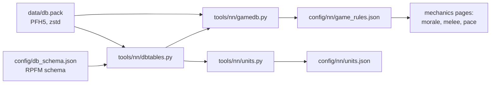

# The game's database

[← Back](README.md) · [Documentation](../README.md) › [Game knowledge](README.md) › The game's database · [Русский](../../ru/game/database.md)

The battle rules live in the game's database: morale, fatigue, hit chance,
leadership, arrows. We read them straight from the game's files so we do not
have to guess numbers.

**Formulas are in the engine, numbers are in the database.** For example, the
database has 35, 8 and 90; that hit chance = 35 + attack − defence within
8–90 % is how the engine uses these numbers. So every formula is checked against
battle recordings ([morale](units/morale.md), [melee](units/melee.md)).

## Where it is

- File: `<game folder>/data/db.pack`.
- Format: PFH5 — the same as our packs ([build](../launch/build.md)), but the
  entries are zstd-compressed: 4 bytes of uncompressed size, then a zstd frame.
- Needs Python 3.14 or newer (the `compression.zstd` module).

## How to read it

```bash
py -3.14 -m tools.nn.gamedb     # rules → config/nn/game_rules.json
py -3.14 -m tools.nn.units      # units → config/nn/units.json
```

Both find the game through `config/local.json`. `tools/nn/gamedb.py` writes the
battle rules, `tools/nn/units.py` the [unit passports](../training/units.md).
The tables are read by `tools/nn/dbtables.py` by the RPFM schema (below). Checked on v9.0.1, build 50381.



## Which tables

| Table | What it holds | Where to |
|---|---|---|
| `_kv_rules_tables` | battle rules: hit chance, a blow every 4 s, armour, flank and rear, charge, shields, arrows, difficulty | `game_rules.json`: `battle`, 276 keys |
| `_kv_morale_tables` | morale: the lord's aura, his death, casualties, flanks, fire, combat, thresholds, timers, difficulty | `game_rules.json`: `morale`, 131 keys |
| `_kv_fatigue_tables` | fatigue: what each activity adds, thresholds | `game_rules.json`: `fatigue`, 29 keys |
| `unit_experience_bonuses_tables` | what a rank adds: leadership, attack, defence, accuracy, reload | `game_rules.json`: `experience_bonus`, 5 rows |
| `unit_experience_thresholds_tables` | experience for ranks 1–9 | `game_rules.json`: `experience_levels`, 9 rows |
| `main_units_tables` | the unit as it is recruited: men, cost, link to `land_units` | `units.json` |
| `land_units_tables` | the unit in battle: attack, defence, leadership, charge, armour, shield, weapons, ammo, figure | `units.json`; attack, defence and leadership of the arena's three units also in `game_rules.json` (`units`) |
| `battle_entities_tables` | a man's figure: health, mass, speeds, height, size class | `units.json` |
| `melee_weapons_tables` | melee weapon: damage, armour-piercing damage, bonuses, hitting several | `units.json` |
| `missile_weapons_tables` | missile weapon → its projectile | `units.json` |
| `projectiles_tables` | projectile: range, damage, reload, flight | `units.json` |
| `unit_armour_types_tables` | armour: key → number | `units.json` |
| `unit_shield_types_tables` | shield: key → chance to block an arrow | `units.json` |
| `unit_spacings_tables` | formation template (`land_units.spacing`): spacing across the front and between ranks, scatter, chaotic formation | `units.json` (`spacing`) |
| `unit_attributes_to_groups_junctions_tables` | the unit's attributes (`expendable`, `encourages`…) | `units.json` |
| `land_units_to_unit_abilites_junctions_tables` | the unit's abilities (keys) | `units.json` |

`_source` in the files is the path to the `db.pack` that was read.

## How the tables are laid out

- **A table holds no names.** A header with a version number (the `_kv_*` and some junctions have none — version 0),
  one byte, the row count (4 bytes), then the rows one after another. A row is the same sequence of fields: int32,
  float32, a flag (1 byte), text (2-byte length + UTF-8), optional text (a flag, then the text) and a few rarer types.
- **The fields' names and order come from the modders' RPFM schema** ([rpfm-schemas][rpfm], Frodo45127,
  `schema_wh3.ron`): for every table and each of its versions, the fields in the order they are written, with name and
  type. The community has kept it up for years; every mod editor uses it.
- We keep not the whole schema (11 MB) but **a cut of it** — `config/db_schema.json` (~18 KB): only our tables, only
  the versions the installed game and the required mods have, plus the source and the SHA-256 of the downloaded file.
  So the code needs no external file, and a schema change shows in git. `tools/nn/dbschema.py` makes the cut.
- `tools/nn/dbtables.py` reads a table **whole** by the schema of its version: to the last byte, every text readable
  text, every flag 0 or 1. The code reaches the columns by the schema's names. If a game update changes a table (a
  new version, or fields that do not fit), reading stops with an error instead of reading shifted numbers. Then:

```bash
curl -L -o build/rpfm/schema_wh3.ron https://raw.githubusercontent.com/Frodo45127/rpfm-schemas/master/schema_wh3.ron
py -3.14 -m tools.nn.dbschema     # rebuild config/db_schema.json
```

| Table | Version | Fields | Rows |
|---|---:|---:|---:|
| `land_units` | 54 | 60 | 2679 |
| `main_units` | 7 | 45 | 2802 |
| `battle_entities` | 39 | 58 | 1341 |
| `melee_weapons` | 25 | 20 | 1280 |
| `missile_weapons` | 12 | 6 | 863 |
| `projectiles` | 53 | 58 | 1093 |
| `unit_armour_types` | 6 | 3 | 106 |
| `unit_shield_types` | 6 | 5 | 24 |
| `unit_spacings` | 7 | 19 | 165 |
| `unit_attributes_to_groups_junctions` | 2 | 2 | 8563 |
| `land_units_to_unit_abilites_junctions` | 1 | 3 | 9693 |
| `unit_special_abilities` | 74 | 71 | 3173 |
| `special_ability_phases` | 44 | 31 | 2526 |
| `special_ability_to_special_ability_phase_junctions` | 2 | 6 | 2730 |
| `special_ability_phase_stat_effects` | 3 | 4 | 3252 |

Also read whole: `_kv_*`, `unit_experience_*`, the abilities' condition junctions
(`special_ability_to_recharge_contexts`, `_to_auto_deactivate_flags`, `special_ability_phase_attribute_effects`) and
the army generator `cdir_military_generator_*` ([armies](../training/armies.md#army-templates-from-the-games-database)).

- **Checked in battle.** Against the unit cards: health, mass, walk and run (`battle_entities`), damage and
  armour-piercing damage (`melee_weapons`, `projectiles`), a projectile's range and reload, the armour number
  ([unit passports](../training/units.md#checked-against-the-cards)). By the melee probe (`build/meleetests`): the
  charge distances `battle_entities.charge_distance_commence_run` / `_adopt_charge_pose` / `_pick_target` (30 / 25 /
  25 m for infantry, 35 / 30 / 30 for lords); an ability's initial recharge `unit_special_abilities.initial_recharge`
  (0 for the lords' actives, 3 s Strength of the Penitent, 5 s Single Entity). The close formation's spacing
  (`unit_spacings.close_formation_spacing_horizontal` / `_vertical`) against the roster: the game's front
  (files − 1) × h within ~1 %.
- **`unit_experience_bonuses`**: `stat`, `value` (int32), `growth_rate`, `growth_scalar` (float32); `game_rules.json`
  writes them under the old keys `flag`, `a`, `b`. For leadership `growth_scalar` = 1.06 — what one rank adds.
- **`unit_experience_thresholds`**: `key` — the level's name, `value` — the experience.

## Where we read columns differently before

Before the schema we decoded some tables ourselves: the field order was fitted so the table reads to the last byte,
the names given from the values. The schema confirmed nearly all of it; the differences are below. None changes a
number in `units.json` or `abilities.json`: the files rebuilt by the schema are the same byte for byte (except the
`_fields` texts).

| Column | How we read it | By the schema | Affects the simulator |
|---|---|---|---|
| `special_ability_to_special_ability_phase_junctions`, 2nd and 3rd | ability, phase | **phase, ability** (swapped) | no: each of our abilities has one phase named as itself; the rows "another ability with the same phase" we took for "variants" |
| `unit_armour_types.material` | the armour's material | `audio_type` — the hit's sound (body, leather, chainmail…) | no: `armour_material` is only in the passport |
| `unit_shield_types.material` | the shield's material | `audio_type` | no: not read |
| `unit_special_abilities` 5th (`targets_own`) | "cast on the caster or friends" | `affect_self` — acts on the owner too | no: 1 for all of ours; `self_cast` the same |
| an ability being passive | `active_time` and `recharge_time` both −1 | the table has its own `passive` column | no: only Strength of the Penitent differs (passive in the table, our `auto` — innate too) |
| `projectiles.trajectory` | trajectory | `trajectory_sight` | no: the same values (`low` — direct fire) |
| `projectiles` 21st, 22nd (`f21`, `f22`) | a float of no known meaning | `bonus_v_infantry`, `bonus_v_large` (int32) | no: both 0 for our units' projectiles (we thought there was no such column) |
| `main_units.barrier_health`, `battle_entities` 40th, `unit_attributes_to_groups_junctions` 2nd | int32; float; a flag + text | float32; `vfx_filter_id` int32; optional text | no: unused (the same bytes) |
| `unit_experience_bonuses` | flag, `a`, `b` | `value`, `growth_rate`, `growth_scalar` | no: the simulator has no experience |
| `unit_spacings` 3rd–8th | "six more numbers" | the dismounted formation's spacing (`dismounted_*`) | no |

Our other names the schema confirmed or refined without a change of meaning: `turn_rate` → `turn_speed`,
`marksmanship` → `marksmanship_bonus`, `penetration` → `projectile_penetration`, `close_h` / `close_v` /
`close_scatter` → `close_formation_spacing_horizontal` / `_vertical` / `_variation`, `chaotic` →
`is_chaotic_formation`, `f13` → `is_magical`, `update_targets` → `update_targets_every_frame`. The former guesses by
position (a phase's duration — "the float before the key", a phase's fatigue — "the float after three flags", the
abilities' combat potential — a copy from twwstats) are replaced by reading the columns `duration`,
`fatigue_change_ratio`, `additional_melee_cp` / `additional_missile_cp`.

## Not checked

- What the `_kv_*` keys that never showed up in recorded battles mean (there are many).
- How the engine uses the columns not checked in battle (a name from the schema is not yet a formula):
  acceleration, deceleration, charge speed, radius, height, size class, the time between blows, a projectile's
  flight, a shield's chance ([unit passports](../training/units.md#not-checked-against-the-game)).

[rpfm]: https://github.com/Frodo45127/rpfm-schemas
