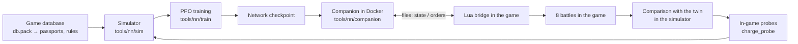

# Project summary

[← Back](README.md) · [Documentation](README.md) › Project summary · [Русский](../ru/summary.md)

A short map of the project: what it does, its parts, the state of each part and where to read the
details. It is read first after a context loss; the detailed pages only for the current task. Fresh
numbers of an iteration are in its logs (`build/steps/`, `build/compare/`); here only the main ones.

## What the project is

A neural network that commands an army in Total War: WARHAMMER III battles. It learns from scratch in
our battle simulator (PyTorch, thousands of battles at once on the GPU) and then plays real battles in
the game against the game's AI at Normal difficulty. Two factions for now - the Empire and the Skaven, a
flat empty map, a lord and up to 19 units a side (21 units and 2 lords in the pools; the v2 army scheme 6 more:
halberdiers, the Ratling Gun, Plague Monks, Plague Censer Bearers, Giant Rats of two kinds;
[passports](training/units.md)). The goal is a network that beats the game's AI in ≥ 97 % of battles and
plays "in character" for its faction ([idea and readiness](training/network.md#readiness)).

## Where we are

- **Level in the game:** on the old exam (8 battles against the game's AI at Normal, pairs with the armies swapped;
  `build/compare/itS*.json`) line S networks since S14 win 5.6 of 8 on average (12 exams, 3 to 8), trade (enemy losses
  over ours) 0.94-1.15; the best is S23_2: 8 of 8, 1.15. Before line S the best was K3: 5 of 8, 0.96. After 8 of 8 the
  exam was replaced by a new one - 10 battles on v2 armies with the new units ([exam](launch/gate.md#exam)); the first
  network on it is S24.
- **What raised it** ([what helped, with numbers](training/training.md#what-has-been-shown-to-help)): a past-version pool of
  equal networks with the full enemy view only (S12: 5/8, the first trade above 1); v2 armies (from S14: 5.9 of 8 on
  average against 3.0 before); simulator fixes from game battles, the main one closing the "ever-fresh lord" loophole
  (S23_2: 8 of 8).
- **How we look for the gap:** the step replay without drift (`tools/nn/sim/stepreplay.py`, [the measure](training/simulator.md#the-step-replay-a-measure-without-drift)):
  every 10 / 20 s the simulator is put into the recorded game state with its hidden clocks and compared by situation.
  On 92 battles, from the same state the window's damage is right (0.94; after 5 s 1.02) and it routs **more** than
  the game (1.11 / 1.21): the whole battles' rout deficit is the battle's path, not morale in the moment. Candidates:
  the morale of middling and fresh units ('charge' in a long melee), the contact at the game's places, flank and rear
  attacks. The acceptance number A (`build/holes`) - how far the twins of the panel's 56 battles are from the game
  (lower is better, ~0.30).
- **The twin's largest gaps:** our units lose half the game's health while routing; the network's lord is in melee
  1.5x as often as in the game and out of the fight in 0.30 of battles against the game's 0.38 (0.12 before the lord's fatigue rule); the AI's shooters move less in the twin.
- **The simulator on the game's recordings** (the replay of 72 battles, below): the loss curves match;
  routs and rallies remain.

## The working loop

One iteration is about an hour of training and battles; between iterations - a simulator fix at the
largest hole.

| Step | What | How |
|---|---|---|
| 1. Training | 40 min from the previous network, no checks in the simulator | `bash build/steps/v2_iterW.sh NAME 40 INIT` (survives a crash: the next attempt starts from `latest.pt`) |
| 2. Exam in the game | 10 battles: 5 seeds of v2 armies of different sizes, each twice with the armies swapped ([exam](launch/gate.md#exam)) | `build/steps/watch_set8.ps1 -Ckpt build/v2/itN.pt` |
| 3. Twin | the same 8 starts in the simulator (the network against `ai_like`, 4 copies); a "game / twin" table and the 3-5 largest behaviour gaps | `bash build/steps/compare_set.sh N` → `build/compare/set_vs_twin.py` |
| 4. Probe | the largest gap is staged as one mechanic in the game and in the simulator alike (lanes of units, everything recorded) | `tools/nn/charge_probe.py` + `src/entries/charge_probe.lua`, plans `--plan` ([probe](apps/entries.md#charge_probe---the-melee-probe-one-mechanic-game-and-simulator-alike)) |
| 5. Simulator fix | the game's rule from the probe, behind a switch in `config/nn/sim.json` | an agent; a test at once |
| 6. Replay of 72 battles | the sets' game battles replayed in the simulator by both sides' recorded orders, 19 copies; skill and bias per quantity | `build/shotgap/replay72.py`, `build/shotgap/replay_card.py` |

The loop's scripts live in `build/` (not in Git). Battles against the game's AI - only at Normal.

## Battle simulator

**What it does.** Each unit is one object (men, health, place, facing, morale, fatigue, ammunition),
not each soldier. Step 0.5 s (the game's morale tick). A battle ends when a side has no standing units;
after 60 minutes the defender wins. ~590 battles a second on an RTX 5070 Ti (4096 at once).

**Where the numbers come from.** The game's database (`config/nn/game_rules.json`, passports
`units.json`, effects `effects.json`, abilities `abilities.json`), community formulas, measurements of
in-game probes. Every rule is a switch in `config/nn/sim.json` with its reason. Any change to `config/nn`
or `tools/nn/sim` changes the simulator version (`tools/nn/train/version.py`).

**What is modelled** (details - [mechanics and their sources](training/simulator.md#mechanics-and-their-sources)):

- **Melee by the game's formulas:** hit chance 35 + attack − defence (weight 1), a miss costs 0.5 s;
  damage - armour-piercing whole + base minus the armour roll; the wound pool; flank / rear - defence
  ×0.6 / ×0.3; charge from a run-up and the charge-speed sprint (into a target already fighting ours too, unless
  through our own men: `charge.blocked_side`, the `busycharge` probe); the first strike on entering a fight; the
  opening wave of a fight (`melee.wave`) - both at a formation's first contact of the battle only (the `recontact` probe), the first strike by the men without the wave, a charge's by its whole front rank, then a pause for the attack interval (`contact.first_strike_rank`, `melee.swing_interval`: a charge's 0-2 s error against the game 0.32 -> 0.22); a thinned formation keeps its width and only part of its men reach
  the enemy (`melee.front_fill_ranks` 1.5: the `dmgmelee` probe, a unit at 30 % struck 1.6-1.9x the game
  before); random blows (`noise.blows`: on in the replay and the twin, off in training).
- **Leaving melee and orders in a fight:** the 24 s window from the database (a lord's too); a move order in a fight is
  leaving in any direction; an attack on a target out of contact is leaving (a lord's too); a new attack in a fight
  strikes only its own target for 24 s; a hold after a leave or an attack on an enemy out of contact does not
  close the window (no strikes until 24 s from the first order; a lord's too); an unchased leaver is held 2 s; the chase has no charge sprint.
- **Shooting by the game's rules:** range centre to centre, a fire arc per man, the database's scatter
  model with no fitting: the scatter is a uniform square, area = calibration area / p, p ∝ accuracy × (calibration distance / d)², at most 1 - no more
  accurate near (`missile.accuracy.spread`, probe `shots`: crossbows at a lone man 30 m off - the game 0.35 hits a shot, the former Gaussian 0.68, the square 0.40;
  the missile probe's lanes - formations 0.105 → 0.069, lone men 0.163 → 0.059; the square overshoots the Ratling Gun on formations more - open; no "zeroing in" shot by shot), a formation catches shots only within the span the shooter sees (`missile.accuracy.width`, probe `ratshape`: the gun used to hit a narrow column 1.6x the game), flat hits on a formation's front rank first (`kills.missile_front`, probe `ratform`: the gun's dead share 0.0 → the game's, damage on formations 1.45 → 1.20 of the game), spill onto neighbours, fire past own men by the bullet's arc, firing on the move
  (militia, throwing stars); shooters in melee strike weakly, as in the game; a new order or target: arcing fire (arrows, bolts,
  slings) is silent 8.5 s whatever the reload, each order restarting the window; handguns and stars fire at once
  (probes `retarget`, `retarget2`, `retarget3`); arrows and bolts at a target that lost a third of its men: a
  cycle of reload + 3.3 s; a shooter without an order on its target keeps a target that routs (or shatters) as the
  game's engine does: 1.5 / 5.5 / 30 s into the rout 33 / 30 / 12 % of the shooters are still on it (789 battles'
  recordings; it used to drop it at once).
- **Skirmish mode** (the `skirmish`, `skirmish2` probes): a shooter of the game's AI and the scripts runs away, not
  shooting, from an enemy coming at it (its way within 40°) within 43.9 m (Skaven 33.1) man to man - over its order;
  from its own attacker to 82 m, from one attacking another ending with a chance of 0.18 a second; a new order ends
  the run (in the game 91 % of the AI's runs end with its own order); off for the network, as the bridge sets it ([details](training/simulator.md#skirmish-mode)).
- **A shooter's way out of melee**: a shooter told to move beyond 10 m leaves at once (no hold in place) and in any
  direction, through the enemy too; the chase keeps it in melee. So in the records of 72 battles: the AI's and the
  network's shooters under such a move move from the first second, 2.3-3.0 m/s ([details](training/simulator.md#a-caught-shooters-way-out)).
- **Morale by the game's rules:** casualty windows 4 / 60 s, "under fire", flank / rear, "flanks secure",
  charge, outnumbering, "losing the fight" (−3 / −8 by the combat ratio, as in the database), a strong
  enemy, the lord's death (−16 for 45 s, then −10), shattering of a unit and of the army; the rally is the
  measured process (`morale.rally_hazard`: a chance a second by the distance to the nearest enemy for routers with morale above 0; measured on the same condition over 360 game recordings).
  By the probe hyp and the recordings of 92 battles: wavering with a margin (it starts below 12 points and ends above
  16), the points stay at 0 or above until the waver timer is up, a 1st / 2nd rout shatters by the living men
  (< 5 % / < 10 %), not health, routing friends and enemies cancel, an enemy weaker than a third of a router does not
  hold its rally. The step replay of 92 battles: shatters sim / game 4.09 → 0.64, waver starts 1.66 → 1.02, routs
  0.98 → 0.95, rallies 1.02 → 1.05 ([morale](game/mechanics/morale.md)).
- **Rout:** the first 7 s the router stays in contact, then while a unit with an attack order on it is within
  16 m edge to edge; a chaser that caught it (no slower) strikes with as many men as it has, gaining them over ~3-5 s
  as its men run in from their ranks; router men that ran into
  a standing enemy formation stay stuck there and die there (the 72-battle replay: units lose 0.75 of the game's while
  routing, was 0.61); it is slowed in a crowd; it dodges its chaser at
  an angle; far from the enemy it flees from all standing enemies (weight 1 / distance), to its own edge
  only when none stands ([where a router runs](training/simulator.md#where-a-router-runs)).
- **Lords:** as fragile as in the game (no own aura, always "losing" in melee), a blow split over 4 men,
  the lord duel by the game's formula, abilities (the game's AI uses them by the measured rule), "Wounds".
- **Fatigue** by the database (10 ticks a second, melee tires under an attack order; the charge +34 on the sprint in,
  no surcharge after the blow; in melee without an attack — ready, a lord tiring as in an attack while he strikes — measured; shooting 11.4 — measured), units' innate
  effects, turning at the database's turn rate, formation by the database's template.
- **Contact effects and bursts** ([details](training/simulator.md#contact-effects-and-the-ratling-guns-burst)):
  poison, the censer's contagion, the Ratling Gun's suppressing fire - the database phase's stats on the unit hit for
  10 s from the last hit, different ones stack, friendly fire lays none; the Ratling Gun - 18 bullets a volley at 4 a
  second, a 12 s cycle, one ammunition pool, it fires in melee too; a 4.5 s spin-up after a halt, an order and every new target (measured), an order mid-burst cuts it: the men who had begun reload 7.5 s from the cut, the rest stay loaded (spamming orders gains nothing, as in the game); a man whose target died loses the spin-up
  from his burst. A beast (an ellipse body in the database) takes its body's width along a contact in melee: 2.2x the
  Giant Rats striking (the probe's twin: 0.4 -> ~1 of the game); as a target the same ellipse turned to the shooter (a
  beast running at the shooter is narrow). The network as the Skaven (guns, wolf rats) against the game's AI: the
  replay by both sides' orders gives the game's outcome 8 of 8 - the twin's loss is `ai_like`'s, not the mechanics'.
- **Bullets slow** ([details](training/simulator.md#contact-effects-and-the-ratling-guns-burst)): hits of projectiles of
  category `musket` (handguns, the gun, pistols, throwing stars) slow a small formation for 10 s: run x0.65, walk
  x0.9 (the `hitslow` measure: a run at handgunners x0.68, bolts do not slow; no number in the database).
- **Magic** ([details](training/simulator.md#magic), `tools/nn/sim/magic.py`): the side's winds (start 12 / 68,
  +0.1 a second), a cast on request that walks into its 200 m range, a 1 s wind-up and the cooldown from the effect's
  end; the bombardments Searing Doom (Gold Wizard) and Warp Lightning (Warlock Engineer) by the target's formation
  density and the friends near it, the landings gathering at the centre; a man knocked down (the database's speed
  threshold by the projectile's and the man's mass) is not hurt until he is up. The probe's twin (Searing Doom / Warp
  Lightning, sums): HP on units 0.72 / 0.90 of the game's, dead 0.73 / 1.01, dead on first casts 0.92 / 1.05; HP on lone
  men (heroes, lords) 0.85 / 1.38 (1.39 / 3.66 without the knock). Friendly hits near the target (battle 4): the twin
  places the units by the game's centres, while in melee their men are mixed - open. **The network casts**
  ([input](training/model.md#magic-spells-winds-casting-16102026-s27)): a spell is a slot of the caster's abilities (the
  same head and press price), it sees its own winds, the enemy caster's spells, "the enemy caster is casting" and the
  strikes; where: the attack target's pointer, no range mask (the caster walks up). The cast's price in training is
  direct accounting, no replays ([price](training/ability_price.md#spells): enemy damage - own damage - 13.9 gold x
  the winds; k the lab's mean gold of a good cast). Training with a caster in every battle is ~2 times slower (`magic.bombard`
  is not compiled). The scripts do not cast; casters in the armies sit behind the `mages` switch, off
  ([armies](training/armies.md#casters)); the scripts' sides get none.
- **The fighters lab** ([details](training/fighters_lab.md), `tools/nn/fighters/`; in training `run.py --fighters`, off by default): every man a point
  with his own health inside the simulator's step. On the replay of 92 battles men killed per health in thinned units and
  under fire come nearer the game (two-handers 0.24 -> 0.62), damage on thinned units 0.95; a man swings
  once an interval, a miss too (the swing probe; the simulator charged a miss 0.5 s), whole battles' damage 1.37 - open. A handful of men
  surrounded has no cap on how many strike one (the crowd probe: 5 rats surrounded by 120 swordsmen die 5.5 times as fast
  as under one striker), while in a formation, by the game's records, the damage follows the striker-enemy pairs, not the
  crowd of strikers: mobs of 3+ units are the lab's excess (1.46 of the game, the rectangle 1.10). The rule "an enemy is
  struck by at most two at a time" (`melee.pairs` 2) gives 1.18 and routs 1.09 -> 1.00, but men killed per health 0.72 ->
  0.48 and the step +33 % - off until the user decides; open - how the game concentrates the blows on fewer men (a target picked "by a score", with
  "the man in front", does not gather them: killed per HP 0.77 -> 0.68-0.73 - rejected). The men decide the dead under
  fire: the rectangle's `kills.missile_front` is off in the men's step (`hook.own_kills`; it took damage from the men, and
  on the 92-battle replay killed per HP under fire was 0.25 of the game, now 1.09 - training with `--fighters` had it
  too); a projectile passes the men of its own unit (the shots probe: handguns at 27 m 0.05 -> 0.74 hits a shot, game
  0.74). Beasts (wolf rats) fight free, flowing round the enemy as in the game (56-64
  rats within reach against 17 formed). The step is
  compiled, Triton kernels look for the neighbours: 1024 battles 20.5 ms (1.7-2.8 simulator steps), 1.1 GB of the GPU.
  Training with the men ([in training](training/fighters_lab.md#in-training), `tools/nn/train/men.py`): the men with the
  batch, restarted battles, the ability branches and the evaluation; 7168 places a battle; the network sees the units'
  shape. Training with the men ~1,320 battle seconds a second (was ~1,150: video memory in segments, the shape only
  before an observation, the men off the card for the update - [training speed](training/training.md#training-speed)),
  with `--amp bf16h --parts 2` ~1,390-1,500; without the men it was 1,710; GPU peak 11.5 GB.
- **Not modelled:** terrain, forest, visibility, cavalry, monsters, other magic, flight, artillery, experience.

**Checks against the game.** A recorded battle is replayed by its recorded orders 19 times with the start
shifted up to 2 m; the copies are the forecast, the game's record is the outcome. The main score is **the
share of the game's values inside the copies' 90 % interval** (90 % for a simulator matching the game),
next to it the **skill** CRPSS (0 - no better than "a typical game value", higher is better)
([how it is scored](training/simulator.md#the-checks-score-the-simulator-as-a-forecast)). The general
check is `python -m tools.nn.sim.check` ([checks](training/simulator.md#checks-against-the-game)); in the
loop - the replay of the network's 72 set battles.

**Replay of 72 battles** (the network against the game's AI, from the iterations' sets):

| Quantity | Simulator | Game |
|---|---:|---:|
| Skill, median over quantities (4 copies) | +2 % | — |
| Our side's loss 60 / 120 / 180 s after first contact | 0.23 / 0.39 / 0.51 | 0.235 / 0.42 / 0.55 |
| Enemy loss at the end | 0.52 | 0.57 |
| Routs per unit | 0.94 | 1.19 |
| Rallies per unit | 0.53 | 0.60 |

**Known mismatches** (details - ["What is missing"](training/simulator.md#what-is-missing)):

- a worn unit in melee loses health faster than in the game (the `dmgmelee` probe is being analysed);
- greatswords in melee take ~0.75 of the game - not because of armour (the `armour` probe: armour 90 on stormvermin
  gives no shortfall) but because stormvermin as strikers fall short x0.76-0.84 on any target; the cause is not found;
- fewer routs and rallies than in the game; in the twin our units rout less than in the game, the AI's
  more;
- the AI's shooters lose less in the replay than in the game (0.34 health against 0.42): one running out of melee loses
  more in the game (likely more chasers); they move less in the twin (0.27-0.29 of their seconds against 0.38-0.41: the
  AI's short steps towards its target at 40-100 m - `ai_like`'s behaviour);
- "flanks secure" grows over ~45 s in the game (+1…+7), in the simulator +5 at once (the `rallysecure`
  probe);
- order delay 0.6-0.8 s in small battles in the game, 0.36 s in the simulator;
- the second wave of units is not fully checked against recordings.

The probes and what each gave - on the [simulator](training/simulator.md) and
[melee](game/mechanics/melee.md#in-game-check-the-melee-probe) pages; failed rules -
["Tried and rejected"](training/simulator.md#tried-and-rejected).

Details: [simulator](training/simulator.md) · [unit passports](training/units.md) ·
[in-game measurements](training/measurements.md) · [game mechanics](game/mechanics/README.md) ·
[game database](game/database.md) · [unit indicator register](game/units/indicators.md).

## Network v2

One network for both factions and both roles (attack or defence is an input). It sees only what a human
would: its own units in full, enemies while visible - everything the game shows about an enemy unit (exact
morale, fatigue, ammunition, kills) except their orders ([visibility rule](training/model.md#the-rule-the-ai-sees-only-what-a-human-sees)). It never sees the time
to the end of the battle. Preset `v2`, 3.51 M weights, trained from scratch
([details](training/model.md#variant-v2-map-sectors-chained-heads-commitment)):

- **Unit tokens** (225 numbers each: passport, state, effects - contact effects too -, fire arc, the order in force,
  shots a volley and magic, the aim before the first shot and the silence after a new target, 28 - the bonuses other
  units' abilities lay on it, 'casting / struck by a spell', 26 - the unit's shape from its soldiers' places (`SHAPE`:
  from the fighters lab or the companion's `--shape`, else zeros; [more](training/model.md#the-units-shape-17102026-s27-own-units-and-seen-enemies-the-tokens-last-inputs));
  checkpoints of 155, 167, 169, 197 and 199 inputs load with zero weights for the new ones) +
  **abilities**: 30 slots a unit - all its abilities, none lost (15 for the actives - the head chooses among them, 15
  for the passives; a passive shows its condition and "on now"; the passport comes from a table, a unit stores the
  slot's 6 numbers and the ability's index; [details](training/model.md#abilities-each-unit-each-of-its-ability-slots))
  → 3 attention
  layers with a distance bias and pair features (who reaches whom, closing speed, flank / rear; also in the target
  pointer) → GRU memory.
- **Map sectors** 16 × 16 of 100 m: strength and count of own and visible enemy units, routers, the map
  edge; units look at the sectors through a separate attention layer.
- **Chained heads:** order kind (hold / move / attack / withdraw / keep) → target → sector → 25 m cell →
  term. Sampling by the Gumbel-max trick (no `torch.multinomial`), logits with a soft cap
  (30 × tanh(x / 30)).
- **Commitment:** each new order is held 2 / 4 / 8 / 16 s; events cut the term (melee, a flank threat,
  the target died or routs, own lord died, an enemy comes at the unit - within 40 m or 8 s of its run, the unit
  lost > 5 % of its health in 4 s).
- **"Eyes":** auxiliary heads learn from the simulator's truth (own losses in 10 / 30 s, an enemy's
  threat, a sector's danger) - as an auxiliary task only: their loss trains the shared trunk, they do not go into
  the decision and are not computed at a decision. The feedback (predictions back into the tokens) is removed: the
  decisions barely depended on it; old checkpoints play with it as before, `eyes_cut.py` moves a checkpoint to the
  new design.

The old presets `small` / `wide` and their checkpoints still work but are not trained.

Details: [input and design](training/model.md) · [idea](training/network.md).

## Training

**How it runs.** PPO as MAPPO: each unit is an agent, a side's units share its advantage, the critic sees
the whole field and does not go to the game. 1024 battles at once, a decision every second, orders
arrive after 0.36 s. v2 with eyes trains at ~3,300-3,900 battle-seconds a second. Battles -
[random armies](training/armies.md): equal budget, a lord and 0-19 units, ¾ of armies by the game AI's
templates, numbers jittered ±15 %. Army scheme v1 (budget first; median 5 units) for the checks; v2
(`run.py --armies v2`, AI-vs-AI battles: numbers of units first, 15-19 units for 36 % of sides, budget up to
15,000) for training. On v2 the speed in battle-seconds is the same, but battles are ~20-30 % longer (finished
battles a minute -16 %).

**Reward v2** (`--reward v2`): win / loss + gold exchange (gold of the enemy destroyed minus our own, over
the budget) + a price for an order change 0.006 ("keep" and a repeat are free)
([reward](training/training.md#reward)).

**Opponents** (`--mix`, line S - `build/steps/v2_iterW.sh`): self-play 0.35, past versions 0.38 (pool 12 and the
networks S9, S10; drawn by quality scores as OpenAI Five's, one version a battle, [past versions](training/training.md#past-versions)),
`ai_like` 0.15 (a script modelled on the game's AI; 0.3 before S24), `nearest` 0.02 (everyone runs at the nearest enemy); of the
self / past battles 0.17 with kiting by situation (`--kite-share`, ~10 % of all battles)
([opponents](training/training.md#battles-and-opponents)); the scripts decide at the game's cadence - once a
second, their orders as late as the network's. The game's AI takes no part in training - it is
the independent check.

**Off:** teachers and drills. The drills (`kiting`, `counter`, `hold_fire`, `direct_fire` and others) stay
in the code, but v2 does not use them, except kiting by situation ([drills](training/training.md#drills)).

**Learning by observation** (`--observe-dir`): the network takes over another player's orders (a human, the
game's AI) from recorded battles, only those its critic found better than expected; weight 0.1 x 0.95 an update. In
line S the flag is set, but the weight is already about 0 - off in effect (below 1e-6 nothing is computed)
([observation](training/training.md#learning-by-observation)).

**The game AI's student** (`tools/nn/student`): a v2 network taught by plain imitation of the game's AI on its
recorded battles (135 AI-vs-AI battles, every second: the AI's new order or keep; a repeat of the same order is
keep), split by start; a candidate pool opponent (`--pool-extra`, no new code) and twin instead of `ai_like`. From
S12's weights, 10 epochs on the CPU: on held-out starts order kind 0.76, target 0.53 (better than simple rules), point
within 25 m 0.22 (worse than "repeat", 0.46); in the simulator it wins 0.41 of its battles against `nearest`, 0.25
against `ai_like` ([student](training/student.md)).

**Abilities by their effect** (`--ability-branch share`, off by default): a share of the ability presses is
replayed in the simulator from the same moment twice — "pressed" and "not pressed" (4 copies with common random
numbers, 60 s, both sides by the same policies); the difference of the gold trade is an extra advantage for the
ability head only, weight 0.1 → 0 over 300 updates. A general mechanism (magic and the lord's skills later). itS23's
ability head had collapsed (presses a ready ability with probability 0.9996 in any situation): for the start —
`--reset-heads ability` and `--head-entropy ...,ability=0.2`
([abilities by their effect](training/training.md#abilities-by-their-effect-branches)).
About 105 of ~5,000 moments an update are replayed and the price is noisy; the **ability critic** (`--ability-critic`,
off by default) is a small separate network that learns from the replayed prices and, after its warm-up (2,000 prices
and an error below the mean's), prices every moment an ability is ready. On S25 it stays off, and rightly: the 60 s
price is almost all the battle's noise (real share 0.07 in a probe of 649 presses) and no model predicted its real part
from the inputs (explained share ≤ 0). The **open loop** removes the chaos (`--ability-branch-openloop`): "not"
plays the orders "pressed" gave, so only the ability's effect differs — real share over 60 s 0.46 instead of 0, half
the price spread, cheaper branches. With it the abilities do work in the simulator: a press is worth +0.003 of the
budget over 60 s on average, Stand Your Ground in melee +0.005. The share is logged (`price_rel`). **The press priced
by its bonuses** (`tools/nn/abilities_price`, training untouched): a brick per bonus kind (a counter of its useful
work; morale weighted by the wavering / rout thresholds, vigour by the fatigue tier's penalties), an ability as its
passport's data, a recharge cost by the situation (the same press at the first moment of the recharge window when its
bonus has work, less the gain of the earlier return), one generic validator
against the open-loop replay; on 4 563 presses of itS25_12 Stand Your Ground, Deadly Onslaught and Foe-Seeker pass
(rank correlation 0.74, 0.63, 0.44), Rally has no signal at 60 s, Verminous Valour fails. The training's open-loop
branches drop only the pressed slot in "not pressed" (they used to drop all of the lord's abilities)
([the press's price](training/ability_price.md)).
**The bonus lab** measures each
bonus kind's rate without the network's presses - pairs of battles "with the bonus / without" (small fights and
whole v2 battles played by `ai_like`); its rates with curves (vigour by the fatigue tier, morale by the unit's morale)
reproduce the replay at least as well as the regression, except Deadly Onslaught's sign (0.89 against 0.92).
**The ability head's own signal** (`--ability-own-signal`, off by default): the ability head is out of the main PPO
and learns only from its own PPO term (weight 1.0) by the press's price - a valid ability's by its bonuses on the
"pressed" branch's trajectory (the lab's rates recounted with today's bricks; the recharge cost by the situation;
`config/ability_price.json`), Rally's and Verminous Valour's by the branches; a moment left ready - the ability
critic's value of the same price. The body gets its gradient x 0.1 (`--ability-body-grad`). The log has the press
rate in melee and out of it per ability and the mean bonus price
([own signal](training/training.md#the-ability-heads-own-signal)).

**Spread of the simulator's uncertain numbers** (`--dr`, on in line S): 23 numbers not taken exactly from
the game's database (a few probes, fits, estimates), each battle draws them inside ranges from the evidence; the
`sim.json` number stays the median ([spread](training/training.md), `config/nn/dr.json`).

**The enemy view:** the networks of line S (from S9) see about a visible enemy what a human sees (exact morale,
fatigue, ammunition, kills; not its orders) - older networks rush with this input, so the pool holds S9 and newer only.

The chain of steps with checks in the simulator (`tools.ops.step`, `test5`, `tools.ops.card`,
`config/train-chain.json`) remains but is not used in the v2 loop: the network is measured by battles in
the game ([workflow](training/workflow.md)).

Details: [training](training/training.md).

## Bridge and companion: how the network plays in the game

- **Bridge** - Lua inside the game (`src`, entry point `nn_arena`). Once a battle second it writes the
  state of all units to a file and reads the orders file every 100 ms (files are written to a temporary
  name and renamed).
- **Companion** (`tools/nn/companion`, Docker container `snake-ai-trainer`) brings the state to the
  simulator's form, builds the side's input, runs the network (with the same commitment as in training)
  and writes orders; ~40 ms from state to orders at speed ×20.
- **The network gives:** hold, move, withdraw, attack a target, run, lord abilities. Routing units are
  controlled by the game.
- **The enemy under `ai_like`:** the simulator's script the network trains against can command the
  enemy in the game (`--enemy-ai ai_like`, a second bridge, the same companion): only the engine's
  difference is left ([bridge](apps/bridge.md#the-enemy-under-the-simulators-script)).
- **Starting a battle:** pack build (`tools.build nn-arena`), the launcher sets Normal difficulty and
  restores the player's settings; one battle per game launch (~2 min). The True Sight mod is required; the launcher removes its
  copies in the game folder (pack, `true_sight.pack`, mod list) after a failed battle too (`build/launcher-installed.json`).

Details: [bridge](apps/bridge.md) · [watch a network battle](launch/watch.md) · [run](launch/run.md) ·
[build](launch/build.md) · [in-game modules](apps/README.md) · [project design](architecture/overview.md).

## In-game check

The working check is **the exam** after each iteration (`watch_set8.ps1`, above; [exam](launch/gate.md#exam)): 5 pairs, in
each the network plays both armies (2-0 - the network beats the AI with both armies; 1-1 - the army
decides; 0-2 - the AI is better). The set is compared with its twin at once - the main source of
simulator holes. The general check tool is
`tools/launcher/gate.ps1` (pairs on evaluation seeds, result in `build/nn-gate/<time>/summary.json`) and
the gap card `tools.ops.gapcard` ([gap card](training/workflow.md#game-vs-sim-gap-card-toolsopsgapcardpy)).

Details: [in-game check](launch/gate.md) · [the game's AI](game/game-ai.md) ·
[difficulty](game/difficulty.md).

## Where things are

| What | Where |
|---|---|
| Working rules | `CLAUDE.md` in the root |
| In-game code (Lua) | `src/apps`, `src/entries`; tests without the game - `tests/` (pytest + lupa) |
| Simulator, training, network, companion | `tools/nn/sim`, `tools/nn/train`, `tools/nn/model`, `tools/nn/companion` |
| Simulator numbers and rules | `config/nn/` (part of the simulator version), switches - `config/nn/sim.json` |
| In-game probes | `tools/nn/charge_probe.py`, `src/entries/charge_probe.lua` |
| Loop scripts | `build/steps/v2_iter.sh`, `watch_set8.ps1`, `compare_set.sh`; `build/compare/`, `build/shotgap/` (not in Git) |
| Iteration networks | `build/v2/itN.pt`, runs - `build/nn-train/runs/` (not in Git) |
| Game battle recordings | `build/nn-arena/runs/<time>/` (not in Git) |
| Orchestrator tools | `tools/ops`: `leftovers`, `wait.sh`, `baselines`, `gapcard`, `step`, `card` |

All documentation sections: [contents](README.md) · [training data](training/README.md) ·
[game knowledge](game/README.md) · [research archive](research/README.md).
