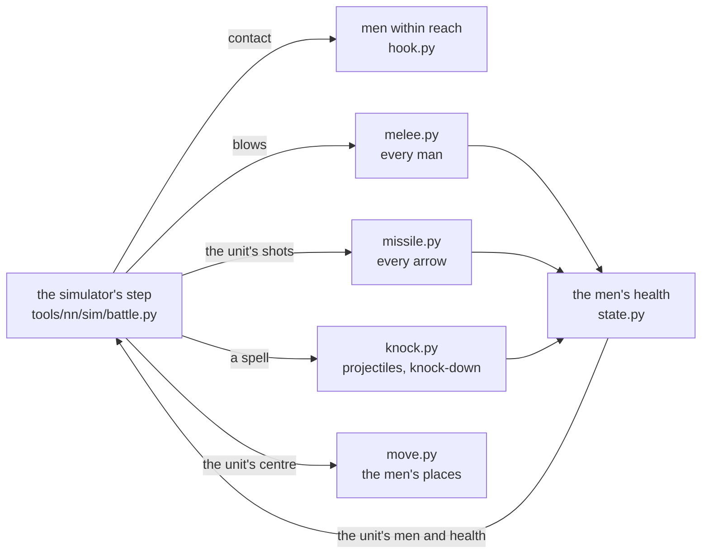

# The fighters lab

[← Back](README.md) · [Documentation](../README.md) › [Training data](README.md) › The fighters lab · [Русский](../../ru/training/fighters_lab.md)

A model where every man of a unit is a point of his own, with his own health, his place in the formation and his own
blows. The code is `tools/nn/fighters/`, the simulator's files (`tools/nn/sim`, `config/nn`) are not changed and the
simulator's version stays. The lab hooks into the simulator's step for the run and answers: how much closer to the
game are the men than the rectangle, and what do they cost. Training with the men: the switch `run.py --fighters`
(off by default; below, "In training").

## In short

- **What it gives.** On the same game recordings the men beat the rectangle where it was wrong: men killed per health
  lost in thinned units, the first seconds of a melee, men killed under fire (two-handers most), the contact and the
  formation's shape. Tables below, "Against the game".
- **The attack clock found.** A man swings once an attack interval of his passport - hit or miss (CA's schema: the
  interval is "the smallest gap between the starts of attack animations"). The simulator charged a miss 0.5 s; hence
  the old "share of blows 0.35". A probe in the game (units of 5 and 1 men, every 0.1 s): 91 hits where "a swing every
  interval" expects 76 and "a miss of 0.5 s" 167. One on one in the probes the damage now meets the game with no fit; in
  whole battles 1.37 of the game (with the share 0.35: 1.20), on thinned units 0.95 (was 0.85). The whole battles'
  surplus - probably the first blow of every new clash, open.
- **Mobs: the rule "at most two on one" is there but off.** Mobs of 3+ units are the lab's excess (1.46 of the game;
  the rectangle 1.10). The rule `melee.pairs` 2 (an enemy man in a formation struck by at most two at a time) gives 1.18,
  routs 1.09 -> 1.00, but men killed per health 0.72 -> 0.48 and the step +33 % - off until the user decides (below,
  "Mobs").
- **The knock-down** is one mechanism - "a blow of mass or force -> the man is thrown / down, lies" - spells today;
  charges and monsters will use it. A probe battle in the game (the men's places every 0.1 s) confirmed: knocked men
  do not die lying, a knocked unit hardly strikes; the throw has a median of 3 m. But the men's share thrown is 2-5x
  below the game's (below).
- **Speed** - below, "Speed".

## How it works



The simulator still runs a unit as a whole: orders, the centre's movement, morale and routs, fatigue, abilities, when
a unit fires and how many shots. For the run the lab replaces (`hook.installed()`, no file of the simulator changed)
five places of the step:

| What | The rectangle | The men |
|---|---|---|
| Contact | the rectangles' edges step into each other | a man of one unit within reach of a man of the other: the database's formed combat distance 2.5 m + the man's radius |
| Melee | men striking = a share of the front's files x the wave x the fill | every man with an enemy in reach strikes on his own clock |
| Missiles | the hit share by the spread formula, spill on neighbours | every arrow flies at one man and hits the first on its way |
| Spells | the dose by rings round the strike point | every projectile lands at a point: contact, blast, knock-down of men |
| Losses | the wounded pool, even hits | every man's health; damage beyond it is lost, a man dies at 0 |

After the step the unit's men and health in the simulator are the men's, and the men walk to their places.

Death at 0 has a tolerance: a man left with under 1e-5 of his health after a blow (`hook.DEAD_FRAC`) is dead. A blow
that took all he had leaves 0 only up to rounding; without the tolerance ~1 % of the living stood on with under 1e-6
of their health (no remainders between 1e-6 and 1e-4), how many depending on the order of the arithmetic: on the same
blows these "nearly dead" gave ~9 % fewer men killed per health lost, the compiled step 7 % fewer still. A man wounded
by the check against the recording (`state.conform`) keeps at least 1e-4 of his health - above the tolerance.

**The men** (`state.py`). A man's place is an offset from his unit's centre. A unit in formation: ranks at its
template's spacing from the database (`unit_spacings`), the ordered width, the place's scatter the database's
`close_formation_spacing_variation`. When a man dies the man behind him in the file takes his place (the file closes
up), the width stays. A formation that turns about more than 90 deg in a step swaps its ranks (the front rank becomes
the back) instead of running through itself.

**Melee** (`melee.py`). A man strikes an enemy whose centre is within the database's formed combat distance (2.5 m)
plus the enemy's radius. He keeps his opponent while in reach, else takes the nearest (first of his unit's order
target). A blow: the game's formulas as in the simulator, but per man: hit chance 35 + attack + charge - defence x
direction (the direction against the struck man's own facing), an armour roll every blow, damage beyond health lost.
The attack clock: the passport's interval after every swing, hit or miss (`melee.swing_per_interval`; measured -
below, "The attack clock"); it runs only while an enemy is in reach (the
first blow is at once, a return to the fight brings no new burst - the `recontact` probe). The unit's rules stay: a
holding formation strikes at 0.5, a router is struck at 0.43 and so on (a blow lands with that chance). A blow on a
router has no charge, as the simulator's; in the game half the chase blows carry the whole charge (the `pursuitfast`
probe, [melee](../game/mechanics/melee.md)), but with the chase share 0.43 it overshoots - the switch
`melee.chase_charge` is off.

**At most two on one** (`lab.json` `melee.pairs`: `null` by default - off; on - `--lab melee.pairs=2`). An enemy man is
struck by at most two men at a time (a lone man - a lord - by any number). He keeps first those who struck him last step, then the men of units whose order target is his
unit, then the nearest. A man left over takes the nearest enemy in reach who has room (`pairs_repair`); if there is
none he waits: no swing, his attack clock stands. Source - below, "Mobs: at most two on one".

**Missiles** (`missile.py`). How many shots and when - the simulator (volleys, reload, aim). The shots are loosed by
the unit's living men. Each aims at his own target man (keeps him while he lives - the simulator's `missile.reaim`), the
projectile lands with the database's spread (calibration area, accuracy), flies below head height over its last h / tan
theta metres and hits the first man on its way - an enemy or a man of another friendly unit; it passes the men of its
own unit (`lab.json` `missile.own_pass`, below "Missile probes"). The shield of a man facing the shooter blocks its
share (with the simulator's `missile.shield_ap_pierce` cut by the projectile's armour piercing, [simulator](simulator.md)).
A hit takes that man's health. The men decide who died: the rectangle's rule "the front rank takes the bullets"
(`kills.missile_front`) is off in the men's step (`hook.own_kills`). Otherwise it took "the excess over the dead" by its
own count out of the step's damage, every man got less than his share, and a man shot dead stood on with a sliver of
health (below, "Missile probes").

**Movement** (`move.py`). A man is carried by his unit's centre and walks to his place (at most his run). A front-rank
man with an enemy in reach stands at the "standoff" from him (measured, below), at most 2 m from his place (the
database's `entity_action_attack_formed_tether_distance`); the ranks behind follow. Bodies (the database's radius) do
not overlap.

**Beasts fight free** (`move.free_attack`, `lab.json` `move.free`, on). A man of a beast unit (an ellipse body - the
database's `radii_ratio` below 1 - and no missile weapon; in the roster the wolf rats), once his unit is in the fight
under an attack order, leaves his place: he closes on the enemy he fights or the nearest within reach + the tether,
with no tether to his place, else runs at his unit's target's centre; the bodies stop him at the enemy's men and the
rest flow round its formation. The database has both attack modes, "formed" and "free"
(`matched_combat_formed_vs_free_percentage`, `max_range_for_attack_mode_free_attack` 100 m), but no table says which
unit fights which way - so the rule goes by the body. Measured below, "Wolf rats".

**The knock-down** (`knock.py`), one mechanism for any blow of mass or force:

- the speed the impact gives the man (a body struck him - the projectile's mass x speed / his mass; a shockwave -
  force / his mass x (1 - d / R)) against the database's ladder: from `..._knocked_back` 4 / 2 m/s he is thrown and
  stays up, from `..._knocked_down` 7 / 3.5 m/s thrown and lying (`collision_` / `shockwave_speed_delta_threshold_*`);
- lies a random time in the database's `knockdown_getting_up_delay` (1.0-2.7 s); lying he strikes nobody (his clock
  stops), nobody strikes him, arrows and blasts do not wound him (`knock.invulnerable`: the simulator's `magic.knock`
  reading; the community: knocked-down infantry outlive what would kill them), he does not move with his unit;
- thrown from the impact's centre by `knock.throw`: a median of 3.0 m, spread x e^N(0, 0.37) - measured (below), no
  database number;
- up, he walks back to his place.

Spells call it today (each projectile of Searing Doom and Warp Lightning lands at its own point: the contact within
`collision_m` + the man's radius, at most `penetration` nearest men, and the blast with the falloff of
`config/nn/sim.json` `magic`). Charges and monsters will call the same `knock.knock()`.

**Morale and routs** are the simulator's, unit by unit, unchanged; morale sees the losses counted by the men.

## Numbers and sources

| Number | Value | Source |
|---|---|---|
| Reach of a blow | 2.5 m + the target's radius | database `entity_action_attack_formed_combat_distance`, radius `battle_entities` |
| Tether to the place | 2.0 m | database `entity_action_attack_formed_tether_distance` |
| Standoff (the front rank's distance to the enemy) | 1.0 m at contact -> 2.3 m, tau 13 s | measured: soldiers' places, 48 lanes of the probes reform, reform2, damaged, dmgmelee, wave, armour - the median nearest-enemy distance of the 15 nearest men 0.98 / 1.14 / 1.32 / 1.51 / 1.91 / 2.24 / 2.26 / 2.39 m at 0-1 / 1-3 / 3-5 / 5-10 / 10-20 / 20-40 / 40-90 / 90-240 s |
| Attack clock | a swing every interval of the passport, a miss too | CA's schema (`melee_weapons`: the interval between the starts of attack animations); measured - the `swing` probe, below |
| Share of blows `blow_share` | 1 (was 0.35) | the old measured 0.35 = the ratio of "a swing every interval" to "a miss of 0.5 s" (p + 0.5 / interval) |
| Spread of arrows | as the simulator's (`missile.accuracy.spread`): a square of side sqrt(calibration area / p), p = accuracy / 100 x (distance / d)^2 x (1 - launch angle / 180 deg) within [0.01, 1], the landing point uniform over it (across the line +-side / 2, along on the ground +-side / (2 sin angle)); with "gauss" sigma = sqrt(calibration area) x d / distance x (1 - accuracy) | database, the simulator's model `missile.square_side`, the `shots` probe |
| Knocked / lying | 7 / 3.5 m/s; 1.0-2.7 s | database |
| Throw | median 3.0 m (p10-p90 2.3-6.0) | measured: the knock probe battle, below |
| Beasts fight free | an ellipse body, no missile weapon | a rule by the body (the database does not say who attacks how); measured: the wolf rats' probes, below |
| Men striking one enemy at a time | as many as reach him; the rule "at most 2" (`melee.pairs`) is off | the game's records: the damage on the 'own target' follows the striker-enemy pairs with two an enemy, flat for any crowd; the database has a "second attacker on the same target" (`melee_secondary_attack_probability`), no third; below, "Mobs" |

Every lab number with its reason: `tools/nn/fighters/lab.json`.

## Against the game

### The step replay of 92 battles

Every 10 s the simulator is put into the recorded state of a game battle and plays 9 s on the recorded orders, 4
copies (`tools/nn/sim/stepreplay.py`). The men carry their places and wounds over from their own last window (the
wounds put to the recording's health: the most wounded die first). The windows are chosen by the game - the same for
both models. Sim / game, 95 % interval over battles (`python -m tools.nn.fighters.card`):

The table was taken before the death tolerance (`hook.DEAD_FRAC`, "How it works"). With it (the same 92 battles
replayed, `sr_swing` -> `build/fspeed/full92_sr`): men killed per health in melee 0.87 -> 0.94 (> 85 % 1.07 -> 1.17,
20-40 % 0.89 -> 0.98, < 20 % 1.29 -> 1.56), under fire 0.65 -> 0.89 (two-handers 0.63 -> 0.82); melee damage 1.37 ->
1.39, under fire 0.84 -> 0.83, contact 0.884 and routs 1.21 -> 1.20 - the same.

With "the men decide the dead" (`hook.own_kills`, below "Missile probes"; the same 92 battles with the square spread,
before -> after): killed per HP under fire 0.25 -> 1.09 (whole units 0.40 -> 1.36, greatswords 0.67 -> 1.28), in melee
0.85 -> 0.94; the damage under fire 0.92 -> 0.94, in melee 1.33 -> 1.34, routs 1.19 -> 1.20. Before the fix the lab in
training with `--fighters` lost these dead too (the rectangle's rule is on with `kills.missile_front`). Passing its own
unit (`missile.own_pass`) changes nothing in these battles (under fire 0.94, the dead 1.08).

| Number | Windows | Game | Rectangle | Men |
|---|---|---|---|---|
| Melee, men killed per health lost, health > 85 % | 8,481 | 0.42 | 0.91 [0.87-0.95] | 0.89 [0.87-0.92] |
| ... 60-85 % | 12,430 | 0.72 | 0.94 [0.91-0.97] | 0.78 [0.76-0.80] |
| ... 40-60 % | 7,621 | 0.98 | 0.80 [0.78-0.82] | 0.77 [0.75-0.79] |
| ... 20-40 % | 5,018 | 1.22 | 0.72 [0.71-0.74] | 0.85 [0.82-0.87] |
| ... < 20 % | 840 | 1.58 | 0.66 [0.62-0.70] | 1.19 [1.05-1.40] |
| Under fire, men killed per health, all | 6,283 | 0.38 | 0.58 [0.52-0.65] | 0.62 [0.58-0.66] |
| ... health > 85 % | 3,442 | 0.11 | 0.30 [0.25-0.37] | 0.64 [0.57-0.73] |
| ... two-handers (greatswords) | 669 | - | 0.24 [0.13-0.40] | 0.62 [0.49-0.76] |
| Melee, health lost, all | 34,390 | - | 0.89 [0.86-0.91] | 1.20 [1.15-1.25] |
| ... health > 85 % / < 20 % | | - | 0.85 / 1.08 | 1.26 / 0.66 |
| A thinned unit (< 30 %) in melee, damage on it | 2,886 | - | 1.03 [0.98-1.09] | 0.85 [0.80-0.91] |
| Contact: the game's melee seconds with the copies' flag | | - | 0.901 | 0.885 |
| ... false contact (the game has none) | | - | 0.121 | 0.111 |
| Routs begun | | 2,399 | 0.97 | 1.03 |

Mainly: men killed per health in thinned units (20-40 % and < 20 %) come nearer the game (0.72 / 0.66 -> 0.85 /
1.19), under fire the two-handers 0.24 -> 0.62 and whole units 0.30 -> 0.64. Worse: melee damage on whole units 0.85
-> 1.26 (the one blow share 0.35 was measured one on one; in whole battles it overshoots), on nearly broken ones 1.08 ->
0.66. Contact at the rectangle's level (0.90 / 0.89).

### The attack clock (the swing probe)

The melee probe's `swing` plan (`build/charge-probe/runs/20261016-213837`, one battle, 5 lanes): units cut to 5 and 1
men (`kill_number_of_men`), both sides attacking from 3 m, health and the men's places every 0.1 s
(`python -m tools.nn.fighters.swingdata`). Hits - the drops of a unit's health between samples; man-seconds - men
within reach (3.15 m) of an enemy. In all 91 hits (77 drops) in 1,020 man-seconds: "a swing every interval" (p /
interval) expects 76 (game / it 1.20 +- 0.21 by hits, 1.01 by drops), "a miss of 0.5 s" 167 (0.55). By lane 0.63-1.96
(few hits each). One battle was enough: the two rules are 2x apart, the error +-21 %.

The column "men, swing" - no share 0.35, the clock "a swing every interval" (below, "Attack clock"):

| Number | Rectangle | Men, share 0.35 | Men, swing |
|---|---|---|---|
| Melee, damage, all | 0.89 | 1.20 | 1.37 [1.32-1.43] |
| ... health > 85 % / 60-85 % / < 20 % | 0.85 / 0.86 / 1.08 | 1.26 / 1.26 / 0.66 | 1.51 / 1.42 / 0.70 |
| A thinned unit (< 30 %), damage on it | 1.03 | 0.85 | 0.95 [0.88-1.02] |
| Men killed per health, melee, all / < 20 % | 0.86 / 0.66 | 0.79 / 1.19 | 0.87 / 1.29 |
| Men killed per health, under fire, all | 0.58 | 0.62 | 0.65 |
| Routs begun | 0.97 | 1.03 | 1.21 |

One on one in the probes the swing every interval meets the game (damage 15-30 s / steady 1.00 / 1.02); in whole
battles the damage is above the game: probably the opening of every clash - each man who first reaches an enemy
swings at once (the probes 0-1 / 0-2 s 1.58 / 1.39 of the game) - and whole battles have many clashes. Open.

### The first blow (the swing probe, battle 2)

`build/charge-probe/runs/20261016-232843`: the same pairs at 25 men (many first contacts), one lane a charge from 40 m
(`python -m tools.nn.fighters.openingdata`). The whole battle: 551 hits, "a swing every interval" expects 441 (1.25 by
hits, 1.04 by drops), "a miss of 0.5 s" 959 (0.57): the clock confirmed a second time. The opening: each man from the
moment he first stands within reach - the hits by 1 / 2 / 3 / 5 / 10 s after contact, game / model:

| First-blow model | 1 s | 2 s | 3 s | 5 s | 10 s |
|---|---|---|---|---|---|
| strikes at once, then every interval | 1.22 | 1.41 | 1.50 | 1.09 | 0.98 |
| a random point of his interval | 6.85 | 3.54 | 2.42 | 1.82 | 1.28 |
| strikes after 0.5 s | 1.72 | 1.41 | 1.51 | 1.25 | 1.00 |
| strikes after 1 s | 4.67 | 1.45 | 1.51 | 1.87 | 1.07 |

The game's opening is not weaker but stronger than "at once" (1.2-1.5 in the first 3 s): the first blow is "ready at
once", no delay (CA's schema: the interval is between animation starts; a man who has not struck has none to wait).
The rest (+20-50 % in the first seconds) - more men within reach at contact in the game than the 0.1 s places count
(the first wave's crush), open. So the lab's surplus in whole battles (1.37) is not the first blow.

### Replay from the game's soldiers' places

A battle recorded with the soldiers' places (`tools.build nn-arena ... --soldiers-every 1`: the bridge writes
`nn_soldiers` once a second) is replayed so: at each window start every living man of the lab is put on a recorded
place of his unit's men (nearest pairs), and those places in the unit's frame are his places for the window
(`places.py`, `soldiersdata.py`; `python -m tools.nn.fighters.replay --runs <run> --places --geometry`). Two exam v2
battles (seed 1000700001, the net itS26_15 against the game's AI; the second 479 s of ~950, interrupted), melee damage
on whole units, sim / game:

| Window start | Damage, all | Men within reach of an enemy a second (game 525) | Nearest enemy inside one's own formation (game 0.83) |
|---|---|---|---|
| Rectangle (the simulator) | 0.98 | - | - |
| Men, a rectangle formation at the recorded centre | 1.45 | ~507 | 0.74 |
| Men, places from the recording | 1.21 | 530 | 0.86 |

The game's places take away about half the excess (1.45 -> 1.21); the men within reach are then as many as the
game's, through all 9 s of the window (521-533 against 542-554 / 472-485 by battle). The rest is the damage per man
within reach in big mêlées above the game's (one on one in the probes it matches). In the game mêlées are the rule:
'nearest enemy inside one's own formation' for 83 % of the men within reach (31 % one on one in the probes).

**Mêlées in the game** (the same recordings, melee seconds with no shooter at the unit; `build/fighters2/game_rate.py`,
`mob_rate.py`): a unit loses about the same however many enemy units reach it - 18 / 21 / 21 (x1e-4 of its health a
second) with 1 / 2 / 3+ units, though the enemies within reach are 18 / 33 / 61. The damage per man within reach falls
threefold; a man of a unit whose target is another unit strikes 0.35-0.53 as hard as one whose unit targets this one
(a fit over the seconds). The pressure on the striker himself (how many enemies reach him) does not change his rate.
The lab from the game's places: 21 / 25 / 31 - 1.15 / 1.24 / 1.46 of the game.

| Variant (replay from the places, 2 battles) | Damage, all | 1 / 2 / 3+ units |
|---|---|---|
| As now (the side of a blow by the man's facing) | 1.23 | 1.15 / 1.24 / 1.46 |
| The side by the unit's facing (`melee.direction` "unit") | 1.29 | 1.18 / 1.29 / 1.55 |
| ... from unit centre to unit centre (as the rectangle) | 1.19 | 1.05 / 1.18 / 1.44 |
| A man of a unit with another target strikes with share 0.45 (`--set contact.unit_incidental=0.45`, measured above) | 1.10 | 1.04 / 1.05 / 1.33 |

The side of a blow does not explain the mêlées (the melee probes are the same under any rule: steady 1.01). The
'other target' share takes more than half the rest: in the lab it is the lab's own number `melee.unit_incidental` 0.45
(`lab.json`, with its source); the rectangle's `contact.unit_incidental` stays 1. The rest of the big mêlées goes with
the rule "at most two on one" (below), but it is off.

**Mobs: at most two on one** (`melee.pairs`, off by default). The excess is the lab's alone: the rectangle on the same 2 battles from
the places (`build/agent-mobs/rect`) gives 1 / 2 / 3+ units 1.07 / 0.95 / 1.10, the lab without the rule 1.28 / 1.16 /
1.46. The game's records (the same 2 battles, victim-seconds where every striker's unit has the victim as its order
target): the damage over one striker's formula for every enemy man in reach falls 0.85 -> 0.44 as the strikers per
man struck rise 1.3 -> 4.6. Over the formula times the disjoint striker-enemy pairs (each enemy with at most two
strikers, the largest matching within the reach of 3.15 m) it is flat: 0.61-0.69 (with one an enemy 0.79-1.05). The lab
without the rule grows with the crowd: 1.5 -> 2.4 of the same pairs. So in the game extra strikers on one enemy add no
damage. The database has a "second attacker on the same target" (`melee_secondary_attack_probability` 1 - he may always
strike), no third. Replay of 2 battles from the places (`build/agent-mobs`), lab / game (the default is the first row, the rule off):

| Variant | Damage, whole units | 1 / 2 / 3+ units | Men killed per health lost | Routs |
|---|---|---|---|---|
| No rule (default) | 1.16 | 1.28 / 1.16 / 1.46 | 0.72 | 1.09 |
| At most 1 an enemy | - | 0.92 / 0.79 / 0.92 | 0.33 | 0.97 |
| **At most 2** | **0.99** | **1.12 / 0.97 / 1.18** | 0.48 | **1.00** |
| At most 3 | 1.06 | 1.18 / 1.07 / 1.31 | 0.55 | 1.05 |
| At most 2, a leftover does not look for another enemy | 0.84 | 0.95 / 0.85 / 1.00 | 0.51 | 0.97 |

With the rule the mobs of 3+ units are as 1 unit (1.18 and 1.12); the rest ~1.1 is common to the 'own target' (1.29, without the rule
1.53; 'other' 0.58). Step replay itS26_15 (10 battles, the lab's own places): melee damage 1.15 -> 1.08, routs 1.03 ->
0.97. Melee probes (53 lanes with the crowd's): target HP 0-1 / 0-5 / 5-15 s / steady 1.45 / 1.13 / 0.80 / 0.98 ->
1.25 / 1.03 / 0.80 / 0.98, the per-lane error lower in every window; the target's men killed 0-10 s 1.33 -> 1.04.
**Worse:** men killed per health lost in whole battles 0.72 -> 0.48 (itS26_15 0.91 -> 0.71) and the attacker's men
killed in the probes 0-10 s 0.80 -> 0.56: the blows land on more men while the game concentrates them. This and the
old shortfall of the killed (0.72 without the rule, 30 s windows too) are one open question: how the game concentrates
the blows on fewer men. The rule is off until the user decides: men killed per health lost in whole battles fall (0.72 -> 0.48 of the game, and morale counts the killed), the lab step costs 33 % more, K is chosen partly by the result, and the crowd probe found no cap on attackers (the `crowd` probe: a handful of
rats surrounded die from 3.6-5.5 strikers a rat). The lab's step with the rule: 1024 battles 21.1 -> 28.1 ms.

**Where the mobs' rest sits** (the replay of the same 2 battles from the places, `build/night_mob`):

- The surplus is there in the window's first second already, when the men stand exactly on the game's places: 3+
  units 1.28 / 1.35 / 1.37 at the window's seconds 0-1 / 2-4 / 5-8. So it is the rule of a man's blow, not how the men
  drift apart.
- Not the charge: with no charge (`--set charge.min_runup_m=1e9`) 3+ units 1.27 (was 1.28). Not "another target": with
  `unit_incidental` 0 3+ units 1.08-1.27, but 1 unit 0.88-1.00.
- The surplus grows with the size of the contact, not with the number of units. Lab / game by the enemy men within
  reach of the unit (the window's first second): < 10 - 0.52, 10-20 - 0.76, 20-35 - 1.03, 35-50 - 1.12, 50-80 - 1.22,
  80+ - 1.77. The game loses about the same (14-29 x 1e-4 a second) however many enemies reach; the lab in proportion
  to the strikers. A mob of 3+ units is simply a big contact (often a fresh unit coming in: with a "fresh" striking
  unit, < 5 s in melee, 3+ units 1.59, without one 0.82-1.14).
- "In the probes the damage per striker falls with the crowd" (0.98 -> 0.18 of the formula from < 10 to 90+ strikers)
  was a counting error: the big crowds of the probes came from lanes where the attacker does not strike (the
  meleeorders plan - an order to walk through the enemy, the game 0.00-0.14 of the formula; defender - a halt, a move
  away), while its men stand within 3.15 m of the enemy. Without them 0.6-0.9 of the formula at any 14-32 strikers.

**The crowd probe** (plan `crowd`, `build/charge-probe/runs/20261017-231623`, one battle; swordsmen attack clanrats from
3 m, both sides attacking; the clanrats cut down to 5 / 15 / 25 men or full, one swordsmen unit on them or three - two
more on the flanks; places and health every 0.1 s; `python -m tools.nn.fighters.crowddata <run> [--lab]`):

| Lane | Clanrats' HP/s in the game, 0-3 / 3-10 / 10-30 s | Lab / game | Strikers in reach / men struck in reach |
|---|---|---|---|
| 1 unit -> 5 rats | 53 / 28 / - | 1.30 / 0.48 / - | 26 / 2.8 |
| 1 unit -> 15 rats | 138 / 53 / 16 | 1.19 / 1.02 / 0.07 | 24 / 6.4 |
| 1 unit -> full | 172 / 54 / 31 | 0.78 / 1.55 / 1.24 | 30 / 26 |
| 3 units -> full | 253 / 173 / 75 | 1.28 / 1.03 / 1.11 | 25 / 22 |
| 3 units -> 25 rats | 217 / 100 / 23 | 0.89 / 0.88 / 0.64 | 26 / 9 |
| Sum over lanes | | 1.06 / 1.02 / 0.95 | |

There is no cap on how many strike one man: 5 surrounded rats (2.8 within reach) lose 14 HP/s a rat - 5.5 strikers'
blows by the formula; "each man struck takes at most K" fits for no K <= 5. The lab on these lanes is within the game's
noise (sum 0.95-1.06). These are the first seconds and a handful of enemies surrounded, every side of each open; in a
formation (whole battles) extra strikers add no damage - the rule "at most two on one" (above, off). With it the crowd lanes
are about the same: target HP sum 0-1 / 0-5 / 5-15 / 15-30 s 1.97 / 1.39 / 0.63 / 1.29 -> 1.50 / 1.22 / 0.67 / 1.23.

**Where the whole battles' excess is** (the replay of the 2 battles from the places, the victim unit's seconds, lab /
game damage), by whose strikers:

| Strikers on the victim | Seconds | Lab / game |
|---|---|---|
| all of units whose order target is this victim, standing, not fresh | 2,726 | 1.59 (the window's first second: 1.49) |
| all of units with another target (an "other" enemy), standing | 3,595 | 0.50 |
| some of moving units | 4,334 | 1.45 |
| all seconds | 12,989 | 1.22 |

The excess is in the "own target", already in the first second, when the men's places are exactly the game's, and the
same at any crowd size (1.81 / 1.44 / 1.60 / 1.57 with 9 / 21 / 38 / 67 strikers). The "other target" is the
opposite, half the game (`melee.unit_incidental` 0.45 balances their sum). A mob of 3+ units mixes the two with a bigger
contact. How the game differs is not found; tried (no better, "Tried and rejected"): the choice of the enemy without the
order target's preference (`melee.prefer_target`), the reach 2.5 m centre to centre (`melee.reach_radius`), a blow only
along a clear line to the enemy (`melee.clear_line`).

What is known (`build/night3`: the lab's men in reach logged by unit pair, `reachlog.py`):

- The lab has as many "own target" men in reach as the game (23.4 against 21.8 a victim a second): the excess is in the
  damage per man, not in their number. The "other target" has 0.64 of the game's men in reach in the lab (they are
  drawn to their order target).
- In the game a man of the "other target" strikes not 0.45 but ~0.6 of an "own target" man (at the same men in reach by
  the game's places: 0.94 / 0.52 / 0.48 against 1.40 / 0.86 / 0.81 x1e-4 of the health a second with 10-20 / 20-35 /
  35-50 strikers). So in whole battles both strike at ~0.6 of the formula in the game, and the lab's 0.45 covers the
  "own" excess.
- The game's damage grows with the number of its men reached, not with the strikers: 0.62-0.69 x1e-4 a second on such a
  man with 1-3 strikers on him; the lab grows with the strikers (lab / game 1.02 / 1.22 / 1.32 / 1.29 at 0-1 / 1-1.5 /
  1.5-2 / 2-3 strikers per man struck).
- A striker with a man of his own side on the line to the enemy (a body within 0.6 m of it) adds no damage in the game
  (least squares: 0.78 per clear one, -0.46 per blocked); 30 % of the game's are blocked, 30-40 % of the lab's. Forbidding
  the blocked ones spoils the killed per health ("Tried and rejected").
- Unit type, fatigue and health do not explain the excess: "own target" 1.1-1.6 for every infantry type, at any fatigue.

**Killed per health: the window reset and the men's turnover** (the replay of the same 2 battles from the places,
`build/night4`):

- **Part of the shortfall is the window reset.** Killed per health, lab / game, by the window's second 0-8: 0.64 / 0.54 /
  0.66 / 0.67 / 0.70 / 0.81 / 0.88 / 0.86 / 0.87 (the game's is flat). After the reset the men stand at new places and
  strike new enemies - the blows land on men they have not wounded yet; in 5-8 s the pairs "striker - his wounded man"
  form again. `card --settle 5` (the window's seconds 5-9 only): all 0.75 -> 0.86; whole units (> 85 %) 0.97 -> 1.11,
  60-85 % 0.69 -> 0.81, 40-60 % 0.72 -> 0.78. It is not where the wounds lie: the wound share of the men in reach is the
  same before and after the reset (0.217), and handing the wounds over by nearness to the enemy or keeping the targets
  through the reset changes nothing (0.74). With no reset - the probes, whole units - the lab kills per health even more
  than the game (1.1-1.4).
- **The turnover is almost the game's.** A man within reach of the enemy (3.15 m) at a window's second 1-7 - still in
  reach 3 s later (of the survivors; `python -m tools.nn.fighters.churndata`, the lab: `replay --places --churn`). The
  game's men are followed by their slot in `ManList` (a dead man's slot takes the list's last man - checked on the probes
  every 0.1 s), so a slot counts as the same man only while it never jumps further than a threshold in a second. The
  threshold decides: at 2.5 m half the men of units whose centre moved over 6 m in 3 s drop out of the count - exactly
  those who went with it - and those who stood stay (hence the earlier "game 0.88 against 0.63 when the centre moves").
  The same way for both models (threshold 5 m, units not routing, by the game's centre shift):

  | Centre shift in 3 s | < 0.5 m | 0.5-1.5 | 1.5-3 | 3-6 | > 6 m | all |
  |---|---|---|---|---|---|---|
  | Game | 0.82 | 0.83 | 0.84 | 0.83 | 0.77 | 0.82 |
  | Lab | 0.83 | 0.83 | 0.83 | 0.76 | 0.67 | 0.80 |

  A gap of 0.02, only when the unit moves over 3 m in 3 s. Routing units: the game 0.86 (their men caught in a fight do
  not leave it: a routing unit's centre often stands in the game), the lab 0.67 (the centre carries the men off at the
  rout's speed) - the unit's move in the simulator, not the men's. What the lab has more of is jitter: a man in reach
  at a standing centre moves 1.64 m in 3 s (game 0.73), and the same nearest enemy is still beside him for 0.55 (game
  0.67) - the bodies push a man off his place (0.22 m a 0.5 s step), he walks back (0.36 m). Rules that remove the
  jitter or the pull of the centre barely change the killed per health and raise the damage ("Tried and rejected"): the
  turnover is not the main cause of the short killed per health.
- `clear_line` with `unit_incidental` 1 (`build/night4/clear_inc1`): melee damage on whole units 1.14 -> 0.95, killed per
  health 0.75 -> 0.62, after the window's 5 s 0.86 -> 0.68 (whole units 1.11 -> 0.83) - the fall is not the reset: the
  rule takes away the second rank's blows on the same front men. Too early to turn it on before how the game concentrates
  the blows is found.

### Wolf rats (probes wolfrats, wolfpoison)

22 lanes of 4 battles (`build/charge-probe/runs/20261011-2141...2145`; rats on swordsmen, spearmen, the General; 4
copies; `probes --plans wolfrats,wolfpoison`). The network trained on the men (itS27_4) keeps its rats away from melee:
in the lab the rats lost it much harder than in the game. The cause is the formation: in the game the rats fight free,
nearly all within reach, flowing round the enemy; in the lab they fought formed (ranks 3.5 m apart, only the first
strikes). Sim / game, sum over lanes:

| Measure | Game | Rectangle | Men formed (was) | Men, beasts free |
|---|---|---|---|---|
| Rats within reach of the enemy, 1-3 / 5-10 s | 57 / 55 | - | 17 / 16 | 56 / 64 |
| Wrap (share of rats beside and behind the enemy), 5-10 s | 0.1-0.7 | - | 0.00-0.02 | 0.1-0.8 |
| Rats' damage, 0-5 / 5-15 s / steady | | 0.81 / 0.70 / 0.83 | 0.69 / 0.32 / 0.41 | 1.60 / 1.13 / 0.87 |
| Rats' losses, 0-5 / 5-15 s / steady | | 0.59 / 0.54 / 0.80 | 1.08 / 0.75 / 1.35 | 1.43 / 1.34 / 1.92 |
| Rats' damage / their losses, 5-15 s | | 1.30 | 0.43 | 0.84 |

The rats stand in the fight as in the game, and "dealt / lost" at 5-15 s goes 0.43 -> 0.84. But both sides now strike
harder than the game: the same trouble of big contacts as in the mobs (in the game 87 swordsmen are within reach of
the rats and deal about a third of the formula). On the General the rats take 0.08-0.22 of the game's both before and
after - a separate question (a lone target). The replay of the 2 exam battles from the places: melee damage on whole
units 1.10 -> 1.14 (the battles have rats).

### The unit's shape (for the network)

`shape.unit_features` (torch) - one function for the lab's men and for the game's soldiers' places: per unit 9 numbers
and a 4 x 4 map, in the unit's frame (its facing, from the men's centre of mass): men per m² (width x depth), width and
depth (sqrt(12) x the men's spread across / along - a full rectangle's side), the mass off the middle of the extent
forward and sideways, the share of men within reach of an enemy, the share of empty cells of the box (holes) and of its
front row, wounds (1 - health / (men x a man's health)), the share of the men in each of 16 cells. In the game the
companion computes it from the places the bridge sends every 2 s (`--soldiers-every 2 --soldiers-state`, companion
`--shape`; the network's input `SHAPE`, [model](model.md)): 4 ms a reading of 3,000 men (4 CPU threads; a 17 x 20 units battle), the
state document +32 KB; a 3 x 4 units battle in the game 2.2 ms median.

Check (`python -m tools.nn.fighters.shapecheck`; the replay of 2 battles from the game's places, `replay --places
--shape-log`): the lab 5 / 10 s after the window's start against the game at that second; 'no change' - the game at
the window's start against the game 5 / 10 s on (how much the shape changes by itself):

| Feature | Game mean | Lab - game, 5 / 10 s | No change, 5 / 10 s | Correlation lab / game, 5 / 10 s |
|---|---|---|---|---|
| men per m² | 0.26 (lab 0.27) | 0.040 / 0.048 | 0.026 / 0.041 | 0.75 / 0.67 |
| width, m | 23.9 (23.9) | 2.9 / 3.5 | 2.3 / 3.4 | 0.61 / 0.55 |
| depth, m | 24.1 (23.1) | 3.8 / 4.5 | 3.5 / 5.6 | 0.97 / 0.96 |
| mass forward, m | 1.9 (1.4) | 1.7 / 1.9 | 1.7 / 2.6 | 0.86 / 0.80 |
| within reach of an enemy | 0.185 (0.181) | 0.075 / 0.082 | 0.045 / 0.070 | 0.84 / 0.81 |
| holes / in the front row | 0.09 / 0.14 | 0.04 / 0.08 | 0.04 / 0.07-0.09 | 0.85-0.88 / 0.78-0.80 |
| wounds | 0.23 | 0.007 / 0.009 | 0.004 / 0.008 | 1.00 / 0.99 |
| 4 x 4 cells | 0.04-0.08 | ~0.021 | ~0.020-0.027 | 0.42-0.74 |

The means agree (no bias); the lab's error is about how much the shape changes by itself in 5-10 s (at 10 s the lab is
nearer the game than 'no change' in depth, the mass forward and holes; worse in the share within reach at 5 s). 4,524
unit-seconds a horizon; units of 10+ men, no lords.

### Melee probes

112 lanes of 11 plans of the melee probe (`tools/nn/charge_probe.py`: reform, reform2, dmgmelee, damaged, wave, armour,
defender, fresh, meleeorders, recontact, busycharge), each lane's twin 4 copies. Mean |log(sim / game)| over lanes and
the sum sim / game:

| What | Rectangle | Men, share 0.35 | Men, swing |
|---|---|---|---|
| Target's HP at 0-1 s | 0.90 (0.61) | 0.53 (0.83) | 0.63 (1.58) |
| Target's HP at 0-5 s | 0.60 (0.63) | 0.38 (0.86) | 0.42 (1.35) |
| Target's HP at 5-15 s | 0.20 (0.94) | 0.27 (0.90) | 0.36 (0.85) |
| Target's HP at 15-30 s | 0.29 (1.11) | 0.30 (0.92) | 0.27 (1.00) |
| Target's HP a second, steady | 0.31 (1.03) | 0.34 (0.92) | 0.29 (1.02) |
| Target's men killed at 0-10 s | 1.63 (0.34) | 0.46 (0.90) | 0.50 (1.37) |
| Target's men killed at 15-30 s | 0.39 (1.34) | 0.37 (1.10) | 0.40 (1.19) |
| Attacker's men killed at 5-15 s | 2.49 (0.14) | 0.83 (0.69) | 0.59 (0.95) |

The shape from the men's places (game / men, lane means; the rectangle is its box: depth 12.2 m, width 28.6 m
always): men within reach 3.15 m at 1-3 / 5-10 / 20-40 / 90-240 s 48 / 38 / 23 / 16 and 37 / 34 / 22 / 15; the front
rank's standoff 1.43 / 1.76 / 2.53 / 2.82 and 1.30 / 1.46 / 2.34 (6.3 at 90-240 s: the formation is down to stragglers);
depth 11.7 / 11.3 / 12.7 / 10.4 and 11.7 / 11.8 / 11.2 / 8.9 m; width 28.3-28.5 and 28.6-29.1 m; wrap (the share of men
beside the enemy) 0.01-0.05 and 0.00-0.02.

### Routers

The routmob, routmob2, passby probes: the routing crowd along the flight / across (p90 - p10, m) at 0-3 / 3-7 / 7-15 /
25-45 s after the rout: game 8.1 / 21.4, 11.7 / 22.5, 7.6 / 23.1, 6.5 / 23.3; rectangle 7.2 / 23.0, 7.2 / 23.0, 5.8 /
23.0, 5.8 / 23.0; men 6.4 / 17.3, 5.2 / 12.3, 5.4 / 22.4, 5.4 / 22.2. In the game the crowd keeps the formation's width
(~23 m) and stretches along the flight to 12 m in the first seconds; the men's formation narrows at 3-7 s (the about-face
and the walk to the new places) - open.

### The knock-down (a probe battle)

The magic plan's battle 6 (`build/magic/runs/20261016-211346`, one battle, Normal, graphics low): targets held by
script, the men's places every 0.1 s, each man followed (`python -m tools.nn.fighters.knockdata`). "Thrown" - moved
faster than 4 m/s (the control lane without a cast had no such strike). Per strike (cast):

| Strike, target | Men | Thrown | Throw, m (p10 / median / p90) | Lying, s (median / p90) |
|---|---|---|---|---|
| Doom -> clanrats (4 strikes) | 537 | 0.39 | 2.3 / 3.3 / 6.0 | 2.7 / 4.4 |
| Doom -> skavenslaves (3) | 421 | 0.47 | 2.3 / 3.2 / 7.2 | 2.3 / 4.4 |
| Lightning -> swordsmen (3) | 244 | 0.29 | 1.4 / 3.0 / 9.0 | 0.1 / 1.0 |
| Lightning -> swordsmen in melee (2) | 165 | 0.27 | 1.6 / 2.8 / 4.7 | 0.2 / 3.1 |

- The throw is the same for both spells and every target: one distribution; mostly away from the strike (cosine with
  the line from its centre, median 0.5-0.7). The old "1.5-3 m" from 1 s places held ordinary moves.
- After Doom men lie 2.3-2.7 s (the database's 1.0-2.7 + getting up); after Lightning they hardly lie - its wave
  (force 400 / mass 100) throws but seldom knocks down: the database's ladder gives just that.
- Lying they do not die: 0 deaths in 778 man-seconds lying while the men up nearby died at 0.005-0.020 a second (~11
  expected).
- A knocked man does not strike: swordsmen in melee, 31 of 106 thrown by Lightning, took 20 / 13 HP a second off the
  clanrats 3-6 / 6-12 s after the strike, the control without a cast 48 / 33.
- **The lab's men** on the same targets for one cast (32 copies): thrown 0.17 / 0.06 / 0.06 (Doom -> clanrats,
  skavenslaves, Lightning -> swordsmen) against 0.39 / 0.47 / 0.29. In the game men 6-9 m from the centre are thrown
  too (Lightning 0.42), where the wave by the database's formula (linear falloff, the blast radius less 1 m) does not
  reach. Candidates: thrown bodies knocking their neighbours (collisions), another falloff of the wave's force - open.

### Missile probes

33 lanes (dist, targets, shield; thin from `build/probes7`): men killed per health lost by 20 / 40 s after the first
volley, sim / game (lane mean): rectangle 0.67 / 0.55, men 0.92 / 0.71. The target's health at 80 / 120 s: rectangle
0.76 / 0.82 of the game (it hits thinned targets harder than the game), men 1.11 / 1.49 (softer: a sparse formation
lets arrows through). Thin targets (45 slaves on 30 m): the game keeps 14 men at 40 s, the rectangle 20, the men 28-30.

**The men decide the dead** (`hook.own_kills`). While the rectangle's rule `kills.missile_front` ran in the men's step it
took out of the step's damage what by its own count went "beyond the dead", though the men already lose the damage beyond
a man's health themselves. Every man's damage was cut, and a man killed by one shot stood on with a sliver of health.
The `ratling`, `ratform`, `ratshape` probes (17 kinds of lanes on formations), before / after / game: HP a bullet 0.77 /
0.96 of the game (error over the kinds 0.27 → 0.07), the dead's share of the HP lost at a quarter lost 0.25 / 0.40 /
0.41; handguns on clanrats HP a bullet 4.66 / 6.90 / 6.60, the dead's share 0.04 / 0.50 / 0.45. Lone men (a lord, the
engineer) do not change: one man has no front rank. The numbers after the fix equal those with
`--set kills.missile_front=0` (the old workaround) to the last digit.

**A projectile passes its own unit** (`missile.own_pass`). The `shots` probe (handguns at a lone engineer 27 m off): hits a
shot game 0.736, men 0.051 - a flat bullet aimed at the waist comes down ~60 m beyond the target and over its own front
ranks flies under 1.2 m: the back ranks shot their own men in the back. Passing its own unit - 0.735; the other probe
lanes (crossbows at 27 m 0.437 → 0.436 with the game's 0.352, every lane at 100-137 m, the `ratform` and `ratling`
formations) do not change.

**The lord next to his own infantry in melee** (Ratling guns firing at the General out of melee; the replay of the net
itS26_15's battles, sim / game by the lord's health). By the units' centres (10 battles, `build/night3/sr_s26_15_lat`
and `build/night5/s26_15_lab`): all seconds - rectangle 0.50, men 0.51; the seconds with the nearest own unit in melee
beside the line of fire (62 s) - 0.14 and 0.28: the men too cover the lord more than the game. But by the soldiers'
places (battle 041729, places once a second): with no own men in the 30 m corridor from the lord to the gun (63 s) the
game loses 39 HP/s, the men 0.50 of it; with 3 or more (12 s) the game loses almost nothing (1-7 HP/s) - own men on the
line cover the lord in the game as in the lab. So "a unit in melee nearby" by its centre does not mean "men on the line
of fire" (in a fight the formation stretches to the enemy), the lab's cover is by the real bodies, and the short damage
on the lord is the same as on a lone man in the open (0.5), not the cover.

## Speed

`python -m tools.nn.fighters.bench` (RTX 5070 Ti 16 GB, the arena whole_emp_v_skv 20 x 20, 2,262 men a battle, all
attacking the nearest; ms a 0.5 s step, 100 steps from the start into the melee; the card was shared with another
agent - up to +-20 %):

| Battles | Simulator, compiled (as training) | Men | Men's peak memory |
|---|---|---|---|
| 256 | 5.9 | 13.7 | 0.33 GB |
| 1024 | 9.3-12 | 20.5 | 1.1 GB |

The men's step is 1.7-2.8 simulator steps. The rule "at most two on one", if switched on (`melee.pairs` 2: two rounds of the
share-out and two searches for a free enemy a step), costs +33 %: 1024 battles 21.1 -> 28.1 ms a step (80 steps, the card free).
How it got there (ms a step, 256 / 1024 battles):

| Step | 256 | 1024 | Memory, 256 / 1024 |
|---|---|---|---|
| Not compiled (before) | 262 | did not fit | 4.8 / 21.6 GB |
| The whole step - the simulator and the men - through `torch.compile`: no syncs with the CPU and no data-dependent sizes, the men's draws by a counter | 50 | - | 2.0 / - |
| The units' contact from two numbers a man (was ~60 M atomic adds a step), splash blows for the men of such units only, the projectiles' kernel (projectiles not loosed are skipped) | 15.9 | 42.9 | 1.2 / 4.7 GB |
| Own kernels look for neighbours (contact, melee target, the bodies' push) straight in the cell table, skipping the empty slots | 13.7 | 20.5 | 0.33 / 1.1 GB |

How it works:

- **Compiling.** On the GPU the whole step is compiled (`hook.Hook._runner`, as `battle.stepper` in training) when the
  batch has 100,000 men's places or more (`hook.COMPILE_MEN`): the first compile of a batch of a new size takes ~4 min
  (Docker keeps it until the code changes). Small batches (the probes) run eager. An outside reset (the replay's window
  start from the recording) is looked for before the step, eager - one sync a step.
- **The men's draws** - a counter (`state.rnd`: a hash of the battle, the man, the step and the call site), no
  generator: the step compiles and the same inputs give the same numbers. Splash strikes (spells, `knock.bombard`) stay
  eager, on the generator.
- **Neighbours.** The cell table (`cells.Table`): the men sorted by cell, per cell where its men start and how many.
  Triton kernels (`scans.py`: contact, target, bodies; `kernels.py`: a projectile's path) read it directly and skip
  the empty places; the "108 candidates a man" lists are no longer built on the GPU. Each kernel has the same logic in
  torch beside it (CPU, tests); `tests/tools/test_nn_fighters_kernels.py` checks the numbers match.
- The kernels run through one torch op (`fighters::launch`): put straight into the compiled graph they ran 3-5x slower
  (the compiler lost their launch settings).

## In training

`run.py --fighters` (off by default; in the chain `python -m tools.ops.step ... --set fighters=true`): the training's
simulator runs with the men in every batch of battles, the network sees the units' shape (the `SHAPE` input: the flag
"shape present" = 1, the features from the men's places). Morale, routs, orders, fatigue, abilities are the
simulator's, as in the lab. `--fighters-men` (7168): places a battle. The simulator's version does not change.

How it works (`tools/nn/train/men.py`):

- The lab is installed for the whole run (`hook.installed(adopt=False, shape="lazy", outside=False)`): the battles built
  (the bank of armies) get no men; the men live beside the batch's state (`st.men`), and any state that has them steps
  with them. A state without men steps with the plain (compiled) simulator - so do `test5`'s evaluations inside
  training and the scripts' baselines: they stay the plain simulator's.
- **A batch's start and a battle's restart.** The men are built after the battle is taken from the bank, its places
  moved and its uncertain numbers drawn (`randomise`, `--dr`): a restarted battle's anew (its rows of the batch
  replaced, the other battles untouched). The units' shape is made before every observation (`Men.shape_now`), not
  after every step: the network reads it once a decision (the same numbers, test).
- **The batch's sizes are fixed** - the step is compiled for them (a new size ~4 min of compiling): 7168 places a
  battle (the v2 banks: 3,070 men a battle on average, p99 5,900, the largest 6,800 of 6,144 battles), up to 32 men of
  units whose blow splashes (the banks: at most 2), a blow split 8 ways at most. A battle with too many men is taken
  again from the bank (none in 6,144 battles).
- **Ability branches** (`--ability-branch`): a battle's snapshot copies its men too (the `f/...` entries); both
  branches, "pressed" and "not", start from the same men and the same random numbers; the branches repeat exactly
  (test).
- **Evaluation** (`evaluate.play(fighters=...)`; `run.py`'s final evaluation with `--fighters`): the batch has its men,
  they follow their battles when the batch shrinks; no CUDA graph (the men's step has eager parts).
- **Memory.** For the update the batch's men go to host memory (`Men.park` / `unpark`, ~0.1 s; on the card:
  `--no-fighters-park`): -1.2 GB, the update's peak 11.5 GB (12.7 with them on the card). With the minibatch in 2 parts
  the peak was 14.8 GB (~13.6 with the men off the card) and the card spilled into its shared memory (a decision 0.23 ->
  2.2 s, an update 18 -> 158 s). So with `--fighters` the minibatch is in 3 parts by default (2 with `--amp bf16h`,
  [training speed](training.md#training-speed)), and the card's cache is released before and after the collection.
- **The unit's shape** - the share of men within an enemy's reach is counted by the contact kernel straight from the
  cell table (`shape.unit_features`, on the GPU): the neighbour lists [battles x places x 108] of such a batch would
  take 6 GB.

Speed (RTX 5070 Ti, 1024 battles, line S's options from `itS26_15`):

| | Without men | With men | Ratio |
|---|---|---|---|
| Simulator step, ms (battles' start, hold orders) | 8.9 | 66.6 | 7.5 |
| A decision (network + 2 steps), s | 0.110 | 0.229 | 2.1 |
| Training, battle seconds a second (10 min; an update 37 / 56 s) | 1,710 (1,570-2,030) | 1,130 (1,080-1,370) | 1.5 |
| Peak GPU memory, GB (the minibatch in 3 parts) | 11.5 | 12.7 | |
| Warm-up (compiling), s: first time / from the cache | 35 | 251 + 247 (branches) / 71 | |

The men's step on such a batch is 7.5 simulator steps (the lab's bench on 2,262 men: 1.7-2.8): by the profile the
contact kernel (two passes: the step and the shape, ~12 ms), melee (~9 ms), the bodies' push (~7 ms) and sorting the
cell table (~10 ms). Half the places are empty (3,100 men of 7,168 on average), but the kernels skip empty places.
Training slows down less because much of it is not the step: the network, the update, the branches (the branches with
the men 12 s an update against 6 s, the collection without them 22 against 11 s, the update 22 against 20 s). Without
the men and with the minibatch in 2 parts (as line S runs) the peak is 13.5 GB: the card spilled into its shared memory
too, 760 battle seconds a second instead of 1,710.

Now with the men (by default: video memory in segments, the shape before an observation, the men off the card for the
update; from `itS27_4`, updates 2-14) - ~1,320 battle seconds a second instead of ~1,150, peak 11.5 GB, the branches
11 s; with `--amp bf16h --parts 2` ~1,390-1,500 ([training speed](training.md#training-speed)).

## How to run

```bash
# the checks (the container, the GPU; DOCK_MEM - the container's memory cap)
DOCK_MEM=8g DOCK_BUILD=<main>/build bash tools/nn/dock.sh tools.nn.fighters.probes --plans reform,dmgmelee --copies 4 --device cuda --out build/fighters/probes.json
DOCK_MEM=8g DOCK_BUILD=<main>/build bash tools/nn/dock.sh tools.nn.fighters.probes --routers --plans routmob,routmob2,passby --device cuda --out build/fighters/rout.json
DOCK_MEM=8g DOCK_BUILD=<main>/build bash tools/nn/dock.sh tools.nn.fighters.probes --missile build/probes7/runs/<thin> ... --device cuda --out build/fighters/missile.json
DOCK_MEM=8g DOCK_BUILD=<main>/build bash tools/nn/dock.sh tools.nn.fighters.replay --runs-from build/contactgap/sr_free_rect --out build/fighters/sr_fighters --device cuda --chunk 46
DOCK_MEM=8g DOCK_BUILD=<main>/build bash tools/nn/dock.sh tools.nn.fighters.replay --runs-from ... --out build/fighters/sr_rect --rect --device cuda --chunk 16
python -m tools.nn.fighters.card build/fighters/sr_rect build/fighters/sr_fighters     # the table, no torch
python -m tools.nn.fighters.card ... --settle 5                                         # killed per health over the window's seconds 5-9
DOCK_MEM=12g DOCK_BUILD=<main>/build bash tools/nn/dock.sh tools.nn.fighters.replay --runs <run> ... --places --churn --device cuda --out build/fighters/churn   # the lab's turnover
python -m tools.nn.fighters.churndata build/nn-arena/runs/<run> ... --lab build/fighters/churn   # against the game (no torch)
DOCK_MEM=8g bash tools/nn/dock.sh tools.nn.fighters.bench --B 256 1024                 # speed
DOCK_MEM=12g bash tools/nn/dock.sh tools.nn.train.run --fighters ...                   # training with the men (above)
python -m tools.nn.charge_probe run --plan magic --battles 6 --speed 3                  # the knock-down probe battle (the game)
python -m tools.nn.fighters.knockdata build/charge-probe/runs/<run>                     # its reading
python -m tools.nn.charge_probe run --plan crowd                                        # the crowd probe (game, 1 battle)
python -m tools.nn.fighters.crowddata build/charge-probe/runs/<run>                     # its reading (no torch)
DOCK_MEM=8g bash tools/nn/dock.sh tools.nn.fighters.crowddata build/charge-probe/runs/<run> --lab --device cuda   # and the lab
```

```python
from tools.nn.fighters import hook
with hook.installed() as h:            # whatever is built inside (scenario.build) gets its men: h.F
    st = scenario.build(armies, params, device="cuda")
    battle.run(st, policy, params)
```

Tests: `tests/tools/test_nn_fighters_torch.py` (the container), `tests/tools/test_nn_fighters_kernels.py` (the
container, the GPU: the kernels = torch), `tests/tools/test_nn_fighters_shape.py`, `tests/tools/test_nn_fighters_churn.py`, `tests/tools/test_magic_probe.py`
(no torch), `tests/tools/test_nn_train_men.py` (the container: training with the men - the switch, restarts, branches,
evaluation). The replay: every batch of a new size compiles for ~4 min, so the batches are big - `--chunk 46` (92
battles - 2 batches, 10 min with the compiling; it was 44 min in batches of 16, not compiled); a batch of 46 battles
x 4 copies ran in a container of 10 GB (`DOCK_MEM=10g`).

## Not there

- The damage in whole battles: mobs of 3+ units 1.46 of the game (1 unit 1.28); the men of units striking their order
  target deal 1.5-1.6 of the game, an "other" enemy 0.6. The rule "at most two on one" (`melee.pairs`, off) gives 1.18 /
  1.12 and ~1.3 for the 'own target', but spreads the blows: men killed per health lost 0.72 -> 0.48 of the game. How the
  game concentrates the blows on fewer men is open; whether to switch the rule on depends on the answer.
- The short killed per health of wounded units (0.78-0.84 after the window's 5 s): the men's turnover does not explain
  it (still in reach 3 s later 0.80 against the game's 0.82, "Killed per health: the window reset and the men's
  turnover"), the cause is open.
- A routing unit in a fight: in the game its men reached by the enemy stay in reach (0.86), in the lab the unit's centre
  carries them off (0.67) - how a unit locked with the enemy routs is the simulator's.
- The share thrown by a spell is 2-5x below the game's (the knock probe battle): how the game throws men beyond the
  blast radius is not found.
- The ellipse body (wolf rats) - the men are circles; the Ratling Gun's burst - at most 2 shots a man a step.
- A projectile looks for bodies over its whole low path (`lab.json` `missile.path_full`: the tallest body's height /
  tan of the angle + radius, no farther than the shooter, up to 48 points 3.6 m apart). It used to be cut at 21.6 m - a
  counting error: a flat bullet's is 37 m at 100 m and 61 m at 60 m. The Ratling Gun on formations (the `ratling`,
  `ratform` probes), HP a bullet lab / game: 60 m 0.7 -> 1.06, 100-135 m 0.97-1.04, swordsmen 1.08-1.15,
  flagellants 0.96 / 1.11 (60 / 100 m); handguns on formations 0.92-1.05; lone men unchanged (0.85-1.0; crossbows 1.46 as
  before). The dead's share of the HP lost at a
  quarter lost: game 0.30-0.56, lab 0.39-0.50.
  The itS26_15 step replay (`build/ratform/s26_lab_full`): the lord under the guns 0.58 -> 0.85 of the game, the lord
  out of melee overall 0.87 -> 1.17 (the rectangle 0.64 / 1.19).
- Wrapping round the enemy (the "drop") is weaker than the game's (0-0.02 against 0.01-0.05 one on one).

## Tried and rejected

- **Every man strikes by the formula (`blow_share` 1).** The probes' damage 2-5x the game's (target HP at 15-30 s:
  sum sim / game 4.15).
- **Every man in reach + tether closes on the enemy.** The second rank pressed the first into the enemy: men within
  reach 34-45 against 19 in the game at 20-40 s, fronts 1.1-1.4 m apart against 2.3.
- **The formation follows every fighting man.** Fighting second ranks pulled the formation forward and the fronts did
  not part (standoff 1.0-1.3 m all fight). Kept: only the front rank takes the standoff and pulls the formation.
- **The same attack clock in the rectangle** (measured in a copy, the patch `build/fighters/rect_swing.patch`, not in
  the simulator): `melee.swing_per_interval` (a swing every interval) and `fighting_files` 1 instead of 0.5. Melee
  probes: target HP steady 1.03 -> 0.99, but 0-5 s 0.63 -> 0.41 and the attacker's steady loss 0.93 -> 0.72; the replay
  of 92 battles: melee damage 0.89 -> 0.84, on thinned units 1.03 -> 0.95, men killed per health 0.86 -> 0.67, routs
  0.97 -> 0.98. The rectangle's other rules (the wave, the first strike, the wounded pool) were fitted to the old clock;
  swapping the clock alone breaks them.
- **At most two on one, no search for another enemy** (`--lab melee.pairs_repair=false`): a man left over waits even
  with a free enemy near. Replay of 2 battles from the places: damage on whole units 0.84, 1 / 2 / 3+ units 0.95 / 0.85
  / 1.00 - too little. **One on one** (`pairs` 1): 0.92 / 0.79 / 0.92, men killed per health 0.33. **Three** (`pairs`
  3): 1.18 / 1.07 / 1.31. Of the variants two with the search is best (written in `lab.json`, but off).
- **A man takes the blows of at most K enemies at a time** (`--lab melee.max_attackers=2`; each of the n strikers of
  one man lands with the chance K / n; not on a lone man - a lord). Melee probes: target HP 0-1 / 0-5 / 0-10 s 1.59 /
  1.40 / 1.24 -> 1.33 / 1.14 / 1.01, steady 1.07 -> 0.96, 5-15 s 0.97 -> 0.78. But the replay of 2 battles from the
  places: melee damage on whole units 1.10 -> 0.79, men killed per health lost 0.74 -> 0.52 (game 0.79: the blows spread
  over more men), 1 / 2 / 3+ units 0.82 / 0.70 / 0.91. On the General in the rats' probes 0.22 -> 0.02. The switch is
  kept, off.
- **No "another target"** (`unit_incidental` 0): 3+ units 1.08-1.27, but 1 unit 0.88-1.00 - does not explain the mobs.
- **The target picked by a score** (`--lab melee.pick="score"`, `melee.pick_score`; the hypothesis: of the 16 nearest
  enemy men in reach the score = 1 / the rank by distance + 1.5 for a man within 30 deg of the striker's facing, + 1.0
  within 30-60 deg, + 3 for a man of a unit attacking the striker's unit; the last target x1.25; the second rank strikes
  "the man in front of it"). Expected: the blows gather and the killed per HP lost grows. The replay of the 2 exam
  battles from the game's places, sim / game: melee killed per HP lost 0.77 → 0.73 (facing to the last target) and 0.68
  (facing the unit's way), on whole units 0.99 → 0.92 / 0.84; the damage 1.20 → 1.16 / 1.16; routs 1.10 → 1.15 / 1.11.
  The blows spread more, not less: rejected, the switch kept (default `"nearest"`).
- **A man strikes the nearest, no order target preference** (`--lab melee.prefer_target=false`; the replay of 2 battles
  from the places, `build/night_mob/np_inc045`): "own target" 1.60 -> 1.51, "other" 0.50 -> 0.54, all 1.22 -> 1.19. With
  `unit_incidental` 1 too (`np_inc1`): "other" 0.89, "own" 1.52, all 1.35 - the "own target" stays.
- **The reach 2.5 m centre to centre** (`--lab melee.reach_radius=false`; the database does not say with the target's
  radius or without): the replay of 2 battles - melee damage on whole units 1.14 -> 0.92, "own target" 1.60 -> 1.19,
  80+ strikers 1.63 -> 1.33, but men killed per health lost 0.75 -> 0.66 (game 0.79); the melee probes (53 lanes with
  the crowd) target HP 0-1 s 1.45 -> 1.12, 5-15 s 0.80 -> 0.63, steady 0.98 -> 0.90. The switch stays on (the radius
  counts).
- **Only a man with a clear line to the enemy strikes** (`--lab melee.clear_line=true`, `melee.blocked_line`: a man of
  his own side whose body crosses the segment to the enemy blocks the blow; a second rank does not strike past the
  first). The replay of 2 battles from the places (`build/night3`): melee damage on whole units 1.15 -> 0.84, with
  `unit_incidental` 1 0.95; "own target" 1.54 -> 1.16 (1.17), "other" 0.52 -> 0.38 (0.61), but men killed per health
  lost 0.75 -> 0.60 (0.63; game 0.79): the blows spread over more men. The melee probes (53 lanes with the crowd, with
  `unit_incidental` 1): target HP 0-1 / 0-5 / 5-15 s 1.45 / 1.13 / 0.80 -> 1.01 / 0.82 / 0.71, steady 0.98 -> 0.99. The
  switch stays, off. Why the killed fall: the lab's killed per health is low everywhere - on the "other target" 0.61 of
  the game without the rule too; the "own" 0.70 rested on the second rank's blows on the same front men (the blows
  concentrated), the rule removes them and the "own" falls to the same 0.61. So first a mechanism by which the game
  concentrates the blows on fewer men is needed (open), then `clear_line`.
- **A locked man is not carried by his unit's centre** (`--lab 'move.hold={"on":true}'`, `move.held`: a man with an
  enemy in reach of a standing unit stays where he is, a front man at the standoff from the enemy with no tether;
  `release_m` - while his place is no further). The replay of 2 battles from the places (`build/night5`): in reach 3 s
  later 0.80 -> 0.85 (game 0.82), but at a standing centre 0.83 -> 0.90 (game 0.82) and no gain with a shift over 6 m
  (0.67 -> 0.68, game 0.77); killed per health 0.74 -> 0.77 (with `release_m` 5: 0.79; game 0.79), melee damage on whole
  units 1.15 -> 1.32 (1.30). Off.
- **A fighting man behind the front rank stays within the tether** (`--lab move.tether_all=true`: he does not walk to his
  place while it is no further than 2 m - the database's `entity_action_attack_formed_tether_distance`). The replay of 2
  battles from the places (`build/night5/tall`): a man's move in 3 s at a standing centre 1.64 -> 1.39 m (game 0.73), in
  reach 0.80 -> 0.82, the same enemy beside him 0.55 -> 0.60 (game 0.67), killed per health 0.75 -> 0.76 (from the
  window's 5th second 0.86 -> 0.87), melee damage on whole units 1.14 -> 1.19. Off: too little for the added damage.
- **Wounds by nearness to the enemy and the target kept through the window reset** (the replay from the places: the
  lab's man nearest the enemy before the reset hands his health to the place nearest the enemy after; a man keeps his
  target): killed per health 0.74 / 0.74 - no change.

- **Speed: neighbour lists through the compiler.** The whole step under `torch.compile`, the neighbours as lists
  [battles x men x 108], the compiler fusing the operations itself: 1024 battles 42.9 ms, three passes over the lists
  25 ms of it (each reads all 108 places, the empty ones too). Replaced by kernels that skip the empty places (20.5 ms).
- **A kernel program a man.** A Triton program a man (128 cell places): contact / target / bodies 22 / 24 / 18 ms on
  1024 battles; 2-4 men a program and 1-2 warps - 2.2 / 3.7 / 2.5 ms (searched, `kernels.TUNE`).
- **The kernels straight inside the compiled step.** The same kernels called inside `torch.compile` as they are ran
  3-5x slower (contact 12.6 ms against 2.1): the compiler lost the men a program and the warps. Kept: the call through
  the torch op `fighters::launch`, which the compiler leaves alone.
