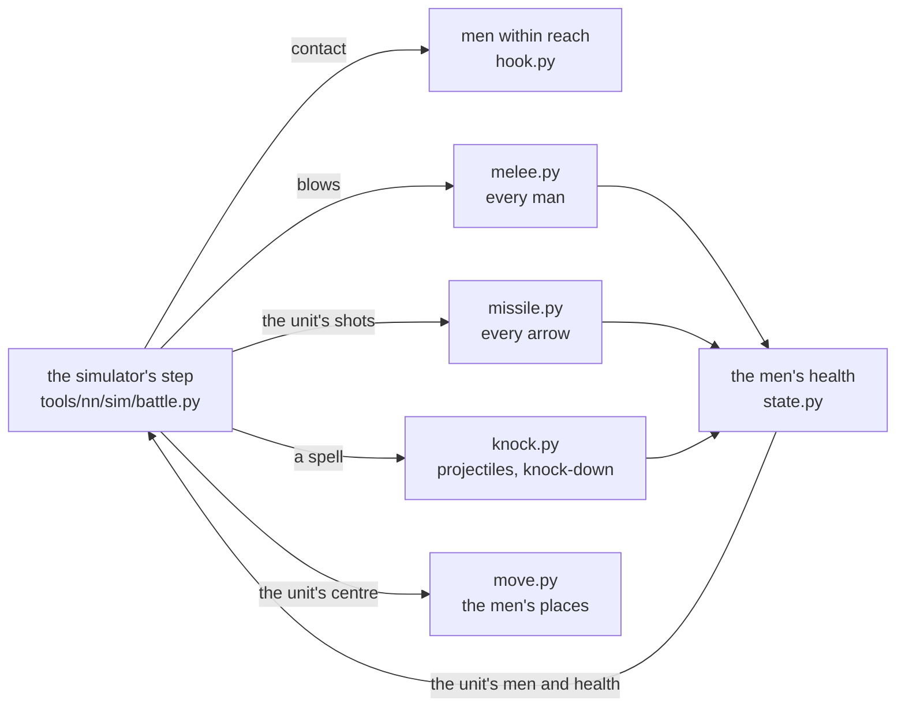

# The fighters lab

[← Back](README.md) · [Documentation](../README.md) › [Training data](README.md) › The fighters lab · [Русский](../../ru/training/fighters_lab.md)

A model where every man of a unit is a point of his own, with his own health, his place in the formation and his own
blows. It lives apart from training: the code is `tools/nn/fighters/`, the simulator's files (`tools/nn/sim`,
`config/nn`) are not changed and the simulator's version stays. The lab hooks into the simulator's step for the run
and answers: how much closer to the game are the men than the rectangle, and what do they cost.

## In short

- **What it gives.** On the same game recordings the men beat the rectangle where it was wrong: men killed per health
  lost in thinned units, the first seconds of a melee, men killed under fire (two-handers most), the contact and the
  formation's shape. Tables below, "Against the game".
- **The attack clock found.** A man swings once an attack interval of his passport - hit or miss (CA's schema: the
  interval is "the smallest gap between the starts of attack animations"). The simulator charged a miss 0.5 s; hence
  the old "share of blows 0.35". A probe in the game (units of 5 and 1 men, every 0.1 s): 91 hits where "a swing every
  interval" expects 76 and "a miss of 0.5 s" 167. One on one in the probes the damage now meets the game with no fit; in
  whole battles 1.37 of the game (with the share 0.35: 1.20), on thinned units 0.95 (was 0.85). The whole battles'
  surplus - probably the first blow of every new clash, open.
- **The knock-down** is one mechanism - "a blow of mass or force -> the man is thrown / down, lies" - spells today;
  charges and monsters will use it. A probe battle in the game (the men's places every 0.1 s) confirmed: knocked men
  do not die lying, a knocked unit hardly strikes; the throw has a median of 3 m. But the men's share thrown is 2-5x
  below the game's (below).
- **Speed** - below, "Speed".

## How it works



The simulator still runs a unit as a whole: orders, the centre's movement, morale and routs, fatigue, abilities, when
a unit fires and how many shots. For the run the lab replaces (`hook.installed()`, no file of the simulator changed)
five places of the step:

| What | The rectangle | The men |
|---|---|---|
| Contact | the rectangles' edges step into each other | a man of one unit within reach of a man of the other: the database's formed combat distance 2.5 m + the man's radius |
| Melee | men striking = a share of the front's files x the wave x the fill | every man with an enemy in reach strikes on his own clock |
| Missiles | the hit share by the spread formula, spill on neighbours | every arrow flies at one man and hits the first on its way |
| Spells | the dose by rings round the strike point | every projectile lands at a point: contact, blast, knock-down of men |
| Losses | the wounded pool, even hits | every man's health; damage beyond it is lost, a man dies at 0 |

After the step the unit's men and health in the simulator are the men's, and the men walk to their places.

**The men** (`state.py`). A man's place is an offset from his unit's centre. A unit in formation: ranks at its
template's spacing from the database (`unit_spacings`), the ordered width, the place's scatter the database's
`close_formation_spacing_variation`. When a man dies the man behind him in the file takes his place (the file closes
up), the width stays. A formation that turns about more than 90 deg in a step swaps its ranks (the front rank becomes
the back) instead of running through itself.

**Melee** (`melee.py`). A man strikes an enemy whose centre is within the database's formed combat distance (2.5 m)
plus the enemy's radius. He keeps his opponent while in reach, else takes the nearest (first of his unit's order
target). A blow: the game's formulas as in the simulator, but per man: hit chance 35 + attack + charge - defence x
direction (the direction against the struck man's own facing), an armour roll every blow, damage beyond health lost.
The attack clock: the passport's interval after every swing, hit or miss (`melee.swing_per_interval`; measured -
below, "The attack clock"); it runs only while an enemy is in reach (the
first blow is at once, a return to the fight brings no new burst - the `recontact` probe). The unit's rules stay: a
holding formation strikes at 0.5, a router is struck at 0.43 and so on (a blow lands with that chance).

**Missiles** (`missile.py`). How many shots and when - the simulator (volleys, reload, aim). The shots are loosed by
the unit's living men. Each aims at his own target man (keeps him while he lives - the simulator's `missile.reaim`), the
projectile lands with the database's spread (calibration area, accuracy), flies below head height over its last h / tan
theta metres and hits the first man on its way - enemy or friend. The shield of a man facing the shooter blocks its
share. A hit takes that man's health.

**Movement** (`move.py`). A man is carried by his unit's centre and walks to his place (at most his run). A front-rank
man with an enemy in reach stands at the "standoff" from him (measured, below), at most 2 m from his place (the
database's `entity_action_attack_formed_tether_distance`); the ranks behind follow. Bodies (the database's radius) do
not overlap.

**The knock-down** (`knock.py`), one mechanism for any blow of mass or force:

- the speed the impact gives the man (a body struck him - the projectile's mass x speed / his mass; a shockwave -
  force / his mass x (1 - d / R)) against the database's ladder: from `..._knocked_back` 4 / 2 m/s he is thrown and
  stays up, from `..._knocked_down` 7 / 3.5 m/s thrown and lying (`collision_` / `shockwave_speed_delta_threshold_*`);
- lies a random time in the database's `knockdown_getting_up_delay` (1.0-2.7 s); lying he strikes nobody (his clock
  stops), nobody strikes him, arrows and blasts do not wound him (`knock.invulnerable`: the simulator's `magic.knock`
  reading; the community: knocked-down infantry outlive what would kill them), he does not move with his unit;
- thrown from the impact's centre by `knock.throw`: a median of 3.0 m, spread x e^N(0, 0.37) - measured (below), no
  database number;
- up, he walks back to his place.

Spells call it today (each projectile of Searing Doom and Warp Lightning lands at its own point: the contact within
`collision_m` + the man's radius, at most `penetration` nearest men, and the blast with the falloff of
`config/nn/sim.json` `magic`). Charges and monsters will call the same `knock.knock()`.

**Morale and routs** are the simulator's, unit by unit, unchanged; morale sees the losses counted by the men.

## Numbers and sources

| Number | Value | Source |
|---|---|---|
| Reach of a blow | 2.5 m + the target's radius | database `entity_action_attack_formed_combat_distance`, radius `battle_entities` |
| Tether to the place | 2.0 m | database `entity_action_attack_formed_tether_distance` |
| Standoff (the front rank's distance to the enemy) | 1.0 m at contact -> 2.3 m, tau 13 s | measured: soldiers' places, 48 lanes of the probes reform, reform2, damaged, dmgmelee, wave, armour - the median nearest-enemy distance of the 15 nearest men 0.98 / 1.14 / 1.32 / 1.51 / 1.91 / 2.24 / 2.26 / 2.39 m at 0-1 / 1-3 / 3-5 / 5-10 / 10-20 / 20-40 / 40-90 / 90-240 s |
| Attack clock | a swing every interval of the passport, a miss too | CA's schema (`melee_weapons`: the interval between the starts of attack animations); measured - the `swing` probe, below |
| Share of blows `blow_share` | 1 (was 0.35) | the old measured 0.35 = the ratio of "a swing every interval" to "a miss of 0.5 s" (p + 0.5 / interval) |
| Spread of arrows | calibration area x (d / distance)^2 x (1 - accuracy) | database, the simulator's model `missile.hit_chance_plane` |
| Knocked / lying | 7 / 3.5 m/s; 1.0-2.7 s | database |
| Throw | median 3.0 m (p10-p90 2.3-6.0) | measured: the knock probe battle, below |

Every lab number with its reason: `tools/nn/fighters/lab.json`.

## Against the game

### The step replay of 92 battles

Every 10 s the simulator is put into the recorded state of a game battle and plays 9 s on the recorded orders, 4
copies (`tools/nn/sim/stepreplay.py`). The men carry their places and wounds over from their own last window (the
wounds put to the recording's health: the most wounded die first). The windows are chosen by the game - the same for
both models. Sim / game, 95 % interval over battles (`python -m tools.nn.fighters.card`):

| Number | Windows | Game | Rectangle | Men |
|---|---|---|---|---|
| Melee, men killed per health lost, health > 85 % | 8,481 | 0.42 | 0.91 [0.87-0.95] | 0.89 [0.87-0.92] |
| ... 60-85 % | 12,430 | 0.72 | 0.94 [0.91-0.97] | 0.78 [0.76-0.80] |
| ... 40-60 % | 7,621 | 0.98 | 0.80 [0.78-0.82] | 0.77 [0.75-0.79] |
| ... 20-40 % | 5,018 | 1.22 | 0.72 [0.71-0.74] | 0.85 [0.82-0.87] |
| ... < 20 % | 840 | 1.58 | 0.66 [0.62-0.70] | 1.19 [1.05-1.40] |
| Under fire, men killed per health, all | 6,283 | 0.38 | 0.58 [0.52-0.65] | 0.62 [0.58-0.66] |
| ... health > 85 % | 3,442 | 0.11 | 0.30 [0.25-0.37] | 0.64 [0.57-0.73] |
| ... two-handers (greatswords) | 669 | - | 0.24 [0.13-0.40] | 0.62 [0.49-0.76] |
| Melee, health lost, all | 34,390 | - | 0.89 [0.86-0.91] | 1.20 [1.15-1.25] |
| ... health > 85 % / < 20 % | | - | 0.85 / 1.08 | 1.26 / 0.66 |
| A thinned unit (< 30 %) in melee, damage on it | 2,886 | - | 1.03 [0.98-1.09] | 0.85 [0.80-0.91] |
| Contact: the game's melee seconds with the copies' flag | | - | 0.901 | 0.885 |
| ... false contact (the game has none) | | - | 0.121 | 0.111 |
| Routs begun | | 2,399 | 0.97 | 1.03 |

Mainly: men killed per health in thinned units (20-40 % and < 20 %) come nearer the game (0.72 / 0.66 -> 0.85 /
1.19), under fire the two-handers 0.24 -> 0.62 and whole units 0.30 -> 0.64. Worse: melee damage on whole units 0.85
-> 1.26 (the one blow share 0.35 was measured one on one; in whole battles it overshoots), on nearly broken ones 1.08 ->
0.66. Contact at the rectangle's level (0.90 / 0.89).

### The attack clock (the swing probe)

The melee probe's `swing` plan (`build/charge-probe/runs/20261016-213837`, one battle, 5 lanes): units cut to 5 and 1
men (`kill_number_of_men`), both sides attacking from 3 m, health and the men's places every 0.1 s
(`python -m tools.nn.fighters.swingdata`). Hits - the drops of a unit's health between samples; man-seconds - men
within reach (3.15 m) of an enemy. In all 91 hits (77 drops) in 1,020 man-seconds: "a swing every interval" (p /
interval) expects 76 (game / it 1.20 +- 0.21 by hits, 1.01 by drops), "a miss of 0.5 s" 167 (0.55). By lane 0.63-1.96
(few hits each). One battle was enough: the two rules are 2x apart, the error +-21 %.

The column "men, swing" - no share 0.35, the clock "a swing every interval" (below, "Attack clock"):

| Number | Rectangle | Men, share 0.35 | Men, swing |
|---|---|---|---|
| Melee, damage, all | 0.89 | 1.20 | 1.37 [1.32-1.43] |
| ... health > 85 % / 60-85 % / < 20 % | 0.85 / 0.86 / 1.08 | 1.26 / 1.26 / 0.66 | 1.51 / 1.42 / 0.70 |
| A thinned unit (< 30 %), damage on it | 1.03 | 0.85 | 0.95 [0.88-1.02] |
| Men killed per health, melee, all / < 20 % | 0.86 / 0.66 | 0.79 / 1.19 | 0.87 / 1.29 |
| Men killed per health, under fire, all | 0.58 | 0.62 | 0.65 |
| Routs begun | 0.97 | 1.03 | 1.21 |

One on one in the probes the swing every interval meets the game (damage 15-30 s / steady 1.00 / 1.02); in whole
battles the damage is above the game: probably the opening of every clash - each man who first reaches an enemy
swings at once (the probes 0-1 / 0-2 s 1.58 / 1.39 of the game) - and whole battles have many clashes. Open.

### Melee probes

112 lanes of 11 plans of the melee probe (`tools/nn/charge_probe.py`: reform, reform2, dmgmelee, damaged, wave, armour,
defender, fresh, meleeorders, recontact, busycharge), each lane's twin 4 copies. Mean |log(sim / game)| over lanes and
the sum sim / game:

| What | Rectangle | Men, share 0.35 | Men, swing |
|---|---|---|---|
| Target's HP at 0-1 s | 0.90 (0.61) | 0.53 (0.83) | 0.63 (1.58) |
| Target's HP at 0-5 s | 0.60 (0.63) | 0.38 (0.86) | 0.42 (1.35) |
| Target's HP at 5-15 s | 0.20 (0.94) | 0.27 (0.90) | 0.36 (0.85) |
| Target's HP at 15-30 s | 0.29 (1.11) | 0.30 (0.92) | 0.27 (1.00) |
| Target's HP a second, steady | 0.31 (1.03) | 0.34 (0.92) | 0.29 (1.02) |
| Target's men killed at 0-10 s | 1.63 (0.34) | 0.46 (0.90) | 0.50 (1.37) |
| Target's men killed at 15-30 s | 0.39 (1.34) | 0.37 (1.10) | 0.40 (1.19) |
| Attacker's men killed at 5-15 s | 2.49 (0.14) | 0.83 (0.69) | 0.59 (0.95) |

The shape from the men's places (game / men, lane means; the rectangle is its box: depth 12.2 m, width 28.6 m
always): men within reach 3.15 m at 1-3 / 5-10 / 20-40 / 90-240 s 48 / 38 / 23 / 16 and 37 / 34 / 22 / 15; the front
rank's standoff 1.43 / 1.76 / 2.53 / 2.82 and 1.30 / 1.46 / 2.34 (6.3 at 90-240 s: the formation is down to stragglers);
depth 11.7 / 11.3 / 12.7 / 10.4 and 11.7 / 11.8 / 11.2 / 8.9 m; width 28.3-28.5 and 28.6-29.1 m; wrap (the share of men
beside the enemy) 0.01-0.05 and 0.00-0.02.

### Routers

The routmob, routmob2, passby probes: the routing crowd along the flight / across (p90 - p10, m) at 0-3 / 3-7 / 7-15 /
25-45 s after the rout: game 8.1 / 21.4, 11.7 / 22.5, 7.6 / 23.1, 6.5 / 23.3; rectangle 7.2 / 23.0, 7.2 / 23.0, 5.8 /
23.0, 5.8 / 23.0; men 6.4 / 17.3, 5.2 / 12.3, 5.4 / 22.4, 5.4 / 22.2. In the game the crowd keeps the formation's width
(~23 m) and stretches along the flight to 12 m in the first seconds; the men's formation narrows at 3-7 s (the about-face
and the walk to the new places) - open.

### The knock-down (a probe battle)

The magic plan's battle 6 (`build/magic/runs/20261016-211346`, one battle, Normal, graphics low): targets held by
script, the men's places every 0.1 s, each man followed (`python -m tools.nn.fighters.knockdata`). "Thrown" - moved
faster than 4 m/s (the control lane without a cast had no such strike). Per strike (cast):

| Strike, target | Men | Thrown | Throw, m (p10 / median / p90) | Lying, s (median / p90) |
|---|---|---|---|---|
| Doom -> clanrats (4 strikes) | 537 | 0.39 | 2.3 / 3.3 / 6.0 | 2.7 / 4.4 |
| Doom -> skavenslaves (3) | 421 | 0.47 | 2.3 / 3.2 / 7.2 | 2.3 / 4.4 |
| Lightning -> swordsmen (3) | 244 | 0.29 | 1.4 / 3.0 / 9.0 | 0.1 / 1.0 |
| Lightning -> swordsmen in melee (2) | 165 | 0.27 | 1.6 / 2.8 / 4.7 | 0.2 / 3.1 |

- The throw is the same for both spells and every target: one distribution; mostly away from the strike (cosine with
  the line from its centre, median 0.5-0.7). The old "1.5-3 m" from 1 s places held ordinary moves.
- After Doom men lie 2.3-2.7 s (the database's 1.0-2.7 + getting up); after Lightning they hardly lie - its wave
  (force 400 / mass 100) throws but seldom knocks down: the database's ladder gives just that.
- Lying they do not die: 0 deaths in 778 man-seconds lying while the men up nearby died at 0.005-0.020 a second (~11
  expected).
- A knocked man does not strike: swordsmen in melee, 31 of 106 thrown by Lightning, took 20 / 13 HP a second off the
  clanrats 3-6 / 6-12 s after the strike, the control without a cast 48 / 33.
- **The lab's men** on the same targets for one cast (32 copies): thrown 0.17 / 0.06 / 0.06 (Doom -> clanrats,
  skavenslaves, Lightning -> swordsmen) against 0.39 / 0.47 / 0.29. In the game men 6-9 m from the centre are thrown
  too (Lightning 0.42), where the wave by the database's formula (linear falloff, the blast radius less 1 m) does not
  reach. Candidates: thrown bodies knocking their neighbours (collisions), another falloff of the wave's force - open.

### Missile probes

33 lanes (dist, targets, shield; thin from `build/probes7`): men killed per health lost by 20 / 40 s after the first
volley, sim / game (lane mean): rectangle 0.67 / 0.55, men 0.92 / 0.71. The target's health at 80 / 120 s: rectangle
0.76 / 0.82 of the game (it hits thinned targets harder than the game), men 1.11 / 1.49 (softer: a sparse formation
lets arrows through). Thin targets (45 slaves on 30 m): the game keeps 14 men at 40 s, the rectangle 20, the men 28-30.

## Speed

`python -m tools.nn.fighters.bench` (RTX 5070 Ti 16 GB, the arena whole_emp_v_skv 20 x 20, 2,262 men a battle, all
attacking the nearest; ms a 0.5 s step, 100 steps from the start into the melee):

| Battles | Simulator, compiled (as training) | Simulator, not compiled | Men (not compiled) | Men's peak memory |
|---|---|---|---|---|
| 256 | 6.7 | 106 | 262 (its own part 156) | 4.8 GB |
| 1024 | 7.4 | 146 | 7,800-30,000 | 21.6 GB - does not fit the 16 GB card |

At 1024 battles the men do not run today: the neighbour lists (108 candidates a man) take ~19 GB. In batches of 256 it
is ~1.05 s a step of 1024 battles - ~140x the compiled simulator. What would cut it: neighbours only for the men of
units near an enemy (a minority in a battle), int32 indices, `torch.compile` of the men's step (without the Python
checks) - not estimated.

## How to run

```bash
# the checks (the container, the GPU; DOCK_MEM - the container's memory cap)
DOCK_MEM=8g DOCK_BUILD=<main>/build bash tools/nn/dock.sh tools.nn.fighters.probes --plans reform,dmgmelee --copies 4 --device cuda --out build/fighters/probes.json
DOCK_MEM=8g DOCK_BUILD=<main>/build bash tools/nn/dock.sh tools.nn.fighters.probes --routers --plans routmob,routmob2,passby --device cuda --out build/fighters/rout.json
DOCK_MEM=8g DOCK_BUILD=<main>/build bash tools/nn/dock.sh tools.nn.fighters.probes --missile build/probes7/runs/<thin> ... --device cuda --out build/fighters/missile.json
DOCK_MEM=8g DOCK_BUILD=<main>/build bash tools/nn/dock.sh tools.nn.fighters.replay --runs-from build/contactgap/sr_free_rect --out build/fighters/sr_fighters --device cuda --chunk 16
DOCK_MEM=8g DOCK_BUILD=<main>/build bash tools/nn/dock.sh tools.nn.fighters.replay --runs-from ... --out build/fighters/sr_rect --rect --device cuda --chunk 16
python -m tools.nn.fighters.card build/fighters/sr_rect build/fighters/sr_fighters     # the table, no torch
DOCK_MEM=8g bash tools/nn/dock.sh tools.nn.fighters.bench --B 256 1024                 # speed
python -m tools.nn.charge_probe run --plan magic --battles 6 --speed 3                  # the knock-down probe battle (the game)
python -m tools.nn.fighters.knockdata build/charge-probe/runs/<run>                     # its reading
```

```python
from tools.nn.fighters import hook
with hook.installed() as h:            # whatever is built inside (scenario.build) gets its men: h.F
    st = scenario.build(armies, params, device="cuda")
    battle.run(st, policy, params)
```

Tests: `tests/tools/test_nn_fighters_torch.py` (the container), `tests/tools/test_nn_fighters_shape.py`,
`tests/tools/test_magic_probe.py` (no torch). A replay batch of 16 battles x 4 copies keeps the container within ~8 GB
of memory; 46 battles at once and several jobs in parallel took 12 GB.

## Not there

- The damage in whole battles with "a swing every interval" is 1.37 of the game: the opening of a clash (who strikes
  at once at contact) - to measure with the `swing` probe by the moments of the first health drops after contact; a
  random phase of the clock on entering a fight gave 0.35 of the game at 0-1 s (too little) - kept "ready at once".
- The share thrown by a spell is 2-5x below the game's (the knock probe battle): how the game throws men beyond the
  blast radius is not found.
- The ellipse body (wolf rats) - the men are circles; the Ratling Gun's burst - at most 2 shots a man a step; a flat
  shot looks for bodies over its last 21.6 m only.
- Wrapping round the enemy (the "drop") is weaker than the game's (0-0.02 against 0.01-0.05 one on one).
- The lab runs without `torch.compile` only (Python checks inside the step).

## Tried and rejected

- **Every man strikes by the formula (`blow_share` 1).** The probes' damage 2-5x the game's (target HP at 15-30 s:
  sum sim / game 4.15).
- **Every man in reach + tether closes on the enemy.** The second rank pressed the first into the enemy: men within
  reach 34-45 against 19 in the game at 20-40 s, fronts 1.1-1.4 m apart against 2.3.
- **The formation follows every fighting man.** Fighting second ranks pulled the formation forward and the fronts did
  not part (standoff 1.0-1.3 m all fight). Kept: only the front rank takes the standoff and pulls the formation.
