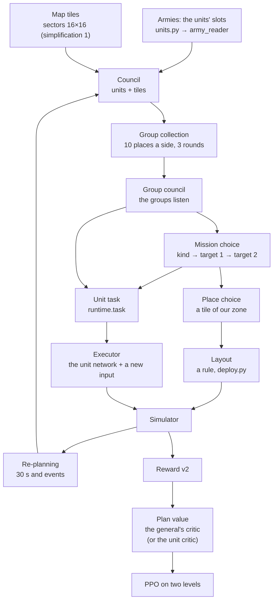

# The general's network (S28)

[← Back](README.md) · [Documentation](../README.md) › [Data for training](README.md) › The general's network · [Русский](../../ru/training/general.md)

The general is a network that makes the battle plan for the whole army: it splits the army into groups, gives each
group a mission and a deployment place, and the units (today's unit network, the "executor") carry it out themselves.
The agreed architecture (with the "why so and what was rejected" blocks) is the page `design/general/index.html`; this
page says what of it is in code (`tools/nn/general/`) and how it learns.

**Now:** the whole loop is built as a "skeleton" — from the plan to the weights' update, in the simulator. It is
switched on by `run.py --general` (or the chain's step `general`, [below](#running-it)). Some blocks are simplified —
[the list](#simplifications-of-the-skeleton); each simplification is a setting, not hard-wired code.

## The whole loop



| Block of the design | Code | What it does |
|---|---|---|
| Armies | `units.py` (+ `army_input.py`) | the slots of all the battle's units: 45 numbers and 3 labels (as the "Armies" input); "come" = what is left now |
| Army analysis | `army_reader.py` | one network for all slots → the unit's card (`card` wide) |
| Map tiles | `tiles.py` | 256 sectors of 100 m with their 8 numbers, projected to the card's width + the tile's place |
| Council | `net.General.cards` | a transformer: units and tiles, each asks each; the label own / enemy / tile; empty slots and tiles outside the map take no part |
| Group collection | `net.SlotGroups` | slot attention: 10 places ours + 10 the enemy's, each with its own starting card; a unit splits itself 100 % between its side's places (the side mask); 3 rounds; the routing and the dead are in no group. A group is a place that is some unit's main place. The units' keys less a learned share of their side's mean key (`--general-center`, starts at 1): the places compete for the units by what tells the units apart ([why](#more-differences-from-the-design)) |
| Group council | `net.Listen` | the groups listen to the tiles and to all groups; the tiles do not change |
| Mission kinds | `General.kinds` | a table of 10 learned cards with no input |
| Mission choice | `General.decide` | step by step: kind (the group's card against the kinds) → target 1 → target 2 or "none"; targets: our groups (not itself), their groups, tiles inside the map; the enemy's groups do not choose |
| Place choice | `General.decide` | in the battle's first plan only: a pointer to a tile of our zone |
| Layout | `deploy.py` | a rule: a line by the formations' widths on the group's tile, facing the enemy's centre; groups on one tile stand one behind the other; everything inside the zone |
| Unit task | `runtime.Runtime.task` | for each own unit: its group card (the mix of the places' cards by its shares), its main group's mission kind card, 2 targets (direction from where the unit faces, cos and sin; distance / 100 m, at most 20; a "none" flag) — 2 × card + 8 numbers |
| Executor | `executor.GeneralActor` | today's unit network; the task goes through a linear layer with zero weights and is added to the unit's token (as the commitment's input); enemies get nothing |
| Re-planning | `runtime.Runtime.replan` | every 30 s of battle; sooner when a group is broken (more than half of its units rout or are destroyed) or a lord falls (ours or theirs), but not sooner than 3 s after the plan. Between plans the groups, missions and targets are locked |
| Reward | `tools/nn/train/reward.py` | as now (v2); no reward for carrying a mission out |
| Plan value | `General.value` | predicts the plan's return from the plan's cards (detached); with `--general-return critic` the advantage's base is the unit critic, and it learns beside it |
| Missions that tell apart | `distinct.py`, `runtime.behave` | (`--general-distinct W`) a classifier guesses a group's mission kind from its units' behaviour; the executor's bonus |
| Training | `learn.py`, `tools/nn/train/ppo.py` | [below](#training) |

Size at a card width of 128 (the chain's step): 1.14 million weights, at 64: 308 thousand (the unit network: 3.5
million).

## In the battle

`tools/nn/general/runtime.py` — the plan of every side a network with a general plays (the learner, or a pool's past
version that has a general) is kept per row of the batch (as `rollout.Battles` keeps its rows).

- **Deployment** (a battle's start): the general plans on the armies and on the tiles of the scripted placement
  (`place.py`) — groups, missions, places; the rule puts the units on their groups' tiles. Scripted sides and old
  networks without a general stand as before. When a side's units do not stand in their zone (kite battles, drills)
  the placement stays scripted and the general only forms the groups and missions.
- **Re-planning:** the network runs the whole scheme again: the armies "now" (the men and health left), the tiles from
  the side's observation (the same numbers as the unit network's sectors), the group places start from their last
  cards.
- **The unit task** is computed every decision (the targets move): a target group's point is the centre of its units
  now (as the side sees them), a tile's its centre.
- **Both sides** in battles against itself and the pool (when the pool's version has a general) use the general;
  against scripts only our side does.

## Training

PPO on two levels (`learn.py`):

- **The executor** learns as before. The task's cards are computed again in the update from the chunk's plan table
  (`learn.task_for`) — with the gradient, so the executor's loss reaches the group council, the group collection, the
  council and the army readers. At every chunk's start the cards of the plans in force are computed again with the
  weights of the moment — the decisions' probabilities in the battle and in the update agree (test).
- **The general:** its choices (kind, target 1, target 2, place) are discrete and sampled; each own group is an agent
  with its own ratio of probabilities, all groups of a plan share its advantage = the plan's return − the plan value at
  the plan (normalised over the update's plans). The return is the reward summed from the decision to the next
  re-plan or the battle's end (`--general-return span`). Plus an entropy bonus on the choices (`--general-entropy`,
  0.01). The plan value learns the return. The general's steps come after the executor's epochs, the same Adam
  (`--general-lr-mult` scales its step); 2 epochs of 512 plans, the epochs stop when the KL a group passes 0.03. At a
  chunk's start the choices' probabilities of the plans in force are computed again with the weights of the moment
  (a plan made before the last update is priced as the policy of now: the ratio starts at 1; without it the general's
  KL was 0.05–0.07 an update and the clipped share 0.5–0.6).
- **The return by the unit critic** (`--general-return critic`, off by default). Why: with `span` nearly all of the
  return's spread (98.6 % in the analysis of the g1 points) is in the battle's last plans (±1 for the win), the
  deployment's return spreads ~0.004, and the plan value explains ~0 — the general has nothing to learn from. The unit
  critic explains 0.995 of the spread, so: the plan's advantage = the reward over the plan (decision k times γ^k) +
  γ^n · V(end) − V(start). V is the unit network's critic's value of the own side (one number a side: that is how the
  critic is built), γ the PPO's, n the plan's decisions. V(start) is at the plan; for the deployment's plan at the
  battle's first decision. V(end) is at the re-plan's decision that cut the plan; when the battle ended, 0, and the
  last reward (the win) is already in the sum. The plan value learns the same target beside it, but the advantage
  takes the critic's difference. The formulas: `signal.py` (no torch); the critic's value at a decision:
  `runtime.note_value` (computed before the decision's re-plans).
- **The executor's bonus for missions that tell apart** (`--general-distinct W`, default 0 — off). Why: the executor
  hardly listens to its task (the input's weights 0 → 0.39 by a random walk; swapping the mission kind changes the
  decisions by a KL of 0.0006). How: over a plan the behaviour of each own group's units is summed
  (`runtime.behave`): the shares of the order kinds, the run share, the group centre's displacement forward and
  sideways (from the direction "our centre → the enemy's centre" at the plan's start, / 100 m), the centre's path, the
  plan's length — 10 numbers (`runtime.BEH`). A small classifier (`distinct.py`: 2 layers of 64, its own Adam, outside
  the network) guesses the group's mission kind from them. When the plan ends, each group gives W × (log q(kind |
  behaviour) − log(1/10)) (within ±ln 10): 0 when the classifier guesses no better than chance, up to W · 2.3 when it is
  sure and right. The bonus goes into the side's reward at the plan's last decision; not into the general's return.
  It is a reason to act differently under different kinds, not a payment for carrying a mission out. W goes down to
  0 linearly over `--general-distinct-decay N` updates of the chain (the counter goes on over the parts); the
  classifier learns after every update on the ended plans, also once W = 0 (its accuracy measures how much the
  behaviour depends on the kind). Its weights, Adam and the counter are in the checkpoint's `train`. A caveat: the kind
  is tied to whom the general gives it (cavalry, say, gets one kind more often), so part of the guessing is by the
  group's type, not by behaviour; an accuracy above chance does not yet mean the executor listens — read it with the
  task input's weight norm.
- **Start:** the executor takes the last unit network's weights, the new input at zero weights — it plays as before
  (test: the outputs are equal to the bit); the general from scratch.

The chunk's plan table: the plans in force during the chunk (carried over and new) — their inputs, membership,
choices. A transition keeps only the task's geometry, the "has a task" flag and the plan's number (not the cards:
~90 MB a chunk of 1024 battles × 64 decisions instead of gigabytes).

## Simplifications of the skeleton

Each is a value of a setting (`GeneralConfig`, `run.py` flags); the values of the full version, which is not built
yet, are refused with a `NotBuilt` error (the network never thinks it has what it has not).

| # | Simplification | Flag (now) | The full version |
|---|---|---|---|
| 1 | the map tiles are today's 16 × 16 sectors of 100 m (8 numbers), projected to the card's width | `--general-tiles sectors` | `cnn`: the map analysis's 1024 tiles (`map_cnn.py`) |
| 2 | the effects are not connected: the effect cards are zeros | `--general-effects off` | `on`: the effects' analysis |
| 3 | small widths: council 2 layers, group council 1 layer, card 128 (the chain's step; `run.py`'s default 64), 4 heads | `--general-card 128 --general-council-layers 2 --general-group-layers 1 --general-heads 4` | settled by the checks |
| 4 | mission branches are not built; the bonus for missions that tell apart is built but off by default; the entropy bonus on the choices is on | `--general-branches 0 --general-distinct 0 --general-entropy 0.01` | branches as the abilities'; the bonus: `--general-distinct W` ([above](#training)) |
| 5 | the deployment zone is the area `place.py` deploys an army in (forward from −260 to +40 m of the side's line, sideways ±150 m); a tile is in the zone when its centre is; the layout inside a group is a rule | `--general-zone place`, `--general-deploy net` (`script`: the scripted placement as before) | `map`: the zones from the map's layers |

More differences from the design (skeleton too):

- **the group collection's keys less a share of their side's mean key** (`--general-center 1`, the share learns; `0`:
  plain slot attention). Without it a fresh general in a probe put nearly all units into one group: 1.0–1.3 groups a
  side (the common part of one army's keys outweighed the differences); with it 4.3–4.6 at the start (an army of ~14
  units), 3.6–4.0 in the trial training. My decision; the design page does not have it;
- the slots are the battle's own slots (up to 80, their order means nothing: the network does not depend on it —
  test), not "40 own + 40 enemy";
- a hidden enemy counts as full (the simulator hides nobody);
- the re-planning's events are only 30 s, a broken group, a lord's fall ("mission done" and "reinforcements" — no);
- "broken" counts destroyed units too, not only routing ones;
- in the ability branches the plan is frozen (no re-plans in a branch's 60 s);
- the formation (width, depth) is not chosen — as in the scripted placement;
- the unit critic does not see the plan.

## Numbers in the log

The run's `log.jsonl`, field `general` (and the `general:` line of the output):

| Number | What |
|---|---|
| `groups_own`, `groups_enemy` | groups a plan a side (places that are some unit's main place) |
| `kinds`, `kind_entropy` | the shares of the mission kinds of our groups and this histogram's entropy (at most ln 10 = 2.30) |
| `places_top` | the most chosen deployment tiles (`row_column` of the side's 16 × 16 grid: the row is forward) |
| `deploy_net_share` | the share of deployments made by the general (the rest scripted: the zone did not fit) |
| `replans_per_battle`, `replan_reasons` | re-plans a battle and by reason (timer, broken group, lord) |
| `value_mse`, `value_ev` | the plan value's error on the update's plans (before the step) and its explained share |
| `critic_ev` | (`--general-return critic`) the explained share of the plan's target by the unit critic's value at the plan's start |
| `return_mean`, `return_std` | the mean and the spread of the plan's target (return) |
| `adv_mean`, `adv_std` | the mean and the spread of the plan's advantage before its normalisation (target − base: the critic or the plan value) |
| `task_in_w`, `task_in_group`, `task_in_kind`, `task_in_geo` | the executor's task input's weight norm: all, the group card's columns, the kind card's, the targets' geometry's — how much the executor listens to its task |
| `distinct_acc`, `distinct_chance`, `distinct_gain`, `distinct_loss` | (`--general-distinct`) the accuracy of the classifier of kinds by behaviour on the update's plans (before its steps) and chance (0.1); the mean log q + ln 10 (the bonus without W); its loss |
| `distinct_bonus`, `distinct_weight` | the mean bonus paid a group and W now |
| `pl`, `ent`, `kl`, `clip` | the general's PPO: loss, the choices' entropy, KL, clipped share |

The mandatory ones (rating, pair gold, own lord deaths) are in the `test5` evaluations as before.

## The step's cost

Measured on the GPU (RTX 5070 Ti; line S27's options with the fighters lab and the ability branches; 1024 battles, 64
decisions an update; the same battles in both runs): an update (collection + PPO step) **48.3 s without the general,
54.1 s with it (card 128) — +12 %**; +14 % while no battle ends, +10.5 % once battles end and deploy again. Collection
27.8 → 30.5 s, the step 20.5 → 23.6 s, the GPU's peak memory 11.5 → 12.3 GB. With a card of 64 the same (+11.6 %):
the cost is nearly all fixed (small operations, reads from the GPU, the layout on the CPU), not the width, so the
chain's step uses 128. The runs: `build/nn-train/runs/gen_cost_*` (not in Git).

In the trial training (10 and 12 min, from `itS27_4`): no NaN, no skipped steps; 3.6–4.0 groups a side (with the mean
key taken off), all 10 mission kinds in use (entropy 2.18–2.29 of 2.30); ~20 re-plans a battle (timer ~80 %, broken
groups ~17 %, lord ~3 %); the general's KL 0.005–0.018; the plan value explains nothing yet (share ≈ 0: a 30 s return
is mostly noise; see `--general-return critic`).

## Running it

The chain's step `general` in `config/train-chain.json` (`steps.general`): the options of line S27
(`build/steps/v2_iterW.sh` + `train_extra_S.txt`: reward v2, armies v2, ability branches with their own signal, the
fighters lab, the pool of S networks) over `test5`'s protocol (its `--small`, step size, entropy and anchor undone),
and the general. The evaluations: the mandatory set only. The command from the unit network's last point:

```bash
.venv/Scripts/python -m tools.ops.step --label g1_general --from build/v2/itS27_4.pt --step general
```

The general's signal is switched on over the step: `--set general-return=critic` (the advantage by the unit critic)
and `--set general-distinct=0.003 --set general-distinct-decay=150` (the bonus for missions that tell apart: W 0.003
down to 0 over 150 updates). W's scale: ~20 plans a battle × ~4 groups × the classifier's gain (up to 2.3) × W — at
0.003 and a gain of 0.5 that is ~0.12 a battle against the battle return's spread of ~0.8; watch `distinct_bonus` in
the log.

`--from <file>.pt` (new): a line's point outside `test5` — it is the `--init`, the `--reference` and the
`--critic-init` (Adam and the counters go on). `--step NAME` (new): a named step's options over the standing ones.

## The map

The "Landscape" input is `map_input.py` (6 layers on a grid of 128 × 128 cells of 16 m, always as its own side sees
it) and `map_batch.py` (the same layers for many battles at once); the "Map analysis" is `map_cnn.py` (a convolutional
network: 1024 regions of 64 m, 32 numbers each, a summary cache per map); checks: `map_probe.py`, tests
`tests/tools/test_general_map_*.py`. The skeleton's general does not read them yet (simplification 1).

## The "Armies" input

Code: `tools/nn/general/army_input.py`, no torch.

- **80 slots**: 0–39 the own army, 40–79 the enemy's; one unit a slot. Always as its own side sees it: for side 2 the
  armies swap places (as the map's layers do). The slots' order means nothing; the lord may stand anywhere. An empty
  slot is flagged `empty` and holds zeros. More than 40 units a side is an error.
- **A slot is 45 numbers and 3 labels** (groups and order as in the "Unit slot" table of the design page):

| group | numbers | what and how |
|---|---|---|
| side | 1 | own 1 / enemy 0 |
| cost | 1 | multiplayer cost, log (5000 → 1) |
| size and health | 5 | men in the full unit (log 200), men come — share, health of the full unit (log 20000), health come — share, health of a man (log 10000) |
| body and speed | 4 | mass (log 10000), walk / 5, run / 10, charge / 10 (m/s) |
| melee | 10 | attack, defence, charge bonus / 100; damage and its AP part (log 500); bonuses v large and v infantry / 50; time between blows, s / 6; splash targets / 10; magical attacks — flag |
| defence and morale | 8 | armour / 200; shield, % / 100; leadership / 100; resistances to all, physical, missile, magic, fire, % / 100 (fire may be < 0) |
| missile | 12 + label | range, m / 500; ammo (log 100); projectile damage and its AP part (log 500); reload, s / 20; **spread at 100 m**, m / 10; projectiles a shot / 10; shots a volley / 20; projectile speed, m/s / 100; fire arc each side, ° / 180; aim before the first shot and silence after a new target, s / 10 |
| properties | 4 | flags: expendable, charge reflection, unbreakable, fires on the move |
| labels | 3 | trajectory (direct / high arc / direct with an arc over friends; 0 — no missile weapon), caste (12), size (4) |

  The scales are those of the unit network's passport (`tools/nn/model/passport.py`) wherever it has the field (test
  `test_the_scales_are_the_passports`). New ones: the come shares (0…1 already), the spread at 100 m / 10 m (handguns
  0.30, crossbows 0.44, slings 0.60, throwing stars 0.78), shots a volley / 20 and the aim times / 10 — as in the unit
  network's token. On all our units the numbers lie within −1…1.5 (test `test_numbers_span`).
- **There is no "other" variant.** A caste, size or trajectory not in its list is an `UnknownVariant` error when the
  data is built. The game database's trajectories: `low` → direct, `fixed` → high arc (mortars), `dual_low_fixed` →
  direct with an arc over friends; `high` is only spells' in the database — an error for now. A new variant is
  appended at the end of its list.
- **Where the numbers come from** (`final_stats`). The future bridge will read the final numbers from the unit's card
  in the game (rank, items, skills already inside) and pass them as `card` (allowed names: `CARD_KEYS`, another name
  is an error); what the card lacks comes from the passport (`config/nn/units.json`) or is computed. There is no card
  now: in the simulator and our battles the passport's numbers are the final ones (rank 0). Computed:
  - **spread at 100 m** — as the simulator computes it (`tools/nn/sim/missile.py` `square_side`,
    `config/nn/sim.json` `missile.accuracy.spread` = `square`): the side of the uniform square in the target's plane
    √(calibration area / p), p = accuracy / 100 × (calibration distance / 100)² × (1 − launch angle / 180°),
    p within 0.01…1; accuracy = the unit's accuracy + the projectile's marksmanship + 3 a rank
    (`game_rules.json` `experience_bonus.stat_accuracy`). The design page's formula "spread × (1 − accuracy / 100)"
    is the older Gaussian reading; with `spread` = `gauss` the code gives the side of a square of the same variance
    (√12 σ), so the number means the same. The match with the simulator: test `test_spread_agrees_with_the_simulator`;
  - walk and charge = database × (the card's run / the database's run) — a factor of 1 now;
  - come to the battle = now / full (1 in our battles; in a re-plan, what is left now).

In the battle the skeleton gathers the same numbers from the simulator with one table over all passports (`units.py`:
`UnitTable`; test: equal to `army_input`'s).

## Army analysis

Code: `tools/nn/general/army_reader.py` (torch). One shared network of two dense layers for all slots — the same
weights for own and enemy:

- layer 1: ReLU(W1 · 45 numbers + b1 + the trajectory's vector + the caste's vector + the size's vector), 256 wide
  (128 in the skeleton);
- layer 2: card = W2 · h + b2, 256 numbers (the card's width in the skeleton), no activation;
- the effect cards are added to the card (`effects`; the "Effects" input is not designed yet; 0 by default).

A label is a learned vector of the first layer (`nn.Embedding`), the same as the variant's flags with their weights.
"No missile weapon" is a vector fixed at zero. 82 688 weights at 256 (45 × 256 + 256 + 20 × 256 + 256 × 256 + 256).
Empty slots never enter the network (they are taken out before it); their card is 0. A new label variant —
`add_variant`: a new vector of zeros, the old cards stay the same to the bit. The layer's and the card's widths are
parameters (`hidden`, `card`).

Speed on the CPU (6 cores): 1024 battles × 80 slots (47 thousand occupied) — 99 ms without gradients, 272 ms forward
and backward (`python -m tools.nn.general.army_reader --bench`).

## Checks

Tests at build time (group 1 of the design's "Checks" pages):

- `test_general_army_input.py`, `test_general_army_reader_torch.py` — the armies' input and analysis: the slots' order
  means nothing, empty slots do not interfere, one network for all, side 2's mirror, a new variant with zero weights,
  an unknown caste / size / trajectory is an error, the numbers' span.
- `test_general_net_torch.py` — the general's network: the side mask of the group collection and the shares summing
  to 1; the routing, the dead and the empty in no group; empty slots change nothing; a permutation of the slots
  permutes the units and changes nothing else (groups, choices, probabilities, value); the choices' rules (only our
  groups choose; a target is a live group, not itself, or a tile inside the map, or "none"; targets 1 and 2 differ; a
  place only a zone tile and only in a deployment); the probability of a choice given again equals the sampled one;
  the gradient of the task's cards reaches the group collection, the councils and the readers; a re-plan starts from
  the last places; the simplifications not built are refused.
- `test_general_executor_torch.py` — the new input at zero = the old network to the bit (with a task and without);
  a trained input changes the decision; with no unit given a task, the old network again; a checkpoint keeps the
  general, an old network loads into an executor, the new weights come last (Adam goes on).
- `test_general_runtime_torch.py` — the unit table = the "Armies" input; the tiles of the state = the observation's
  sectors; the deployment is the general's and in the zone, the scripted side is not moved; the plan is locked between
  re-plans; re-plans by the timer, by a broken group (not sooner than 3 s), by a lord's fall (both sides); the task
  only for own units in a group; the direction and distance to the target from the unit's facing; the update's cards
  = the battle's (the probabilities agree), a tiny update trains every part of the general; narrowing the batch and an
  ability branch keep the plans.
- `test_general_signal.py` (no torch) — the formulas: the plan's target and advantage by the critic on toy numbers; the
  battle's end — V(end) = 0 and the last reward; a right critic — advantage 0; the bonus is 0 at a chance guess, grows
  with the guess, is bounded below; W's decay.
- `test_general_signal_torch.py` — in the battles: the target of a plan cut by a re-plan = the reward + γ^n · V at the
  re-plan, the base = V at the plan's start; the battle's end — no V(end); the deployment's plan takes V of the
  battle's first decision; the classifier starts at chance and learns; a group's behaviour (order shares, run,
  displacement forward and sideways, path); the bonus goes into the decision's reward but not into the general's
  return; a tiny update logs the new numbers.
- `test_general_deploy.py` (no torch) — the layout stays in the zone (200 random armies a side, the zone's edges, all
  on one tile), the line faces the enemy, a second group on a tile stands just behind, a wide line goes on in a second
  row.

Groups 2 and 3 (dead neurons, card likeness, new units) — after training.
