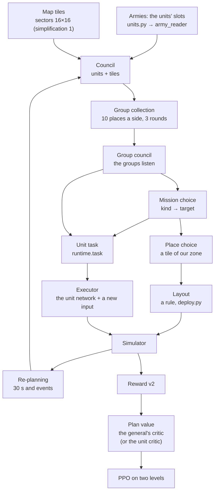

# The general's network (S28)

[← Back](README.md) · [Documentation](../README.md) › [Data for training](README.md) › The general's network · [Русский](../../ru/training/general.md)

The general is a network that makes the battle plan for the whole army: it splits the army into groups, gives each
group a mission and a deployment place, and the units (today's unit network, the "executor") carry it out themselves.
The agreed architecture (with the "why so and what was rejected" blocks) is the page `design/general/index.html`; this
page says what of it is in code (`tools/nn/general/`) and how it learns.

**Now:** the whole loop is built as a "skeleton" — from the plan to the weights' update, in the simulator. It is
switched on by `run.py --general` (or the chain's step `general`, [below](#running-it)). Some blocks are simplified —
[the list](#simplifications-of-the-skeleton); each simplification is a setting, not hard-wired code. In the real game
the general plays through the companion with the same code ([below](#in-the-game)); the deployment there is still
scripted.

## The whole loop



| Block of the design | Code | What it does |
|---|---|---|
| Armies | `units.py` (+ `army_input.py`) | the slots of all the battle's units: 45 numbers and 3 labels (as the "Armies" input); "come" = what is left now |
| Where a unit stands | `runtime.pos_of_obs` / `pos_of_state`, `net.POS_FEATURES` | 7 numbers a unit in the side's frame, as in the unit network's token: forward and sideways / 500 m, its facing (cos, sin), velocity forward and sideways / 5 m/s, "known". In a re-plan from the side's observation's tokens (an enemy where it was last seen; one never seen: zeros), at the deployment from the state (velocity 0). Nothing new from the game is needed: the game has the same fields (the bridge state's `x`, `z`, `b`) |
| Army analysis | `army_reader.py` | one network for all slots → the unit's card (`card` wide) |
| Map tiles | `tiles.py` | 256 sectors of 100 m with their 8 numbers, projected to the card's width + the tile's place + its centre (through the same layer as the units' positions: a unit and a tile compare by place). `--general-tile-feats v2` (default): the three numbers always 0 in the simulator (the enemy seen earlier; own and enemy routs) replaced by the strength of own shooters, of the enemy's shooters and of the enemy's fast units in the sector (`tiles.extra`, the strength's scale). `--general-tile-norm 1` (default): each number standardised over the map — less its mean over the tiles, / its spread, within ±5 (`General.tile_numbers`) |
| Council | `net.General.cards` | a transformer: units (card + position) and tiles, each asks each; the label own / enemy / tile; empty slots and tiles outside the map take no part |
| Group collection | `groups.py`, `net.SlotGroups` | **by default a rule** (`--general-groups rule`, [below](#group-collection-by-a-rule)): roles, within a role clusters by place, at most 10 groups a side, both sides alike; a group's card from its units (`SlotGroups.fixed`: the mean of the units' values through the GRU and the feed-forward; the keys, queries, sharpness, centring and stick take no part and learn nothing). `--general-groups net`: the learned collection — slot attention (keys and queries through a LayerNorm, × a learned sharpness `--general-sharp`, starting at 15 — a fresh general's main place share ~0.9): 10 places ours + 10 the enemy's, each with its own starting card; a unit splits itself 100 % between its side's places (the side mask); 3 rounds; the routing and the dead are in no group. A group is a place that is some unit's main place. The units' keys less a learned share of their side's mean key (`--general-center`, starts at 1): the places compete for the units by what tells the units apart ([why](#more-differences-from-the-design)). The unit's position is added to its key (its own layer `k_pos`): groups gather by place too, not only by type |
| Group numbers | `net.match_groups`, `net.renumber`, `SlotGroups.stick` | in a re-plan a unit holds on to its last group (a learned bonus on its logit, `--general-stick`); then the new groups are matched to the old ones by the units they share (greedily: the pair sharing the most units first; with nothing to tell, a place keeps its own number) and renumbered — a number `gN` holds while the group keeps its units; the prev card, the task and the log go by that number. The numbering (`perm`) is kept with the plan: the update computes the plan again with it |
| Group council | `net.Listen` | the groups listen to the tiles and to all groups; the tiles do not change |
| Mission kinds | `General.kinds`, `General.exec_kinds`, `config.MISSION_KINDS` | tables of learned cards with no input — **two**: `kinds` the general's (the kind choice's keys), `exec_kinds` the executor's (the task input; `--general-split-kinds 1`, default; a copy of `kinds` at the start): the executor's epochs do not move the general's choice; 6 kinds with a meaning ([below](#missions)): number, name, target types, what "done" is — in one place, `config.py` `MISSION_KINDS` |
| Carrying missions out | `mission.py`, `runtime.execute` | every decision a measure 0…1 for each unit with a mission, from the simulator's state ([below](#missions)); the executor's bonus goes into the unit's advantage |
| Teacher | `teacher.py` | (`--general-teacher P`) in a share of the battles a rule gives the missions, not the network; the general learns to imitate it (`--general-imitate`) ([below](#teacher)) |
| Mission choice | `General.decide` | step by step: kind (the group's card against the kinds) → one target; targets: our groups (not itself), their groups, the tiles of a coarse 4 × 4 grid (`--general-target-grid`, a 400 m tile = the mean of its 16 sectors after the council; at least one sector inside the map): ≤ 36 candidates; the enemy's groups do not choose. A kind takes only its target types (the `pair_ok` mask: the other pairs' logits are −∞); a kind with no target there (screen without another group of ours) is not chosen. In a re-plan the group's last kind's logit gets +B (`--general-kind-stick`, [below](#more-differences-from-the-design)). `--general-threat 1` (default): our group's card gets its threat numbers through a linear layer from zero before the kind and target (`General.threat`): the nearest enemy group's distance (/ 500 m, at most 3), log of the strength ratio own : that group (cost × health come, ±3), the shooters' share in ours and in that group, the share of the group's units in contact (an enemy within 40 m), "an enemy group there is"; and by a second layer from zero (`General.fight`) the share of the group's units **under fire** (a standing enemy not in melee is firing with this unit its target: the state's firing flag `fire` and target `target`; in the simulator the flag is on from the aim, in the game `IsFiringMissiles` and the engine's target `t`) and the share **in melee** (the flag `m`) - every unit's input `fight` (`Runtime.fight_of`). `--general-group-tiles 1` (default): **every** group's card (ours before the kind and target, the enemy's as a target's key) gets the numbers of the tiles under its centre - the same 8 numbers the council reads (after the standardisation), the tiles within 1.5 tiles of the centre weighted by exp(−d²/2), by a layer from zero (`General.group_tiles`). The path from the tiles to the choice is direct, past the council |
| Place choice | `General.decide` | in the battle's first plan only: a pointer to a tile of our zone |
| Layout | `deploy.py` | a rule: a line by the formations' widths on the group's tile, facing the enemy's centre; groups on one tile stand one behind the other; everything inside the zone |
| Unit task | `runtime.Runtime.task` | for each own unit: its group card (the mix of the places' cards by its shares; by default zeros, `--general-task-group 0`: the executor did not listen to it, KL 0.003; the width kept, older points load), its group's mission kind card (of the executor's table), the group's target (direction from where the unit faces, cos and sin; distance / 100 m, at most 20; a "none" flag) — 2 × card + 4 numbers |
| Executor | `executor.GeneralActor` | today's unit network; the task goes through a linear layer with zero weights and is added to the unit's token (as the commitment's input); enemies get nothing |
| Re-planning | `runtime.Runtime.replan` | every 30 s of battle; sooner when a group is broken (more than half of its units rout or are destroyed) or a lord falls (ours or theirs), but not sooner than 3 s after the plan. Between plans the groups, missions and targets are locked |
| Reward | `tools/nn/train/reward.py` | as now (v2); the bonus for carrying a mission out is not in the reward (only in the executor's units' advantage) |
| Plan value | `General.value` | predicts the plan's return from the plan's cards (detached); with `--general-return critic` the advantage's base is the unit critic, and it learns beside it |
| Missions that tell apart | `distinct.py`, `runtime.behave` | (`--general-distinct W`) a classifier guesses a group's mission kind from its units' behaviour; the executor's bonus, in units of its advantage's spread |
| Mission branches | `branch.py` | (`--general-branches P`) a copy of the battle "the same plan, one group with another mission kind"; the exchange's difference is the kind choice's price ([below](#mission-branches)) |
| Training | `learn.py`, `tools/nn/train/ppo.py` | [below](#training) |

Size at a card width of 128 (the chain's step): 1.14 million weights, at 64: 308 thousand (the unit network: 3.5
million).

## Group collection by a rule

`tools/nn/general/groups.py`, `--general-groups rule` (default). The learned collection was degenerate (the atlas of
g17r, `build/diag_atlas2/atlas.md`: one group for the whole army at the first plan, the group cards alike, shooters
mixed with infantry as at random), so while the general learns to choose its kinds by the battle a rule makes the
groups. It sees only the general's input (the army slots and the units' places) and is the same for both sides:

1. **Roles** by the unit's card: the lord and heroes (caste lord / hero); fast (a cavalry or chariot caste, or a run of
   ≥ 7 m/s); shooters (a missile range); melee — the rest.
2. **Within a role, by place:** the two clusters of a side and role whose centres are nearest join while the centres
   are closer than `--general-group-r` (100 m); one pair at a time.
3. **A lone lord or hero** (a cluster of one) joins the nearest melee group of his side whose centre is closer than
   `--general-lord-join-m` (60 m); else his own group.
4. **At most 10 groups a side** (`places`): while more, the side's two nearest clusters join (those of one role first).

The free units take part (alive, not routing); an enemy never seen stands at its zeros. The groups' numbers between
re-plans — the same `match_groups` by the units shared. A group's card reads its units' values less their side's mean
(`--general-group-centre 1`, default): the units' cards after the council are nearly alike, and without it so were the
groups'. The group council and the kind and target choices work on top
of the rule as before.

## In the battle

`tools/nn/general/runtime.py` — the plan of every side a network with a general plays (the learner, or a pool's past
version that has a general) is kept per row of the batch (as `rollout.Battles` keeps its rows).

- **Deployment** (a battle's start): the general plans on the armies and on the tiles of the scripted placement
  (`place.py`) — groups, missions, places; the rule puts the units on their groups' tiles. Scripted sides and old
  networks without a general stand as before. When a side's units do not stand in their zone (kite battles, drills)
  the placement stays scripted and the general only forms the groups and missions.
- **Re-planning:** the network runs the whole scheme again: the armies "now" (the men and health left), the units'
  positions and the tiles from the side's observation (the same numbers as the unit network's tokens and sectors), the
  group places start from their last cards; the new groups take the old numbers by the units they share
  (`match_groups`).
- **The unit task** is computed every decision (the target moves, the unit turns): a target group's point is the
  centre of its units now (as the side sees them), a tile's its centre (a fixed point of the plan). It is a function
  of the state, not noise: a unit that stands keeps its task.
- **Both sides** in battles against itself and the pool (when the pool's version has a general) use the general;
  against scripts only our side does.

## In the game

The companion (`tools/nn/companion/`, [bridge](../apps/bridge.md)) sees for itself that a checkpoint has a general and
plays with it. The general's code is the simulator's (`runtime.Runtime`), not a copy: `tools/nn/companion/general.py`
(`GameBattles`) turns the bridge's state into "a simulator batch of one battle" - the units in the state file's order
and exactly the fields `Runtime` reads:

- position, bearing (`b`), men, health share, morale state, visibility - from the game's state; a missing reading
  keeps the last one; men but no position - the unit has left the map (as the enemy's script reads it). The units'
  positions for the general in a re-plan come from the same observation the unit network reads (the velocity too);
- start health, cost, formation - the simulator's numbers for the unit's key;
- a lord fallen (dead, shattered or off the map) - as the simulator's `lord_dead_s`.

How the battle goes:

- **The plan** - at the battle's first state, on the armies and tiles of that state. The deployment stays the
  bridge's, as before: `deploy` in the game is always `script` (the bridge does not move units yet), the checkpoint's
  value is overridden. The general splits the army into groups and gives missions; it picks no places.
- **Re-planning** - the same rules: every 30 s of **battle time** (the state's `t`, so the game's speed-up x3-x10
  changes nothing), a broken group, a lord fallen; not sooner than 3 s after the last plan.
- **The unit task** - every decision (once a second of battle); it goes into the executor with the usual input.
- Without a general in the checkpoint (or with `--no-general`) the companion works as before, to the bit.
- The missions' measures are not computed in the game (there is no training there); no teacher.

Running it - as usual ([watch](../launch/watch.md), the exam): a checkpoint with a general switches it on by itself.
The companion's flags: `--no-general` - play without the general (the executor without a task); `--general-set
KEY=VALUE` - a field of the general's settings over the checkpoint's, e.g. `replan_s=20` (`deploy=net` is an error).

The companion's log - a line for every plan:

```
general plan 2 t 30.0 s (timer): 4 groups, enemy 3 | g0 [lord, spear_1, spear_2] kind withdraw -> g1 | g1 [...] kind hold -> tile 2_1 | ...
```

The plan's number, the battle time, the reason (`deploy` - the battle's start, `timer`, `broken`, `lord`), the number
of our and the enemy's groups, and per our group `gN`: its units, the mission kind (its name in `MISSION_KINDS`), the target - our group `gN`, an
enemy group `eN` (in brackets: how many units it has) or a tile `tile row_column` of the side's coarse 4 x 4 grid (the
row is forward). A group's number holds from plan to plan while it keeps its units. In `companion.jsonl` the decision
a plan was made at has the field `general`: the same in full (a group also has `kind_name`, the kind's name of
`MISSION_KINDS`), plus the enemy's groups `enemy` with their units. A unit without a passport - the line `general off: ...`, and that battle goes
without the general.

## Training

PPO on two levels (`learn.py`):

- **The executor** learns as before. The task's cards are computed again in the update from the chunk's plan table
  (`learn.task_for`) — with the gradient, so the executor's loss reaches the group council, the group collection, the
  council and the army readers. At every chunk's start the cards of the plans in force are computed again with the
  weights of the moment — the decisions' probabilities in the battle and in the update agree (test).
- **The general:** its choices (kind, target, place) are discrete and sampled; each own group is an agent with its
  own ratio of probabilities, all groups of a plan share its advantage = the plan's return − the plan value at the plan
  (normalised over the update's plans). The return is the reward summed from the decision to the next re-plan or the
  battle's end (`--general-return span`; the chain's step: `critic`, below). Plus an entropy bonus on each head apart:
  `--general-entropy-kind`, `--general-entropy-target`, `--general-entropy-place` (0.001 each). The plan value learns
  the return. The general's steps come **before** the executor's epochs, the same Adam (`--general-lr-mult` scales its
  step); 2 epochs of 512 plans. Before, because the executor's epochs move the general's weights too (the gradient
  through the task cards reaches 83 of its 108 tensors, and Adam steps ~lr however small the gradient): after them the
  plans' probability ratio did not start at 1 (clip 0.3–0.5 at `kl_plan` 0.02–0.06, `build/diag_clip`). The order's
  price: the executor's epochs start from task cards already after the general's step (the executor's probabilities in
  its first step are slightly not those of the play); the general's step is bounded by the KL 0.03 of its choices. The
  clipped share is logged apart for the plans begun in this chunk (`clip_fresh`) and the older ones (`clip_old`). A
  plan keeps the log-probability it was chosen with (`lp_plan`, the sum over the heads kind + target + place). **Old
  plans.** A plan lives up to 30 s, a chunk is 64 s, so ~40 % of the ended plans were begun in the previous chunk, that
  is by the previous policy (before the last update). With their ratio counted from `lp_plan` it is far from 1 from
  the first step and PPO clips almost all of them (g10: `clip_old` 0.6–0.8 at `clip_fresh` 0–0.06) — ~40 % of the
  general's data is lost. So the ratio is counted from `lp0` — the probability of **the policy at the update's start**
  (once, without gradients, before the epochs): for an old plan it starts at 1. The old plan's lag is a separate
  truncated weight on its advantage: `c = min(1, exp(lp0 − lp_plan))` (as in V-trace: the data are kept, the bias is
  bounded; a weight a group, on the same sum of the heads as the ratio). For a plan begun in this chunk `lp0` and
  `lp_plan` come from the same weights: `lp_plan` itself is taken and `c = 1`, the plain PPO to the bit (test). The
  old plans' mean `c` is logged as `stale_w`. The epochs stop when the KL a group from the policy at the update's
  start passes 0.03; the KL is the k3 estimate (r − 1) − log r, r = the probability now / at the update's start
  (`--general-kl k3`, default; `learn.kl_est`): never below 0. The old one, the mean log r (`k1`), went below zero as
  the policy sharpened (the atlas: −0.40) and the stop never came; the gap between it and the plans' own probabilities is logged as `kl_plan`.
- **The return by the unit critic** (`--general-return critic`, off by default). Why: with `span` nearly all of the
  return's spread (98.6 % in the analysis of the g1 points) is in the battle's last plans (±1 for the win), the
  deployment's return spreads ~0.004, and the plan value explains ~0 — the general has nothing to learn from. The unit
  critic explains 0.995 of the spread, so: the plan's advantage = the reward over the plan (decision k times γ^k) +
  γ^n · V(end) − V(start). V is the unit network's critic's value of the own side (one number a side: that is how the
  critic is built), γ the PPO's, n the plan's decisions. V(start) is at the plan; for the deployment's plan at the
  battle's first decision. V(end) is at the re-plan's decision that cut the plan; when the battle ended, 0, and the
  last reward (the win) is already in the sum. The plan value learns the same target beside it, but the advantage
  takes the critic's difference. The formulas: `signal.py` (no torch); the critic's value at a decision:
  `runtime.note_value` (computed before the decision's re-plans).
- **The executor's bonus for carrying out its mission** (`--general-exec W`, default 1; `--general-exec-decay N` —
  W down to 0 over N updates of the chain, default 0 — no decay). Why: while a mission kind is a number with no
  meaning, the executor has no reason to listen to it, and while it is deaf, the general's choice changes nothing and
  its signal is noise (a closed circle). How: every decision, after the simulator's steps, each own unit with a mission
  gets a measure m from 0 to 1 ([below](#missions)); the decision's bonus = W × (m − b), b the running mean of that
  kind's measure (every decision b ← b + 0.01 · (the decision's mean − b); a kind's first decision: its mean): it pays
  for doing it better than usual, not for easy missions. The bonus goes **into the unit's advantage only**: PPO adds to
  the side's (normalised) advantage each unit's own — (1 − γλ) · Σ (γλ)^j · bonus[t + j] to the battle's or the chunk's
  end (`signal.exec_advantage`, γλ the executor's PPO's: a horizon of ~10 decisions). The factor (1 − γλ): a steady
  bonus counts once, W = 1 gives a unit one advantage spread (the side's advantage is normalised) for a measure 1 above
  the mean; that is "W × (m − b) × σ" in the spread's units. Not into the reward: neither the unit critic nor the
  general's return sees it, the general gains nothing by picking easy kinds (test: with the bonus the reward, the
  values, the general's plans' targets and bases and the critic's step are those without it to the bit). Each unit is
  paid its own (the distinct bonus went to the whole side). The measures are computed and logged at any W (W = 0: not
  paid).
- **Teacher** (`--general-teacher P`): [below](#teacher).
- **Imitating the teacher** (`--general-imitate W`, default 0.3; `--general-imitate-decay N`: W goes down over N
  updates, default 300, its own counter in the point's `train` from the first update with imitation, to the floor
  `--general-imitate-min M`, default 0.15, not to zero; M is kept in the point's `train`, the option given on the
  command line goes over the saved one; W = 0 turns imitation off, the floor does not turn it on;
  `signal.imitate_weight`). The floor: the general's own signal is still weaker than the teacher's, and without the
  support the general drifts to worse plans ([Tried and rejected](#tried-and-rejected)). Why imitation at all: in g10 the
  general got only noise from the battle, its choice of kind drifted (46 % `flank`, the kind carried out worst, 0.13;
  the choice's dependence on the situation ≈ 0). How: on the teacher's plans its kind and target are known for every
  group it gave a mission. The teacher's groups are the ones the network collected (the teacher changes only the kind
  and the target), so everything matches: the general's network runs on those situations anyway, and their inputs
  (armies, tiles, prev cards, membership, numbering) are kept in the record as for its own plans. Every PPO step of
  the general adds W × the network's mean NLL of the teacher's choice to its loss: −(log π(the teacher's kind) +
  log π(the teacher's target | the teacher's kind)) over the groups the teacher gave a mission (`learn.imitate_term`;
  the place is not imitated — the teacher does not choose it). Pairs the network cannot choose (the mask) do not
  count. The gradient goes into the general's weights only (the executor is not in this loss, test). The teacher's
  plans still do not go into the PPO, the plan value, the classifier or the branches. The accuracy and the NLL are
  computed before the steps, at any W (W = 0: the log only).
- **The general's small bonus for carrying missions out** (`--general-exec-general S`, default 0.2). Each of our groups
  of a plan adds S × its centred measure over the plan to the plan's advantage: the mean over the plan's decisions and
  the group's units of (measure − the kind's running mean), the executor's bonus's own centring. Centring by kind
  removes the gain of "easy" kinds: only "can this be done here" is left. It is added to the plan's normalised
  advantage (spread 1), that is in units of its spread; the old plans take the same weight `c`. S = 0: the plain PPO
  to the bit (test). In a trial run (a fresh general): 0.01–0.04 of the spread a group.
- **The executor's bonus for missions that tell apart** (`--general-distinct W`, default 0 — off; with kinds that mean
  something the bonus for carrying them out took its place, it stays for comparison). Why: the executor
  hardly listens to its task (the input's weights 0 → 0.39 by a random walk; swapping the mission kind changes the
  decisions by a KL of 0.0006). How: over a plan the behaviour of each own group's units is summed
  (`runtime.behave`): the shares of the order kinds, the run share, the group centre's displacement forward and
  sideways (from the direction "our centre → the enemy's centre" at the plan's start, / 100 m), the centre's path, the
  plan's length — 10 numbers (`runtime.BEH`). A small classifier (`distinct.py`: 2 layers of 64, its own Adam, outside
  the network) guesses the group's mission kind from them. When the plan ends, each group gives W × (log q(kind |
  behaviour) − log(1/K)) × σ (K kinds; within ±ln K before the factor): 0 when the classifier guesses no better than
  chance, up to W · ln K · σ when it is sure and right. σ is the spread of the executor's advantage before its normalisation
  (the mean of PPO's `adv_std_attack` and `adv_std_defend`, running: 0.7 · old + 0.3 · new, at least 0.005; 0.06 before
  the first update — the number of the g1–g8 logs): the bonus is in the executor's signal's units, W = 1 pays a group
  one advantage spread for each nat of the guess. The bonus goes into the side's reward at the plan's last decision;
  not into the general's return. It is a reason to act differently under different kinds, not a payment for carrying
  a mission out. W goes down to 0 linearly over `--general-distinct-decay N` updates of the chain (600 by default; the
  counter goes on over the parts); σ is kept with the classifier in the point. The classifier learns after every update on the ended plans, also once W = 0 (its accuracy measures how much the
  behaviour depends on the kind). Its weights, Adam and the counter are in the checkpoint's `train`. A caveat: the kind
  is tied to whom the general gives it (cavalry, say, gets one kind more often), so part of the guessing is by the
  group's type, not by behaviour; an accuracy above chance does not yet mean the executor listens — read it with the
  task input's weight norm.
- **Mission branches** (`--general-branches P`, default 0 — off): [below](#mission-branches).
- **The kind head's own signal** (`--general-kind-own-signal 1`, the default): [below](#the-kind-heads-own-signal).
- **Start:** the executor takes the last unit network's weights, the new input at zero weights — it plays as before
  (test: the outputs are equal to the bit); the general from scratch.

The chunk's plan table: the plans in force during the chunk (carried over and new) — their inputs, membership,
choices. A transition keeps only the task's geometry, the "has a task" flag and the plan's number (not the cards:
~90 MB a chunk of 1024 battles × 64 decisions instead of gigabytes).

## Missions

The kinds: `config.py` `MISSION_KINDS` (number = the row of the kinds' card table; a new kind goes at the end). The
measure: `mission.py` (`measure`), every decision after the simulator's steps, for each own unit that decided, in a
group with a mission. It is the definition of "done", not a game mechanic: by the simulator state's truth (nothing is
hidden there). A target group is its units standing now (alive, on the map, not routing), its point their centre; a
tile's, its centre. near(d, R) = 1 within R, linearly to 0 at 3R.

| Kind | Target | Measure 0…1 |
|---|---|---|
| `attack` | an enemy group | 1 — in melee with a unit of the target (the state's `m` and `target`); else 0.5 × (1 − d / 300 m) to its **centre** (not to its nearest unit: a straggler running off is not the group; the measure by the nearest unit paid two units and the lord for chasing one crossbow 700 m off, `build/diag_skv`) |
| `hold` | a tile, our group | near(d to the target point, R): a tile's R is half its side (200 m: the tile itself), a group's 100 m around its centre |
| `flank` | an enemy group | as `attack` (closing on the centre), but only a blow off the target's front counts. In melee (`--general-flank-measure contact`, the default) — by the side the unit's contact with a unit of the target group **began** on: the state's field `hit_sec` (the same that gives the simulator's morale 'attacked in the flank / rear'): flank or rear — 1, front — 0. The angle now does not do for this: the struck unit turns to its attacker, and a good flank blow looks like 'into the front' a couple of seconds later. No contact side (the field 0 or absent — so in the game, where the measures are not computed), `angle`, and before melee — by the angle: the unit stands more than 45° from the facing of the target's unit it fights (or the nearest) — the struck unit's sides as in the simulator (`config/nn/sim.json` contact.front_deg 45: CA's front ±45°) |
| `screen` | our group | on the segment from the target's centre to the standing enemy nearest to it (projection 0…1 of the way) × near(the distance off the segment, 50 m) |
| `shoot` | an enemy group | a shooter (range and ammunition): 0 in melee, 1 shooting at a unit of the target, 0.5 the target within its range, else 0; no missiles: 0 in melee, 1 at 50–250 m of the target's nearest unit |
| `withdraw` | a tile, our group | 0 in melee, else 0.5 × near(d to the target point, R) + 0.5 × (distance to the nearest standing enemy / 300 m, at most 1) |

- **The pair mask** "kind × target": a kind is chosen only with targets of its types (the "Target" column); the other
  pairs' logits are −∞ (`net.General.pair_ok`), not "zero done". A kind with no target there (screen without another
  group of ours) is not chosen. Every target type is taken by ≥ 2 kinds (the mission branches need it). The masked
  share is logged.
- **Cohesion:** every measure × the unit's distance from its own group — 1 within 150 m of the centre of its standing
  units, linearly to 0 at 300 m (`COHESION_M`): a unit that has left its group does not carry out the group's mission.
- **The kinds' weights on the bonus** (`--general-exec-kind`, default `withdraw=2,screen=2`): the executor's bonus ×
  the kind's weight — "withdraw" and "screen" the executor carried out worst, they pay double; the others 1.
- **"Shoot" only for a group of shooters** (`GeneralConfig.task_mask`): the kind `shoot` is open to the general only
  when the units with a missile range on their card (`army_input` `range` > 0) are at least half of the group's units
  (`--general-shoot-share 0.5`, a rule kept in the point); else its logit is −∞ (`net.General.shoot_ok`). In the
  battle's analysis infantry without shooters got `shoot` — 28 % of the unit-seconds; with the rule "one shooter at
  least" 61–66 % of the units under `shoot` still had no missiles. Logged as `shoot_noshooter` (should be 0) and
  `shoot_units_nomissile`.
- **Not counted**: a unit whose target makes no sense now — a target group with no standing unit, a tile outside the
  map, `screen` without a standing enemy.
- The measure — the mean over the group's units and the plan's decisions — is logged per kind (`exec_<kind>`).

## Task masks

Code: `tools/nn/general/taskmask.py`, flag `--general-task-mask 1` (the default; the field `GeneralConfig.task_mask`,
kept in the point, a point without the field: 1). Why: the executor is not talked into its mission by a bonus, it is
**limited** to it — the mission cuts its action space. In the analysis of a lost battle (`build/diag_skv`) units under
"withdraw" went towards the enemy (cosine −0.44, 32 % of the time in melee), and under changing missions chased one
crossbow. A mask is logits of −∞ (the heads' `NEG`) before the softmax, as the general's (kind × target), for each own
unit with a mission, on the parts of the chained heads (`tools/nn/model/chain.py`: order kind → target → sector →
cell):

Each mask is a separate part, switched on by the list `--general-task-mask-parts` (the field
`GeneralConfig.task_mask_parts`, kept in the point; `all` every one, `none` none). **By default only the harmless ones
are on** (the "default" column), the harmful ones are off — why, in the table below and in
[Tried and rejected](#tried-and-rejected).

| Mission | Part | What is closed | Default |
|---|---|---|---|
| `withdraw` | `withdraw_attack` | the attack (and "keep" while an attack order is in force) | no |
| `withdraw` | `withdraw_move` | the move sectors — only those whose centre is no nearer the nearest seen enemy than the unit now, or nearer the mission's point while 300 m from the enemy | yes |
| `shoot` | `shoot_melee` | for a unit without missiles (the token's `ammo` 0) — the attack (and "keep" of an attack in force): a shooter's attack order in the simulator is to fire from its range (`battle.py` close_in), the others' a melee | no |
| `shoot` | `shoot_target` | a shooter's attack target only from the target group; moving free | no |
| `attack`, `flank` | `attack_target` | the attack target only the target group's units (the visible ones; none visible — targets free, a fall-back) | no |
| `attack`, `flank` | `attack_move` | the sectors no farther from the target group's centre than the unit now (at least 150 m): a charge is not cut | yes |
| `hold` | `hold_move` | the sectors within the point's reach (as in the measure: half a tile's side, 100 m of a group) | yes |
| `hold` | `hold_target` | the attack only at enemies within 3 × the reach of the point (where the measure is 0) | yes |
| `screen` | `screen_move` | the sectors near the segment from the target group's centre to the seen enemy nearest to it (50 m aside, between its ends) | yes |
| (general) | `shoot_group` | the kind `shoot` only for a group with at least the share `--general-shoot-share` of shooters | yes |
| `shoot` | `shoot_volley` | **the volley lock**: a shooter that fires or aims gets nothing but "keep" (no move, no other target, no "hold") until its volley (below) | yes |

**The volley lock** (`shoot_volley`). In the game any new order resets a shooter's aim (in the simulator too,
`missile.aim_reset_on_order`). In the g15 battle as the Empire (seed 1000920026, 0:10) the executor under `shoot` gave
~10 shooters a new move or another target every second: they aimed 1-3 s and never reached a volley. The lock:
- **when it is on:** the unit is under `shoot`, has ammunition and a reload on its card, and fires or aims — the token's
  `firing` flag (in the simulator and in the game it is on from the moment a standing shooter has taken a target in
  range and aims at it: the game's `IsFiringMissiles`). Not in melee and no seen enemy within `VOLLEY_FREE_M` = 50 m
  (centre to centre): then the unit is free — it may step back or turn (a rule of the mask, not a game number);
- **what is closed:** every order kind but "keep" (KEEP): the order in force goes on, nothing goes to the engine;
- **how long:** from the first decision the unit fires to the decision where a volley is seen (the token's
  `volley_ready`: the ammunition fell at this decision) — that decision is free: an order right after a volley costs
  least (the men reload anyway). From the next decision a new cycle. No volley — the lock is lifted after the cycle
  `cycle_s`: the aim (the larger of the first aim and the silence after a new target, `passport.aim`, the simulator's
  numbers from `sim.json`) + 1.3 × the card's reload (`reload_s` from the game's database; 1.3: the simulator's men are
  fully loaded after 1.1-1.3 reloads, `observation.py` VOLLEY) + one decision. An archer (reload 10 s, silence 8.5 s):
  22.5 s;
- **the clock** is the `Runtime`'s (`vl_t0` a unit; the battle time from `replan`, called every decision before the
  executor), the lock goes with the observation as `task_lock`, and the update computes the mask from the same record.
  A second call at the same time (the past slots' rows) gives the same lock; a battle begun again starts the clock
  afresh. The companion calls the same `Runtime`, so in the game the lock is the same. The bridge gives nothing on
  "keep" (`nn_keeps`), and an attack on the same target to a firing shooter it does not give anyway (`nn_aim_kept`,
  [the bridge](../apps/bridge.md)); the bridge's own interventions (a standing shooter without a target, an idle shooter)
  stay as they were.
- **Checked in the simulator** (the point g15 m40, trained without the lock; on the CPU, `ai_like` only, the same
  battles without and with the lock; `build/diag_volley`): 24 battles — the rating +0.68 → +0.94, wins 63 → 71 %; 48
  other battles — +1.23 → +1.30, wins 75 → 77 % (noise ±0.4-0.5: no difference to tell — the lock does no harm). 2-3 %
  of the units' decisions are under the lock; the shooters' firing share is the same (0.54 / 0.51): in the simulator
  the executor jerks firing shooters less often than in the game — the lock is first of all for the game.

**The parts checked at minute 0** (the point g13 m40, trained without masks; the `mandatory` evaluation on 256 battles
an opponent instead of 512, the same for all; the rating's noise ±0.16, but the variants play the same battles; under
mask — the share of the learner's unit decisions under a mask; fall-back — the share of those whose mask closed
everything):

| Variant | Rating | Δ to "no masks" | Exchange vs ai_like | Under mask | Fall-back |
|---|---|---|---|---|---|
| no masks | +0.77 | — | ×1.54 | 0 | 0 |
| every part | −1.31 | −2.08 | ×0.40 | 98 % | 0.08 % |
| `withdraw_*` (both) | −0.37 | −1.15 | ×0.80 | 39 % | 0 |
| `withdraw_move` | +0.84 | +0.07 | ×1.61 | 32 % | 0 |
| `shoot_*` | +0.58 | −0.19 | ×1.34 | 12 % | 0 |
| `attack_target` | +0.16 | −0.61 | ×1.06 | 50 % | 0.11 % |
| `attack_move` | +0.82 | +0.05 | ×1.58 | 52 % | 0.38 % |
| `hold_target` | +0.82 | +0.05 | ×1.55 | 0.8 % | 0 |
| `hold_move` | +0.80 | +0.03 | ×1.59 | 0.6 % | 0 |
| `screen_move` | +0.96 | +0.19 | ×1.60 | 3.5 % | 1.8 % |
| `shoot_group` | +0.84 | +0.07 | ×1.58 | — | — |
| the harmless ones without `withdraw_move` | +0.81 | +0.04 | ×1.49 | 62 % | 0.38 % |
| **the default** (the harmless ones with `withdraw_move`) | +0.78 | +0.01 | ×1.47 | 96 % | 0.29 % |
So the parts that **forbid fighting** (the attack closed, or the target only from one group) do harm, and the limits
on movement are harmless (under `withdraw` too: the harm is `withdraw_attack`, the sectors away from the enemy cost
nothing). No bug in the code was found (the point's, the units' and the sector centres' frames are one
— the side's frame; the masks are held by tests on hand-made observations); the harm is behaviour: the general picks
its kind nearly independently of the battle (in g10 the choice-situation MI was 0.03 nats), and the executor without
masks did not listen to it and so saved the army. With masks the general's poor choice is carried out literally: under
`withdraw` (21 % of the plans, 39 % of the unit decisions) a unit in melee cannot answer and runs under the blows,
under `attack X` it does not hit an enemy that is near and hitting it, under `shoot` infantry without missiles stands
idle. The harmful parts make sense once the general picks its kind by the battle (e.g. from the teacher), not from the
start.

A sector is judged by its centre with half its diagonal of slack (a 100 m sector: 71 m); the cell inside the sector
is free. The target pointer is shared with the spells: a target mask limits the unit's spells the same way.

- **Fall-back.** A part whose mask closed everything the unit had is not masked (`mask_fallback` in the log). A target
  mask that left the attack no target closes the attack (hold: nothing to fight near the point); for `attack`/`flank`/
  `shoot` a target group not seen leaves the targets free (a fall-back too).
- **The same masks in training.** The task's numbers per unit come with the decision's observation (`Runtime.task`:
  `task_mk` the kind or −1, `task_pt` the point in the side's frame, `task_reach` the reach, `task_tg` the target,
  `task_main` every slot's group number, `task_lock` the volley lock), are kept in the chunk's record, and the update computes the masks from that
  record: PPO's old probability is the masked choice's (test: the update's probabilities = the rollout's). The game
  (the companion) gets them the same way — one code.
- **The heads' code.** `taskmask.MaskedChainHeads` is `ChainHeads` with three lines of masks (the executor changes its
  heads' class, the weights are the same); `tools/nn/model` is not edited (it is in the simulator's version). A test
  holds the copy to the original's source (`SOURCE_SHA`): when `ChainHeads.forward` changes, carry it into the copy.
- **Off** (`--general-task-mask 0`): no mask numbers in the observation and no `shoot` mask at the general — the
  executor computes what it did, to the bit (test). A part not in the list closes nothing, and a unit under that kind
  does not count as "under a mask".
- **Update time.** The masks cost almost no time: in g14 the first 12 updates took 25–38 s (g13 without masks 22–32 s),
  the collection 48–62 s against 47–49 s. The growth to 160–250 s from update 13 is not the masks: the GPU's peak
  memory is the same (12.4–12.5 GB), and at the same time the "after" evaluation took 816 s instead of ~300 s —
  something else held the GPU.
- **Mission branches** change a group's kind together with its mask (`branch.swap_kind`).

## Teacher

Code: `tools/nn/general/teacher.py`, flag `--general-teacher P` (default 0). Why: a fresh general picks kinds nearly
uniformly, the executor learns to listen to missions on random plans; the teacher gives meaningful ones. In a share P
of the battles (drawn at the battle's start by its own generator — at P = 0 the training's random numbers are the
same) the learner side's missions come from the rule, the groups from the network. The rule (on the groups' standing
units), later over earlier:

- every group first **waits**: `hold` the tile it stands on while the nearest standing enemy unit is farther than
  250 m from its centre (`--general-teacher-hold-m`) and our shooters have been firing less than 30 s
  (`--general-teacher-fire-s`; the first volley's time is the row's `fire_t0`); then — `attack` the nearest enemy group
  (by the groups' centres). S27 waited and met the enemy (80 hold orders in the first 100 s against the general's 8,
  `build/diag_skv`); the old teacher sent everyone to attack from the first second. The switch comes at the next
  re-plan (every 30 s or on an event);
- a group of mostly shooters (range and ammunition) — `shoot` the nearest enemy group;
- one group — not shooters, without the lord, nearest to our largest shooting group — `screen` it;
- the lord's group, with a standing enemy within 150 m of the lord — `withdraw` to our largest other group;
- **the flank** (`--general-teacher-flank 1`, the default): (1) where two or more of our (not fast) groups attack one
  enemy group, the one nearest to the point in front of the target (100 m ahead of its centre along its units' mean
  facing) attacks (pins it), the others get `flank` of the same group if it is within 300 m of their centre; (2) a fast
  group (the role "fast" of `groups.py`: cavalry, chariots, a run of 7 m/s; not a shooting one) instead of
  `attack`/`withdraw` gets `flank` of the enemy group nearest to it that one of our non-fast, non-shooting groups pins:
  attacks it or holds (`hold`/`screen`) with its centre within 150 m of its centre. On the 32 generated check battles
  (teacher 1.0) neither side has cavalry, rule (2) never fires; `flank` is in 2.3 % of the teacher's plans (2.9 % of
  the plans with three or more groups), the `flank` measure 0.20. Without this rule the teacher never gave `flank`, the general
  picked it for 1–2 % of groups (and for ones that never reach the fight), the `flank` measure was 0.00
  (`build/diag_flank`); with `flank` forced the measure is 0.20–0.30 and blows from the side and rear are twice as
  frequent as under `attack` — the executor can flank, it lacked examples.

No enemy group — the network's choice stays. Every teacher's pair is one the general may choose itself (the target's
type by the kind; `shoot` only for a group at least half of shooters; `hold` a tile that is there), so the imitation never meets a
masked pair (test). The teacher's plans (`teach`) train the executor: they are in the chunk's
table — the executor's task cards are computed from them as from all. To the general they give only the imitation
(`--general-imitate`, [above](#training)): an ended teacher's plan is a record with its inputs, kinds and targets and
the mark of the groups it gave a mission (`use`; `batch["general"]["teach"]`). The general's PPO, the plan value, the
classifier and the branches do not see them. In the general's log numbers (`kinds`, `kind_share_*`,
targets, the mask) only its own plans; the measures — all the learner's plans. The teacher's share: `teach_share`.

## Mission branches

Code: `tools/nn/general/branch.py` (after the ability branches, `tools/nn/train/ability_branch.py`), the flag
`--general-branches P`. Why: the mission kind learns from the whole plan's advantage, one number for all groups of the
plan, and one group's kind is a small part of it. A branch gives the choice a fair price: "the same plan, but this
group with another kind".

- **Snapshot.** Every new plan of the learner (a re-plan or a deployment) is marked; at its first decision the battle
  is snapshotted with the chance P (as in the ability branches: the state before the simulator steps, the networks'
  memories after the decision, the decision's orders, the general's plans). At most `--general-branch-cap` (128)
  snapshots an update, evenly over the chunk's decisions and over the battle kinds (against a script, against a past
  version, against itself — their shares in the branch batch as in the main batch). One of the plan's own groups is
  drawn, and for each copy another kind. `--general-branch-kinds all` (default): any kind the general could give the
  group in that plan (not masked), each with its own target (`branch.alt_targets`): the group's target where the kind
  takes it, else the natural one of its types — attack, flank, shoot the nearest enemy group; hold the tile the group
  stands on; screen our nearest other group; withdraw to our nearest other group, without one to the tile 300 m behind.
  `target` (the old way): only the kinds that take the group's target as it is (an enemy group — attack, flank, shoot;
  ours — hold, screen, withdraw; a tile — hold, withdraw): the atlas of g17r found it biased — withdraw was compared only
  with hold and screen (whose mask keeps a unit from fighting far from the point), never with attack, and the branches
  pulled to withdraw. The kind: `--general-branch-alt teacher` (the default) — the kind and target the teacher would
  give this group in this battle now (the [teacher's](#teacher) rule, `Runtime.teacher_choice`; its clock "our
  shooters are firing" runs without `--general-teacher` too), in every copy. The price is then "how much better my
  choice is than the teacher's here": one comparison with a sensible swap, a lower spread than a random one. Where the
  teacher gives the group nothing, gives the kind the network chose, or a masked kind, the copies take a swap as
  `uniform` (their share: `branch_alt_fallback` in the log; "the teacher's second choice" is not used: the rule has no
  order of second choices). `uniform` — evenly of the candidates, `policy` — by the general's probabilities among
  them, the price's factor 1 − π(chosen) among them. `same` — a check, not a signal: "other" = the same kind with the
  same target, but from the second decision on the "another kind" copy runs with another seed (other draws of the
  networks and the simulator), so the group plays its kind again, differently. In the open loop the mean raw price
  (`branch_price_raw_mean`) is the loop's own bias, ~0 without the loop. Such branches are only logged: the kind term,
  the kind critic and the per-kind scale take none of them.
- **Play.** At the chunk's end, before the update, every snapshot in `--general-branch-copies` (4) copies, two batches:
  "as chosen" and "another kind" (the group's units' kind card = the other kind's card, the target its target; the
  groups, places the same), `--general-branch-horizon` (60) s on. The plan is locked in the copies (no re-plans: open loop for the
  general). The first decision is the snapshot's orders in both (made under the chosen
  kind): the other kind acts from the second second. Common random numbers as in the ability branches (one place in
  two batches of one shape, one seed a decision, one battle id): a swap to the same kind prices exactly 0 (test).
  `--general-branch-greedy`: the networks in the branches take their most likely action (less of the battle's chaos
  in the price).
- **Partial open loop** (`--general-branch-openloop 1`, the default). Why: in the closed loop (every unit of both sides
  in both copies decides anew every second) the copies drift apart within 10–20 s — one different sample, then
  everything differs; the 60 s price is nearly all noise (g20–g22: real share 0 in 5 of 9 updates, 0.2–0.37 in the
  others). How: every decision "as chosen" plays first and its orders are recorded (the learner's network, the past
  versions, the scripts, the step an order lands on — `ability_branch._recording_play`); "another kind" decides as
  usual (its own observation, its networks) but plays the "as chosen" orders for every unit except the swapped group's
  units (its membership at the snapshot), which keep their own new orders (`branch._openloop_play`,
  `branch.group_units`). Only the swapped group decides anew; the enemy and the rest of our army do what they did in
  "as chosen". A full open loop as in the ability branches (where "not pressed" decides nothing) is impossible here:
  the kind acts only through what the group's executor does with it. `0`: the old closed loop. Measured (CPU, the g22
  checkpoint, 32 battles, the same 64 snapshots, 4 copies, 60 s): the price's real share 0.56 against 0.075 in the
  closed loop, the copies' noise 0.008 against 0.013 of the budget; those are deployment snapshots (the first chunk).
  In the same run's later chunks (mid-battle plans, 64–72 snapshots) 0.18, 0.0, 0.37: noise stays from the swapped
  group's own samples (its executor samples differently under different kinds) — the next step if the share does not
  hold ≥ 0.4 on 1024 battles: `--general-branch-greedy` and/or a 30 s horizon.
- **The price** (budget share, from the general's side) = the mean over the copies of ("as chosen" − "another kind"):
  `--general-branch-price trade` — the exchange at the horizon, (the enemy's gold destroyed − own) / budget, as in the
  v2 reward and the ability branches; `reward` — the side's reward summed over the horizon. A price > 0: the chosen
  kind is better than the swap.
- **The price centred** (`--general-branch-center 1`, the default; `signal.RunningMean`). Why: in the partial open loop
  "as chosen" beats "other" by 0.0027 ± 0.0003 of the budget on average whatever the pair of kinds
  (`build/diag_kind_critic`: m[a, b] + m[b, a] < 0 in 28 of 30 cells). The cause is the loop itself: in "other" the
  group decides anew while the enemy and the rest of the army replay orders made for "as chosen" and cannot answer it.
  A bias, not a property of the kinds: by it better/worse is 0.2/0.35 in the open loop against ~0.5/0.5 in the closed
  one, and "the network worse than the teacher" 0.36 against 0.16. How: the running mean price over all pairs (the
  sums × 0.9 an update, ~10 updates; the update's rows added before it is read) is taken off every copy's price before
  the advantage, the kind critic and the log's better/worse and against-the-teacher numbers; the raw ones are logged
  beside them (`branch_price_raw_mean`, `branch_better_raw`, `branch_vs_teacher_price_raw` …), the mean itself is
  `branch_center`. Kept in the checkpoint's `train` (`general_kind`); the kind critic's buffer of prices of the other
  sort (centred or not) starts afresh on a resume. `0`: the prices as measured.
- **The kind choice's advantage** = the price; with `policy` the price × (1 − π(chosen)). With `teacher` the advantage
  = Q(kind) − Q(the teacher's kind): the baseline does not depend on the choice, except on the plans where the network
  already chose the teacher's kind (a random swap there) — that bias pulls to the teacher's kind where it beats the
  others, the same way as the imitation. With `uniform` and `policy` both are fair advantages:
  with `uniform` the price's mean = K/(K−1) × (Q(kind) − the mean Q over the kinds), with `policy` exactly Q(kind) − V
  (the formulas and their check: `signal.py`, a test without torch). The prices are divided by a scale and clipped to
  ±5. The scale is **each kind's own** (`--general-kind-norm per-kind`, the default; `signal.KindNorm`, as
  `--ability-norm per-ability`): the running root mean square of that (chosen) kind's prices over ~10 updates (the sums
  × 0.9 an update), a kind with few rows filled up to 32 rows with the update's mean square of all prices, at least
  0.005 of the budget; kept in the checkpoint's `train` (`general_kind`). Why: 64–128 rows an update over 6 kinds are
  10–20 rows a kind, the chunk's root mean square of them is mostly noise, and the kinds' scales differ. `chunk`: the
  old way, the chunk's root mean square of all prices.
- **Training.** Every PPO step of the general adds a clipped PPO term on the log of
  this group's kind probability (weight `--general-branch-weight`, 1, without the kind head's own signal; with it
  `--general-kind-weight` and the kind critic's rows, [below](#the-kind-heads-own-signal)) (`learn.branch_term`: the plan computed again from its record, the gradient reaches the
  cards, the councils and the army readers as the general's PPO does; targets and places are not touched). The old
  probability is the plan's own (the ratio starts at 1, test). The branches take only the plans made in this chunk,
  with one exception: a deployment at the last step of the previous chunk is captured at this one's first decision.
  Such a branch is an old plan and counts as the old plans above: the ratio from the kind's `lp0`, the weight `c`
  (`branch_stale_w`). The same number of steps, the same KL stop. `branch_clip` 0.15–0.40 in g9 does not come from
  old plans: the branch term is at most 64 rows, and every general step (10–14 an update) trains on the same rows
  again, so the ratio leaves the clip range within the update. The term's KL is the k3 estimate (`--general-kl`, as the
  KL stop's: never below 0; the old k1 went below 0, −0.009 in g22).
- **P = 0**: no branches, nothing changes (test: with branches and the term's weight 0 the batch, the battles and the
  weights after the update are the same to the bit as without branches).

What to keep in mind. The swapped group's executor plays on its own (otherwise the kind affects nothing); in the
ability branches the price of a "closed loop" over 60 s is nearly all noise (real share 0.07; over 30 s 0.16, over
20 s 0.52; [ability branches](training.md#abilities-by-their-effect-branches)), in the open loop 0.46–0.59. Watch
`branch_price_rel` in the log: the partial open loop's aim is ≥ 0.4; below ~0.2 — a 30 s horizon (also the plan's
length: a plan is re-made every 30 s) and/or `--general-branch-greedy`.

## The kind head's own signal

The aim: the general can learn its kind choice without imitating the teacher. The recipe is the one that made the
ability branches work ([there](training.md#abilities-by-their-effect-branches)): a fair price (the partial open loop,
above), a critic as a denoiser over the prices, the head with its own signal, a scale per kind.

- **The kind critic** (`--general-kind-critic 1`, the default; `tools/nn/general/kind_critic.py`, after
  `ability_critic.py`). A small separate network (2 layers of 64, dropout 0.2, its own AdamW; nothing of it reaches the
  general's network) gives Q of every kind (budget share) from the group's numbers. Its input is what the general sees
  of the group as fixed numbers, not its learned card (the buffer's rows stay comparable while the general learns):
  the threat and fight numbers (`net.THREAT`, `net.FIGHT`), the tiles under the group's centre (`net.group_tiles`), the
  group's size, our and the enemy's group counts, deployment — 20 numbers. A branch's price = Q(chosen) − Q(other), so
  the regression (Huber) is on that difference, copy by copy (each copy has its own other kind). The buffer: the last
  `--general-kind-critic-buffer` (25 000) prices, kept in the checkpoint's `train` (`general_kind`; prices of the other
  loop, open or closed, are not taken). Each update 32 steps; every 10th price is held out: on them the shrink s ∈
  [0, 1] (prediction = s × Q: where the network knows little the estimate falls to 0, "no kind is better") and ev. On
  (`critic_on`) once it has ≥ `--general-kind-critic-warmup` (1000, ~8 updates at 128 rows) prices and its held-out
  error is 2 % below "zero"'s. Then every own group of every ended plan (~8 500 groups an update instead of 64–128
  rows) gets the kind's advantage = Q(chosen) − Σ π0(k) Q(k) (π0: the general's policy at the update's start over the
  kinds it could take: a baseline independent of the choice, as COMA's), divided by the kind's scale (`KindNorm`),
  clipped to ±5.
  The critic does not learn on the branches' prices (`build/diag_kind_critic`): ev ≤ 0.015 whatever the settings
  against a ceiling of 0.43 (the price's real share); its 20 numbers carry no part of the price that depends on the
  kind, and Q(a) − Q(b) cannot represent the open loop's steady shift (above, "The price centred"). So it works only
  under `--general-kind-q branch`, and learns only there.
- **The outcome Q** (`--general-kind-q outcome`, the default, or `both`; `tools/nn/general/kind_q.py`). Why: a branch
  prices one group of ~5 % of the plans (~124 rows an update, a copy's noise 0.022 of the budget; a direct signal
  needs ~500 branches an update — dear), while here a sample is every own group of every ended plan (~2 500 plans × ~3
  groups), its outcome taken from the recorded battle itself, with no replay.
  - *The outcome*: the side's exchange over `--general-kind-q-horizon` (60) s of battle since the plan began: (the
    enemy's gold destroyed − own) / budget, as the branches' `trade` price (`Runtime.side_trade` =
    `ability_branch.trade`). The battle's next plans play in the window (Q of the policy). A battle over sooner: the
    exchange at its end (final by then), marked `ended`. `Runtime` keeps it (`q_h`): the exchange at the plan's start,
    the one at the horizon if the plan is still in force; an ended plan gets an id `qid` and waits until the horizon
    passed or the battle ended; `end_chunk` gives the chunk's known outcomes (`q_out`) with the battle's number `bid`
    (every battle started gets its own, both sides one). A battle restarted in the same slot moves its epoch: an older
    battle's outcome there is dropped. A plan's features wait for its outcome at most the horizon in chunks + 2 chunks
    (`kind_q.wait_chunks`: 3 at 60 s and 64 decisions); those that never got one are `kind_q_lost` in the log. The
    battles and the batch are the same to the bit as without it (test).
  - *The input*: everything the kind head sees when it chooses, else the choice depends on what Q does not see and
    Q(chosen) is biased: the group card the kind head reads (`decide` → `query`: after the group council and the
    threat, fight and tile layers), detached from the gradient; the kind critic's 20 numbers; the kind's inertia (the
    group's last kind where it kept its units, `General.prev_kind_hot`, what `kind_stick` is added to); the kinds the
    group may take (`kind_ok`, 6 numbers: Q(attack) is not learned together over groups that may and may not shoot).
    A separate
    network on this input rather than a head on the general's body: the general's network, its checkpoints and the
    game do not change, the buffer gives an update ~4 updates of data instead of one, and the cards' staleness in it
    is bounded by its length (`--general-kind-q-buffer` 30 000 groups ≈ 4 updates).
  - *The network*: 2 layers of 128, dropout 0.1, its own AdamW; the inputs standardised by the first fit and not
    adjusted after (a known limit: the general's cards drift with time, the standardisation does not), the target in
    units of the first fit's root mean square outcome. Each update 64 Huber steps of Q(chosen) ≈ the outcome. Held
    out: every 10th **battle** whole (`kind_q.held_out`): all its plans and both its sides. Not by plan: a plan is
    re-made every 30 s with a 60 s window, so the group's next plan shares half the held-out one's window and often its
    kind (the inertia), and in a battle of the network with itself the other side has the same outcome with the other
    sign — ev and the shrink came out too high.
  - *The gate*: Q is on (`kind_q_on`) once it has ≥ `--general-kind-q-warmup` (10 000, ~1.5 updates) groups and
    held-out ev ≥ `--general-kind-q-ev-min` (0.05). *The shrink* s (`--general-kind-q-shrink 1`): on the held-out plans
    the coefficient c of A in outcome ~ 1 + V + A (V = Σ π Q, A = Q(chosen) − V) less two of its standard errors
    (`kind_q_coef_se`, by battle: a battle's plans, groups and sides are tied), within [0, 1] — how far Q's part that
    depends on the kind is borne out by the outcomes (nearly all of ev is the situation's part V, which the kind head
    never sees). The point c jumps ±0.3 when the kind's part is small, and noise got a shrink near 1 at times.
  - *The advantage*, as the kind critic's: Q(chosen) − Σ π0(k) Q(k) (COMA), Q × s, divided by the kind's scale — the
    running root mean square of its groups' A over ~10 updates (`KindNorm` over the advantages, `--general-kind-norm
    per-kind`; `chunk`: over all the update's groups), at least 1·10⁻⁴; clipped to ±5. The head gets an advantage of
    about s.
  - *The agreement with the branches* (`kind_q_agree`): for the update's branch rows, the correlation of Q(chosen) −
    Q(other) (the mean over the copies' kinds) with the branch's centred price. > 0: Q and the branches say the same.
- **The kind signal's source** (`--general-kind-q`): `outcome` (the default) — Q alone; the branches (when on) are
  played, centred and logged (the agreement, the `same` mode) but train nothing; until Q is on the kind term is empty
  (only the imitation trains the head). `both` — the kind term = the mean over Q's groups + `--general-branch-weight` ×
  the mean over the branch rows (the branches have their own weight; until Q is on, the branches alone). `branch` —
  the old way: the branch rows and the kind critic's groups together, the mean over all rows; the kind critic learns
  only here.
- **The kind term**: clipped PPO on the kind's log-probability over the branch rows (their measured price) and the
  ended plans' groups (Q's or the critic's estimate), as said above. (A branch is also a group of a plan that ends
  later: such a group counts twice; ~2–5 % of the groups.)
- **The kind head out of the plan's PPO** (`--general-kind-own-signal 1`, the default). The kind's log-probability is
  taken out of the plan's PPO ratio: the plan's advantage (one number for all groups) trains the target and the place
  only. The kind learns from the kind term with the weight `--general-kind-weight` (1, no decay) and the imitation
  (while there is one). The kind head (`kind_q`, `kinds`) steps at `--general-kind-lr-mult` (2) × the general's lr
  (its own Adam group, `run.optimizer`), and `--general-kind-epochs` (2): after the PPO epochs one more pass over the
  kind term in which only the kind head moves (test: the other weights the same to the bit), with its own KL stop (k3
  > 0.03). `0`: the old way, the kind in the plan's PPO + `--general-branch-weight` × the branches' term.

## Simplifications of the skeleton

Each is a value of a setting (`GeneralConfig`, `run.py` flags); the values of the full version, which is not built
yet, are refused with a `NotBuilt` error (the network never thinks it has what it has not).

| # | Simplification | Flag (now) | The full version |
|---|---|---|---|
| 1 | the map tiles are today's 16 × 16 sectors of 100 m (8 numbers), projected to the card's width | `--general-tiles sectors` | `cnn`: the map analysis's 1024 tiles (`map_cnn.py`) |
| 2 | the effects are not connected: the effect cards are zeros | `--general-effects off` | `on`: the effects' analysis |
| 3 | small widths: council 2 layers, group council 1 layer, card 128 (the chain's step; `run.py`'s default 64), 4 heads | `--general-card 128 --general-council-layers 2 --general-group-layers 1 --general-heads 4` | settled by the checks |
| 4 | the bonus for carrying missions out is on (the executor's and a small one the general's), imitating the teacher is on (it acts when the teacher is on); the mission branches, the bonus for missions that tell apart and the teacher are built but off by default; the entropy bonus on the choices is on, per head | `--general-exec 1 --general-exec-general 0.2 --general-imitate 0.3 --general-imitate-decay 300 --general-teacher 0 --general-branches 0 --general-distinct 0 --general-entropy-kind 0.001 --general-entropy-target 0.001 --general-entropy-place 0.001` | branches: `--general-branches P` ([above](#mission-branches)); the distinct bonus: `--general-distinct W` ([above](#training)); the teacher: `--general-teacher P` ([above](#teacher)) |
| 5 | the deployment zone is the area `place.py` deploys an army in (forward from −260 to +40 m of the side's line, sideways ±150 m); a tile is in the zone when its centre is; the layout inside a group is a rule | `--general-zone place`, `--general-deploy net` (`script`: the scripted placement as before) | `map`: the zones from the map's layers |

More differences from the design (skeleton too):

- **the group collection's keys less a share of their side's mean key** (`--general-center 0.7`, the share learns;
  `0`: none). Without it a fresh general put nearly all units into one or two groups (the common part of one army's
  keys outweighed the differences). My decision; the design page does not have it;
- **the group collection's sharpness** (`--general-sharp 15`): keys and queries through a LayerNorm with no weights of
  its own, their product / √card × a learned sharpness (kept as a log, starts at 15). Measured on real armies
  (`build/gfix/slotproto.py`, 96 sides, a fresh general): a unit's main place share 0.87–0.92 (0.79–0.82 at 10), the
  cosine of a plan's group cards 0.76–0.88, ~3.4 groups a side of ~3.6 units (with a centring of 1: ~6 groups of ~2,
  46 % of one unit; without centring ~2.3 groups of ~5);
- **the groups' inertia in a re-plan** (`--general-stick 1`): a learned bonus is added to the logit of a unit's last
  group (the place that starts from its card) — a unit stays unless the attention clearly prefers another place. In a
  trial run (6 updates) `group_churn` 0.47 → 0.13;
- **the kind's inertia in a re-plan** (`--general-kind-stick B`, default 1; a rule, not a weight: saved in the point
  with `GeneralConfig`, the option goes over it): the logit of the group's last kind gets +B
  (`net.General.kind_bonus`). "The same group" is the same number and at least one unit shared with that number's last
  group (a number a new place got by default is not the same group). The last kind is the plan's input `prev_kind`
  (kept in the record, so the update computes the probabilities again with the same bonus). The kind is chosen before
  the target, so "the last kind is allowed" is the kind's mask: with no target of its types now it stays closed. Why:
  in g10 the kind of the same group changed at 57 % of the re-plans. B = 1 on a near-uniform choice of 6 kinds gives
  the last kind ~0.35 (a fresh general in the trial: `kind_switch` 0.55–0.69), B = 2 ~0.6. B = 0: as before to the
  bit (test). One code for the simulator and the game (`Runtime.inputs`);
- the slots are the battle's own slots (up to 80, their order means nothing: the network does not depend on it —
  test), not "40 own + 40 enemy";
- a hidden enemy counts as full (the simulator hides nobody);
- the re-planning's events are only 30 s, a broken group, a lord's fall ("mission done" and "reinforcements" — no);
- "broken" counts destroyed units too, not only routing ones;
- in the ability and the mission branches the plan is frozen (no re-plans in a branch's 60 s);
- in a mission branch only the group's kind changes; the targets and the place chosen under the old kind stay;
- the formation (width, depth) is not chosen — as in the scripted placement;
- the unit critic does not see the plan.

## Numbers in the log

The run's `log.jsonl`, field `general` (and the `general:` line of the output):

| Number | What |
|---|---|
| `groups_own`, `groups_enemy` | groups a plan a side (places that are some unit's main place) |
| `kinds`, `kind_entropy` | the shares of the mission kinds of our groups and this histogram's entropy (at most ln 6 = 1.79) |
| `kind_share_<kind>` | the same by the kinds' names |
| `masked_pairs` | the share of the "kind × target" pairs the mask closes, of all kinds × the targets there are |
| `exec_<kind>` | the kind's mean measure a unit and decision (0…1; all the learner's plans, the teacher's too) |
| `exec_base`, `exec_units`, `exec_weight` | the measures' running means by kind (the bonus's base), unit-decisions measured, W now |
| `exec_bonus`, `exec_bonus_abs` | the bonus a unit-decision: signed (≈ 0 by its construction) and its magnitude |
| `exec_adv_mean`, `exec_adv_std`, `exec_paid` | the unit's own part of its advantage from the bonus (in units of the side's normalised advantage, whose spread is 1) and the share of unit-decisions paid |
| `teach_share` | (`--general-teacher`) the share of the learner's plans the teacher made |
| `mask_share` | the share of the learner's deciding unit-decisions a task mask acts on |
| `mask_fallback`, `mask_fallback_n` | the share of them where the mask closed everything and fell back (and the number) |
| `volley_lock` | the share of the learner's deciding unit decisions under the volley lock (`shoot_volley`) |
| `shooters_firing` | the share of our shooters' (with ammunition) decisions when they fire or aim (the `firing` flag) |
| `shoot_noshooter` | the share of the groups with the kind `shoot` without a single shooter (all the learner's plans; with the mask 0) |
| `shoot_units_nomissile` | the share of the unit-decisions under `shoot` of units without missiles (infantry in a shooting group) |
| `imitate_nll`, `imitate_acc_kind`, `imitate_acc_target` | (`--general-teacher`) on the teacher's ended plans, before the steps: the network's mean NLL of the teacher's choice (kind + target), the share of groups where the network's most likely kind is the teacher's, and where its most likely target (under the teacher's kind) is the teacher's |
| `imitate_groups`, `imitate_rows`, `imitate_w`, `imitate_loss` | groups and teacher's plans in the imitation, W now, the imitation's term (the mean over the steps; only at W > 0) |
| `exec_general_term`, `exec_general_mean` | (`--general-exec-general`) the mean addition S × centred measure to a group's advantage: absolute and signed, in units of the plan advantage's spread |
| `target_group`, `target_own`, `target_enemy`, `target_tile` | the targets' shares: a group (ours or theirs), our group, an enemy group, a 4 × 4 tile |
| `group_churn` | the share of our units whose group number changed at a re-plan (of those in a group before and after) |
| `kind_switch` | the share of our groups (the number alive before and after a re-plan) whose mission kind changed (the teacher's plans included) |
| `places_top` | the most chosen deployment tiles (`row_column` of the side's 16 × 16 grid: the row is forward) |
| `deploy_net_share` | the share of deployments made by the general (the rest scripted: the zone did not fit) |
| `replans_per_battle`, `replan_reasons` | re-plans a battle (of the battles that ended during the update) and by reason (timer, broken group, lord). It grows with the battle's length: all battles start together, in the first updates only the short ones end (g10: 10 a battle at ~5 min battles, 20–22 at ~10–11 min; the battle's limit is 3600 s, not 600) |
| `replans_per_min`, `battle_min` | re-plans a minute of the same battles (~2 at 30 s plans, above it — the events) and their mean length in minutes |
| `value_mse`, `value_ev` | the plan value's error on the update's plans (before the step) and its explained share |
| `critic_ev` | (`--general-return critic`) the explained share of the plan's target by the unit critic's value at the plan's start |
| `return_mean`, `return_std` | the mean and the spread of the plan's target (return) |
| `adv_mean`, `adv_std` | the mean and the spread of the plan's advantage before its normalisation (target − base: the critic or the plan value) |
| `task_in_w`, `task_in_group`, `task_in_kind`, `task_in_geo` | the executor's task input's weight norm: all, the group card's columns, the kind card's, the targets' geometry's — how much the executor listens to its task |
| `distinct_acc`, `distinct_chance`, `distinct_gain`, `distinct_loss` | (`--general-distinct`) the accuracy of the classifier of kinds by behaviour on the update's plans (before its steps) and chance (1/K); the mean log q + ln K (the bonus without W); its loss |
| `distinct_bonus`, `distinct_weight`, `distinct_scale` | the mean bonus paid a group, W now and σ (the executor's advantage spread) |
| `pl`, `ent`, `kl`, `clip` | the general's PPO: loss, the choices' entropy a group (the heads' sum), KL from the policy at the update's start, clipped share |
| `clip_fresh`, `clip_old`, `fresh_share` | the clipped share of the plans begun in this chunk and of those begun earlier; the first ones' share of the ended plans |
| `stale_w`, `branch_stale_w` | the mean weight `c = min(1, exp(lp0 − lp_plan))` of the old plans (their groups) and of the old branches; 1 — the plan did not lag |
| `ent_kind`, `ent_target`, `ent_place` | the entropy per head a group (the kind's at most ln 6 = 1.79, the target's ~ln 36 = 3.6 without the mask; the place's only at a deployment) |
| `kl_plan` | the KL from the probabilities the plans were chosen with to the policy at the update's start (how much "older" the plans are than the policy) |
| `branch_plans`, `branch_branches`, `branch_taken_share` | (`--general-branches`) the learner's new plans a chunk, how many were played as branches, their share |
| `branch_price_mean`, `branch_price_std`, `branch_price_rms`, `branch_price_se`, `branch_gold_mean` | the kind choice's price (budget share): mean, spread between branches, root mean square, the copies' noise; the mean in gold |
| `branch_price_rel` | the real share of the prices' spread: 1 − the copies' noise of the mean / the prices' spread (the ceiling of what in the price is not noise) |
| `branch_better`, `branch_worse` | the share of branches where the chosen kind is better than the swap (price > 0.002 of the budget) and worse (< −0.002) |
| `branch_alt_fallback` | (`--general-branch-alt teacher`) the share of branches whose swap is a random one, not the teacher's (the teacher gave the group nothing, the same kind, or a masked one) |
| `branch_vs_teacher_better`, `branch_vs_teacher_worse`, `branch_vs_teacher_n`, `branch_vs_teacher_price` | of the branches against the teacher: the share where the network's choice beats the teacher's (price > 0.002 of the budget) and loses (< −0.002), their number, the mean price |
| `branch_battles`, `branch_battle_s`, `branch_seconds`, `branch_weight_mean` | battles in the branches, battle seconds, wall seconds; the price's mean factor (1, with `policy` 1 − π) |
| `branch_loss`, `branch_kl`, `branch_clip`, `branch_rows` | the branches' term in the general's PPO: loss, the kind's KL (k3), clipped share, rows |
| `branch_norm_rms_<k>` | (`--general-kind-norm per-kind`) kind k's price scale after the update (the kind's number), budget share |
| `branch_critic_samples`, `branch_critic_on`, `branch_critic_ev`, `branch_critic_shrink`, `branch_critic_val`, `branch_critic_base`, `branch_critic_train`, `branch_critic_s` | the kind critic: prices in the buffer, on or not, the explained share of the held-out prices' spread, the shrink, the held-out error and "zero"'s, the training error, seconds |
| `kind_loss`, `kind_kl`, `kind_critic_groups`, `kind_critic_adv_std`, `kind_critic_adv_mean` | the kind term with the critic's groups: loss, the kind's KL (k3), groups with an estimate, their advantage's spread and mean |
| `kind_own`, `kind_extra_kl`, `kind_extra_steps` | the kind head's own signal (1/0); the extra pass over the kind head: KL, steps |
| `branch_center`, `branch_price_raw_mean`, `branch_better_raw`, `branch_worse_raw`, `branch_vs_teacher_*_raw` | (`--general-branch-center 1`) the running mean price taken off; the raw mean price and the raw better/worse and against-the-teacher numbers (without `_raw`: centred) |
| `branch_same` | (`--general-branch-alt same`) 1: the branches are the loop's check; the loop's bias is `branch_price_raw_mean` |
| `kind_q_samples`, `kind_q_matured`, `kind_q_waiting`, `kind_q_ended_share`, `kind_q_span_s` | the outcome Q: groups in its buffer; plans whose outcome came in the update; plans waiting for theirs; the share of outcomes whose battle ended before the horizon; the window's mean length, s |
| `kind_q_lost`, `kind_q_orphans` | plans whose features did not live to their outcome; outcomes that came without features (after a resume) |
| `kind_q_held`, `kind_q_ev`, `kind_q_ev_kind`, `kind_q_coef`, `kind_q_coef_se`, `kind_q_shrink`, `kind_q_on` | on the held-out battles: groups; the explained share of the outcome's spread (the gate); the share of what V leaves that A explains; A's coefficient and its standard error by battle; the shrink (c − 2 errors); on or not |
| `kind_q_agree`, `kind_q_agree_n` | the correlation of Q(chosen) − Q(other) with the update's branches' centred price (> 0: they agree), rows |
| `kind_q_y_mean`, `kind_q_y_std`, `kind_q_train`, `kind_q_val`, `kind_q_base`, `kind_q_adv_rms`, `kind_q_scale_<k>`, `kind_q_seconds` | the buffer's outcomes (mean, spread); the training, held-out and the mean's errors; the update's groups' root mean square A; kind k's scale; seconds |

The mandatory ones (rating, pair gold, own lord deaths) are in the `test5` evaluations as before.

## The step's cost

Measured on the GPU (RTX 5070 Ti; line S27's options with the fighters lab and the ability branches; 1024 battles, 64
decisions an update; the same battles in both runs): an update (collection + PPO step) **48.3 s without the general,
54.1 s with it (card 128) — +12 %**; +14 % while no battle ends, +10.5 % once battles end and deploy again. Collection
27.8 → 30.5 s, the step 20.5 → 23.6 s, the GPU's peak memory 11.5 → 12.3 GB. With a card of 64 the same (+11.6 %):
the cost is nearly all fixed (small operations, reads from the GPU, the layout on the CPU), not the width, so the
chain's step uses 128. The runs: `build/nn-train/runs/gen_cost_*` (not in Git).

In the trial training (10 and 12 min, from `itS27_4`): no NaN, no skipped steps; 3.6–4.0 groups a side (with the mean
key taken off), all 10 mission kinds in use (entropy 2.18–2.29 of 2.30); ~20 re-plans a battle (timer ~80 %, broken
groups ~17 %, lord ~3 %); the general's KL 0.005–0.018; the plan value explains nothing yet (share ≈ 0: a 30 s return
is mostly noise; see `--general-return critic`).

**Mission branches — an estimate, not a measurement.** What costs is the number of decisions in a row, not of battles
(a GPU step is launches: 64 and 512 battles cost about the same). A branch batch is 2 × horizon / 1 s decisions in a
row; with `--general-branch-cap` ≤ `--general-branch-batch` one batch an update, and P hardly changes the cost (the
learner's new plans are several thousand an update, ~50–90 a decision; at P ≥ ~0.05 the cap is already filled). The
ability branches on the same machine: 2 × 60 decisions, 5.6–7.8 s an update (1024 battles); the mission branches at
64 snapshots × 4 copies are 512 battles a batch, a decision ~14 % dearer (the executor's task) → **~6.5–9 s, +12–17 %
of 54 s** at a 60 s horizon, **~3.5–4.5 s (+6–8 %)** at 30 s. The first update: ~50 s more to compile the batch's new
shape (once a run).

## Running it

The chain's step `general` in `config/train-chain.json` (`steps.general`): the options of line S27
(`build/steps/v2_iterW.sh` + `train_extra_S.txt`: reward v2, armies v2, ability branches with their own signal, the
fighters lab, the pool of S networks) over `test5`'s protocol (its `--small`, step size, entropy and anchor undone),
and the general. The exam's opponent `itS27_4` is pinned in a slot of its own: 0.65 of the past battles, ~31 % of all
(`--past-pin`, outside the pool: [the pinned opponent](training.md#past-versions)). The evaluations: the mandatory set and,
at the step's last point, [the exam's proxy](training.md#the-exams-proxy) (the profile `mandatory,exam`: the network
against `itS27_4` on the exam's 6 seeds, defending, with the fighters; ~7 min). The command from the unit network's last
point:

```bash
.venv/Scripts/python -m tools.ops.step --label g1_general --from build/v2/itS27_4.pt --step general
```

The chain's step already runs with `--general-return critic` (the advantage by the unit critic) and with the bonus for
carrying missions out (`--general-exec 1` — the option's default; stronger: `--set general-exec=2`; the teacher:
`--set general-teacher=0.3`; with the teacher the general imitates it, `--general-imitate 0.3` down to `--general-imitate-min 0.15`
over 300 updates — the default; the branches (`--set general-branches=0.2`) compare the network's choice with the
teacher's by default (`--general-branch-alt teacher`); the general's small bonus `--general-exec-general 0.2` and the kind's inertia `--general-kind-stick 1` —
the defaults; the task masks `--general-task-mask 1`, the kinds' weights on the bonus `--general-exec-kind
withdraw=2,screen=2`, the teacher's waiting `--general-teacher-hold-m 250 --general-teacher-fire-s 30`, the teacher's flank
`--general-teacher-flank 1` and the flank measure by the contact's side `--general-flank-measure contact` — defaults too). The points g1–g9 (10 abstract kinds) do not load with today's code (6 kinds): a new line
starts from `build/v2/itS27_4.pt`. The bonus for missions that tell apart goes over the step: `--set general-distinct=1` (W 1 down to 0 over 600 updates). Its scale:
~20 plans a battle × ~4 groups × the classifier's gain × W × σ — at a gain of 0.3 and σ 0.06 that is ~1.4 a battle
against the battle return's spread of ~0.8, and ~0.3σ a group at the plan's last decision; watch `distinct_bonus` and
`distinct_scale` in the log.

Mission branches: `--set general-branches=0.2` (the rest by default: 4 copies, 60 s, up to 128 snapshots an update,
the partial open loop, the other kind the teacher's, the price by the exchange, centred, the scale per kind, the kind
head's own signal with weight 1, lr × 2 and 2 passes, the head taught by the outcome Q over 60 s —
`--general-kind-q outcome`, the branches only measure; to teach by the branches too: `--set general-kind-q=both`). Shorter and cheaper: `--set general-branch-horizon=30`. The loop's bias check: `--set
general-branch-alt=same` (the raw price in the log; trains nothing). The old behaviour: `--set general-kind-q=branch
general-branch-center=0` (and before that `general-branch-openloop=0 general-kind-critic=0 general-kind-norm=chunk
general-kind-own-signal=0 general-branch-cap=64`).

`--from <file>.pt` (new): a line's point outside `test5` — it is the `--init`, the `--reference` and the
`--critic-init` (Adam and the counters go on). `--step NAME` (new): a named step's options over the standing ones.

**A point that already has a general.** Its settings (`GeneralConfig`) are saved in the point and taken from there. A
rule's option given on the command line goes over the saved value: `--general-deploy`, `--general-replan-s`,
`--general-replan-min-s`, `--general-rounds`, `--general-zone`, `--general-kind-stick` (a point without the field: 1),
`--general-task-mask` (a point without the field: 1), `--general-shoot-share` (a point without the field: 0.5), the atlas's repairs `--general-groups`, `--general-group-r`, `--general-lord-join-m`, `--general-split-kinds`, `--general-tile-feats`, `--general-tile-norm`, `--general-threat`, `--general-task-group`, `--general-group-tiles` (a point without these fields — g15–g17r and before — plays as before: `net`, 0, `v1`, 0, 0, 1; on loading the line `general: a checkpoint saved before the atlas's repairs`; the new weights — the executor's table `exec_kinds` (a copy of the point's `kinds`) and the threat layer (zeros) — load fresh, Adam afresh for them; the fight's layer `fight_in` and the tiles-under-the-group layer `gtile_in` of a point without them are zeros, on loading the line `general: a checkpoint without the layers …`: the point plays as before until they learn); one not given stays as in the point (an option's
default never goes over the point). A size's option (`--general-card`, `-hidden`, `-council-layers`, `-heads`,
`-group-layers`, `-places`, `-kinds`, `-target-grid`, `-center`, `-tiles`, `-effects`) with another value than the point's stops the
run: the weights would not fit. The log at the start has the line `general: from the checkpoint …; overridden by
flags: deploy 'net' -> 'script'` (or `none`); the next points save the new rules. The general's learning settings
(`--general-entropy-*`, `-return`, `-branch-*`, `-distinct*`, `-epochs`…) are not kept in a point and always come from
the options. The points g1–g8 (before the units' positions, the coarse targets and the one target) do not load with
today's code (another shape of the general): a new line starts from the unit network (`build/v2/itS27_4.pt`) — a fresh
general, the executor = S27 + the task input at zero.

**Only the general learns** (`--general-only 1`, default 0; on a step — `--set general-only=1`). For the experiment
"the executor fixed, the general learns on its own". Everything outside the general's module (`general.*`) is frozen:
the executor (the unit network and its task input `task_in`) and the unit critic — they get no gradient, Adam does not
move them (test: after the updates they equal the start to the bit), their Adam moments go into the new points as they
were — a later step without the flag resumes them. Not computed: the executor's PPO, the critic's training, the heads'
entropy and the tuning of its weights, the ability branches with their critic (turned off by themselves, their saved
state goes into the new points as it was), the executor's bonus for carrying out missions, the observation
(`--observe-dir`), the critic's warm-up. Working as usual: the general's plan PPO (the advantage from the frozen
critic's values), the teacher's imitation, the outcome Q, the mission branches; the collection, the pool, the pinned
opponent and the evaluation do not change. The price: the general loses its second source of gradient — the
executor's loss through the task cards (it reached the councils and the army readers); it learns from its own plan PPO
only (and the imitation, the Q). Without a general (no `--general`, and none in `--init`) the run stops with an error.
At the start the log has the line `general only: N weights frozen, M trainable (general)` (on point g26: 6,609,897 and
1,012,486); the log's rows have no executor's `policy_loss`, `entropy`, `kl` (`nan` in the printout), `minibatches` 0.

## Tried and rejected

The module atlas at the point g17r m10 (`build/diag_atlas2/atlas.md`, 1536 battles a mode): the general added nothing
to the battle (with it +0.88, without +0.89). Rejected:

- **The learned group collection** (slot attention, `--general-groups net`): the battle's first plan — one group for the
  whole army in all 1536 battles, later 1.6 on average; the plan's group cards alike (cosine 0.995); not by role (mixed
  "shooters + others" 0.52 against 0.53 for a random split), hardly by place (spread in a group 115 m against 125 m at
  random); 31 % of the units with a main place < 0.5 — the unit jumps between groups from batch to batch. Now: the
  rule ([above](#group-collection-by-a-rule)).
- **One kind table for the general and the executor:** the executor's epochs moved the general's choice keys through
  the kind card (−0.21 of the withdraw share in one update), past the general's KL stop. Now the executor has its own
  table, the group card detached.
- **The KL stop by the mean log r:** went below zero (−0.40), the general's step ran every step unbraked. Now k3.
- **Branches only with the kinds of the same target:** withdraw was compared only with hold / screen and won (price
  +0.09…+0.63); the branches were the main force for withdraw (77 % of the kinds). Now all allowed kinds with their own
  targets.
- **The tiles' raw numbers:** spread 0.03–0.11, three of eight always 0; the tile's content 2 % of its token, zeroing
  the tiles changed the kind choice by KL 0.00002. Now standardised over the map and three new numbers.
- **The tiles only through the council:** after the standardisation and v2 too, zeroing the tiles changed the kind
  choice by KL ~1e-7 - the choice did not read the tiles through the council. Now the tiles under the group's centre
  go straight onto its card.
- **The group card in the executor's task:** the executor did not listen to it (a swap: KL 0.003), and the executor's
  gradient reached the general through it. Now zeros.
- **The kind choice without threat numbers:** the kind's link to the threat 0.003 nats, to the strength near 0.006 —
  the general did not see the group's situation directly. Now the threat numbers on the group's card.

- **Branches in the closed loop** (every unit of both sides in both copies decides anew): the price's real share 0 in 5
  of 9 updates of g22, 0.2–0.37 in the others; on the same 64 snapshots 0.075 against 0.56 in the partial open loop.
  Now the partial open loop ([above](#mission-branches)).
- **The prices' scale by the chunk** (the root mean square of 63 rows over all kinds): 10–20 rows a kind, the scale
  mostly noise. Now each kind's own scale over ~10 updates.
- **The kind critic on the branches' prices as the signal's source** (g23, 3103 prices): ev ≤ 0.015 against a ceiling
  of 0.43 whatever the settings (MLP 32–128, 1–2 layers, dropout, lr, Huber/MSE, early stop; ridge; a table of pairs ×
  situations), the curve over the sample count flat (the kind's part 0.004 → 0.010); Q(a) − Q(b) cannot represent the
  open loop's steady shift (−0.0027), which leaked into the kinds' Q (±1–2·10⁻³, the size of the real differences).
  Now centred prices and the outcome Q of the battle itself; the critic only under `--general-kind-q branch`.
- **Imitating the teacher down to zero** (g18–g21, `--general-imitate 0.3` down to 0 over 300 updates): while W was
  0.3–0.18 (g18–g19) the rating grew to +1.21; when W fell 0.18 → 0.065 (g20–g21) it fell +0.97 → +0.56, though the
  missions carried out and "does the executor listen" grew. The general's own signal (the plan's advantage by the
  critic, ~3300 plans an update, one number a plan) is still weaker than the teacher. Now: the floor
  `--general-imitate-min 0.15`.
- **Every task mask at once** (g14 from the point g13): the rating at minute 0 +0.86 → −1.25 (the exchange vs ai_like
  ×1.57 → ×0.45), after 19 updates only up to +0.04. Checked by parts ([Task masks](#task-masks)): `withdraw_attack`
  (with the sectors −1.15, the sectors alone +0.07), `attack_target` (−0.61) and `shoot_*` (−0.19) do harm — everything that forbids a unit to fight; they are
  off by default, switched on by `--general-task-mask-parts`.

Line g1–g8 (8 steps of 40 min, ~280 updates, from `itS27_4`) learned nothing on the former design:

- **The group collection by the plain dot product** (key · query / √card) with the side's mean key taken off (share 1):
  after it ~10 % of a key's length was left, every unit split exactly 0.100 over the 10 places (the logits' spread
  0.01), a group was chosen by noise in the third digit, 65 % of the groups were of one unit, a plan's group cards were
  alike (cosine 0.995), the group collection's weights did not move from the start over the night (the g8 atlas,
  `build/diag_atlas/atlas.md`): no gradient reached the group collection — the root of the closed circle. Now:
  layer-normed keys and queries and a learned sharpness (above).

- **Targets as one softmax over ~262 candidates** (≤ 20 groups + 256 tiles of 16 × 16), **two targets** a group. The
  uniform start almost never chose a group: in the game g8's 24 targets of 12 plans were all tiles, spread over the
  whole grid; the choices' entropy a group 14.5 → 13.2–13.4 at a maximum of ≈ 13.4 (ln 10 + 2 × ln 262) — the choices
  were uniform. Now: one target of ≤ 36 (groups + 4 × 4).
- **One entropy bonus of 0.01 on the heads' summed entropy** (~13 nats): with a near-zero signal it pulled towards
  uniform, on 256 tiles a large bonus for "a random target". Now: per head, 0.001.
- **Slots without the units' positions:** groups gathered by type (all swordsmen in one, the lord apart), and the
  tiles were not tied to the units. Now the position is in the council's input and in the group collection's keys.
- **Group numbers without matching:** the prev cards did not hold identity — in the game g8's lord went g0 → g4, the
  swordsmen g3 → g5 → g1, the members changed with nothing happening in the battle. Now: `match_groups` and the
  `group_churn` number.
- **Abstract mission kinds** (10 numbers with no meaning, `abstract_0…9`): the executor had no reason to listen to a
  kind that means nothing, and while it was deaf the kind's choice changed nothing and the general's signal was noise —
  a closed circle. Now 6 kinds with a meaning, a measure of carrying them out and the executor's bonus
  ([above](#missions)).
- **The plans' probabilities overwritten at a chunk's start** by the policy of the moment (PPO's ratio started at 1 for
  a plan chosen before the update too; the general's KL 0.0001–0.005, `clip` ≈ 0). That is a bias: the plan's lag was
  lost altogether.
- **The old plan's ratio from its own probability** (the plain PPO on all plans): the old plans (~40 %) were clipped
  almost all (g10: `clip_old` 0.6–0.8, `clip_fresh` 0–0.06) — their data were lost. Now — from `lp0` and the weight `c`
  ([above](#training)).
- **The distinct bonus without a scale** (W 0.003, decay over 150 updates): ~0.0002 a group against the battle
  return's spread of ~0.8 — 3–4 orders of magnitude below the signal, decayed to 0 by g6; `distinct_acc` 0.13–0.31 at a
  chance of 0.1. The executor did not listen to the task: zeroing the task changed the decisions by a KL of 0.0023
  (noise 0.0002), swapping the kind by 0.0006, the targets at the noise level; the task input's weight norm grew
  0.3 → 1.08 by a random walk. Now the bonus is in the executor's advantage spread's units, the decay 600 by default.

## The map

The "Landscape" input is `map_input.py` (6 layers on a grid of 128 × 128 cells of 16 m, always as its own side sees
it) and `map_batch.py` (the same layers for many battles at once); the "Map analysis" is `map_cnn.py` (a convolutional
network: 1024 regions of 64 m, 32 numbers each, a summary cache per map); checks: `map_probe.py`, tests
`tests/tools/test_general_map_*.py`. The skeleton's general does not read them yet (simplification 1).

## The "Armies" input

Code: `tools/nn/general/army_input.py`, no torch.

- **80 slots**: 0–39 the own army, 40–79 the enemy's; one unit a slot. Always as its own side sees it: for side 2 the
  armies swap places (as the map's layers do). The slots' order means nothing; the lord may stand anywhere. An empty
  slot is flagged `empty` and holds zeros. More than 40 units a side is an error.
- **A slot is 45 numbers and 3 labels** (groups and order as in the "Unit slot" table of the design page):

| group | numbers | what and how |
|---|---|---|
| side | 1 | own 1 / enemy 0 |
| cost | 1 | multiplayer cost, log (5000 → 1) |
| size and health | 5 | men in the full unit (log 200), men come — share, health of the full unit (log 20000), health come — share, health of a man (log 10000) |
| body and speed | 4 | mass (log 10000), walk / 5, run / 10, charge / 10 (m/s) |
| melee | 10 | attack, defence, charge bonus / 100; damage and its AP part (log 500); bonuses v large and v infantry / 50; time between blows, s / 6; splash targets / 10; magical attacks — flag |
| defence and morale | 8 | armour / 200; shield, % / 100; leadership / 100; resistances to all, physical, missile, magic, fire, % / 100 (fire may be < 0) |
| missile | 12 + label | range, m / 500; ammo (log 100); projectile damage and its AP part (log 500); reload, s / 20; **spread at 100 m**, m / 10; projectiles a shot / 10; shots a volley / 20; projectile speed, m/s / 100; fire arc each side, ° / 180; aim before the first shot and silence after a new target, s / 10 |
| properties | 4 | flags: expendable, charge reflection, unbreakable, fires on the move |
| labels | 3 | trajectory (direct / high arc / direct with an arc over friends; 0 — no missile weapon), caste (12), size (4) |

  The scales are those of the unit network's passport (`tools/nn/model/passport.py`) wherever it has the field (test
  `test_the_scales_are_the_passports`). New ones: the come shares (0…1 already), the spread at 100 m / 10 m (handguns
  0.30, crossbows 0.44, slings 0.60, throwing stars 0.78), shots a volley / 20 and the aim times / 10 — as in the unit
  network's token. On all our units the numbers lie within −1…1.5 (test `test_numbers_span`).
- **There is no "other" variant.** A caste, size or trajectory not in its list is an `UnknownVariant` error when the
  data is built. The game database's trajectories: `low` → direct, `fixed` → high arc (mortars), `dual_low_fixed` →
  direct with an arc over friends; `high` is only spells' in the database — an error for now. A new variant is
  appended at the end of its list.
- **Where the numbers come from** (`final_stats`). The future bridge will read the final numbers from the unit's card
  in the game (rank, items, skills already inside) and pass them as `card` (allowed names: `CARD_KEYS`, another name
  is an error); what the card lacks comes from the passport (`config/nn/units.json`) or is computed. There is no card
  now: in the simulator and our battles the passport's numbers are the final ones (rank 0). Computed:
  - **spread at 100 m** — as the simulator computes it (`tools/nn/sim/missile.py` `square_side`,
    `config/nn/sim.json` `missile.accuracy.spread` = `square`): the side of the uniform square in the target's plane
    √(calibration area / p), p = accuracy / 100 × (calibration distance / 100)² × (1 − launch angle / 180°),
    p within 0.01…1; accuracy = the unit's accuracy + the projectile's marksmanship + 3 a rank
    (`game_rules.json` `experience_bonus.stat_accuracy`). The design page's formula "spread × (1 − accuracy / 100)"
    is the older Gaussian reading; with `spread` = `gauss` the code gives the side of a square of the same variance
    (√12 σ), so the number means the same. The match with the simulator: test `test_spread_agrees_with_the_simulator`;
  - walk and charge = database × (the card's run / the database's run) — a factor of 1 now;
  - come to the battle = now / full (1 in our battles; in a re-plan, what is left now).

In the battle the skeleton gathers the same numbers from the simulator with one table over all passports (`units.py`:
`UnitTable`; test: equal to `army_input`'s).

## Army analysis

Code: `tools/nn/general/army_reader.py` (torch). One shared network of two dense layers for all slots — the same
weights for own and enemy:

- layer 1: ReLU(W1 · 45 numbers + b1 + the trajectory's vector + the caste's vector + the size's vector), 256 wide
  (128 in the skeleton);
- layer 2: card = W2 · h + b2, 256 numbers (the card's width in the skeleton), no activation;
- the effect cards are added to the card (`effects`; the "Effects" input is not designed yet; 0 by default).

A label is a learned vector of the first layer (`nn.Embedding`), the same as the variant's flags with their weights.
"No missile weapon" is a vector fixed at zero. 82 688 weights at 256 (45 × 256 + 256 + 20 × 256 + 256 × 256 + 256).
Empty slots never enter the network (they are taken out before it); their card is 0. A new label variant —
`add_variant`: a new vector of zeros, the old cards stay the same to the bit. The layer's and the card's widths are
parameters (`hidden`, `card`).

Speed on the CPU (6 cores): 1024 battles × 80 slots (47 thousand occupied) — 99 ms without gradients, 272 ms forward
and backward (`python -m tools.nn.general.army_reader --bench`).

## Checks

Tests at build time (group 1 of the design's "Checks" pages):

- `test_general_army_input.py`, `test_general_army_reader_torch.py` — the armies' input and analysis: the slots' order
  means nothing, empty slots do not interfere, one network for all, side 2's mirror, a new variant with zero weights,
  an unknown caste / size / trajectory is an error, the numbers' span.
- `test_general_net_torch.py` — the general's network: the side mask of the group collection and the shares summing
  to 1; the routing, the dead and the empty in no group; a fresh general (the sharpness) gives a unit one clear main place (share > 0.8) and different group cards (cosine < 0.9), without the sharpness ~0.1; the inertia of a re-plan keeps the units in their groups; empty slots change nothing; a permutation of the slots
  permutes the units and changes nothing else (groups, choices, probabilities, value); alike units at different places
  are told apart by place; the group numbers (`match_groups`: without a last plan in order, the same units under other
  numbers get their numbers back, in a split the bigger part keeps the number, the sides do not mix); a re-plan gets
  the old numbers and is computed again with the plan's numbering to the bit; the coarse 4 × 4 grid of the sectors;
  the kinds' list `MISSION_KINDS`; a kind only with its target types, a kind with no target (screen with one group)
  is not chosen; the kind's inertia: + B on the logit of the last kind of a group that kept its number and units
  (the log-probabilities' gaps to the other kinds grow by exactly B), without `prev_kind` or shared units to the bit as
  without it, a large B keeps the kind, a kind closed by the mask stays closed; the choices' rules (only our groups choose; a target is a live group, not itself,
  or a 4 × 4 tile inside the map; a fresh general chooses groups too; a place only a zone tile and only in a
  deployment); the probability of a choice given again equals the sampled one;
  the gradient of the task's cards reaches the group collection, the councils and the readers; a re-plan starts from
  the last places; the simplifications not built are refused.
- `test_general_executor_torch.py` — the new input at zero = the old network to the bit (with a task and without);
  a trained input changes the decision; with no unit given a task, the old network again; a checkpoint keeps the
  general, an old network loads into an executor, the new weights come last (Adam goes on).
- `test_general_runtime_torch.py` — the unit table = the "Armies" input; the tiles of the state = the observation's
  sectors; the units' positions of the state = of the observation's tokens; a plan keeps the probability it was chosen
  with (a chunk's start leaves it); the targets' shares, `group_churn`, `kind_switch` in the log; a target group is its
  units' centre; the deployment is the general's and in the zone, the scripted side is not moved; the plan is locked between
  re-plans; re-plans by the timer, by a broken group (not sooner than 3 s), by a lord's fall (both sides); the task
  only for own units in a group; the direction and distance to the target from the unit's facing; the update's cards
  = the battle's (the probabilities agree), a tiny update trains every part of the general; narrowing the batch and an
  ability branch keep the plans; a re-plan gets the groups' last kinds (`prev_kind`), with a large kind's inertia the
  groups with shared units keep it.
- `test_general_signal.py` (no torch) — the formulas: the mission bonus = W × (measure − mean), its part of the
  advantage a reward-to-go at γλ, a steady bonus counts once, the battle's end cuts it; every target type is taken by
  ≥ 2 kinds; the plan's target and advantage by the critic on toy numbers; the
  battle's end — V(end) = 0 and the last reward; a right critic — advantage 0; the bonus is 0 at a chance guess, grows
  with the guess, is bounded below; W's decay; the mission branches: the other kind is never the chosen one and covers
  the rest evenly, the advantage is Q(kind) less a baseline that does not depend on the kind (with `policy` and the
  factor 1 − π exactly Q − V), the normalisation, its floor and the clip.
- `test_general_signal_torch.py` — in the battles: the target of a plan cut by a re-plan = the reward + γ^n · V at the
  re-plan, the base = V at the plan's start; the battle's end — no V(end); the deployment's plan takes V of the
  battle's first decision; the classifier starts at chance and learns, the bonus is × σ; a group's behaviour (order
  shares, run,
  displacement forward and sideways, path); the bonus goes into the decision's reward but not into the general's
  return; a tiny update logs the new numbers; the mission bonus: the reward, the values, the general's plans' targets
  and bases and the critic's step are those without it to the bit, the executor's step is not; the measures by kind,
  the kinds' shares, the mask in the log; the teacher's plans train the executor (they are in the chunk's table) but
  give the general no record; the general's update in `ppo.update` comes before the executor's epochs (its numbers are
  those of `learn.update` alone to the bit); `clip_fresh` and `clip_old` are logged apart; the old plan's weight is 1
  for the fresh ones and `min(1, exp(lp0 − lp_plan))` for the old ones; with fresh plans only the update is to the bit
  that without the mark (the plain PPO); with the general's weights moved after the plans the old ones are not clipped
  at the first step (their ratio from `lp0`), the fresh ones are, `stale_w` < 1 and equal to the hand-computed one;
  the re-plans are counted a battle that ended and a minute of it; the imitation: the teacher's ended plans come with
  its kinds and targets on the network's groups and the mark `use`; at W = 0 the weights are those without them to the
  bit (the log only), at W > 0 only the general's weights move; imitation steps bring the network to the teacher's
  choice (the NLL falls); the general's small bonus: a group's centred measure is finite, within ±1, 0 for groups
  without a measure; S = 0 is the plain PPO to the bit, S > 0 — `exec_general_term` = the mean |S × measure|.
- `test_general_branch_torch.py` — the mission branches: the swap changes the kind card of the group's units only; a
  swap to the same kind prices exactly 0, the branches repeat, the random state is restored; an executor that does not
  listen to its task (and without the task masks) prices every swap 0; the other kind is never the chosen one and only of the kinds taking the
  group's target, the `policy` weight = 1 − π; against the teacher (`teacher`, the default) the copies play the
  teacher's rule's kind and target in this battle where it gave another kind, else a random admissible swap (never
  the chosen one); a teacher agreeing with the network everywhere — all swaps random; the log has `alt_fallback` and
  the better / worse shares against the teacher; with
  branches (the term's weight 0) the batch, the battles and the weights after the update are the same to the bit as
  without; the term's old probability is the plan's (KL 0), its gradient reaches the kind, the council and the
  readers, not the targets, places or the value; at P = 0 no branches, the flags reach the config.
- `test_general_mission_torch.py` — the measures on hand-made states: `attack` (melee with the target — 1, with
  another group — less, far — half the closeness to the target's centre), the cohesion (225 m from its group's centre —
  the measure × 0.5, 350 m — 0), `flank` (the target's front — 0, its side — 1, its rear far — half
  the closeness; in melee by the side the contact began on, `hit_sec`: flank and rear — 1, front — 0 whatever the angle
  now, a contact with another group does not count, no field — by the angle), `hold` (a tile and a group, a tile outside the map is not counted), `screen` (on the segment — 1,
  behind — 0, aside — the fall-off), `shoot` (shooting at the target, in range, in melee, no missiles — the distance),
  `withdraw`, a target with no standing unit is not counted; the teacher: attack the nearest group, shooters shoot,
  one group screens the shooters, a threatened lord withdraws; every pair of the teacher is allowed by the mask; the
  waiting: the groups hold their tile (shooters shoot) while the enemy is farther than 250 m and the shooters have not
  fired 30 s, then attack; the flank: of two groups on one target the one nearer to its front attacks (with the target's
  facing and without it), the other gets `flank`, beyond 300 m — attacks; the flag 0 — both attack; a fast group flanks
  the enemy group our infantry attacks, without it — attacks.
- `test_general_taskmask_torch.py` — the task masks on hand-made observations: `withdraw` (the attack and "keep" of an
  attack closed, the sectors towards the enemy closed, those back open), `shoot` (no missiles — no attack, a shooter —
  the group's targets), `attack` (targets — group X, sectors no farther from X; X not seen — a fall-back), `hold`
  (sectors near the point, the attack only nearby), `screen` (sectors near the segment), the fall-back when the
  sectors are closed; the heads' copy matches `ChainHeads.forward`'s source; in a battle where every group withdraws —
  not one attack, the update's probabilities = the rollout's under the masks, the masked share logged; off — no mask
  numbers, the executor to the bit as without the general; the general gives `shoot` only to a group whose shooters
  are at least `shoot_share` (1 of 2 — yes, 1 of 3 — no, at 0.3 — yes);
  the bonus's kind weights.
- `test_general_deploy.py` (no torch) — the layout stays in the zone (200 random armies a side, the zone's edges, all
  on one tile), the line faces the enemy, a second group on a tile stands just behind, a wide line goes on in a second
  row.
- `test_general_flags_torch.py` — options over a point with a general: a point with `deploy='net'` +
  `--general-deploy script` → script; without the option — net; an option given at its default goes over too; a
  size's option against the point stops the run; the rules reach the network (the group collection's rounds) and the
  next point keeps them; `--general-kind-stick` is a rule (it goes over the point; a point without the field: 1); the
  imitation's and the small bonus's defaults.
- `test_companion_general_torch.py` - the general in the companion: a 240 s simulator battle (the enemy's lord falls
  at 75 s, our big group routs at 140 s), at every decision the bridge's document of the same moment - the plan
  (every unit's group, the kinds, the targets) and every unit's task are `Runtime`'s on the simulator's own state (the
  task to 1e-4), the re-plans at the same moments and for the same reasons (the same check with the trained g8
  checkpoint - greedy and sampling with the same random draws: the task within 2e-6); re-planning on the
  battle's time (the states may come at any speed), on a fallen lord (once), on a broken group (not sooner than 3 s),
  the routing out of the groups, a new battle - its own plan; the plan's record and log line; the `companion.jsonl`
  log; without a general in the checkpoint - no general, and a general with the task input at zero gives the old
  network's orders to the bit; the settings (`deploy` only `script`); a unit without a passport - the battle without
  the general.

Groups 2 and 3 (dead neurons, card likeness, new units) — after training.
