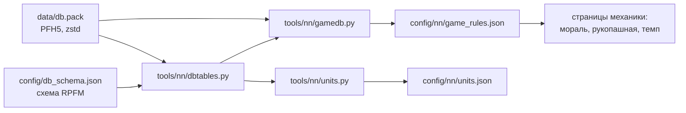

# База игры

[← Назад](README.md) · [Документация](../README.md) › [Знания об игре](README.md) › База игры · [English](../../en/game/database.md)

Правила боя лежат в базе игры: мораль, усталость, шанс попасть, лидерство,
стрелы. Мы читаем их прямо из файлов игры, чтобы не угадывать числа.

**Формулы — в движке, числа — в базе.** Например, в базе есть 35, 8 и 90, а то,
что шанс попасть = 35 + атака − защита в пределах 8–90 %, — это как движок
использует эти числа. Поэтому каждую формулу сверяем с записями боёв
([мораль](units/morale.md), [рукопашная](units/melee.md)).

## Где лежит

- Файл: `<папка игры>/data/db.pack`.
- Формат: PFH5 — тот же, что у наших pack ([сборка](../launch/build.md)), но
  записи сжаты zstd: 4 байта — размер без сжатия, потом кадр zstd.
- Нужен Python 3.14 и новее (модуль `compression.zstd`).

## Как прочитать

```bash
py -3.14 -m tools.nn.gamedb     # правила → config/nn/game_rules.json
py -3.14 -m tools.nn.units      # отряды  → config/nn/units.json
```

Оба находят игру по `config/local.json`. `tools/nn/gamedb.py` пишет правила
боя, `tools/nn/units.py` — [паспорта отрядов](../training/units.md). Таблицы
читает `tools/nn/dbtables.py` по схеме RPFM (ниже). Проверено на v9.0.1, сборка 50381.



## Какие таблицы

| Таблица | Что в ней | Куда |
|---|---|---|
| `_kv_rules_tables` | правила боя: шанс попасть, удар раз в 4 с, броня, фланг и тыл, натиск, щиты, стрелы, сложность | `game_rules.json`: `battle`, 276 ключей |
| `_kv_morale_tables` | мораль: аура лорда, его смерть, потери, фланги, обстрел, схватка, пороги, таймеры, сложность | `game_rules.json`: `morale`, 131 ключ |
| `_kv_fatigue_tables` | усталость: сколько даёт каждое занятие, пороги | `game_rules.json`: `fatigue`, 29 ключей |
| `unit_experience_bonuses_tables` | что даёт ранг: лидерство, атака, защита, меткость, перезарядка | `game_rules.json`: `experience_bonus`, 5 строк |
| `unit_experience_thresholds_tables` | опыт для рангов 1–9 | `game_rules.json`: `experience_levels`, 9 строк |
| `main_units_tables` | отряд, как его нанимают: бойцов, цена, ссылка на `land_units` | `units.json` |
| `land_units_tables` | отряд в бою: атака, защита, лидерство, натиск, броня, щит, оружие, снаряды, фигура | `units.json`; атака, защита, лидерство трёх отрядов арены ещё и в `game_rules.json` (`units`) |
| `battle_entities_tables` | фигура бойца: здоровье, масса, скорости, рост, класс размера | `units.json` |
| `melee_weapons_tables` | оружие ближнего боя: урон, пробивающий урон, бонусы, удар по нескольким | `units.json` |
| `missile_weapons_tables` | стрелковое оружие → его снаряд | `units.json` |
| `projectiles_tables` | снаряд: дальность, урон, перезарядка, полёт | `units.json` |
| `unit_armour_types_tables` | броня: ключ → число | `units.json` |
| `unit_shield_types_tables` | щит: ключ → шанс отбить стрелу | `units.json` |
| `unit_spacings_tables` | шаблон строя (`land_units.spacing`): шаг по фронту и в глубину, разброс, хаотичный строй | `units.json` (`spacing`) |
| `unit_attributes_to_groups_junctions_tables` | свойства отряда (`expendable`, `encourages`…) | `units.json` |
| `land_units_to_unit_abilites_junctions_tables` | способности отряда (ключи) | `units.json` |

`_source` в файлах — путь к прочитанному `db.pack`.

## Как устроены таблицы

- **Внутри таблицы имён нет.** Заголовок с номером версии (у `_kv_*` и части связок номера нет — версия 0),
  один байт, число строк (4 байта), затем строки одна за другой. Строка — одна и та же последовательность полей:
  int32, float32, флаг (1 байт), текст (длина 2 байта + UTF-8), необязательный текст (флаг, затем текст) и
  редкие другие типы.
- **Имена и порядок полей — из схемы моддеров RPFM** ([rpfm-schemas][rpfm], Frodo45127, `schema_wh3.ron`): для
  каждой таблицы и каждой её версии — поля в том порядке, в каком они записаны, с именем и типом. Сообщество
  поддерживает её годами, ею пользуются все редакторы модов.
- Мы держим не всю схему (11 МБ), а **её вырезку** — `config/db_schema.json` (~18 КБ): только наши таблицы и только
  те версии, что есть в установленной игре и обязательных модах, плюс источник и SHA-256 скачанного файла. Так код
  не зависит от внешнего файла, а изменение схемы видно в git. Делает вырезку `tools/nn/dbschema.py`.
- `tools/nn/dbtables.py` читает таблицу **целиком** по схеме её версии: до последнего байта, каждый текст —
  читаемый текст, каждый флаг — 0 или 1. Код обращается к столбцам по именам схемы. Если игра обновит таблицу
  (новая версия или поля не сходятся), чтение остановится с ошибкой, а не прочитает сдвинутые числа. Тогда:

```bash
curl -L -o build/rpfm/schema_wh3.ron https://raw.githubusercontent.com/Frodo45127/rpfm-schemas/master/schema_wh3.ron
py -3.14 -m tools.nn.dbschema     # пересобрать config/db_schema.json
```

| Таблица | Версия | Полей | Строк |
|---|---:|---:|---:|
| `land_units` | 54 | 60 | 2679 |
| `main_units` | 7 | 45 | 2802 |
| `battle_entities` | 39 | 58 | 1341 |
| `melee_weapons` | 25 | 20 | 1280 |
| `missile_weapons` | 12 | 6 | 863 |
| `projectiles` | 53 | 58 | 1093 |
| `unit_armour_types` | 6 | 3 | 106 |
| `unit_shield_types` | 6 | 5 | 24 |
| `unit_spacings` | 7 | 19 | 165 |
| `unit_attributes_to_groups_junctions` | 2 | 2 | 8563 |
| `land_units_to_unit_abilites_junctions` | 1 | 3 | 9693 |
| `unit_special_abilities` | 74 | 71 | 3173 |
| `special_ability_phases` | 44 | 31 | 2526 |
| `special_ability_to_special_ability_phase_junctions` | 2 | 6 | 2730 |
| `special_ability_phase_stat_effects` | 3 | 4 | 3252 |

Ещё читаются целиком: `_kv_*`, `unit_experience_*`, связки способностей с условиями
(`special_ability_to_recharge_contexts`, `_to_auto_deactivate_flags`, `special_ability_phase_attribute_effects`) и
генератор армий `cdir_military_generator_*` ([армии](../training/armies.md#шаблоны-армий-из-базы-игры)).

- **Сверено в бою.** По карточкам отрядов: здоровье, масса, шаг и бег (`battle_entities`), урон и пробивающий урон
  (`melee_weapons`, `projectiles`), дальность и перезарядка снаряда, число брони
  ([паспорта отрядов](../training/units.md#сверка-с-карточками)). Зондом рукопашной (`build/meleetests`): расстояния
  натиска `battle_entities.charge_distance_commence_run` / `_adopt_charge_pose` / `_pick_target` (30 / 25 / 25 м у
  пехоты, 35 / 30 / 30 у лордов); начальная перезарядка `unit_special_abilities.initial_recharge` (0 у активных
  способностей лордов, 3 с «Сила кающегося», 5 с «Одиночка»). Шаг сомкнутого строя
  (`unit_spacings.close_formation_spacing_horizontal` / `_vertical`) — с ростером: фронт игры (ряды − 1) × h с
  точностью ~1 %.
- **`unit_experience_bonuses`**: `stat`, `value` (int32), `growth_rate`, `growth_scalar` (float32); в
  `game_rules.json` они записаны под старыми ключами `flag`, `a`, `b`. Для лидерства `growth_scalar` = 1,06 — столько
  даёт один ранг.
- **`unit_experience_thresholds`**: `key` — имя уровня, `value` — опыт.

## Где мы раньше понимали столбцы иначе

До схемы часть таблиц мы разбирали сами: порядок полей подобрали так, чтобы таблица читалась до последнего байта, а
имена дали по значениям. Схема подтвердила почти всё; расхождения — ниже. Ни одно не меняет чисел в
`units.json` и `abilities.json`: файлы, собранные заново по схеме, совпали байт в байт (кроме текстов `_fields`).

| Столбец | Как понимали мы | По схеме | Влияет на симулятор |
|---|---|---|---|
| `special_ability_to_special_ability_phase_junctions`, 2-й и 3-й | способность, фаза | **фаза, способность** (перепутаны) | нет: у каждой нашей способности одна фаза с её же именем; строки «другой способности с той же фазой» мы считали «вариантами» |
| `unit_armour_types.material` | материал брони | `audio_type` — звук удара (body, leather, chainmail…) | нет: `armour_material` только в паспорте |
| `unit_shield_types.material` | материал щита | `audio_type` | нет: не читается |
| `unit_special_abilities` 5-й (`targets_own`) | «применяется на себя или своих» | `affect_self` — действует и на владельца | нет: у всех наших 1; `self_cast` то же |
| пассивность способности | `active_time` и `recharge_time` оба −1 | в таблице есть свой столбец `passive` | нет: расходится только «Сила кающегося» (в таблице passive, у нас `auto` — тоже врождённая) |
| `projectiles.trajectory` | траектория | `trajectory_sight` | нет: значения те же (`low` — прямой огонь) |
| `projectiles` 21-й, 22-й (`f21`, `f22`) | float без смысла | `bonus_v_infantry`, `bonus_v_large` (int32) | нет: у снарядов наших отрядов оба 0 (раньше считали, что такого столбца нет) |
| `main_units.barrier_health`, `battle_entities` 40-й, `unit_attributes_to_groups_junctions` 2-й | int32; float; флаг + текст | float32; `vfx_filter_id` int32; необязательный текст | нет: не используются (байты те же) |
| `unit_experience_bonuses` | флаг, `a`, `b` | `value`, `growth_rate`, `growth_scalar` | нет: в симуляторе опыта нет |
| `unit_spacings` 3–8-й | «ещё шесть чисел» | шаг строя спешенных (`dismounted_*`) | нет |

Прочие наши имена схема подтвердила или уточнила без смены смысла: `turn_rate` → `turn_speed`, `marksmanship` →
`marksmanship_bonus`, `penetration` → `projectile_penetration`, `close_h` / `close_v` / `close_scatter` →
`close_formation_spacing_horizontal` / `_vertical` / `_variation`, `chaotic` → `is_chaotic_formation`, `f13` →
`is_magical`, `update_targets` → `update_targets_every_frame`. Прежние догадки по позиции (длительность фазы — «число
перед ключом», усталость фазы — «число после трёх флагов», боевой потенциал способностей — копия с twwstats) заменены
чтением столбцов `duration`, `fatigue_change_ratio`, `additional_melee_cp` / `additional_missile_cp`.

## Не проверено

- Что значат ключи `_kv_*`, которые не встретились в записях боёв (их много).
- Как движок использует столбцы, которые не сверены в бою (имя из схемы ещё не формула): разгон, торможение,
  скорость натиска, радиус, рост, класс размера, время между ударами, полёт снаряда, шанс щита
  ([паспорта отрядов](../training/units.md#что-не-сверено-с-игрой)).

[rpfm]: https://github.com/Frodo45127/rpfm-schemas
