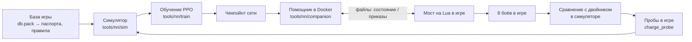

# Сводка проекта

[← Назад](README.md) · [Документация](README.md) › Сводка проекта · [English](../en/summary.md)

Короткая карта проекта: что он делает, из каких частей состоит, в каком состоянии каждая часть и
где читать подробности. Её читают первой после потери контекста; подробные страницы — только по
текущей задаче. Свежие цифры итерации — в её логах (`build/steps/`, `build/compare/`), здесь — главные.

## Что за проект

Нейросеть, которая командует армией в боях Total War: WARHAMMER III. Сеть учится с нуля в нашем
симуляторе боя (PyTorch, тысячи боёв сразу на видеокарте), а потом играет настоящие бои в игре против
ИИ игры на нормальной сложности. Сейчас две фракции — Империя и скавены, ровная пустая карта, лорд и до
19 отрядов у стороны (в пулах 21 отряд и 2 лорда; схема армий v2 — ещё 6: алебардисты, Пушка Крысолинга, Чумные
монахи, монахи с кадилами, Крысоволки двух видов; схема v3 — ещё 8 стрелков линии g43; [паспорта](training/units.md)). Цель — сеть, которая
выигрывает у ИИ игры ≥ 97 % боёв и играет «по характеру» фракции ([замысел и готовность](training/network.md#готовность)).

## Где мы сейчас

- **Уровень в игре:** на старом экзамене (8 боёв против ИИ игры на «Нормальной», пары с обменом армий;
  `build/compare/itS*.json`) сети линии S с S14 выигрывают в среднем 5,6 из 8 (12 экзаменов, от 3 до 8), размен (потери врага
  к нашим) 0,94–1,15; лучшая — S23_2: 8 из 8, 1,15. До линии S лучшая была K3: 5 из 8, 0,96. После 8 из 8 экзамен заменён новым — 10 боёв
  на армиях v2 с новыми отрядами ([экзамен](launch/gate.md#экзамен)); первая сеть на нём — S24.
- **Что дало рост** ([что помогло, с числами](training/training.md#что-подтверждённо-помогло)): пул прошлых версий только из
  равных сетей с полным видом врага (S12: 5/8, первый размен больше 1); армии v2 (с S14: в среднем 5,9 из 8 против
  3,0 до них); правки симулятора по боям в игре, главная — закрыта лазейка «вечно свежего лорда» (S23_2: 8 из 8).
- **Как ищем разрыв:** пошаговый повтор без дрейфа (`tools/nn/sim/stepreplay.py`, [замер](training/simulator.md#пошаговый-повтор-замер-без-дрейфа)):
  каждые 10 / 20 с симулятор ставится в записанное состояние игры со скрытыми часами и сравнивается по ситуациям.
  На 92 боях из того же состояния урон за окно верный (0,94; после 5 с 1,02), а бегут **чаще** игры (1,11 / 1,21):
  нехватка бегств целых боёв — путь боя, не мораль в моменте. Кандидаты: мораль средних и свежих отрядов («Натиск»
  в долгой рукопашной), касание при местах игры, удары во фланг и тыл. Число приёмки A (`build/holes`) — насколько
  двойники 56 боёв панели далеки от игры (меньше — лучше, ~0,30).
- **Главные разрывы двойника:** наши отряды теряют бегущими вдвое меньше игры; лорд сети в двойнике в рукопашной
  в 1,5 раза чаще игры, выбывает 0,30 боёв против 0,38 в игре (до правки усталости лорда — 0,12); стрелки ИИ в двойнике движутся реже.
- **Симулятор на записях игры** (повтор 72 боёв, ниже): кривые потерь совпали, остались бегства и сборы.

## Рабочий круг

Одна итерация — около часа обучения и боёв; между итерациями — правка симулятора по самой большой дыре.

| Шаг | Что | Как |
|---|---|---|
| 1. Обучение | 40 мин от прошлой сети, без проверок в симуляторе | `bash build/steps/v2_iterW.sh NAME 40 INIT` (переживает падение: следующая попытка с `latest.pt`) |
| 2. Экзамен в игре | 10 боёв: 5 зёрен армий v2 разного размера, каждое дважды с обменом армий ([экзамен](launch/gate.md#экзамен)) | `build/steps/watch_set8.ps1 -Ckpt build/v2/itN.pt` |
| 3. Двойник | те же 8 стартов в симуляторе (сеть против `ai_like`, 4 копии); таблица «игра / двойник» и 3–5 самых больших разрывов поведения | `bash build/steps/compare_set.sh N` → `build/compare/set_vs_twin.py` |
| 4. Проба | самый большой разрыв ставится одной механикой в игре и в симуляторе одинаково (полосы отрядов, всё записано) | `tools/nn/charge_probe.py` + `src/entries/charge_probe.lua`, планы `--plan` ([зонд](apps/entries.md#charge_probe--зонд-рукопашной-одна-механика-игра-и-симулятор-одинаково)) |
| 5. Правка симулятора | правило игры по пробе, за переключателем в `config/nn/sim.json` | агент; сразу тест |
| 6. Повтор 72 боёв | бои наборов в игре, переигранные в симуляторе по записанным приказам обеих сторон, 19 копий; навык и смещение по каждой величине | `build/shotgap/replay72.py`, `build/shotgap/replay_card.py` |

Скрипты круга лежат в `build/` (не в Git). Бои против ИИ игры — только на «Нормальной».

## Симулятор боя

**Что делает.** Каждый отряд — один объект (бойцы, здоровье, место, направление, мораль, усталость,
снаряды), а не каждый солдат. Шаг 0,5 с (такт морали игры). Бой кончен, когда у стороны нет стоящих
отрядов; через 60 минут побеждает защитник. ~590 боёв в секунду на RTX 5070 Ti (4096 сразу). На видеокарте шаг,
наблюдение и учёт компилируются с точным делением, как обычный код у помощника в игре (`tools/nn/sim/compiled.py`):
с приближённым делением таймеры урона включались с первой секунды боя, и сеть в симуляторе вела себя осторожнее, чем
в игре ([подробно](training/simulator.md#компилированный-и-обычный-шаг)).

**Откуда числа.** База игры (`config/nn/game_rules.json`, паспорта `units.json`, эффекты `effects.json`,
способности `abilities.json`), формулы сообщества, замеры проб в игре. Каждое правило — переключатель в
`config/nn/sim.json` с причиной. Любая правка `config/nn` или `tools/nn/sim` меняет версию симулятора
(`tools/nn/train/version.py`).

**Что моделируется** (подробно — [механика и откуда числа](training/simulator.md#механика-и-откуда-числа)):

- **Рукопашная по формулам игры:** шанс попасть 35 + атака − защита (вес 1), промах стоит 0,5 с; урон —
  бронебойный целиком + обычный за вычетом броска брони; пул раненых; фланг / тыл — защита ×0,6 / ×0,3; высота
  (карта высот на бой, без неё бой плоский бит в бит): урон удара ×0,7–1,3 по перепаду в парах бойцов, снаряда
  ×(1 ± 0,3·перепад / 40 м), скорость в гору / под гору, линия огня через своих и через холм, +10 морали на холме
  (`tools/nn/sim/terrain.py`; двойник пробы `terrain`: размен на склоне 1,83 / 0,90 при игре 1,86 / 0,86); слои карты
  (`tools/nn/sim/ground.py`, без них бой бит в бит прежний): стволы деревьев из файла карты (Кислев 5159, `trees.npz`)
  останавливают снаряд после первых ~42 м полёта и удлиняют путь бойцов, тип земли под каждым бойцом (лес большим
  ×0,8 скорость и атака, мелководье малым ×0,8, глубокая вода ×0,7, камни ×0,95), укрытие в лесу от снарядов ×0,75 к шансу попадания (замер пробы `cover`; прочтение кода «−0,2» не сошлось), скрытность в лесу для hide_forest
  (60 м зоркости); двойник пробы `ground`: урон за полосой леса 7 / 11 / 57 м 0,89 / 0,80 / 0,64 при игре 0,86 / 0,87 /
  0,68, цель в лесу не видна (0 выстрелов, как в игре); пехота в лесу 0,96 при игре 0,87–0,93 — OPEN; широкая
  линия охватывает узкую — длина касания = перекрытие + до 9 м с каждого края за 10 с, удары охвата во фланг
  (`melee.wrap`, проба `wrap`: темп сошёлся 0,46 → 0,88 %/с при игре 0,87–0,91; размен широкого 1,0 при игре 1,2–1,5 — OPEN);
  цикл удара по коду игры (раз в интервал от начала замаха, `melee.cycle`) — за выключателем, выключен: размен охвата
  поднимает до 1,2–1,3, но слабо бьющих (рабы) делает в 2–3 раза слабее игры — в игре темп бойца в строю слабее
  зависит от шанса, чем «раз в интервал», что его выравнивает — OPEN;
  натиск с разбега и рывок на скорости натиска (в цель, уже дерущуюся с нашими, — тоже, кроме подхода через своих:
  `charge.blocked_side`, проба `busycharge`); первый удар при входе в бой; начальная волна схватки
  (`melee.wave`) — обе только при первом касании строя в бою (проба `recontact`), первый удар — бойцами без волны, при натиске — всем первым рядом, после него пауза на интервал удара (`contact.first_strike_rank`, `melee.swing_interval`: за 0–2 с натиска ошибка к игре 0,32 → 0,22); потрёпанный строй не смыкается — до врага достаёт только часть бойцов
  (`melee.front_fill_ranks` 1,5: проба `dmgmelee`, раньше отряд на 30 % бил в 1,6–1,9 раза сильнее игры);
  случайные удары (`noise.blows`: в повторе и двойнике включены, в обучении нет).
- **Выход из рукопашной и приказы в схватке:** окно 24 с из базы (и для лорда); «идти» в схватке — выход в любую сторону;
  атака на цель вне касания — выход (и для лорда); новая атака в схватке 24 с бьёт только свою цель; «стоять» после выхода или атаки на врага вне касания
  окно не закрывает (не бьёт до 24 с от первого приказа; и лорд); уходящего без погони
  держат 2 с; погоня — без рывка натиска.
- **Стрельба по правилам игры:** дальность от центра до центра, дуга огня у каждого бойца, модель разброса
  из базы без подгонки: разброс — равномерный квадрат, площадь = зона калибровки / p, p ∝ точность × (дистанция калибровки / d)², не больше 1 — вблизи
  точнее не становится (`missile.accuracy.spread`, проба `shots`: арбалеты по одиночке в 30 м — игра 0,35 попадания на выстрел, прежний гаусс 0,68, квадрат 0,40;
  дорожки пробы стрельбы — строи 0,105 → 0,069, одиночки 0,163 → 0,059; Пушку по строю квадрат завышает сильнее — открыто; «пристрелки» от выстрела к выстрелу нет), строй ловит выстрелы только в пределах видимой стрелку ширины (`missile.accuracy.width`, проба `ratshape`: узкую колонну Пушка раньше била в 1,6 раза сильнее игры), настильные попадания сначала в передний ряд строя (`kills.missile_front`, проба `ratform`: доля убитых Пушки 0,0 → как в игре, урон по строю 1,45 → 1,20 игры), разлёт по соседям, огонь мимо своих по дуге пули, стрельба на ходу (ополчение,
  звёзды); стрелки в рукопашной бьют слабо, как в игре; новый приказ или цель: навесной огонь (стрелы, болты,
  пращи) молчит 8,5 с при любой перезарядке, каждый приказ запускает окно заново; ружья и звёзды бьют сразу
  (пробы `retarget`, `retarget2`, `retarget3`); стрелы и болты по цели, потерявшей треть бойцов, — цикл
  перезарядка + 3,3 с; побежавшую (и разбитую) цель стрелок без приказа по ней держит, как движок игры: через
  1,5 / 5,5 / 30 с бегства на ней ещё 33 / 30 / 12 % стрелков (записи 789 боёв; раньше бросал сразу).
- **Режим застрельщиков** (пробы `skirmish`, `skirmish2`): стрелок ИИ игры и скриптов бежит прочь, не стреляя, от врага,
  который идёт на него (путь в пределах 40°) и подошёл на 43,9 м (скавены 33,1) от бойца до бойца, — поверх приказа;
  от атакующего его — до 82 м, от идущего на другого — кончает с вероятностью 0,18 в секунду; новый приказ обрывает бег
  (в игре 91 % отходов ИИ кончаются его приказом); у сети режим выключен, как в мосту ([подробно](training/simulator.md#режим-застрельщиков)).
- **Выход стрелка из рукопашной**: стрелок с приказом «идти» дальше 10 м уходит сразу (без задержки на месте) и в любую
  сторону, сквозь врага тоже; погоня держит его в рукопашной. Так в записях 72 боёв: стрелки ИИ и сети под таким
  приказом движутся с первой секунды, 2,3–3,0 м/с ([подробно](training/simulator.md#выход-пойманного-стрелка)).
- **Мораль по правилам игры:** окна потерь 4 / 60 с, «под обстрелом», фланг / тыл, «фланги прикрыты»,
  натиск, перевес, «проигрываю схватку» (−3 / −8 по соотношению сил, как в базе), сильный враг, гибель
  лорда (−16 на 45 с, потом −10), разгром отряда и армии; сбор — измеренный процесс (`morale.rally_hazard`:
  шанс в секунду по расстоянию до ближайшего врага у бегущих с моралью выше 0; снят на том же условии, по 360 записям игры).
  По пробе hyp и записям 92 боёв: колебание с запасом (начинается ниже 12 очков, кончается выше 16), до конца
  таймера колебания очки не ниже 0, разгром 1-го / 2-го бегства — по живым бойцам (< 5 % / < 10 %), а не по
  здоровью, бегущие свои и чужие гасят друг друга, враг слабее трети бегущего сбор не держит. Пошаговый повтор 92
  боёв: разгромы сим / игра 4,09 → 0,64, начала колебания 1,66 → 1,02, бегства 0,98 → 0,95, сборы 1,02 → 1,05
  ([мораль](game/mechanics/morale.md)).
- **Бегство:** первые 7 с бегущий остаётся в касании, дальше — пока за ним гонится отряд с приказом атаки и края
  строёв ближе 16 м; догнавший (не медленнее бегущего) бьёт всеми бойцами, сколько у бегущего есть, набирая их за
  ~3–5 с, пока его бойцы добегают из рядов; бойцы бегущего,
  вбежавшие в стоящий строй врага, застревают в нём и гибнут там (повтор 72 боёв: бегущими теряют 0,75 от игры, было
  0,61); тормозится в толпе; уходит от погони под углом;
  вдали от врагов бежит прочь от всех стоящих врагов (вес 1 / расстояние), к своему краю — только когда
  стоящих нет ([куда бежит бегущий](training/simulator.md#куда-бежит-бегущий)).
- **Лорды:** хрупкие, как в игре (своя аура не действует, в рукопашной всегда «проигрывают»), удар
  делится на 4 бойца, поединок лордов по формуле игры, способности (ИИ игры применяет их по замеренному
  правилу), «Раны»; бегущего лорда бьют со спины по правилу игры, одиночка в погоне — в полную силу, с полным
  натиском и только в своей досягаемости (в записях игры вражеский Генерал по бегущему — 0,22 удара в секунду,
  по правилу 0,22, прежде 0,04). Шанс попасть — (счёт − 1) / 100 по правилам игры.
- **Усталость** по базе (10 тиков в секунду, рукопашная утомляет по приказу атаки; натиск +34 на подходе рывком, без
  доплаты после удара; в рукопашной без атаки — готовность, а лорд, пока бьёт, устаёт как в атаке — замер; стрельба 11,4 — замер;
  стоящий отдыхает −18, близость врага сама по себе готовности не даёт — проба `fatrun` и записи 1150 боёв; ранг
  отряда −1…−4 за тик по базе — подтверждён пробой, но рангов в симуляторе нет), врождённые эффекты
  отрядов, разворот со скоростью поворота из базы, строй по шаблону из базы; фронт в приказе (`face`, 64 деления по
  5,625°, как держит игра: строй 3,9 с перестраивается, потом поворачивается; в рукопашной это выход из боя — 24 с не бьёт
  тех, кого касался, поворот через 8,5 с — [подробно](training/simulator.md#приказы-face)); ширина строя в приказе
  (`width`: пределы рядов из базы, перестроение за время по геометрии игры — расширение (прирост / 2) / скорость, сужение
  глубина / скорость, +4 с шагом стоя; в рукопашной — то же окно выхода 24 с, на ходу узкий строй готов к приходу —
  [подробно](training/simulator.md#ширина-строя-в-приказе-width)). Счёт усталости «по бойцам в касании»
  записи опровергают: отряды с 2–55 % бойцов у врага устают одинаково
  ([усталость](game/mechanics/fatigue.md)).
- **Упор** (проба `brace`): стоящий отряд отвечает подбежавшему сразу в пределах 80° от взгляда (было 45°), отражение
  натиска ×2 — с любой стороны (под 100° удары копейщиков двойные); повтор 92 боёв без перемен
  ([рукопашная](game/mechanics/melee.md#упор-и-защита-от-натиска)).
- **Эффекты при контакте и очередь** ([подробно](training/simulator.md#эффекты-при-контакте-и-очередь-пушки)): яд,
  «Заражение» кадил, подавление пуль Пушки — статы фазы базы на поражённом 10 с от последнего попадания, разные
  складываются, свои не кладут; Пушка Крысолинга — 18 пуль за залп по 4 в секунду, цикл 12 с, общий боезапас,
  стреляет и в рукопашной; раскрутка 4,5 с после остановки, приказа и каждой новой цели (замер), приказ посреди очереди обрывает её: начавшие бойцы перезаряжаются 7,5 с от обрыва, остальные заряжены (засыпать Пушку приказами не выгодно, как в игре); боец, чья цель погибла,
  теряет раскрутку из очереди. Зверь (тело-эллипс в базе) в рукопашной занимает вдоль касания ширину тела: крысоволков
  бьёт в 2,2 раза больше (двойник пробы: 0,4 → ~1 игры); как мишень — тот же эллипс, повёрнутый к стрелку (бегущий на
  стрелка зверь узкий). Бой сети за скавенов (Пушки, крысоволки) против ИИ игры: повтор по приказам обеих сторон
  даёт исход игры 8 из 8 — проигрыш двойника объясняет `ai_like`, а не механики.
- **Отряды g43** (только армии v3; [паспорта](training/units.md#охотники-железнобокие-длинные-ружья-бегущие-по-канавам-джезейлы), [механики](training/simulator.md#скрытность-пуля-сквозь-нескольких-эффекты-на-врагов)): Охотники, железнобокие, длинные ружья, 4 вида Бегущих по канавам, джезейлы; скрытность (флаг `stealth`), пуля сквозь 2 пехотинцев, «Ловчая сеть» на врагов, ломка щитов, «Пороховая выучка» — по правилам игры, в игре не замерены.
- **Пули тормозят** ([подробно](training/simulator.md#эффекты-при-контакте-и-очередь-пушки)): попадания снарядов
  категории `musket` (аркебузы, Пушка, пистоли, звёздочки) 10 с замедляют небольшой строй: бег ×0,65, шаг ×0,9
  (замер `hitslow`: бег на аркебуз ×0,68, болты — без торможения; в базе числа нет).
- **Магия** ([подробно](training/simulator.md#магия), `tools/nn/sim/magic.py`): ветра стороны (старт 12 / 68,
  +0,1 в секунду), каст по просьбе с подходом в дальность 200 м, стойкой 1 с и перезарядкой от конца действия;
  бомбардировки «Раскалённый рок» (Золотой маг) и «Варп-молния» (инженер-колдун) по плотности строя цели и своих рядом,
  падения сгущаются к центру; сбитый с ног (порог скорости из базы по массе снаряда и бойца) не ранится, пока не
  встанет. Двойник пробы (рок / молния, суммы): урон по отрядам 0,72 / 0,90 от игры, убитые 0,73 / 1,01, убитые в
  первом касте 0,92 / 1,05; урон по одиночкам (герои, лорды) 0,85 / 1,38 (без сбивания было 1,39 / 3,66). Урон своим
  рядом с целью (бой 4): двойник ставит отряды по центрам из игры, а в рукопашной они перемешаны — открыто. **Сеть
  колдует** ([вход](training/model.md#магия-заклинания-ветра-каст-16102026-s27)): заклинание — слот навыка мага (та же
  голова и цена нажатия), видит свои ветра, заклинания вражеского мага, «маг врага колдует» и удары; куда — указатель
  цели атаки, маски дальности нет (маг подходит сам). Цена каста в обучении — прямой учёт без переигровок
  ([цена](training/ability_price.md#заклинания): урон врагу − урон своим − 13,9 золота × ветра; k — средний доход
  хорошего каста в лаборатории). Обучение с магом в каждом бою ~2 раза медленнее (`magic.bombard` не сжимается). Скрипты не
  колдуют; маги в армиях — за выключенным переключателем `mages`
  ([армии](training/armies.md#маги)), у сторон скриптов мага нет.
- **Лаборатория бойцов** ([подробно](training/fighters_lab.md), `tools/nn/fighters/`; в обучении — `run.py --fighters`, по умолчанию выкл.): каждый боец — точка со
  своим здоровьем внутри шага симулятора. На повторе 92 боёв убитые на здоровье у поредевших отрядов и под стрельбой ближе к
  игре (двуручники 0,24 → 0,62), урон по поредевшим 0,95; боец взмахивает раз в интервал удара и при
  промахе (проба swing; симулятор считал промах в 0,5 с), в целых боях урон 1,37 игры — открыто. Предела «сколько бьют
  одного» у горстки в окружении нет (проба crowd: 5 крыс в окружении 120 мечников гибнут в 5,5 раза быстрее, чем под
  одним бьющим), а в строю, по записям игры, урон идёт по числу пар «бьющий — враг», а не по толпе бьющих: свалки 3+ отрядов —
  перебор лаборатории (1,46 игры, прямоугольник 1,10). Правило «врага бьют не больше двух сразу» (`melee.pairs` 2) даёт
  1,18 и бегства 1,09 → 1,00, но убитых на здоровье 0,72 → 0,48 и шаг +33 % — выключено до решения пользователя;
  куча наложенных отрядов: в прямоугольнике свои тела закрывают фронт (`melee.stack_*`, 2 / 3 в куче к одному 1,17 / 1,19 → 1,01),
  в лаборатории бой начинается только касанием тел и свои в рукопашной не пропускают (`melee.start_touch`, `move.stop_own`):
  куча 1,6 / 2,1 → 1,02–1,05 / 1,03–1,08 к одному (игра 0,99 / 1,08), одиночный бой прежний;
  открыто — чем игра сгущает удары на меньшем числе бойцов (выбор цели «по очкам», с «врагом перед лицом», удары не
  сгущает: убитых на здоровье 0,77 → 0,68–0,73 — отказались). Убитых под стрельбой решают бойцы: правило прямоугольника
  `kills.missile_front` в шаге с бойцами выключено (`hook.own_kills`; оно отнимало у бойцов урон, и на повторе 92 боёв
  убитых на здоровье под стрельбой было 0,25 игры, стало 1,09 — так было и в обучении с `--fighters`); снаряд пролетает
  бойцов своего отряда (проба shots: ружья за 27 м 0,05 → 0,74 попадания на выстрел, игра 0,74).
  Звери (волчьи крысы) бьются вразброд, обтекая врага, как в игре (в досягаемости 56–64 крысы против 17 строем). Шаг скомпилирован, соседей ищут
  ядра Triton: 1024 боя 20,5 мс (1,7–2,8 шага симулятора), 1,1 ГБ видеокарты.
  Обучение с бойцами ([в обучении](training/fighters_lab.md#в-обучении), `tools/nn/train/men.py`): бойцы у пачки, у
  перезапущенных боёв, у веток способностей и в проверке; 7168 мест на бой; сеть видит форму отрядов. Обучение с
  бойцами ~1 320 секунд боя в секунду (было ~1 150: память видеокарты сегментами, форма только перед наблюдением,
  бойцы вне карты на время обновления — [скорость обучения](training/training.md#скорость-обучения)), с `--amp bf16h
  --parts 2` ~1 390–1 500; без бойцов было 1 710; пик видеокарты 11,5 ГБ.
- **Не моделируются:** лес, видимость, кавалерия (частично: 6 конных отрядов в паспортах пула, генератор армий выставляет их только в схеме v3 — у половины армий Империи, 12 % её отрядов; v1 и v2 бит в бит; есть тело и скорость коня, защита от натиска против больших, удар тел при натиске по коду игры — сбивание по рядам, урон столкновения, лежащие не бьют, — въезд в строй (упор у бойца свой: сбитые встают без упора, первый удар коня — когда они встают, держащий строй бьёт въехавших целиком), сбивание ударом по массе, погоня с натиском, страх, усталость бега +6; проба `cavcharge`: урон за 13 с по трём видам пехоты −7 % / −7 % / +8 %, потери рыцарей +3 % / +16 % / +3 %; проба `cavcheck` (новые дорожки): фланг −5 %, погоня +14 %, повторный заход −16 %, первый заход −38 % (в игре разброс одной дорожки ±17 %); нет тел бойцов), монстры (частично: Крысоогры, Мрачный ужас и Крысоогр-мутант в паспортах пула, только схема v3;
  монстра бьют те, кто стоит в кольце вокруг его тела, — один строй лицом, половину кольца (мутанта 6,4 копейщика,
  Мрачного ужаса 8,6; лорда 6,5), в полную силу через 3 с; огры в строю бьют по два тела на шаг 6,5 м (9 из 16, было
  2,3); двойник пробы `monster`: темп боя Ужаса и огров в пределах ±5 %, Ужас за 0–13 с −41 % (залп упора на 2–3 с);
  выстрелы по нему в рукопашной попадают; регенерация 6 HP/с, вдвое меньше 10 с после огня, не больше 75 % за бой;
  ужас — бегство 14 с с моралью ниже 13 в 5 м; яд; магические удары и огонь складывают сопротивления; удар тел по
  ширине тела; лорды и монстры устаивают при сбивании со своим шансом из базы (генерал 40 %, вожак 75 %), магические
  удары всех отрядов режет сопротивление магии, а не физическое; бои без монстров, конницы и магических ударов по Пылающему солнцу и Флагеллантам бит в бит (36 из 48) —
  [симулятор](training/simulator.md#монстры-скавенов)), другая магия, полёт, артиллерия (частично: шаг 1 — 6 отрядов с орудиями в паспортах пула, только в схеме v3, в половине её боёв; расчёт — бойцы отряда, 4 орудия в общем здоровье, стреляют min(орудий, расчёт / 3), залп = орудия × снарядов за залп, минимальная дальность, навес мортиры через своих и холмы, полёт снаряда с упреждением, взрыв по площади по своим и чужим со сбиванием, пробитие ядра до 10 бойцов, мораль от артиллерии −8 / −10 (код игры); прицел в центрального (мортира, пушки) или ближайшего бойца (ракеты), промах — поворот ствола (вбок ±r/2, вдоль — через дугу: у мортиры почти ноль, у ракет ±55 м), пристрелка, взрыв от края тела, цикл = перезарядка + анимации (замер: мортира 25,5 с); нет отскока ядра; проба `artillery`, HP за 120 с: мортира +15 % / +9 %, ракеты +23 % / +5 % (было −61 % / −48 %), пушка +4 %, варп-пушка +16 %; открыто — поздние залпы сильнее игры (строй игры после потерь редеет); v1 и v2 и бои без артиллерии бит в бит — [симулятор](training/simulator.md#артиллерия)), опыт.

**Сверка с игрой.** Записанный бой переигрывается по записанным приказам 19 раз со сдвигом начала до 2 м;
копии — прогноз, запись игры — исход. Главный счёт — **доля значений игры внутри 90 % интервала копий**
(у совпадающего с игрой симулятора 90 %), рядом **навык** CRPSS (0 — не лучше «типичного значения игры»,
больше — лучше) ([как считается](training/simulator.md#счёт-сверки-симулятор-как-прогноз)). Общая сверка —
`python -m tools.nn.sim.check` ([сверка](training/simulator.md#сверка-с-игрой)); в круге — повтор 72 боёв
наборов сети.

**Повтор 72 боёв** (бои сети против ИИ игры из наборов итераций):

| Величина | Симулятор | Игра |
|---|---:|---:|
| Навык, медиана по величинам (4 копии) | +2 % | — |
| Потери нашей стороны через 60 / 120 / 180 с после первого контакта | 0,23 / 0,39 / 0,51 | 0,235 / 0,42 / 0,55 |
| Потери врага к концу боя | 0,52 | 0,57 |
| Бегства на отряд | 0,94 | 1,19 |
| Сборы на отряд | 0,53 | 0,60 |

**Известные расхождения** (подробно — [«Чего нет»](training/simulator.md#чего-нет)):

- потрёпанный отряд в рукопашной теряет здоровье быстрее игры (проба `dmgmelee` разбирается);
- двуручники в рукопашной получают ~0,75 игры — не из-за брони (проба `armour`: броня 90 у штурмкрыс недобора не
  даёт), а потому что штурмкрысы как бьющие недобирают ×0,76–0,84 на любой цели; причина не найдена;
- бегств и сборов меньше, чем в игре; в двойнике наши бегут реже, чем в игре, отряды ИИ — чаще;
- стрелки ИИ в повторе теряют меньше игры (0,34 здоровья при 0,42): уходящий бегом из рукопашной теряет в игре больше
  (вероятно, больше догоняющих), в двойнике движутся реже (0,27–0,29 секунд при 0,38–0,41: короткие шаги ИИ к цели на
  40–100 м — поведение `ai_like`);
- «фланги прикрыты» в игре растёт за ~45 с (+1…+7), в симуляторе +5 сразу (проба `rallysecure`);
- задержка приказов в игре 0,6–0,8 с в малых боях, в симуляторе 0,36 с;
- вторая волна отрядов сверена с записями не вся.

Пробы и что каждая дала — на страницах [симулятора](training/simulator.md) и
[рукопашной](game/mechanics/melee.md#проверка-в-игре-зонд-рукопашной); неудачные правила —
[«Пробовали и отказались»](training/simulator.md#пробовали-и-отказались).

Подробно: [симулятор](training/simulator.md) · [паспорта отрядов](training/units.md) ·
[замеры в игре](training/measurements.md) · [механика игры](game/mechanics/README.md) ·
[база игры](game/database.md) · [реестр показателей отрядов](game/units/indicators.md).

## Сеть v2

Одна сеть на обе фракции и обе роли (атака или оборона — вход). Видит только то, что видел бы человек:
свои отряды целиком, врагов — пока видны, всё, что игра показывает о вражеском отряде (точная мораль,
усталость, боезапас, убитые), кроме их приказов ([правило видимости](training/model.md#правило-ии-видит-только-то-что-видит-человек)). Время до конца боя
не видит никогда. Пресет `v2`, 3,51 млн весов, учится с нуля
([подробно](training/model.md#вариант-v2-сектора-карты-цепочка-голов-обязательство)):

- **Токены отрядов** (по 237 чисел: паспорт, состояние, эффекты — и эффекты при контакте, — дуга огня, действующий
  приказ, пуль за залп и магия, прицел до первого выстрела и молчание после смены цели, 28 — бонусы от способностей
  других отрядов на нём, «колдует / удар заклинания», 26 — форма отряда из мест бойцов (`SHAPE`: из лаборатории бойцов
  или помощника `--shape`, иначе нули; [подробно](training/model.md#форма-отряда-17102026-s27-свои-отряды-и-видимые-враги-последние-входы-токена)),
  10 — что делают действующие эффекты на нём числами (яд: скорость −15 %, урон −15 %), «меня обстреливают», секунды
  текущей рукопашной ([подробно](training/model.md#что-делают-эффекты-на-мне-обстрел-длительность-рукопашной-свои-отряды-и-видимые-враги-последние-входы));
  чекпойнты со 155, 167, 169, 197, 199 и 225 входами грузятся с нулевыми весами новых) + **способности**: 30
  слотов на отряд — все его способности, ни одна не теряется (15 для активных — из них выбирает голова, 15 для
  пассивных; у пассивной видно условие и «включена сейчас»; паспорт берётся из таблицы, на отряд хранится 6 чисел
  слота и номер способности; [подробно](training/model.md#способности-каждый-отряд-каждый-его-слот-способности)) → 3 слоя
  внимания с поправкой на расстояние и признаки пар (кто кого достаёт, скорость сближения, фланг / тыл, какую долю
  человека врага снимает попадание снаряда и удар — по правилу урона симулятора; они же — в указателе цели) → память GRU.
- **Сектора карты** 16 × 16 по 100 м: сила и число своих и видимых врагов, бегущие, край карты; отряды
  смотрят на сектора отдельным слоем внимания.
- **Головы цепочкой:** вид приказа (держать / идти / атаковать / отойти / продолжать) → цель → сектор →
  клетка 25 м → срок. Выбор — приёмом Гумбеля (без `torch.multinomial`), логиты с мягким потолком
  (30 × tanh(x / 30)).
- **Обязательство:** каждый новый приказ держится 2 / 4 / 8 / 16 с; срок обрывают события (рукопашная,
  угроза флангу, цель погибла или бежит, свой лорд погиб, на отряд идёт враг — ближе 40 м или 8 с хода, отряд
  потерял > 5 % здоровья за 4 с).
- **«Глаза»:** вспомогательные головы учатся на правде симулятора (свои потери за 10 / 30 с, угроза врага,
  опасность сектора) — только как вспомогательная задача: их ошибка учит общую часть сети, в решение они не идут
  и при решении не считаются. Обратная связь (предсказания обратно в токены) убрана: решения от неё почти не
  зависели; старые чекпойнты играют с ней, как раньше, `eyes_cut.py` переводит чекпойнт на новое устройство.

Старые пресеты `small` / `wide` и их чекпойнты работают, но не учатся.

Подробно: [вход и устройство](training/model.md) · [замысел](training/network.md).

## Генерал (S28, скелет)

Сеть над сетью отрядов: делит армию на группы (10 мест на сторону; видит, где стоит каждый отряд), даёт каждой группе
задание (6 видов со смыслом — атаковать, держать, обойти с фланга, прикрыть, обстреливать, отойти, список в `config.py`
`MISSION_KINDS`; одна цель из ≤ 36: группа или участок сетки 4 × 4, каждый вид — только со своими типами целей) и место
расстановки; сеть отрядов — «исполнитель» — получает задание своей группы новым входом (с нулевыми весами на старте:
играет как раньше). Пересмотр раз в 30 с боя, при разбитой группе и гибели лорда; группа держит свой номер, пока
держит свои отряды. Учатся оба уровня PPO от той же награды v2 (у генерала — честное отношение вероятностей и
энтропия по головам), у генерала свой критик («Оценка замысла»). Исполнителю платят за выполнение задания (мера
0…1 каждое решение по состоянию симулятора, `mission.py`; доплата W × (мера − среднее вида) — только в преимущество
отряда, не в награду: критик и отдача генерала её не видят; `--general-exec`, по умолчанию 1); учитель-генерал
(`--general-teacher P`, по умолчанию 0) даёт задания по правилам в доле боёв, генерал учится ему подражать
(`--general-imitate 0.3`, за 300 обновлений до пола `--general-imitate-min 0.15`: без опоры g20–g21 теряли рейтинг); генералу — малая доплата за выполнение (`--general-exec-general
0.2`, центрированная по виду), при пересмотре прошлый вид группы получает +1 к логиту (`--general-kind-stick`).
Задание **ограничивает** исполнителя (`--general-task-mask 1`, `taskmask.py`), по умолчанию только движение: под
«отойти» — секторы прочь от врага, под «атаковать X» — секторы не дальше от X, под «держать» — секторы у точки, под «прикрыть» — у отрезка до врага;
«стрелять» генерал даёт только группе стрелков. Маски, запрещающие драться (под «отойти» атака закрыта, под «атаковать
X» цель только из X, под «стрелять» пехоте нельзя в рукопашную), стоили рейтинга −1,15 / −0,61 / −0,19 на нулевой
минуте и выключены (`--general-task-mask-parts`). Группе, которая дерётся в рукопашной и не дрогнула, «отойти» генерал
не даёт (`--general-melee-stay`; учитель тоже). После атласа g17r (генерал ничего не добавлял: +0,88 с ним, +0,89 без): группы собирает **правило** (`--general-groups rule`, `groups.py`: роли — стрелки, ближний бой, лорд с героями, быстрые; внутри роли — по месту, R 100 м; одинокий лорд — к пехоте в 60 м; выученный сбор давал одну группу на армию); ветка **выученного сбора** (`--general-groups learned`, `assign.py`: генералу задают число групп K, отряды раскладывает сеть последовательным выбором с маской ёмкости — ровно K непустых групп; учится отдельно турниром `tourney_train.py` — тот же старт с разными K против S27, размен — с якорем к правилу: ARI к правилу 0,835 после подгонки; в точку основной линии — `graft.py`; в линии обучения g41 — `build/steps/line_g41.sh`: шаг по золоту 30 мин с выученным сбором и **липкостью** (`--general-groups-sticky 1`: на плановом пересмотре раз в 30 с состав групп держится, пересборка только при расстановке и по событию), турнир групп 10 мин, прививка; в шаге PPO сбор не учится, только в турнире; [подробно](training/general.md#выученный-сбор-групп-ветка)), у исполнителя **своя таблица видов** (его эпохи не двигают выбор генерала; карточки группы во входе задания нет), KL-стоп генерала — оценка k3, ветки сравнивают вид **со всеми** допустимыми видами (у каждого своя цель), числа участков нормируются по карте (три мёртвых заменены силой стрелков и быстрых), к карточке группы — числа угрозы (расстояние и силы ближайшей вражеской группы, доли стрелков — только с патронами, соприкосновение, доли под обстрелом и в рукопашной; в слоте отряда — мораль, «дрогнул», усталость и доля патронов сейчас) и числа участков под её центром (`--general-group-tiles`: прямой путь от карты к выбору, мимо совещания); точки g15–g17r без этих полей играют по-старому; мера атаки — до центра цели, все меры × сплочённость с группой; учитель сначала ждёт
(все атакующие группы держат участок, пока самая дальняя из них дальше 250 м от врага и стрелки стреляют меньше 30 с,
потом атакуют вместе; пересмотр плана и по событию «враг ближе 250 м к группе»); стрелки учителя бьют группу, по
которой их выстрел снимает больше всего здоровья (с бронёй и щитом цели), а не ближайшую. Линия g1–g8 на прежнем устройстве
(262 кандидата цели, две цели, без положения отрядов, абстрактные виды) осталась равномерно случайной; по флагам —
преимущество плана по критику отрядов (`--general-return critic`) и доплата исполнителю за различимость заданий
(`--general-distinct`, в единицах разброса преимущества исполнителя), ветки заданий — копия боя с другим видом задания у одной группы, разница размена — цена
выбора вида; другой вид по умолчанию — учительский (`--general-branch-alt teacher`: «мой выбор против учителя»)
(`--general-branches P`, оценка цены +12–17 % к шагу при 60 с). Свой сигнал вида (умолчания): в копии «другой вид»
заново решает только изменённая группа, остальные отряды и враг повторяют приказы копии «как выбрано» (частичная
открытая петля, `--general-branch-openloop 1`), цена веток центрирована скользящим средним (у петли постоянный
сдвиг −0,0027 бюджета в пользу «как выбрано», `--general-branch-center 1`), плотный сигнал — **Q по исходам**
(`kind_q.py`, `--general-kind-q outcome`): каждая группа каждого кончившегося плана (~7 500 на обновление против
~124 веток) против размена за 60 с от начала плана в самом бою; вход Q — карточка группы, которую читает голова вида,
+ 20 чисел + инерция вида + допустимые виды; включается при ev ≥ 0,05 на проверочных боях (каждый 10-й бой целиком);
выгода Q(выбранный) − Σ π Q, × сжатие (коэффициент части вида минус две погрешности); ветки играются, центрируются и
дают согласие `kind_q_agree`, голову учат только при `both`/`branch`; голова вида вынута из PPO плана и учится только
по Q (и веткам при `both`) и подражанию (`--general-kind-own-signal 1`, шаг × 2, 2 прохода), масштаб — свой у каждого вида; до 128 веток
на обновление; критик видов на ценах веток (ev ≤ 0,015) — только при `--general-kind-q branch`
([подробно](training/general.md#свой-сигнал-головы-вида)). Весь круг
собран скелетом, в симуляторе, флаг `run.py --general` (шаг цепочки `general`); упрощения — участки = сектора
16 × 16, эффекты нулевые, маленькие ширины (карточка 128, 1,14 млн весов), зона = область
`place.py`. В игре точка с генералом играет через помощника тем же кодом (`tools/nn/companion/general.py`): замысел
на первом состоянии, пересмотры по времени боя, задание отряда каждое решение, расстановка мостовая; каждый замысел —
строка лога. Архитектура — `design/general/index.html`; код — `tools/nn/general/`;
[подробно](training/general.md).

**Тонкий исполнитель (линия g48).** Исполнитель 0,88 млн весов вместо 3,85 (ширина 128, 3 слоя, 4 головы, ff 2,
память 128; вход и выходы те же), веса с нуля под генералом g47_3 (`tools/nn/general/thin.py`); генерал заморожен
`--general-freeze 1`, учатся исполнитель и критик; ветки способностей через раз (`--ability-branch-every 2`), сети
противников считают только свои строки. Шаг 82 → 63 с (1024 боя). Линия — `build/steps/line_g48.sh` (фазы 1–3:
слабые противники → обычные → генерал разморожен); [подробно](training/general.md#тонкий-исполнитель).
Местный размен (`--exec-local-trade W`, умолчание 0): отряду в его преимущество — его собственный размен за решение
(снял − потерял, / бюджет), центрованный по классу среди решений в бою, мимо критика, как доплата за задание;
[подробно](training/general.md#местный-размен-исполнителя).

**Шаг `general` и экзамен.** Противник экзамена `itS27_4` закреплён в своём слоте вне пула (`--past-pin`,
`--past-pin-share 0.65`: ~31 % всех боёв, в журнале `pinned/…`); зёрна обучения — случайные. Другой способ —
**противники поимённо** (`--opponents`, через `tools.ops.step --set opponents=…`): твёрдые доли боёв по каждому
скрипту, `self` и чекпойнту (у каждого свой слот, без жребия пула), журнал и карточка — по именам
([рабочий процесс](training/workflow.md#противники-поимённо---opponents)). Оценка шага — обязательный
набор и на последней точке **прокси экзамена** (`exam_sim.py`, профиль `exam`); с `--set no-script-metrics=1`
(`test5 --no-script-metrics`) боёв против скриптов нет вовсе: шаг судят по прокси, окну побед против закреплённого
`itS27_4` в обучении и гибели своего лорда, базы скриптов шаг не ждёт ([рабочий процесс](training/workflow.md#кэш-баз-и-канарейка)).
Прокси: сеть против `itS27_4` на 6 зёрнах
экзамена, обеими армиями, всегда обороняясь, R 8 (96 боёв), с бойцами; строка «пары 2-0/1-1/0-2, победы на 12, размен
± 95 %», ~7 мин. С бойцами прокси повторил порядок трёх точек игры (g19 m20 ≈ g23 m40 > g22 m30 > зеркало), обычный
симулятор — нет ([прокси экзамена](training/training.md#прокси-экзамена)). Случайный выбор пула заводится и от его папки:
у каждого шага свой (с одним зерном выбор у всех шагов совпадал бы, и часть сетей `--pool-extra` не играла бы никогда).

## Обучение

**Как идёт.** PPO в схеме MAPPO: каждый отряд — агент, отряды стороны делят её преимущество, критик видит
всё поле и в игру не идёт. 1024 боя сразу, решение раз в секунду, приказы доходят через 0,36 с.
Скорость v2 с глазами ~3 300–3 900 секунд боя в секунду обучения. Бои — [случайные армии](training/armies.md):
равный бюджет, лорд и 0–19 отрядов, ¾ армий по шаблонам ИИ игры, разброс чисел ±15 %. Схема армий v1 (сначала
бюджет; медиана 5 отрядов) — для проверок; v2 (сначала численность, 15–19 отрядов у 36 % сторон, бюджет до
15 000) — экзамен, `exam_sim`, бои «ИИ против ИИ»; v3 (`run.py --armies v3`: численность равномерно 1–19, 5 % боёв
полные 20 на 20 с лордами, потолок бюджета 20 000) — для обучения. На v2 скорость в секундах боя та же, что на v1,
но бои на ~20–30 % длиннее (законченных боёв в минуту −16 %).

**Награда v2** (`--reward v2`): победа / поражение + обмен золотом (золото уничтоженного врага минус своё,
к бюджету) + цена смены приказа 0,006 («продолжать» и повтор бесплатны)
([награда](training/training.md#награда)).

**Противники** (`--mix`, линия S — `build/steps/v2_iterW.sh`): сам с собой 0,35, прошлые версии 0,38 (пул 12 и
сети S9, S10; выбор по оценкам качества, как у OpenAI Five, одна версия на бой, [прошлые версии](training/training.md#прошлые-версии)),
`ai_like` 0,15 (скрипт по образцу ИИ игры; до S24 — 0,3), `nearest` 0,02 (все бегом на ближайшего); из боёв «сам / прошлые» 0,17 —
с кайтингом по ситуации (`--kite-share`, ~10 % всех боёв) ([противники](training/training.md#бои-и-противники)); скрипты
решают в такте игры — раз в 1 с, приказ приходит с той же задержкой, что у сети. ИИ игры
в обучении не участвует — он независимая проверка.

**Выключено:** учителя и учения. Учения (`kiting`, `counter`, `hold_fire`, `direct_fire` и др.) остались в
коде, но v2 их не использует, кроме кайтинга по ситуации ([учения](training/training.md#учения)).

**Обучение через наблюдение** (`--observe-dir`): сеть перенимает приказы другого игрока (человек, ИИ игры) из
записанных боёв, только те, что её критик счёл лучше ожидаемого; вес 0,1 × 0,95 за обновление. В линии S
флаг стоит, но вес уже почти 0 — фактически выключено (ниже 1e-6 не считается вовсе)
([наблюдение](training/training.md#обучение-через-наблюдение)).

**Ученик ИИ игры** (`tools/nn/student`): сеть v2, выученная простым подражанием ИИ игры по записям его боёв
(135 боёв ИИ против ИИ, каждая секунда: новый приказ ИИ или «оставить»; повтор того же приказа — «оставить»),
деление по стартам; кандидат в соперники пула (`--pool-extra`, без нового кода) и двойник вместо `ai_like`. С весов
S12, 10 эпох на процессоре: на невиденных стартах вид приказа 0,76, цель 0,53 (лучше простых правил), точка в 25 м
0,22 (хуже «как в прошлый раз», 0,46); в симуляторе побеждает `nearest` в 0,41 боёв, `ai_like` — в 0,25
([ученик](training/student.md)).

**Способности по их действию** (`--ability-branch доля`, по умолчанию выключено): доля нажатий способностей
переигрывается в симуляторе с того же момента дважды — «нажал» и «не нажал» (4 копии с общей случайностью, 60 с,
обе стороны теми же политиками); разница размена золота — добавочное преимущество только для головы способностей,
вес 0,1 → 0 за 300 обновлений. Общий механизм (потом магия, прокачка лорда). Голова способностей itS23 выродилась
(жмёт готовое с вероятностью 0,9996 в любой ситуации): для старта — `--reset-heads ability` и
`--head-entropy ...,ability=0.2` ([способности по действию](training/training.md#способности-по-их-действию-ветки)).
Переигрывается ~105 моментов из ~5 000 за обновление, и цена шумная; **критик способностей** (`--ability-critic`,
по умолчанию выключен) — маленькая отдельная сеть, которая учится на переигранных ценах и после разогрева
(2 000 цен и ошибка ниже, чем у «среднего») даёт цену каждому моменту готовой способности. На S25 он не
включается, и это верно: цена за 60 с почти вся шум боя (реальная доля 0,07 в пробе на 649 нажатиях), а её реальную
часть ни одна модель не предсказала по входам (объяснённая доля ≤ 0). Хаос убирает **открытая петля**
(`--ability-branch-openloop`): «не нажал» играет те же приказы, что «нажал», и различается только действие
способности — реальная доля за 60 с 0,46 вместо 0, разброс цен вдвое меньше, ветки дешевле. С ней видно, что
способности в симуляторе работают: средняя цена нажатия +0,003 бюджета за 60 с, «Стой насмерть» в рукопашной
+0,005. Доля пишется в журнал (`price_rel`). **Цена нажатия по бонусам** (`tools/nn/abilities_price`, обучение не
трогает): кирпич на вид бонуса (счётчик полезной работы; мораль — с весом по порогам шатания и бегства, бодрость —
по штрафам ступени усталости), способность как данные паспорта, цена перезарядки по обстановке (то же нажатие в
первый момент окна перезарядки, когда у бонуса есть работа, минус выгода раннего возврата), общий проверяльщик против переигровки открытой петлёй; на 4 563 нажатиях itS25_12 годны «Стой
насмерть», «Смертоносный натиск» и «Охотник на врагов» (ранговая связь 0,74, 0,63, 0,44), у «Сплотиться» на 60 с
сигнала нет, «Верминозная доблесть» не годна. Ветки обучения (открытая петля) в «не нажал» отменяют только нажатый
слот (раньше — все способности лорда) ([цена нажатия](training/ability_price.md)).
**Лаборатория бонусов** меряет курс каждого вида бонуса без нажатий сети — парами боёв «с бонусом / без» (малые бои
и целые бои v2 со скриптом `ai_like`); её курсы с кривыми (бодрость по ступени усталости, мораль по морали отряда)
воспроизводят переигровку не хуже регрессии, кроме знака «Смертоносного натиска» (0,89 против 0,92).
**Собственный сигнал головы способностей** (`--ability-own-signal`, по умолчанию выключен): голова способностей
выключена из общего PPO и учится только своим членом PPO (вес 1,0) по цене нажатия — у годных способностей по бонусам
на траектории ветки «нажал» (курсы лаборатории, пересчитанные с нынешними кирпичами; цена перезарядки по обстановке;
`config/ability_price.json`), у «Сплотиться» и «Верминозной доблести» — по веткам; упущенный момент — оценка
критика на той же цене. Ствол получает её градиент × 0,1 (`--ability-body-grad`). В журнале — частота нажатий в
рукопашной и вне её по способностям и средняя цена по бонусам
([собственный сигнал](training/training.md#собственный-сигнал-головы-способностей)).

**Разброс неточных чисел симулятора** (`--dr`, в линии S включён): 23 числа, не взятые из базы
игры точно (замеры нескольких проб, подбор, оценка), каждый бой тянет внутри диапазона из данных; число
из `sim.json` остаётся медианой ([разброс](training/training.md), `config/nn/dr.json`).

**Вид врага:** сети линии S (с S9) видят о видимом враге всё, что видит человек (точная мораль, усталость,
боезапас, убитые; не видят приказы) — старые сети с этим входом идут в лоб, поэтому в пуле только S9 и новее.

Цепочка шагов с проверками в симуляторе (`tools.ops.step`, `test5`, `tools.ops.card`,
`config/train-chain.json`) осталась, но в круге v2 не используется: сеть меряется боями в игре
([рабочий процесс](training/workflow.md)).

Подробно: [обучение](training/training.md).

## Мост и помощник: как сеть играет в игре

- **Мост** — Lua внутри игры (`src`, точка входа `nn_arena`). Раз в секунду боя пишет состояние всех
  отрядов в файл, каждые 100 мс читает файл приказов (файлы пишутся во временный и переименовываются).
- **Помощник** (`tools/nn/companion`, Docker-контейнер `snake-ai-trainer`) приводит состояние к виду
  симулятора, строит вход стороны, гоняет сеть (с тем же обязательством, что в обучении) и пишет приказы;
  ~40 мс от состояния до приказов при скорости ×20.
- **Сеть отдаёт:** держать, идти, отойти, атаковать цель, бег, способности лорда. Бегущими отрядами
  управляет игра.
- **Враг под `ai_like`:** врагом в игре может командовать скрипт симулятора, против которого учится
  сеть (`--enemy-ai ai_like`, второй мост и тот же помощник): остаётся только разница движка
  ([мост](apps/bridge.md#враг-под-скриптом-симулятора)).
- **Запуск боя:** сборка пакета (`tools.build nn-arena`), launcher ставит нормальную сложность и
  возвращает настройки игрока; один бой на запуск игры (~2 мин). Мод True Sight обязателен; свои копии в папке игры
  (pack, `true_sight.pack`, список модов) launcher убирает и после упавшего боя (`build/launcher-installed.json`).

Подробно: [мост](apps/bridge.md) · [смотреть бой сети](launch/watch.md) · [запуск](launch/run.md) ·
[сборка](launch/build.md) · [модули в игре](apps/README.md) · [устройство проекта](architecture/overview.md).

## Проверка в игре

Рабочая проверка — **экзамен** после каждой итерации (`watch_set8.ps1`, выше; [экзамен](launch/gate.md#экзамен)): 5 пар, в каждой
сеть играет обеими армиями (2–0 — сеть умнее ИИ обеими армиями; 1–1 — решает армия; 0–2 — ИИ лучше).
Набор сразу сравнивается с двойником — главный источник дыр симулятора. Общий инструмент проверки — `tools/launcher/gate.ps1` (пары на проверочных зёрнах,
итог в `build/nn-gate/<время>/summary.json`) и карточка разрыва `tools.ops.gapcard`
([карточка разрыва](training/workflow.md#карточка-разрыва-игра--симулятор-toolsopsgapcardpy)).

Подробно: [проверка в игре](launch/gate.md) · [штатный ИИ игры](game/game-ai.md) ·
[сложность](game/difficulty.md).

## Где что лежит

| Что | Где |
|---|---|
| Правила работы | `CLAUDE.md` в корне |
| Код в игре (Lua) | `src/apps`, `src/entries`; тесты без игры — `tests/` (pytest + lupa) |
| Симулятор, обучение, сеть, помощник | `tools/nn/sim`, `tools/nn/train`, `tools/nn/model`, `tools/nn/companion` |
| Сеть отряда (g49, личный уровень) | `tools/nn/unit`: `zmap.py` — карта зоны 30 × 30 (одна на все уровни: центр, поворот фронтом вверх, размер клетки; клетка 8 м, у стрелка — дальность / 14, чтобы круг дальности влез; слои стрелка — «круг досягаемости» и «дуга огня сейчас»: стоя ±45°, на ходу ±90° или 0; слои земли — высота относительно меня и уклон вперёд / вправо, в строке отряда — точный перепад высоты до него); выход «ширина» — «не менять» или 7 делений от самого узкого до самого широкого (до 80 м) строя отряда, симулятор перестраивает по времени игры (`formation.reform`); `view.py` — зона (кто дотянется за 15 с), до 16 строк сырых чисел в рамке отряда, память 10 снимков; `net.py` — сеть 0,32 млн весов с жёсткими запретами и оценщик; `decode.py` — выходы в приказы и «поводок» (погоня не выводит за область: отряд встаёт на краю фронтом к цели, флаг в своей строке); `train.py` — свой маленький цикл PPO и дымовой бой; упражнения `drill_*.py`, у каждого свой экзамен `exam_*.py`, все вместе — `--drill mix`; главная цель приказа (флаг в приказе и в строке врага) задаётся сверху, за неподчинение — небольшой штраф в секунду (`--prio-cost`, упражнение У8 `drill_prio.py`); У9 `drill_width.py` — ширина строя под область 20–80 м и врага (один или линия из двух), экзамен сравнивает сеть со скриптами «ширина как в начале» / «по ширине врага» / «по области»; У5в `drill_shootw.py` — ширина стрелка: позиция за зазором 10–45 м между двумя своими пехотными отрядами, тот же зазор под углом 30–55° или открытое поле, стартовая ширина случайная, враги 1–2 (пехота идёт, стрелки стоят); экзамен `exam_shootw.py` — доля огня, отнятая своими, урон огнём, размен, смены ширины против скриптов «как в начале» / «по ширине зазора» (в симуляторе бойцы своего же отряда линию не закрывают — только свои другие отряды и дальность по шеренгам); У10 `drill_height.py` (только на карте) — высота в своей области: место на карте с подъёмом ≥ 4 м внутри области, враг (пехота) сверху, снизу или поперёк склона, у стрелка — позиция на склоне; без подсказок ветками; экзамен `exam_height.py` — перепад над врагом в рукопашной и при стрельбе, доля контактов «мы выше», размен против скриптов «стой где поставили» / «на самую высокую точку области»; в смеси 12-м, без `--map` смесь его пропускает; `--map ksl_plains_01` (обучение и все экзамены, `realmap.py`) — каждая стычка в случайном месте и повороте карты Кислева (высоты, земля, стволы; своя геометрия стычки не меняется — карта читается через рамку боя, `terrain.set_map place`), экзамен — на постоянном наборе мест, плюс мерки рельефа: перепад высоты над врагом в рукопашной и доля бойцов в лесу под обстрелом; шаг симулятора на карте ×1,2 медленнее плоского |
| Числа и правила симулятора | `config/nn/` (входит в версию симулятора), переключатели — `config/nn/sim.json` |
| Пробы в игре | `tools/nn/charge_probe.py`, `src/entries/charge_probe.lua` |
| Скрипты круга | `build/steps/v2_iter.sh`, `watch_set8.ps1`, `compare_set.sh`; `build/compare/`, `build/shotgap/` (не в Git) |
| Сети итераций | `build/v2/itN.pt`, прогоны — `build/nn-train/runs/` (не в Git) |
| Записи боёв в игре | `build/nn-arena/runs/<время>/` (не в Git) |
| Инструменты оркестратора | `tools/ops`: `leftovers`, `wait.sh`, `baselines`, `gapcard`, `step`, `card` |

Все разделы документации: [оглавление](README.md) · [данные для обучения](training/README.md) ·
[знания об игре](game/README.md) · [архив исследований](research/README.md).
