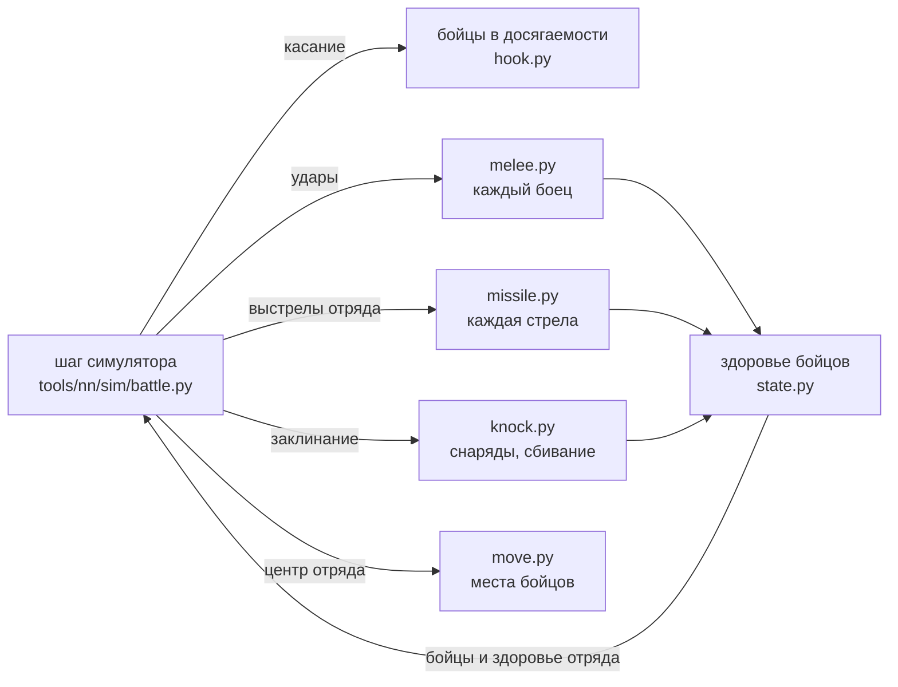

# Лаборатория бойцов

[← Назад](README.md) · [Документация](../README.md) › [Данные для обучения](README.md) › Лаборатория бойцов · [English](../../en/training/fighters_lab.md)

Модель, в которой каждый боец отряда — отдельная точка со своим здоровьем, своим местом в строю и своими ударами.
Код — `tools/nn/fighters/`, файлы симулятора (`tools/nn/sim`, `config/nn`) не меняются, версия симулятора та же.
Лаборатория встраивается в шаг симулятора на время запуска и отвечает на вопрос: насколько бойцы ближе к игре, чем
прямоугольник, и что это стоит. Обучение с бойцами — переключатель `run.py --fighters` (по умолчанию выключен; ниже,
«В обучении»).

## Коротко

- **Что даёт.** На тех же записях игры бойцы лучше прямоугольника там, где он врал: убитые на потерянное здоровье у
  поредевших отрядов, первые секунды схватки, убитые под стрельбой (особенно двуручники), касание и форма строя.
  Таблицы — ниже, «Сверка с игрой».
- **Час удара найден.** Боец взмахивает раз в интервал удара из паспорта — и при попадании, и при промахе (схема CA:
  интервал — «наименьший промежуток между началами анимаций удара»). Симулятор считал промах в 0,5 с; отсюда
  прежняя «доля ударов 0,35». Проба в игре (отряды по 5 и 1 бойцу, каждые 0,1 с): 91 попадание при ожидании 76 по
  «взмаху раз в интервал» и 167 по «промах 0,5 с». В пробах один на один урон теперь как в игре без подгонки; в целых
  боях — 1,37 игры (с долей 0,35 было 1,20), по поредевшим 0,95 (было 0,85). Лишний урон целых боёв — вероятно,
  первый удар каждой новой стычки, открыто.
- **Свалки: правило «не больше двух на одного» есть, но выключено.** Свалки 3+ отрядов — перебор лаборатории (1,46 игры;
  прямоугольник 1,10). Правило `melee.pairs` 2 (врага в строю бьют не больше двух сразу) даёт 1,18, бегства 1,09 → 1,00,
  но убитых на здоровье 0,72 → 0,48 и шаг +33 % — выключено до решения пользователя (ниже, «Свалки»).
- **Сбивание с ног** — общий механизм «удар массой или силой → боец отброшен / сбит, лежит», пока от заклинаний; на
  него лягут натиск и монстры. Бой-проба в игре (места бойцов каждые 0,1 с) подтвердил: сбитые лёжа не гибнут, сбитый
  отряд почти не бьёт; отброс — медиана 3 м. Но доля отброшенных у бойцов в 2–5 раз меньше игры (ниже).
- **Скорость** — ниже, «Скорость».

## Как устроено



Симулятор по-прежнему ведёт отряд целиком: приказы, движение центра, мораль и бегство, усталость, способности,
когда отряд стреляет и сколько выстрелов. Лаборатория подменяет на время запуска (`hook.installed()`, без правки
файлов симулятора) пять мест шага:

| Что | Прямоугольник | Бойцы, доля 0,35 | Бойцы, взмах |
|---|---|---|---|
| Касание | края прямоугольников заходят друг в друга | боец одного отряда в досягаемости бойца другого: дистанция боя строя из базы 2,5 м + радиус бойца |
| Рукопашная | сколько бьёт = доля рядов фронта × волна × заполнение | бьёт каждый боец, у которого враг в досягаемости, своим часом удара |
| Стрельба | доля попаданий по формуле разброса, разлёт по соседям | каждая стрела летит в конкретного бойца и попадает в первого на своём пути |
| Заклинания | доза по кольцам вокруг точки удара | каждый снаряд падает в точку: удар, взрыв, сбивание бойцов |
| Потери | пул раненых, равномерные попадания | здоровье каждого бойца; лишний урон пропадает, боец гибнет на нуле |

После шага бойцы и здоровье отряда в симуляторе берутся из бойцов, а сами бойцы идут к своим местам.

Гибель на нуле — с допуском: боец, у которого после удара осталось меньше 1e-5 его здоровья (`hook.DEAD_FRAC`), убит.
Удар, снявший всё, оставляет ноль лишь с точностью округления; без допуска ~1 % живых стояли с остатком меньше 1e-6
здоровья (между 1e-6 и 1e-4 остатков нет), и сколько их — зависело от порядка вычислений: на тех же ударах эти
«почти мёртвые» давали на ~9 % меньше убитых на потерянное здоровье, а скомпилированный шаг — ещё на 7 % меньше.
Раненый при сверке с записью (`state.conform`) сохраняет не меньше 1e-4 здоровья — выше допуска.

**Бойцы** (`state.py`). Место бойца хранится смещением от центра отряда. Отряд в строю: ряды через шаг шаблона из
базы (`unit_spacings`), ширина — заданная, разброс места — `close_formation_spacing_variation` базы. Когда боец
гибнет, его место занимает стоящий за ним в той же колонне (колонна смыкается), ширина строя держится. Строй,
повернувшийся кругом больше чем на 90° за шаг, меняет ряды местами (первая шеренга становится последней), а не
бежит сквозь себя.

**Рукопашная** (`melee.py`). Боец бьёт врага, чей центр не дальше дистанции боя строя из базы (2,5 м) плюс радиус
врага. Держит своего противника, пока тот в досягаемости, иначе берёт ближайшего (сначала из цели приказа отряда).
Удар — формулы игры, как в симуляторе, но по бойцу: шанс попасть 35 + атака + натиск − защита × направление
(направление — откуда пришёл удар относительно взгляда самого ударенного бойца), бросок брони у каждого удара,
лишний урон пропадает. Час удара: после каждого взмаха, попал он или нет, — интервал из паспорта
(`melee.swing_per_interval`; замер — ниже, «Час удара»); идёт, только пока
враг в досягаемости (поэтому первый удар — сразу, а повторный вход в бой нового всплеска не даёт, как в пробе
`recontact`). Правила отряда остаются: держащий строй бьёт с долей 0,5, бегущего — с долей 0,43 и т. д. (удар
проходит с этой вероятностью). Удар по бегущему — без натиска, как у симулятора; в игре половина ударов погони — с
полным натиском (проба `pursuitfast`, [рукопашная](../game/mechanics/melee.md)), но с долей погони 0,43 он даёт
перебор — переключатель `melee.chase_charge` выключен.

**Не больше двух на одного** (`lab.json` `melee.pairs`: по умолчанию `null` — выключено; включить — `--lab
melee.pairs=2`). Врага бьют не больше двух бойцов сразу (одиночку — лорда — сколько угодно). У врага остаются сначала те, кто бил его в прошлом шаге, потом бойцы отряда, чья цель приказа — его
отряд, потом ближние. Лишний боец берёт ближайшего врага в досягаемости, у которого есть место (`pairs_repair`), а если
такого нет — ждёт: не взмахивает, его час удара стоит. Откуда — ниже, «Свалки: не больше двух на одного».

**Стрельба** (`missile.py`). Сколько выстрелов и когда — решает симулятор (залпы, перезарядка, прицел). Выстрелы
делают живые бойцы отряда. Каждый целит в своего бойца-цель (держит его, пока тот жив, — правило `missile.reaim`
симулятора), снаряд ложится с разбросом из базы (зона калибровки, точность), а последние h / tg θ метров летит ниже
головы и попадает в первого бойца на пути — врага или бойца другого своего отряда; бойцов своего отряда снаряд
проходит (`lab.json` `missile.own_pass`, ниже «Пробы стрельбы»). Щит бойца, смотрящего на стрелка, держит свою долю (с
`missile.shield_ap_pierce` симулятора — урезанную бронебойностью снаряда, [симулятор](simulator.md)).
Попадание снимает здоровье именно этого бойца. Кто погиб, решают бойцы: правило прямоугольника «пули принимает первая
шеренга» (`kills.missile_front`) в шаге с бойцами выключено (`hook.own_kills`). Иначе оно вычитало из урона шага
«лишнее сверх убитых» по своему счёту, каждый боец недополучал свою долю, и убитый «наповал» оставался жив с крохой
здоровья (ниже, «Пробы стрельбы»).

**Движение** (`move.py`). Боец переносится с центром отряда и идёт к своему месту (не быстрее бега). Боец первой
шеренги, у которого враг в досягаемости, стоит от него на расстоянии «стойки» (замер, ниже), не дальше 2 м от своего
места (`entity_action_attack_formed_tether_distance` базы); остальные шеренги держатся за ним. Тела (радиус из базы)
не заходят друг в друга.

**Звери бьются вразброд** (`move.free_attack`, `lab.json` `move.free`, включено). Боец отряда-зверя (тело-эллипс —
`radii_ratio` базы меньше 1 — и нет стрелкового оружия; в составе это волчьи крысы), как только его отряд в схватке под
приказом атаки, бросает своё место: идёт к врагу, которого бьёт или который ближе досягаемости + привязи, без привязи к
месту, а если такого нет — бежит к центру цели своего отряда; тела останавливают его у вражеских бойцов, остальные
обтекают строй. В базе есть оба режима атаки, «строем» и «вразброд» (`matched_combat_formed_vs_free_percentage`,
`max_range_for_attack_mode_free_attack` 100 м), но какой у кого, ни одна таблица не говорит — поэтому правило по телу.
Замер — ниже, «Волчьи крысы».

**Сбивание с ног** (`knock.py`) — общий механизм для любого удара массой или силой:

- скорость, которую удар даёт бойцу (тело ударило — масса снаряда × скорость / масса бойца; ударная волна — сила /
  масса бойца × (1 − d / R)), против лестницы базы: от `…_knocked_back` 4 / 2 м/с боец отброшен и стоит, от
  `…_knocked_down` 7 / 3,5 м/с отброшен и лежит (`collision_` / `shockwave_speed_delta_threshold_*`);
- лежит случайное время из `knockdown_getting_up_delay` базы (1,0–2,7 с); лёжа не бьёт (его час удара стоит), его
  не бьют, стрелы и взрывы его не ранят (`knock.invulnerable`: так читает и симулятор, `magic.knock`; сообщество:
  сбитая пехота переживает то, что её бы убило), с отрядом не движется;
- отброшен от центра удара на `knock.throw`: медиана 3,0 м, разброс ×e^N(0; 0,37) — замер (ниже), в базе числа нет;
- встав, идёт на своё место.

Сейчас его вызывают заклинания (каждый снаряд «Раскалённого рока» и «Варп-молнии» падает в свою точку: удар в
пределах `collision_m` + радиус бойца, не больше `penetration` ближних, и взрыв с убыванием из `config/nn/sim.json`
`magic`). Натиск и монстры позже вызовут ту же функцию `knock.knock()`.

**Мораль и бегство** — симулятора, на уровне отряда, без изменений; мораль видит потери, посчитанные по бойцам.

## Числа и откуда

| Число | Значение | Откуда |
|---|---|---|
| Досягаемость удара | 2,5 м + радиус цели | БД `entity_action_attack_formed_combat_distance`, радиус `battle_entities` |
| Привязь к месту | 2,0 м | БД `entity_action_attack_formed_tether_distance` |
| Стойка (расстояние до врага у первой шеренги) | 1,0 м при касании → 2,3 м, τ 13 с | замер: места бойцов 48 полос проб reform, reform2, damaged, dmgmelee, wave, armour — медиана расстояния до ближайшего врага у 15 ближних бойцов 0,98 / 1,14 / 1,32 / 1,51 / 1,91 / 2,24 / 2,26 / 2,39 м на 0–1 / 1–3 / 3–5 / 5–10 / 10–20 / 20–40 / 40–90 / 90–240 с |
| Час удара | взмах раз в интервал паспорта, и промах тоже | схема CA (`melee_weapons`: интервал — между началами анимаций удара); замер — проба `swing`, ниже |
| Доля ударов `blow_share` | 1 (была 0,35) | прежний замер 0,35 = отношение «взмах раз в интервал» к «промах 0,5 с» (p + 0,5 / интервал) |
| Разброс стрел | как у симулятора (`missile.accuracy.spread`): квадрат со стороной √(зона калибровки / p), p = точность / 100 × (дистанция / d)² × (1 − угол вылета / 180°) в [0,01; 1], точка падения равномерно по нему (поперёк линии ±сторона/2, вдоль на земле ±сторона / (2 sin угла)); при "gauss" — σ = √зона калибровки × d / дистанция × (1 − точность) | БД, модель симулятора `missile.square_side`, проба `shots` |
| Сбит / лежит | 7 / 3,5 м/с; 1,0–2,7 с | БД |
| Отброс | медиана 3,0 м (p10–p90 2,3–6,0) | замер: бой-проба сбивания, ниже |
| Звери вразброд | тело-эллипс без стрелкового оружия | правило по телу (в базе нет, кто как атакует); замер: пробы волчьих крыс, ниже |
| Бьющих одного врага сразу | сколько достаёт; правило «не больше 2» (`melee.pairs`) выключено | записи игры: урон «своей цели» идёт по числу пар «бьющий — враг» с двумя на врага, ровно при любой толпе; в базе — «второй атакующий по той же цели» (`melee_secondary_attack_probability`), третьего нет; ниже, «Свалки» |

Все числа лаборатории с причинами — `tools/nn/fighters/lab.json`.

## Сверка с игрой

### Пошаговый повтор 92 боёв

Каждые 10 с симулятор ставится в записанное состояние боя игры и играет 9 с по записанным приказам, 4 копии
(`tools/nn/sim/stepreplay.py`). Бойцы переносят из своего прошлого окна места и раны (раны подгоняются под здоровье
записи: первыми гибнут самые раненые). Окна выбраны по игре — одинаковые для обеих моделей. Сим / игра, 95 % интервал
по боям (`python -m tools.nn.fighters.card`):

Таблица снята до допуска гибели (`hook.DEAD_FRAC`, «Как устроено»). С ним (повтор тех же 92 боёв, `sr_swing` →
`build/fspeed/full92_sr`): убитых на здоровье в рукопашной 0,87 → 0,94 (> 85 % 1,07 → 1,17, 20–40 % 0,89 → 0,98,
< 20 % 1,29 → 1,56), под стрельбой 0,65 → 0,89 (двуручники 0,63 → 0,82); урон в рукопашной 1,37 → 1,39, под
стрельбой 0,84 → 0,83, касание 0,884 и бегства 1,21 → 1,20 — те же.

С правилом «убитых решают бойцы» (`hook.own_kills`, ниже «Пробы стрельбы»; повтор тех же 92 боёв с разбросом-квадратом,
до → после): убитых на здоровье под стрельбой 0,25 → 1,09 (у целых отрядов 0,40 → 1,36, двуручники 0,67 → 1,28), в
рукопашной 0,85 → 0,94; урон под стрельбой 0,92 → 0,94, в рукопашной 1,33 → 1,34, бегства 1,19 → 1,20. До правки
лаборатория в обучении с `--fighters` тоже теряла эти убитые (правило прямоугольника включено с `kills.missile_front`).
Сквозной пролёт своих (`missile.own_pass`) в этих боях ничего не меняет (под стрельбой 0,94, убитых 1,08).

| Показатель | Окон | Игра | Прямоугольник | Бойцы |
|---|---|---|---|---|
| Рукопашная, убитых на потерянное здоровье, здоровье > 85 % | 8 481 | 0,42 | 0,91 [0,87–0,95] | 0,89 [0,87–0,92] |
| … 60–85 % | 12 430 | 0,72 | 0,94 [0,91–0,97] | 0,78 [0,76–0,80] |
| … 40–60 % | 7 621 | 0,98 | 0,80 [0,78–0,82] | 0,77 [0,75–0,79] |
| … 20–40 % | 5 018 | 1,22 | 0,72 [0,71–0,74] | 0,85 [0,82–0,87] |
| … < 20 % | 840 | 1,58 | 0,66 [0,62–0,70] | 1,19 [1,05–1,40] |
| Под стрельбой, убитых на здоровье, все | 6 283 | 0,38 | 0,58 [0,52–0,65] | 0,62 [0,58–0,66] |
| … здоровье > 85 % | 3 442 | 0,11 | 0,30 [0,25–0,37] | 0,64 [0,57–0,73] |
| … двуручники (большие мечи) | 669 | — | 0,24 [0,13–0,40] | 0,62 [0,49–0,76] |
| Рукопашная, потерянное здоровье, все | 34 390 | — | 0,89 [0,86–0,91] | 1,20 [1,15–1,25] |
| … здоровье > 85 % / < 20 % | | — | 0,85 / 1,08 | 1,26 / 0,66 |
| Поредевший (< 30 %) в рукопашной, урон по нему | 2 886 | — | 1,03 [0,98–1,09] | 0,85 [0,80–0,91] |
| Касание: секунды рукопашной игры с флагом у копий | | — | 0,901 | 0,885 |
| … ложное касание (у игры нет) | | — | 0,121 | 0,111 |
| Начатые бегства | | 2 399 | 0,97 | 1,03 |

Главное: убитые на здоровье у поредевших отрядов (20–40 % и < 20 %) ближе к игре (0,72 / 0,66 → 0,85 / 1,19), под
стрельбой у двуручников 0,24 → 0,62 и у целых 0,30 → 0,64. Хуже: урон в рукопашной у целых отрядов 0,85 → 1,26 (общая
доля ударов 0,35 снята на парах один на один, в целых боях она выше игры), у почти разбитых 1,08 → 0,66. Касание на
уровне прямоугольника (0,90 / 0,89).

### Час удара (проба swing)

План `swing` зонда (`build/charge-probe/runs/20261016-213837`, один бой, 5 полос): отряды урезаны до 5 и 1 бойца
(`kill_number_of_men`), обе стороны атакуют с 3 м, здоровье и места бойцов каждые 0,1 с
(`python -m tools.nn.fighters.swingdata`). Попадания — падения здоровья отряда между замерами; человеко-секунды —
бойцы в досягаемости (3,15 м) врага. Всего 91 попадание (77 падений) за 1 020 человеко-секунд: «взмах раз в интервал»
(p / интервал) ждёт 76 (игра / он 1,20 ± 0,21 по попаданиям, 1,01 по падениям), «промах 0,5 с» ждёт 167 (0,55). По
полосам 0,63–1,96 (мало попаданий в каждой). Одного боя хватило: разница между правилами двукратная, ошибка ±21 %.

Столбец «бойцы, взмах» — без доли 0,35, с часом удара «взмах раз в интервал» (ниже, «Час удара»):

| Показатель | Прямоугольник | Бойцы, доля 0,35 | Бойцы, взмах |
|---|---|---|---|
| Рукопашная, урон, все | 0,89 | 1,20 | 1,37 [1,32–1,43] |
| … здоровье > 85 % / 60–85 % / < 20 % | 0,85 / 0,86 / 1,08 | 1,26 / 1,26 / 0,66 | 1,51 / 1,42 / 0,70 |
| Поредевший (< 30 %), урон по нему | 1,03 | 0,85 | 0,95 [0,88–1,02] |
| Убитых на здоровье, рукопашная, все / < 20 % | 0,86 / 0,66 | 0,79 / 1,19 | 0,87 / 1,29 |
| Убитых на здоровье, стрельба, все | 0,58 | 0,62 | 0,65 |
| Начатые бегства | 0,97 | 1,03 | 1,21 |

В пробах один на один взмах раз в интервал сходится с игрой (урон 15–30 с / устойчиво 1,00 / 1,02), а в целых боях урон
выше игры: вероятно, начало каждой стычки — каждый боец, впервые дотянувшийся до врага, бьёт сразу (в пробах за 0–1 /
0–2 с 1,58 / 1,39 игры), а в целых боях новых стычек много. Открыто.

### Первый удар (проба swing, бой 2)

`build/charge-probe/runs/20261016-232843`: те же пары по 25 бойцов (много первых касаний), одна полоса — натиск с
40 м (`python -m tools.nn.fighters.openingdata`). Весь бой: 551 попадание, «взмах раз в интервал» ждёт 441 (1,25 по
попаданиям, 1,04 по падениям), «промах 0,5 с» — 959 (0,57): час удара подтверждён второй раз. Начало стычки: каждый
боец, впервые оказавшийся в досягаемости врага, — сколько попаданий к 1 / 2 / 3 / 5 / 10 с после касания, игра /
модель:

| Модель первого удара | 1 с | 2 с | 3 с | 5 с | 10 с |
|---|---|---|---|---|---|
| бьёт сразу, потом раз в интервал | 1,22 | 1,41 | 1,50 | 1,09 | 0,98 |
| случайная точка интервала | 6,85 | 3,54 | 2,42 | 1,82 | 1,28 |
| бьёт через 0,5 с | 1,72 | 1,41 | 1,51 | 1,25 | 1,00 |
| бьёт через 1 с | 4,67 | 1,45 | 1,51 | 1,87 | 1,07 |

Игра бьёт в начале не слабее, а сильнее «сразу» (1,2–1,5 за первые 3 с): механика первого удара — «готов сразу»,
без задержки (схема CA: интервал — между началами анимаций, у бойца, ещё не бившего, ограничения нет). Остаток
(+20–50 % в первые секунды) — бойцов в досягаемости при касании в игре больше, чем видит счёт по местам раз в 0,1 с
(толкотня первой волны), открыто. Значит, лишний урон лаборатории в целых боях (1,37) — не от первого удара.

### Повтор от мест бойцов игры

Бой, записанный с местами бойцов (`tools.build nn-arena ... --soldiers-every 1`: мост пишет `nn_soldiers` раз в
секунду), повторяется так: в начале каждого окна каждый живой боец лаборатории ставится на записанное место бойца
своего отряда (ближайшие пары), и эти места в системе отряда — его места на окно (`places.py`, `soldiersdata.py`;
`python -m tools.nn.fighters.replay --runs <run> --places --geometry`). Два боя экзамена v2 (зерно 1000700001, сеть
itS26_15 против ИИ игры; второй — 479 с из ~950, прерван), урон в рукопашной по целым отрядам, сим / игра:

| Старт окна | Урон, все | Бойцов в досягаемости врага за секунду (игра 525) | Ближайший враг внутри своего строя (игра 0,83) |
|---|---|---|---|
| Прямоугольник (симулятор) | 0,98 | — | — |
| Бойцы, строй-прямоугольник по центру записи | 1,45 | ~507 | 0,74 |
| Бойцы, места из записи | 1,21 | 530 | 0,86 |

Места игры убирают около половины перебора (1,45 → 1,21); бойцов в досягаемости тогда столько же, сколько в игре, и
так все 9 с окна (521–533 против 542–554 / 472–485 по боям). Остаток — урон на бойца в досягаемости в больших
свалках выше игры (в пробах один на один совпадает). В игре свалки — норма: «ближайший враг внутри своего строя» у
83 % бойцов в досягаемости (в пробах один на один — 31 %).

**Свалки в игре** (те же записи, секунды рукопашной без стрельбы по отряду; `build/fighters2/game_rate.py`,
`mob_rate.py`): отряд теряет почти одинаково, сколько бы вражеских отрядов его ни доставало — 18 / 21 / 21 (×10⁻⁴ своего
здоровья в секунду) при 1 / 2 / 3+ отрядах, хотя врагов в досягаемости 18 / 33 / 61. Урон на бойца в досягаемости
падает втрое; боец отряда, чья цель — другой отряд, бьёт в 0,35–0,53 раза слабее бойца отряда, который целит в этот
(подбор по секундам). Нажим на самого бьющего (сколько врагов достаёт его) его темп не меняет. Лаборатория от мест
игры: 21 / 25 / 31 — 1,15 / 1,24 / 1,46 игры.

| Вариант (повтор от мест, 2 боя) | Урон, все | 1 / 2 / 3+ отряда |
|---|---|---|
| Как сейчас (сторона удара по взгляду бойца) | 1,23 | 1,15 / 1,24 / 1,46 |
| Сторона удара по взгляду отряда (`melee.direction` "unit") | 1,29 | 1,18 / 1,29 / 1,55 |
| … от центра отряда к центру (как прямоугольник) | 1,19 | 1,05 / 1,18 / 1,44 |
| Боец отряда с другой целью бьёт с долей 0,45 (`--set contact.unit_incidental=0.45`, замер выше) | 1,10 | 1,04 / 1,05 / 1,33 |

Сторона удара свалок не объясняет (пробы рукопашной с любым правилом те же: устойчиво 1,01). Доля «чужой цели»
снимает больше половины остатка: в лаборатории это её собственное число `melee.unit_incidental` 0,45 (`lab.json`, с
источником); `contact.unit_incidental` симулятора-прямоугольника остаётся 1. Остаток больших свалок снимает правило
«не больше двух на одного» (ниже), но оно выключено.

**Свалки: не больше двух на одного** (`melee.pairs`, по умолчанию выключено). Перебор — только у лаборатории: прямоугольник на тех же 2 боях
от мест (`build/agent-mobs/rect`) даёт 1 / 2 / 3+ отряда 1,07 / 0,95 / 1,10, лаборатория без правила 1,28 / 1,16 / 1,46.
Записи игры (те же 2 боя, секунды отряда-жертвы, где все бьющие — из отрядов, чья цель приказа — она): урон к формуле
одного бьющего на каждого бойца в досягаемости падает 0,85 → 0,44, когда бьющих на одного ударенного становится
1,3 → 4,6. К формуле на число непересекающихся пар «бьющий — враг» (каждый враг — не больше чем с двумя бьющими,
наибольшее паросочетание по досягаемости 3,15 м) он ровный: 0,61–0,69 (с одним на врага 0,79–1,05). Лаборатория без
правила растёт с толпой: 1,5 → 2,4 тех же пар. Значит, в игре лишние бьющие у одного врага урона не добавляют. В базе
есть «второй атакующий по той же цели» (`melee_secondary_attack_probability` 1 — ему всегда можно бить), третьего нет.
Повтор 2 боёв от мест (`build/agent-mobs`), лаборатория / игра (по умолчанию — первая строка, правило выключено):

| Вариант | Урон, целые отряды | 1 / 2 / 3+ отряда | Убитых на потерянное здоровье | Бегства |
|---|---|---|---|---|
| Без правила (по умолчанию) | 1,16 | 1,28 / 1,16 / 1,46 | 0,72 | 1,09 |
| Не больше 1 на врага | — | 0,92 / 0,79 / 0,92 | 0,33 | 0,97 |
| **Не больше 2** | **0,99** | **1,12 / 0,97 / 1,18** | 0,48 | **1,00** |
| Не больше 3 | 1,06 | 1,18 / 1,07 / 1,31 | 0,55 | 1,05 |
| Не больше 2, лишний не ищет другого врага | 0,84 | 0,95 / 0,85 / 1,00 | 0,51 | 0,97 |

С правилом свалки 3+ отрядов как 1 отряд (1,18 и 1,12); остаток ~1,1 — общий для «своей цели» (1,29, без правила 1,53;
«чужая» 0,58). Пошаговый повтор itS26_15 (10 боёв, места — свои у лаборатории): урон в рукопашной 1,15 → 1,08, бегства
1,03 → 0,97. Пробы рукопашной (53 полосы с толпой): HP цели 0–1 / 0–5 / 5–15 с / устойчиво 1,45 / 1,13 / 0,80 / 0,98 →
1,25 / 1,03 / 0,80 / 0,98, ошибка по полосам меньше во всех окнах; убитые цели за 0–10 с 1,33 → 1,04. **Хуже стало:**
убитых на потерянное здоровье в целых боях 0,72 → 0,48 (itS26_15 0,91 → 0,71) и убитые атакующего в пробах за 0–10 с
0,80 → 0,56: удары ложатся на большее число бойцов, а игра их сгущает. Это и прежний недобор убитых (без правила 0,72,
окна по 30 с — тоже) — одна открытая задача: чем игра сгущает удары на меньшем числе бойцов. Правило выключено до решения пользователя: убитых на потерянное здоровье в целых боях становится меньше (0,72 → 0,48 игры, а мораль считает убитых), шаг лаборатории дороже на 33 %, K выбран отчасти по результату, а проба толпы предела атакующих не нашла
(проба `crowd`: горстка крыс в окружении гибнет от 3,6–5,5 бьющих на крысу). Шаг лаборатории с правилом: 1024 боя
21,1 → 28,1 мс.

**Где остаток свалок** (повтор тех же 2 боёв от мест, `build/night_mob`):

- Лишнее есть уже в первую секунду окна, когда места бойцов — точно игры: 3+ отряда 1,28 / 1,35 / 1,37 на секундах
  0–1 / 2–4 / 5–8 окна. Значит, дело в правиле удара на бойца, а не в том, как бойцы расходятся.
- Не натиск: без натиска (`--set charge.min_runup_m=1e9`) 3+ отряда 1,27 (было 1,28). Не «чужая цель»: с
  `unit_incidental` 0 3+ отряда 1,08–1,27, зато 1 отряд 0,88–1,00.
- Лишнее растёт с размером касания, а не с числом отрядов. Лаборатория / игра по числу вражеских бойцов в
  досягаемости отряда (первая секунда окна): < 10 — 0,52, 10–20 — 0,76, 20–35 — 1,03, 35–50 — 1,12, 50–80 — 1,22,
  80+ — 1,77. Игра теряет почти одинаково (14–29 ×10⁻⁴ в секунду), сколько бы врагов ни дотягивалось; лаборатория —
  пропорционально числу бьющих. Свалка 3+ отрядов — просто большое касание (часто подход свежего отряда: при
  «свежем» бьющем отряде, < 5 с в схватке, 3+ — 1,59, без него 0,82–1,14).
- «В пробах урон на бьющего падает с толпой» (0,98 → 0,18 формулы от < 10 до 90+ бьющих) — ошибка счёта: большие
  толпы в пробах давали полосы, где атакующий не бьёт (план meleeorders — приказ пройти сквозь врага, игра 0,00–0,14
  формулы; defender — стоп и отход), а бойцы в 3,15 м от врага там есть. Без них — 0,6–0,9 формулы на всех 14–32
  бьющих.

**Проба толпы** (план `crowd`, `build/charge-probe/runs/20261017-231623`, один бой; мечники атакуют кланкрыс с 3 м,
обе стороны атакуют; кланкрысы урезаны до 5 / 15 / 25 бойцов или полные, на них один отряд мечников или три — ещё два с
флангов; места и здоровье каждые 0,1 с; `python -m tools.nn.fighters.crowddata <run> [--lab]`):

| Полоса | HP/с кланкрыс в игре, 0–3 / 3–10 / 10–30 с | Лаборатория / игра | Бьющих в досягаемости / ударенных в досягаемости |
|---|---|---|---|
| 1 отряд → 5 крыс | 53 / 28 / — | 1,30 / 0,48 / — | 26 / 2,8 |
| 1 отряд → 15 крыс | 138 / 53 / 16 | 1,19 / 1,02 / 0,07 | 24 / 6,4 |
| 1 отряд → полный | 172 / 54 / 31 | 0,78 / 1,55 / 1,24 | 30 / 26 |
| 3 отряда → полный | 253 / 173 / 75 | 1,28 / 1,03 / 1,11 | 25 / 22 |
| 3 отряда → 25 крыс | 217 / 100 / 23 | 0,89 / 0,88 / 0,64 | 26 / 9 |
| Сумма по полосам | | 1,06 / 1,02 / 0,95 | |

Предела «сколько бьют одного» нет: 5 крыс в окружении (2,8 в досягаемости) теряют 14 HP/с на крысу — 5,5 удара одного
бьющего по формуле; «каждый ударенный принимает не больше K» не сходится ни при каком K ≤ 5. Лаборатория на этих
полосах — в пределах шума игры (сумма 0,95–1,06). Это первые секунды и горстка врагов в окружении, где у каждого
свободны все стороны; в строю (целые бои) лишние бьющие урона не добавляют — правило «не больше двух на одного»
(выше, выключено). С ним полосы толпы почти те же: сумма HP цели 0–1 / 0–5 / 5–15 / 15–30 с 1,97 / 1,39 / 0,63 / 1,29 → 1,50 /
1,22 / 0,67 / 1,23.

**Где лишнее целых боёв** (повтор 2 боёв от мест, секунды отряда-жертвы, урон лаборатории / игры): по тому, чьи бьющие:

| Бьющие по жертве | Секунд | Лаборатория / игра |
|---|---|---|
| все — из отрядов, у которых эта жертва — цель приказа, стоят, не свежие | 2 726 | 1,59 (первая секунда окна: 1,49) |
| все — из отрядов с другой целью («чужой» враг), стоят | 3 595 | 0,50 |
| есть бьющие из движущихся отрядов | 4 334 | 1,45 |
| все секунды | 12 989 | 1,22 |

Лишнее — у «своей цели» уже в первую секунду, когда места бойцов точно игры, и одинаково при любом размере толпы
(1,81 / 1,44 / 1,60 / 1,57 при 9 / 21 / 38 / 67 бьющих). «Чужая цель» — наоборот, вдвое меньше игры
(`melee.unit_incidental` 0,45 сводит их сумму). Свалка 3+ отрядов — смесь этих двух случаев с бóльшим касанием. Чем
игра отличается — не найдено; проверены (лучше не стало, «Пробовали и отказались»): выбор врага без предпочтения цели
приказа (`melee.prefer_target`), досягаемость 2,5 м от центра до центра (`melee.reach_radius`), удар только при свободной
линии до врага (`melee.clear_line`).

Что известно (`build/night3`: лог досягаемости лаборатории по парам отрядов, `reachlog.py`):

- Бойцов «своей цели» в досягаемости у лаборатории столько же, сколько в игре (23,4 против 21,8 на жертву в секунду):
  лишнее — в уроне на бойца, а не в их числе. У «чужой цели» бойцов лаборатории в досягаемости 0,64 от игры (их тянет
  к своей цели приказа).
- В игре боец «чужой цели» бьёт не в 0,45, а в ~0,6 раза слабее бойца «своей» (при том же числе бойцов в досягаемости
  по местам игры: 0,94 / 0,52 / 0,48 против 1,40 / 0,86 / 0,81 ×10⁻⁴ здоровья в секунду при 10–20 / 20–35 / 35–50
  бьющих). То есть в целых боях в игре и те и другие бьют ~0,6 формулы, а доля 0,45 лаборатории прикрывает перебор
  «своих».
- Урон игры растёт не с числом бьющих, а с числом своих бойцов, до которых дотянулись: на такого бойца 0,62–0,69
  ×10⁻⁴ в секунду при 1–3 бьющих на него; лаборатория растёт с числом бьющих (лаборатория / игра 1,02 / 1,22 / 1,32 /
  1,29 при 0–1 / 1–1,5 / 1,5–2 / 2–3 бьющих на ударенного).
- Бьющий, у которого на линии до врага стоит свой (тело в 0,6 м от линии), в игре урона не добавляет (наименьшие
  квадраты: 0,78 на свободного, −0,46 на закрытого); таких 30 % в игре, 30–40 % в лаборатории. Но запрет бить закрытым
  портит убитых на здоровье (ниже, «Пробовали и отказались»).
- Тип отряда, усталость и здоровье лишнего не объясняют: «своя цель» 1,1–1,6 у всех типов пехоты, при любой усталости.

**Убитых на здоровье: сброс окна и «текучка» бойцов** (повтор тех же 2 боёв от мест, `build/night4`):

- **Часть недобора — от сброса окна.** Убитых на здоровье, лаборатория / игра, по секундам окна 0–8: 0,64 / 0,54 /
  0,66 / 0,67 / 0,70 / 0,81 / 0,88 / 0,86 / 0,87 (у игры ровно). После сброса бойцы стоят на новых местах и бьют новых
  врагов — удары ложатся на тех, кого они ещё не ранили; за 5–8 с пары «бьющий — его раненый» складываются снова.
  `card --settle 5` (только секунды 5–9 окна): все 0,75 → 0,86; целые (> 85 %) 0,97 → 1,11, 60–85 % 0,69 → 0,81, 40–60 %
  0,72 → 0,78. Дело не в том, где лежат раны: доля ран у бойцов в досягаемости до и после сброса одна (0,217), раздача ран
  по близости к врагу и сохранение цели через сброс ничего не меняют (0,74). Без сброса — в пробах и у целых отрядов —
  лаборатория убивает на здоровье даже больше игры (1,1–1,4).
- **«Текучка» почти как в игре.** Боец в досягаемости врага (3,15 м) на секундах 1–7 окна — через 3 с всё ещё в ней
  (среди выживших; `python -m tools.nn.fighters.churndata`, лаборатория — `replay --places --churn`). Бойцы игры
  прослеживаются по месту в списке `ManList` (место погибшего занимает последний боец списка — проверено по пробам раз в
  0,1 с), поэтому место считается тем же бойцом, только пока не прыгает дальше порога за секунду. Порог решает: при
  2,5 м из подсчёта выпадает половина бойцов отрядов, чей центр сдвинулся больше 6 м за 3 с, — именно ушедшие с ним, —
  и остаются стоявшие (отсюда прежнее «игра 0,88 против 0,63, когда центр движется»). Одинаково для обеих моделей
  (порог 5 м, отряды не в бегстве, по сдвигу центра в игре):

  | Сдвиг центра за 3 с | < 0,5 м | 0,5–1,5 | 1,5–3 | 3–6 | > 6 м | все |
  |---|---|---|---|---|---|---|
  | Игра | 0,82 | 0,83 | 0,84 | 0,83 | 0,77 | 0,82 |
  | Лаборатория | 0,83 | 0,83 | 0,83 | 0,76 | 0,67 | 0,80 |

  Разница 0,02 — только когда отряд движется больше 3 м за 3 с. Бегущие отряды: игра 0,86 (их бойцы, застрявшие в
  схватке, из неё не выходят: центр бегущего отряда в игре часто стоит), лаборатория 0,67 (центр уносит бойцов со
  скоростью бегства) — это движение отряда в симуляторе, не бойцов. Чего в лаборатории больше игры — тряски: боец в
  досягаемости при стоящем центре проходит за 3 с 1,64 м (игра 0,73), а тот же ближайший враг остаётся рядом у 0,55
  (игра 0,67) — тела толкают бойца с места (0,22 м за шаг 0,5 с), он идёт обратно (0,36 м). Правила, убирающие тряску
  или «отрыв» от центра, почти не меняют убитых на здоровье, а урон поднимают («Пробовали и отказались»): «текучка» —
  не главная причина недобора убитых на здоровье.
- `clear_line` с `unit_incidental` 1 (`build/night4/clear_inc1`): урон по целым отрядам 1,14 → 0,95, убитых на здоровье
  0,75 → 0,62, после 5 с окна 0,86 → 0,68 (целые 1,11 → 0,83) — падение убитых не от сброса: правило снимает удары
  второй шеренги по тем же передним бойцам. Включать его рано, пока не найдено, чем игра сгущает удары.

### Волчьи крысы (пробы wolfrats, wolfpoison)

22 полосы 4 боёв (`build/charge-probe/runs/20261011-2141…2145`; крысы против мечников, копейщиков, Генерала; 4 копии;
`probes --plans wolfrats,wolfpoison`). Сеть, обученная на бойцах (itS27_4), держит крыс подальше от рукопашной: в
лаборатории крысы проигрывали её много сильнее игры. Причина — строй: в игре крысы бьются вразброд, почти все в
досягаемости и обтекают врага; в лаборатории бились строем (ряды 3,5 м, бьёт только первый). Сим / игра, сумма по полосам:

| Показатель | Игра | Прямоугольник | Бойцы строем (было) | Бойцы, звери вразброд |
|---|---|---|---|---|
| Крыс в досягаемости врага, 1–3 / 5–10 с | 57 / 55 | — | 17 / 16 | 56 / 64 |
| Обтекание (доля крыс сбоку и сзади врага), 5–10 с | 0,1–0,7 | — | 0,00–0,02 | 0,1–0,8 |
| Урон крыс, 0–5 / 5–15 с / устойчиво | | 0,81 / 0,70 / 0,83 | 0,69 / 0,32 / 0,41 | 1,60 / 1,13 / 0,87 |
| Потери крыс, 0–5 / 5–15 с / устойчиво | | 0,59 / 0,54 / 0,80 | 1,08 / 0,75 / 1,35 | 1,43 / 1,34 / 1,92 |
| Урон крыс / их потери, 5–15 с | | 1,30 | 0,43 | 0,84 |

Крысы стоят в схватке как в игре, и соотношение «нанесли / потеряли» на 5–15 с — 0,43 → 0,84. Но обе стороны теперь бьют
больше игры: это та же беда больших касаний, что и в свалках (у игры в досягаемости крыс 87 мечников, а их урон — около
трети формулы). У Генерала крысы снимают 0,08–0,22 игры и до, и после — отдельный вопрос (одиночная цель). Повтор 2
боёв экзамена от мест: урон по целым отрядам 1,10 → 1,14 (в боях есть крысы).

### Форма отряда (для сети)

`shape.unit_features` (torch) — одна функция для бойцов лаборатории и для мест бойцов игры: на отряд 9 чисел и карта
4 × 4, в рамке отряда (по его направлению, от центра масс бойцов): бойцов на м² (ширина × глубина), ширина и глубина
(√12 × разброс бойцов поперёк / вдоль — сторона полного прямоугольника), смещение массы от середины размаха вперёд и
вбок, доля бойцов в досягаемости врага, доля пустых клеток рамки (дыры) и пустых в её переднем ряду, ранения
(1 − здоровье / (бойцы × здоровье бойца)), доля бойцов в каждой из 16 клеток. В игре её считает помощник из мест
бойцов, которые мост шлёт раз в 2 с (`--soldiers-every 2 --soldiers-state`, помощник `--shape`; вход сети — `SHAPE`, [модель](model.md)):
4 мс на чтение 3 000 бойцов (4 потока процессора; бой 17 × 20 отрядов), документ состояния +32 КБ; бой 3 × 4 отряда
в игре — 2,2 мс медиана.

Сверка (`python -m tools.nn.fighters.shapecheck`; повтор 2 боёв от мест игры, `replay --places --shape-log`):
лаборатория через 5 / 10 с после старта окна против игры в ту же секунду; «без изменений» — игра в начале окна против
игры через 5 / 10 с (сколько форма меняется сама):

| Признак | Средняя игры | Лаб. − игра, 5 / 10 с | Без изменений, 5 / 10 с | Корреляция лаб. и игры, 5 / 10 с |
|---|---|---|---|---|
| бойцов на м² | 0,26 (лаб. 0,27) | 0,040 / 0,048 | 0,026 / 0,041 | 0,75 / 0,67 |
| ширина, м | 23,9 (23,9) | 2,9 / 3,5 | 2,3 / 3,4 | 0,61 / 0,55 |
| глубина, м | 24,1 (23,1) | 3,8 / 4,5 | 3,5 / 5,6 | 0,97 / 0,96 |
| смещение вперёд, м | 1,9 (1,4) | 1,7 / 1,9 | 1,7 / 2,6 | 0,86 / 0,80 |
| в досягаемости врага | 0,185 (0,181) | 0,075 / 0,082 | 0,045 / 0,070 | 0,84 / 0,81 |
| дыры / в переднем ряду | 0,09 / 0,14 | 0,04 / 0,08 | 0,04 / 0,07–0,09 | 0,85–0,88 / 0,78–0,80 |
| ранения | 0,23 | 0,007 / 0,009 | 0,004 / 0,008 | 1,00 / 0,99 |
| клетки 4 × 4 | 0,04–0,08 | ~0,021 | ~0,020–0,027 | 0,42–0,74 |

Средние совпадают (смещения нет); ошибка лаборатории — на уровне того, насколько форма меняется сама за 5–10 с
(через 10 с лаборатория ближе к игре, чем «без изменений», по глубине, смещению и дырам; хуже по доле в досягаемости
через 5 с). 4 524 отрядо-секунды на каждый срок; отряды от 10 бойцов, без лордов.

### Пробы рукопашной

112 полос 11 планов зонда (`tools/nn/charge_probe.py`: reform, reform2, dmgmelee, damaged, wave, armour, defender,
fresh, meleeorders, recontact, busycharge), двойник каждой полосы 4 копии. Средний |log(сим / игра)| по полосам и сумма
сим / игра:

| Что | Прямоугольник | Бойцы |
|---|---|---|
| HP цели за 0–1 с | 0,90 (0,61) | 0,53 (0,83) | 0,63 (1,58) |
| HP цели за 0–5 с | 0,60 (0,63) | 0,38 (0,86) | 0,42 (1,35) |
| HP цели за 5–15 с | 0,20 (0,94) | 0,27 (0,90) | 0,36 (0,85) |
| HP цели за 15–30 с | 0,29 (1,11) | 0,30 (0,92) | 0,27 (1,00) |
| HP цели в секунду, устойчиво | 0,31 (1,03) | 0,34 (0,92) | 0,29 (1,02) |
| Убитые цели за 0–10 с | 1,63 (0,34) | 0,46 (0,90) | 0,50 (1,37) |
| Убитые цели за 15–30 с | 0,39 (1,34) | 0,37 (1,10) | 0,40 (1,19) |
| Убитые атакующего за 5–15 с | 2,49 (0,14) | 0,83 (0,69) | 0,59 (0,95) |

Форма по местам бойцов (игра / бойцы, среднее по полосам; прямоугольник — рамка: глубина 12,2 м, ширина 28,6 м
всегда): бойцов в досягаемости 3,15 м на 1–3 / 5–10 / 20–40 / 90–240 с — 48 / 38 / 23 / 16 и 37 / 34 / 22 / 15;
стойка первой шеренги 1,43 / 1,76 / 2,53 / 2,82 и 1,30 / 1,46 / 2,34 (на 90–240 с у бойцов 6,3: от строя остались
одиночки); глубина 11,7 / 11,3 / 12,7 / 10,4 и 11,7 / 11,8 / 11,2 / 8,9 м; ширина 28,3–28,5 и 28,6–29,1 м; обтекание
(доля бойцов сбоку от врага) 0,01–0,05 и 0,00–0,02.

### Бегущие

Пробы routmob, routmob2, passby: толпа бегущих вдоль бегства / поперёк (p90 − p10, м) на 0–3 / 3–7 / 7–15 / 25–45 с
после бегства: игра 8,1 / 21,4, 11,7 / 22,5, 7,6 / 23,1, 6,5 / 23,3; прямоугольник 7,2 / 23,0, 7,2 / 23,0, 5,8 / 23,0,
5,8 / 23,0; бойцы 6,4 / 17,3, 5,2 / 12,3, 5,4 / 22,4, 5,4 / 22,2. В игре толпа держит ширину строя (~23 м) и
вытягивается вдоль бегства в первые секунды до 12 м; у бойцов на 3–7 с строй сжимается поперёк (разворот кругом и
переход на новые места) — открыто.

### Сбивание с ног (бой-проба)

Бой 6 плана magic (`build/magic/runs/20261016-211346`, один бой, «Нормальная», графика low): цели держатся скриптом,
места бойцов каждые 0,1 с, каждый боец прослежен (`python -m tools.nn.fighters.knockdata`). «Отброшен» — двигался
быстрее 4 м/с (в контроле без каста — ни одного такого удара). На удар (каст):

| Удар, цель | Бойцов | Отброшено | Отброс, м (p10 / медиана / p90) | Лежал, с (медиана / p90) |
|---|---|---|---|---|
| Рок → кланкрысы (4 удара) | 537 | 0,39 | 2,3 / 3,3 / 6,0 | 2,7 / 4,4 |
| Рок → рабы (3) | 421 | 0,47 | 2,3 / 3,2 / 7,2 | 2,3 / 4,4 |
| Молния → мечники (3) | 244 | 0,29 | 1,4 / 3,0 / 9,0 | 0,1 / 1,0 |
| Молния → мечники в рукопашной (2) | 165 | 0,27 | 1,6 / 2,8 / 4,7 | 0,2 / 3,1 |

- Отброс одинаков у обоих заклинаний и всех целей: одно распределение; направление — в основном прочь от удара
  (косинус с линией от центра удара, медиана 0,5–0,7). Прежние «1,5–3 м» по местам раз в секунду включали обычное
  движение.
- Лежат после рока 2,3–2,7 с (база 1,0–2,7 + встать); после молнии почти не лежат — её волна (сила 400 / масса 100)
  отбрасывает, но редко сбивает: так и даёт лестница базы.
- Лёжа не гибнут: 0 смертей за 778 человеко-секунд лёжа, стоящие рядом гибли 0,005–0,020 в секунду (ожидалось ~11).
- Сбитый не бьёт: мечники в рукопашной, у которых молния отбросила 31 из 106, снимали с кланкрыс 20 / 13 HP/с на
  3–6 / 6–12 с после удара, контроль без каста 48 / 33.
- **Бойцы лаборатории** на тех же целях за один каст (32 копии): отброшено 0,17 / 0,06 / 0,06 (рок → кланкрысы, рабы,
  молния → мечники) против 0,39 / 0,47 / 0,29. В игре отброшены и бойцы в 6–9 м от центра (молния 0,42), куда волна по
  формуле базы (линейное убывание, радиус взрыва − 1 м) не достаёт. Кандидаты: отброшенные тела сбивают соседей
  (столкновения), другое убывание силы волны — открыто.

### Пробы стрельбы

33 полосы (dist, targets, shield; thin из `build/probes7`): убитые на потерянное здоровье к 20 / 40 с после первого
залпа, сим / игра (среднее по полосам): прямоугольник 0,67 / 0,55, бойцы 0,92 / 0,71. Здоровье цели к 80 / 120 с:
прямоугольник 0,76 / 0,82 игры (бьёт поредевших больше игры), бойцы 1,11 / 1,49 (меньше: редкий строй пропускает
стрелы). Тонкие цели (45 рабов на 30 м): у игры к 40 с остаётся 14 бойцов, у прямоугольника 20, у бойцов 28–30.

**Убитые решают бойцы** (`hook.own_kills`). Пока в шаге с бойцами работало правило прямоугольника `kills.missile_front`,
оно вычитало из урона шага то, что по его счёту ушло «сверх убитых», хотя бойцы уже сами теряют урон сверх здоровья.
Урон каждого бойца урезался, и убитый одним выстрелом оставался жив с крохой здоровья. Пробы `ratling`, `ratform`,
`ratshape` (17 видов полос по строю), до / после / игра: HP за пулю 0,77 / 0,96 игры (ошибка по видам 0,27 → 0,07),
доля убитых в потерянном здоровье при потере четверти 0,25 / 0,40 / 0,41; ружья по кланкрысам HP за пулю 4,66 / 6,90 /
6,60, доля убитых 0,04 / 0,50 / 0,45. Одиночки (лорд, инженер) не меняются: у одного бойца нет первой шеренги. Числа
после правки те же, что с `--set kills.missile_front=0` (прежний обход), до последней цифры.

**Снаряд проходит своих** (`missile.own_pass`). Проба `shots` (ружья по одинокому инженеру за 27 м): попаданий на
выстрел игра 0,736, бойцы 0,051 — настильная пуля, нацеленная в пояс, падает в ~60 м за целью и над своими первыми
шеренгами летит ниже 1,2 м: задние ряды стреляли в спины своим. Со сквозным пролётом своего отряда — 0,735; остальные
полосы проб (арбалеты за 27 м 0,437 → 0,436 при игре 0,352, все полосы на 100–137 м, строи `ratform` и `ratling`) не
меняются.

**Лорд рядом со своей пехотой в рукопашной** (пушки Крысолинга бьют по Генералу вне схватки; повтор боёв сети itS26_15,
сим / игра по здоровью лорда). По центрам отрядов (10 боёв, `build/night3/sr_s26_15_lat` и `build/night5/s26_15_lab`):
все секунды — прямоугольник 0,50, бойцы 0,51; секунды, когда ближайший свой отряд в рукопашной стоит рядом с линией
выстрела (62 с), — 0,14 и 0,28: и бойцы закрывают лорда сильнее игры. Но по местам бойцов (бой 041729, места раз в
секунду): когда своих бойцов в 30-метровом коридоре от лорда к пушке нет (63 с), игра теряет 39 HP/с, бойцы — 0,50 игры;
когда их 3 и больше (12 с), игра почти не теряет (1–7 HP/с) — свои бойцы на линии в игре закрывают лорда, как и в
лаборатории. Значит, «отряд в рукопашной рядом» по центру отряда не значит «бойцы на линии огня» (в схватке строй
вытянут к врагу), закрытие в лаборатории — по настоящим телам, и недобор урона по лорду — тот же, что по одиночке на
открытом месте (0,5), а не от прикрытия.

## Скорость

`python -m tools.nn.fighters.bench` (RTX 5070 Ti 16 ГБ, арена whole_emp_v_skv 20 × 20, 2 262 бойца на бой, все
атакуют ближайшего; мс на шаг 0,5 с, 100 шагов от начала в рукопашную; видеокарту делил другой агент — разброс до
±20 %):

| Боёв | Симулятор, скомпилирован (как в обучении) | Бойцы | Пик памяти бойцов |
|---|---|---|---|
| 256 | 5,9 | 13,7 | 0,33 ГБ |
| 1024 | 9,3–12 | 20,5 | 1,1 ГБ |

Шаг бойцов — 1,7–2,8 шага симулятора. Правило «не больше двух на одного», если его включить (`melee.pairs` 2: два круга раздачи и
два поиска свободного врага за шаг), стоит +33 %: 1024 боя 21,1 → 28,1 мс на шаг (80 шагов, видеокарта свободна).
Как к этому пришли (мс на шаг, 256 / 1024 боя):

| Шаг | 256 | 1024 | Память, 256 / 1024 |
|---|---|---|---|
| Без компиляции (было) | 262 | не влезало | 4,8 / 21,6 ГБ |
| Весь шаг — симулятор и бойцы — через `torch.compile`: без синхронизаций с процессором и данных переменного размера, случайность бойцов — счётчик | 50 | — | 2,0 / — |
| Касание отрядов из двух чисел на бойца (было ~60 млн «атомарных» сложений на шаг), удар по площади — только у бойцов таких отрядов, ядро стрел (не выпущенные снаряды пропускаются) | 15,9 | 42,9 | 1,2 / 4,7 ГБ |
| Соседей ищут свои ядра (касание, цель в рукопашной, толчок тел) прямо по таблице клеток, пустые места клеток пропускаются | 13,7 | 20,5 | 0,33 / 1,1 ГБ |

Как устроено:

- **Компиляция.** На видеокарте весь шаг компилируется (`hook.Hook._runner`, как `battle.stepper` в обучении), если в
  пачке не меньше 100 000 мест бойцов (`hook.COMPILE_MEN`): первая компиляция пачки нового размера ~4 мин (Docker
  хранит её до следующей правки кода). Малые пачки (пробы) идут без компиляции. Внешний сброс (повтор: начало окна по
  записи) проверяется перед шагом без компиляции — одна синхронизация на шаг.
- **Случайность** бойцов — счётчик (`state.rnd`: хеш от боя, бойца, номера шага и места вызова), без генератора:
  шаг компилируется, тот же вход даёт те же числа. Удары по площади (заклинания, `knock.bombard`) — по-прежнему без
  компиляции, на генераторе.
- **Соседи.** Таблица клеток (`cells.Table`): бойцы отсортированы по клетке, у каждой клетки — где её бойцы
  начинаются и сколько их. Ядра Triton (`scans.py`: касание, цель, тела; `kernels.py`: путь стрелы) читают её прямо и
  пропускают пустые места; списки «108 кандидатов на бойца» на видеокарте больше не строятся. У каждого ядра рядом та же
  логика на torch (процессор, тесты); `tests/tools/test_nn_fighters_kernels.py` сверяет числа.
- Ядра вызываются через одну операцию torch (`fighters::launch`): вставленные в скомпилированный граф напрямую, они
  шли в 3–5 раз медленнее (компилятор терял их настройки запуска).

## В обучении

`run.py --fighters` (по умолчанию выключен; в цепочке — `python -m tools.ops.step ... --set fighters=true`):
симулятор обучения идёт с бойцами во всех пачках боёв, сеть видит форму отрядов (вход `SHAPE`: флаг «форма есть» = 1,
признаки из мест бойцов). Мораль, бегство, приказы, усталость, способности — симулятора, как в лаборатории.
`--fighters-men` (7168) — мест бойцов на бой. Версия симулятора не меняется.

Как устроено (`tools/nn/train/men.py`):

- Лаборатория ставится на весь прогон (`hook.installed(adopt=False, shape="lazy", outside=False)`): построенные бои
  (запас армий) бойцов не получают; бойцы живут рядом с состоянием пачки (`st.men`), и шаг идёт с бойцами у любого
  состояния, у которого они есть. Состояние без бойцов идёт обычным симулятором (скомпилированным) — так идут
  проверки `test5` внутри обучения и базы скриптов: они остаются в обычном симуляторе.
- **Начало пачки и перезапуск боя.** Бойцы строятся после того, как бой взят из запаса, сдвинуты места и разыграны
  неточные числа (`randomise`, `--dr`): перезапущенным боям — заново (их строки в пачке заменяются, остальные бои не
  трогаются). Форма отряда считается перед каждым наблюдением (`Men.shape_now`), а не после каждого шага: сеть читает её
  раз в решение (числа те же, тест).
- **Размеры пачки постоянны** — шаг скомпилирован под них (новый размер — ~4 мин компиляции): 7168 мест на бой (в
  запасах v2 в среднем 3 070 бойцов на бой, 99-й процентиль 5 900, наибольший 6 800 из 6 144 боёв), до 32 бойцов
  отрядов с «ударом по нескольким» (в запасах — не больше 2), удар делится самое большее на 8. Бой, которому мест не
  хватает, берётся из запаса другой (в 6 144 боях таких не было).
- **Ветки способностей** (`--ability-branch`): снимок боя копирует и его бойцов (поля `f/…`), обе ветки — «нажал» и
  «не нажал» — начинают с одних бойцов и тех же случайных чисел; ветки повторяются точно (тест).
- **Проверка** (`evaluate.play(fighters=…)`; итоговая проверка `run.py` с `--fighters`): у пачки свои бойцы, при
  сжатии пачки они идут за своими боями; граф CUDA выключен (в шаге бойцов есть части без компиляции).
- **Память.** На время обновления бойцы пачки уходят в память процессора (`Men.park` / `unpark`, ~0,1 с; на карте —
  `--no-fighters-park`): −1,2 ГБ, пик обновления 11,5 ГБ (с ними на карте — 12,7). С 2 частями мини-пачки пик был
  14,8 ГБ (с бойцами вне карты ~13,6), видеокарта уходила в общую память (решение 0,23 → 2,2 с, обновление 18 → 158 с).
  Поэтому с `--fighters` мини-пачка по умолчанию в 3 частях (2 — с `--amp bf16h`, [скорость
  обучения](training.md#скорость-обучения)), а кэш видеокарты освобождается до и после сбора.
- **Форма отряда** — доля бойцов в досягаемости врага считается ядром касания прямо по таблице клеток
  (`shape.unit_features`, на видеокарте): списки соседей [бои × места × 108] на такой пачке заняли бы 6 ГБ.

Скорость (RTX 5070 Ti, 1024 боя, параметры линии S от `itS26_15`):

| | Без бойцов | С бойцами | Во сколько раз |
|---|---|---|---|
| Шаг симулятора, мс (начало боёв, приказы «стоять») | 8,9 | 66,6 | 7,5 |
| Решение (сеть + 2 шага), с | 0,110 | 0,229 | 2,1 |
| Обучение, секунд боя в секунду (10 мин; обновление 37 / 56 с) | 1 710 (1 570–2 030) | 1 130 (1 080–1 370) | 1,5 |
| Пик памяти видеокарты, ГБ (мини-пачка в 3 частях) | 11,5 | 12,7 | |
| Разогрев (компиляция), с: первый раз / из кэша | 35 | 251 + 247 (ветки) / 71 | |

Шаг бойцов на такой пачке — 7,5 шага симулятора (в замере лаборатории на 2 262 бойцах — 1,7–2,8): по профилю ядра
касания (два прохода: шаг и форма, ~12 мс), рукопашной (~9 мс), толчка тел (~7 мс) и сортировки таблицы клеток
(~10 мс). Половина мест пустые (в среднем 3 100 бойцов из 7 168), но ядра пропускают пустые места. Обучение
замедляется меньше, потому что в нём много работы, кроме шага: сеть, обновление, ветки (ветки с бойцами 12 с на
обновление против 6 с, сбор без веток 22 против 11 с, обновление 22 против 20 с). Без бойцов с 2 частями мини-пачки (как
идёт линия S) пик 13,5 ГБ: видеокарта тоже уходила в общую память, 760 секунд боя в секунду вместо 1 710.

Сейчас с бойцами (по умолчанию: память видеокарты сегментами, форма перед наблюдением, бойцы вне карты на время
обновления; от `itS27_4`, обновления 2–14) — ~1 320 секунд боя в секунду вместо ~1 150, пик 11,5 ГБ, ветки 11 с;
с `--amp bf16h --parts 2` — ~1 390–1 500 ([скорость обучения](training.md#скорость-обучения)).

## Как запустить

```bash
# проверки (контейнер, видеокарта; DOCK_MEM — предел памяти контейнера)
DOCK_MEM=8g DOCK_BUILD=<main>/build bash tools/nn/dock.sh tools.nn.fighters.probes --plans reform,dmgmelee --copies 4 --device cuda --out build/fighters/probes.json
DOCK_MEM=8g DOCK_BUILD=<main>/build bash tools/nn/dock.sh tools.nn.fighters.probes --routers --plans routmob,routmob2,passby --device cuda --out build/fighters/rout.json
DOCK_MEM=8g DOCK_BUILD=<main>/build bash tools/nn/dock.sh tools.nn.fighters.probes --missile build/probes7/runs/<thin> ... --device cuda --out build/fighters/missile.json
DOCK_MEM=8g DOCK_BUILD=<main>/build bash tools/nn/dock.sh tools.nn.fighters.replay --runs-from build/contactgap/sr_free_rect --out build/fighters/sr_fighters --device cuda --chunk 46
DOCK_MEM=8g DOCK_BUILD=<main>/build bash tools/nn/dock.sh tools.nn.fighters.replay --runs-from ... --out build/fighters/sr_rect --rect --device cuda --chunk 16
python -m tools.nn.fighters.card build/fighters/sr_rect build/fighters/sr_fighters     # таблица, без torch
python -m tools.nn.fighters.card ... --settle 5                                         # убитых на здоровье за секунды 5–9 окна
DOCK_MEM=12g DOCK_BUILD=<main>/build bash tools/nn/dock.sh tools.nn.fighters.replay --runs <run> ... --places --churn --device cuda --out build/fighters/churn   # «текучка» лаборатории
python -m tools.nn.fighters.churndata build/nn-arena/runs/<run> ... --lab build/fighters/churn   # она против игры (без torch)
DOCK_MEM=8g bash tools/nn/dock.sh tools.nn.fighters.bench --B 256 1024                 # скорость
DOCK_MEM=12g bash tools/nn/dock.sh tools.nn.train.run --fighters ...                   # обучение с бойцами (выше)
python -m tools.nn.charge_probe run --plan magic --battles 6 --speed 3                  # бой-проба сбивания (игра)
python -m tools.nn.fighters.knockdata build/charge-probe/runs/<run>                     # её разбор
python -m tools.nn.charge_probe run --plan crowd                                        # проба толпы (игра, 1 бой)
python -m tools.nn.fighters.crowddata build/charge-probe/runs/<run>                     # её разбор (без torch)
DOCK_MEM=8g bash tools/nn/dock.sh tools.nn.fighters.crowddata build/charge-probe/runs/<run> --lab --device cuda   # и лаборатория
```

```python
from tools.nn.fighters import hook
with hook.installed() as h:            # всё, что строится внутри (scenario.build), получает бойцов: h.F
    st = scenario.build(armies, params, device="cuda")
    battle.run(st, policy, params)
```

Тесты: `tests/tools/test_nn_fighters_torch.py` (контейнер), `tests/tools/test_nn_fighters_kernels.py` (контейнер,
видеокарта: ядра = torch), `tests/tools/test_nn_fighters_shape.py`, `tests/tools/test_nn_fighters_churn.py`, `tests/tools/test_magic_probe.py` (без torch),
`tests/tools/test_nn_train_men.py` (контейнер: обучение с бойцами — переключатель, перезапуск, ветки, проверка).
Повтор: каждая пачка нового размера компилируется ~4 мин, поэтому пачки крупные — `--chunk 46` (92 боя — 2 пачки,
10 мин вместе с компиляцией; было 44 мин пачками по 16 без компиляции); пачка 46 боёв × 4 копии прошла в контейнере
с 10 ГБ памяти (`DOCK_MEM=10g`).

## Чего нет

- Урон в целых боях: свалки 3+ отрядов 1,46 игры (1 отряд 1,28); бойцы отрядов, бьющих свою цель приказа, снимают
  1,5–1,6 игры, «чужого» врага — 0,6. Правило «не больше двух на одного» (`melee.pairs`, выключено) даёт 1,18 / 1,12 и
  ~1,3 «своей цели», но размазывает удары: убитых на потерянное здоровье 0,72 → 0,48 игры. Чем игра сгущает удары на
  меньшем числе бойцов — открыто; от ответа зависит, включать ли правило.
- Недобор убитых на здоровье у раненых отрядов (0,78–0,84 после 5 с окна): «текучка» бойцов его не объясняет (в
  досягаемости через 3 с 0,80 против 0,82 игры, «Убитых на здоровье: сброс окна и „текучка“»), причина — открыто.
- Бегущий отряд в схватке: в игре его бойцы, до которых дотянулся враг, остаются в досягаемости (0,86), в лаборатории
  центр отряда уносит их (0,67) — как бежит отряд, сцепленный с врагом, решает симулятор.
- Доля отброшенных заклинанием у бойцов в 2–5 раз меньше игры (бой-проба сбивания): чем игра отбрасывает бойцов за
  радиусом взрыва — не найдено.
- Тело-эллипс (крысоволки) — у бойцов круг; стрельба очередью Пушки Крысолинга — не больше 2 выстрелов на бойца за
  шаг.
- Снаряд ищет тела на всём своём низком пути (`lab.json` `missile.path_full`: высота самого высокого тела / tg угла +
  радиус, не дальше стрелка, до 48 точек по 3,6 м). Раньше путь обрезался на 21,6 м — ошибка счёта: у настильной пули
  он 37 м на 100 м и 61 м на 60 м. Пушка Крысолинга по строю (пробы `ratling`, `ratform`), HP за пулю бойцы / игра:
  60 м 0,7 → 1,06, 100–135 м 0,97–1,04, мечники 1,08–1,15, флагелланты 0,96 / 1,11 (60 / 100 м); ружья по строю 0,92–1,05;
  одиночки не изменились (0,85–1,0; арбалеты 1,46, как было). Доля убитых в потерянном здоровье при потере четверти: игра 0,30–0,56, бойцы 0,39–0,50.
  Пошаговый повтор itS26_15 (`build/ratform/s26_lab_full`): лорд под пушками 0,58 → 0,85 игры, лорд вне рукопашной
  вообще 0,87 → 1,17 (прямоугольник 0,64 / 1,19).
- Обтекание врага («капля») у бойцов слабее игры (0–0,02 против 0,01–0,05 в схватке один на один).

## Пробовали и отказались

- **Каждый боец бьёт по формуле (`blow_share` 1).** Урон проб в 2–5 раз выше игры (HP цели 15–30 с: сумма сим / игра
  4,15).
- **Встаёт к врагу каждый боец в досягаемости + привязь.** Вторая шеренга вдавливала первую во врага: бойцов в
  досягаемости 34–45 против 19 в игре на 20–40 с, фронты в 1,1–1,4 м против 2,3.
- **Строй сдвигается за всеми дерущимися бойцами.** Дерущиеся вторые шеренги тянули строй вперёд, фронты не
  расходились (стойка 1,0–1,3 м весь бой). Оставлено: стойку держит и строй тянет только первая шеренга.
- **Тот же час удара в прямоугольнике** (замер в копии, патч `build/fighters/rect_swing.patch`, в симулятор не
  внесён): `melee.swing_per_interval` (взмах раз в интервал) и `fighting_files` 1 вместо 0,5. Пробы рукопашной: HP цели
  устойчиво 1,03 → 0,99, но за 0–5 с 0,63 → 0,41 и потери атакующего устойчиво 0,93 → 0,72; повтор 92 боёв: урон в
  рукопашной 0,89 → 0,84, по поредевшим 1,03 → 0,95, убитых на здоровье 0,86 → 0,67, бегства 0,97 → 0,98. Прочие
  правила прямоугольника (волна, первый удар, пул раненых) подогнаны под старый час, одна замена их ломает.
- **Не больше двух на одного без поиска другого врага** (`--lab melee.pairs_repair=false`): лишний боец ждёт, даже
  если рядом свободный враг. Повтор 2 боёв от мест: урон по целым отрядам 0,84, 1 / 2 / 3+ отряда 0,95 / 0,85 / 1,00 —
  мало. **Один на одного** (`pairs` 1): 0,92 / 0,79 / 0,92, убитых на здоровье 0,33. **Трое** (`pairs` 3): 1,18 / 1,07 /
  1,31. Из вариантов лучший — 2 с поиском (он и записан в `lab.json`, но выключен).
- **Боец принимает удары не больше K врагов сразу** (`--lab melee.max_attackers=2`; удар каждого из n бьющих одного
  бойца проходит с шансом K / n; кроме одиночек — лордов). Пробы рукопашной: HP цели за 0–1 / 0–5 / 0–10 с 1,59 / 1,40 /
  1,24 → 1,33 / 1,14 / 1,01, устойчиво 1,07 → 0,96, за 5–15 с 0,97 → 0,78. Но повтор 2 боёв от мест: урон по целым
  отрядам 1,10 → 0,79, убитых на потерянное здоровье 0,74 → 0,52 (игра 0,79: удары размазываются по большему числу
  бойцов), 1 / 2 / 3+ отряда 0,82 / 0,70 / 0,91. По Генералу в пробах крыс 0,22 → 0,02. Переключатель оставлен, выключен.
- **Без «чужой цели»** (`unit_incidental` 0): 3+ отряда 1,08–1,27, но 1 отряд 0,88–1,00 — свалки не объясняет.
- **Выбор цели по очкам** (`--lab melee.pick="score"`, `melee.pick_score`; гипотеза: из 16 ближних врагов в досягаемости
  очки = 1 / место по расстоянию + 1,5 врагу в 30° от взгляда бойца, + 1,0 в 30–60°, + 3 врагу из отряда, который атакует
  отряд бойца; прошлая цель ×1,25; вторая шеренга бьёт «врага перед лицом»). Ждали, что удары сгустятся и убитых на
  потерянное здоровье станет больше. Повтор 2 боёв экзамена от мест игры, сим / игра: убитых на потерянное здоровье в
  рукопашной 0,77 → 0,73 (взгляд — на прошлую цель) и 0,68 (взгляд — по строю), у целых отрядов 0,99 → 0,92 / 0,84;
  урон 1,20 → 1,16 / 1,16; бегства 1,10 → 1,15 / 1,11. Удары не сгущаются, а размазываются сильнее: отказались,
  переключатель оставлен (по умолчанию `"nearest"`).
- **Боец бьёт ближайшего, без предпочтения цели приказа** (`--lab melee.prefer_target=false`; повтор 2 боёв от мест,
  `build/night_mob/np_inc045`): «своя цель» 1,60 → 1,51, «чужая» 0,50 → 0,54, все 1,22 → 1,19. С ним и
  `unit_incidental` 1 (`np_inc1`): «чужая» 0,89, «своя» 1,52, все 1,35 — «своя цель» остаётся.
- **Досягаемость 2,5 м от центра до центра** (`--lab melee.reach_radius=false`; база не говорит, с радиусом цели или
  без): повтор 2 боёв — урон по целым отрядам 1,14 → 0,92, «своя цель» 1,60 → 1,19, 80+ бьющих 1,63 → 1,33, но
  убитых на потерянное здоровье 0,75 → 0,66 (игра 0,79); пробы рукопашной (53 полосы с толпой) HP цели 0–1 с 1,45 →
  1,12, 5–15 с 0,80 → 0,63, устойчиво 0,98 → 0,90. Переключатель оставлен включённым (радиус учитывается).
- **Бьёт только боец со свободной линией до врага** (`--lab melee.clear_line=true`, `melee.blocked_line`: свой боец,
  чьё тело пересекает отрезок до врага, закрывает удар; вторая шеренга не бьёт через первую). Повтор 2 боёв от мест
  (`build/night3`): урон по целым отрядам 1,15 → 0,84, с `unit_incidental` 1 — 0,95; «своя цель» 1,54 → 1,16 (1,17),
  «чужая» 0,52 → 0,38 (0,61), но убитых на потерянное здоровье 0,75 → 0,60 (0,63; игра 0,79): удары размазываются по
  большему числу бойцов. Пробы рукопашной (53 полосы с толпой, с `unit_incidental` 1): HP цели 0–1 / 0–5 / 5–15 с
  1,45 / 1,13 / 0,80 → 1,01 / 0,82 / 0,71, устойчиво 0,98 → 0,99. Переключатель оставлен, выключен. Почему падают
  убитые: убитых на здоровье у лаборатории мало везде — по «чужой цели» 0,61 игры и без правила; у «своей» 0,70 держалось
  на ударах второй шеренги по тем же передним бойцам (удары сгущались), правило снимает их, и «своя» падает до тех же 0,61.
  Значит, сначала нужна механика, по которой игра сгущает удары на меньшем числе бойцов (открыто), потом `clear_line`.
- **Через бойцов другого своего отряда не бьют** (`--lab melee.clear_line="other_units"`: закрывает удар только свой боец чужого отряда; свои шеренги бьют, как раньше). Правило игры: свои тела не пропускают. Лаборатория наложенных отрядов (`build/diag_stack/lab.py`: 1 / 2 / 3 наших строя атакуют один вражеский, 2-й и 3-й стартуют на пути первого, ±8 м вбок, 0–40 м сзади; 64 копии × 3 пары): урон цели при 2 / 3 в куче к одному 1,92 / 2,74 → 1,39 / 1,48 (`true`: 1,29 / 1,42; игра 0,99 / 1,08; прямоугольник с правилами своих тел 1,01 / 1,01). Толчок тел, в котором пришедший позже уступает целиком, сам ничего не меняет (1,91 / 2,81): бойцы второго отряда бьют из-за спин первого — досягаемость 3,15 м. Повтором от мест игры не проверено — выключено.
- **Сцепившийся боец не уносится центром отряда** (`--lab 'move.hold={"on":true}'`, `move.held`: боец с врагом в
  досягаемости стоящего отряда стоит, где стоит, первая шеренга — на стойке от врага без привязи; `release_m` — пока его
  место не дальше). Повтор 2 боёв от мест (`build/night5`): в досягаемости через 3 с 0,80 → 0,85 (игра 0,82), но при
  стоящем центре 0,83 → 0,90 (игра 0,82), а при сдвиге больше 6 м прироста нет (0,67 → 0,68, игра 0,77); убитых на
  здоровье 0,74 → 0,77 (с `release_m` 5 — 0,79; игра 0,79), урон по целым отрядам 1,15 → 1,32 (1,30). Выключен.
- **Дерущийся боец за первой шеренгой стоит в пределах привязи** (`--lab move.tether_all=true`: не идёт на своё место,
  пока до него не дальше 2 м — `entity_action_attack_formed_tether_distance` базы). Повтор 2 боёв от мест
  (`build/night5/tall`): сдвиг бойца за 3 с при стоящем центре 1,64 → 1,39 м (игра 0,73), в досягаемости 0,80 → 0,82,
  тот же враг рядом 0,55 → 0,60 (игра 0,67), убитых на здоровье 0,75 → 0,76 (с 5-й секунды окна 0,86 → 0,87), урон по
  целым отрядам 1,14 → 1,19. Выключен: прирост мал для роста урона.
- **Раны по близости к врагу и цель через сброс окна** (повтор от мест: боец лаборатории, ближайший к врагу до сброса,
  отдаёт своё здоровье месту, ближайшему к врагу после; боец сохраняет цель): убитых на здоровье 0,74 / 0,74 — не меняет.

- **Ускорение: списки соседей через компилятор.** Весь шаг под `torch.compile`, соседи — списками [бои × бойцы × 108],
  компилятор сам сливает операции: 1024 боя 42,9 мс, из них три прохода по спискам 25 мс (каждый читает все 108 мест,
  и пустые). Заменены ядрами, пропускающими пустые места (20,5 мс).
- **Ядро на одного бойца.** Программа Triton на бойца (128 мест клеток): касание / цель / тела 22 / 24 / 18 мс на
  1024 боях; по 2–4 бойца на программу и 1–2 «варпа» — 2,2 / 3,7 / 2,5 мс (подобрано перебором, `kernels.TUNE`).
- **Ядра прямо в скомпилированном шаге.** Те же ядра, вызванные внутри `torch.compile` как есть, шли в 3–5 раз
  медленнее (касание 12,6 мс против 2,1): компилятор терял число бойцов на программу и «варпов». Оставлено: вызов через
  операцию torch `fighters::launch`, компилятор её не трогает.
