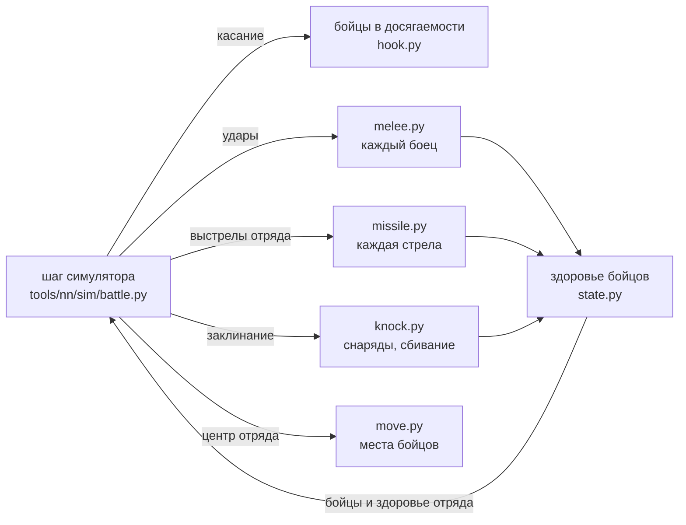

# Лаборатория бойцов

[← Назад](README.md) · [Документация](../README.md) › [Данные для обучения](README.md) › Лаборатория бойцов · [English](../../en/training/fighters_lab.md)

Модель, в которой каждый боец отряда — отдельная точка со своим здоровьем, своим местом в строю и своими ударами.
Она живёт отдельно от обучения: код — `tools/nn/fighters/`, файлы симулятора (`tools/nn/sim`, `config/nn`) не
меняются, версия симулятора та же. Лаборатория встраивается в шаг симулятора на время запуска и отвечает на вопрос:
насколько бойцы ближе к игре, чем прямоугольник, и что это стоит.

## Коротко

- **Что даёт.** На тех же записях игры бойцы лучше прямоугольника там, где он врал: убитые на потерянное здоровье у
  поредевших отрядов, первые секунды схватки, убитые под стрельбой (особенно двуручники), касание и форма строя.
  Таблицы — ниже, «Сверка с игрой».
- **Час удара найден.** Боец взмахивает раз в интервал удара из паспорта — и при попадании, и при промахе (схема CA:
  интервал — «наименьший промежуток между началами анимаций удара»). Симулятор считал промах в 0,5 с; отсюда
  прежняя «доля ударов 0,35». Проба в игре (отряды по 5 и 1 бойцу, каждые 0,1 с): 91 попадание при ожидании 76 по
  «взмаху раз в интервал» и 167 по «промах 0,5 с». В пробах один на один урон теперь как в игре без подгонки; в целых
  боях — 1,37 игры (с долей 0,35 было 1,20), по поредевшим 0,95 (было 0,85). Лишний урон целых боёв — вероятно,
  первый удар каждой новой стычки, открыто.
- **Сбивание с ног** — общий механизм «удар массой или силой → боец отброшен / сбит, лежит», пока от заклинаний; на
  него лягут натиск и монстры. Бой-проба в игре (места бойцов каждые 0,1 с) подтвердил: сбитые лёжа не гибнут, сбитый
  отряд почти не бьёт; отброс — медиана 3 м. Но доля отброшенных у бойцов в 2–5 раз меньше игры (ниже).
- **Скорость** — ниже, «Скорость».

## Как устроено



Симулятор по-прежнему ведёт отряд целиком: приказы, движение центра, мораль и бегство, усталость, способности,
когда отряд стреляет и сколько выстрелов. Лаборатория подменяет на время запуска (`hook.installed()`, без правки
файлов симулятора) пять мест шага:

| Что | Прямоугольник | Бойцы, доля 0,35 | Бойцы, взмах |
|---|---|---|---|
| Касание | края прямоугольников заходят друг в друга | боец одного отряда в досягаемости бойца другого: дистанция боя строя из базы 2,5 м + радиус бойца |
| Рукопашная | сколько бьёт = доля рядов фронта × волна × заполнение | бьёт каждый боец, у которого враг в досягаемости, своим часом удара |
| Стрельба | доля попаданий по формуле разброса, разлёт по соседям | каждая стрела летит в конкретного бойца и попадает в первого на своём пути |
| Заклинания | доза по кольцам вокруг точки удара | каждый снаряд падает в точку: удар, взрыв, сбивание бойцов |
| Потери | пул раненых, равномерные попадания | здоровье каждого бойца; лишний урон пропадает, боец гибнет на нуле |

После шага бойцы и здоровье отряда в симуляторе берутся из бойцов, а сами бойцы идут к своим местам.

**Бойцы** (`state.py`). Место бойца хранится смещением от центра отряда. Отряд в строю: ряды через шаг шаблона из
базы (`unit_spacings`), ширина — заданная, разброс места — `close_formation_spacing_variation` базы. Когда боец
гибнет, его место занимает стоящий за ним в той же колонне (колонна смыкается), ширина строя держится. Строй,
повернувшийся кругом больше чем на 90° за шаг, меняет ряды местами (первая шеренга становится последней), а не
бежит сквозь себя.

**Рукопашная** (`melee.py`). Боец бьёт врага, чей центр не дальше дистанции боя строя из базы (2,5 м) плюс радиус
врага. Держит своего противника, пока тот в досягаемости, иначе берёт ближайшего (сначала из цели приказа отряда).
Удар — формулы игры, как в симуляторе, но по бойцу: шанс попасть 35 + атака + натиск − защита × направление
(направление — откуда пришёл удар относительно взгляда самого ударенного бойца), бросок брони у каждого удара,
лишний урон пропадает. Час удара: после каждого взмаха, попал он или нет, — интервал из паспорта
(`melee.swing_per_interval`; замер — ниже, «Час удара»); идёт, только пока
враг в досягаемости (поэтому первый удар — сразу, а повторный вход в бой нового всплеска не даёт, как в пробе
`recontact`). Правила отряда остаются: держащий строй бьёт с долей 0,5, бегущего — с долей 0,43 и т. д. (удар
проходит с этой вероятностью).

**Стрельба** (`missile.py`). Сколько выстрелов и когда — решает симулятор (залпы, перезарядка, прицел). Выстрелы
делают живые бойцы отряда. Каждый целит в своего бойца-цель (держит его, пока тот жив, — правило `missile.reaim`
симулятора), снаряд ложится с разбросом из базы (зона калибровки, точность), а последние h / tg θ метров летит ниже
головы и попадает в первого бойца на пути — врага или своего. Щит бойца, смотрящего на стрелка, держит свою долю.
Попадание снимает здоровье именно этого бойца.

**Движение** (`move.py`). Боец переносится с центром отряда и идёт к своему месту (не быстрее бега). Боец первой
шеренги, у которого враг в досягаемости, стоит от него на расстоянии «стойки» (замер, ниже), не дальше 2 м от своего
места (`entity_action_attack_formed_tether_distance` базы); остальные шеренги держатся за ним. Тела (радиус из базы)
не заходят друг в друга.

**Сбивание с ног** (`knock.py`) — общий механизм для любого удара массой или силой:

- скорость, которую удар даёт бойцу (тело ударило — масса снаряда × скорость / масса бойца; ударная волна — сила /
  масса бойца × (1 − d / R)), против лестницы базы: от `…_knocked_back` 4 / 2 м/с боец отброшен и стоит, от
  `…_knocked_down` 7 / 3,5 м/с отброшен и лежит (`collision_` / `shockwave_speed_delta_threshold_*`);
- лежит случайное время из `knockdown_getting_up_delay` базы (1,0–2,7 с); лёжа не бьёт (его час удара стоит), его
  не бьют, стрелы и взрывы его не ранят (`knock.invulnerable`: так читает и симулятор, `magic.knock`; сообщество:
  сбитая пехота переживает то, что её бы убило), с отрядом не движется;
- отброшен от центра удара на `knock.throw`: медиана 3,0 м, разброс ×e^N(0; 0,37) — замер (ниже), в базе числа нет;
- встав, идёт на своё место.

Сейчас его вызывают заклинания (каждый снаряд «Раскалённого рока» и «Варп-молнии» падает в свою точку: удар в
пределах `collision_m` + радиус бойца, не больше `penetration` ближних, и взрыв с убыванием из `config/nn/sim.json`
`magic`). Натиск и монстры позже вызовут ту же функцию `knock.knock()`.

**Мораль и бегство** — симулятора, на уровне отряда, без изменений; мораль видит потери, посчитанные по бойцам.

## Числа и откуда

| Число | Значение | Откуда |
|---|---|---|
| Досягаемость удара | 2,5 м + радиус цели | БД `entity_action_attack_formed_combat_distance`, радиус `battle_entities` |
| Привязь к месту | 2,0 м | БД `entity_action_attack_formed_tether_distance` |
| Стойка (расстояние до врага у первой шеренги) | 1,0 м при касании → 2,3 м, τ 13 с | замер: места бойцов 48 полос проб reform, reform2, damaged, dmgmelee, wave, armour — медиана расстояния до ближайшего врага у 15 ближних бойцов 0,98 / 1,14 / 1,32 / 1,51 / 1,91 / 2,24 / 2,26 / 2,39 м на 0–1 / 1–3 / 3–5 / 5–10 / 10–20 / 20–40 / 40–90 / 90–240 с |
| Час удара | взмах раз в интервал паспорта, и промах тоже | схема CA (`melee_weapons`: интервал — между началами анимаций удара); замер — проба `swing`, ниже |
| Доля ударов `blow_share` | 1 (была 0,35) | прежний замер 0,35 = отношение «взмах раз в интервал» к «промах 0,5 с» (p + 0,5 / интервал) |
| Разброс стрел | зона калибровки × (d / дистанция)² × (1 − точность) | БД, модель симулятора `missile.hit_chance_plane` |
| Сбит / лежит | 7 / 3,5 м/с; 1,0–2,7 с | БД |
| Отброс | медиана 3,0 м (p10–p90 2,3–6,0) | замер: бой-проба сбивания, ниже |

Все числа лаборатории с причинами — `tools/nn/fighters/lab.json`.

## Сверка с игрой

### Пошаговый повтор 92 боёв

Каждые 10 с симулятор ставится в записанное состояние боя игры и играет 9 с по записанным приказам, 4 копии
(`tools/nn/sim/stepreplay.py`). Бойцы переносят из своего прошлого окна места и раны (раны подгоняются под здоровье
записи: первыми гибнут самые раненые). Окна выбраны по игре — одинаковые для обеих моделей. Сим / игра, 95 % интервал
по боям (`python -m tools.nn.fighters.card`):

| Показатель | Окон | Игра | Прямоугольник | Бойцы |
|---|---|---|---|---|
| Рукопашная, убитых на потерянное здоровье, здоровье > 85 % | 8 481 | 0,42 | 0,91 [0,87–0,95] | 0,89 [0,87–0,92] |
| … 60–85 % | 12 430 | 0,72 | 0,94 [0,91–0,97] | 0,78 [0,76–0,80] |
| … 40–60 % | 7 621 | 0,98 | 0,80 [0,78–0,82] | 0,77 [0,75–0,79] |
| … 20–40 % | 5 018 | 1,22 | 0,72 [0,71–0,74] | 0,85 [0,82–0,87] |
| … < 20 % | 840 | 1,58 | 0,66 [0,62–0,70] | 1,19 [1,05–1,40] |
| Под стрельбой, убитых на здоровье, все | 6 283 | 0,38 | 0,58 [0,52–0,65] | 0,62 [0,58–0,66] |
| … здоровье > 85 % | 3 442 | 0,11 | 0,30 [0,25–0,37] | 0,64 [0,57–0,73] |
| … двуручники (большие мечи) | 669 | — | 0,24 [0,13–0,40] | 0,62 [0,49–0,76] |
| Рукопашная, потерянное здоровье, все | 34 390 | — | 0,89 [0,86–0,91] | 1,20 [1,15–1,25] |
| … здоровье > 85 % / < 20 % | | — | 0,85 / 1,08 | 1,26 / 0,66 |
| Поредевший (< 30 %) в рукопашной, урон по нему | 2 886 | — | 1,03 [0,98–1,09] | 0,85 [0,80–0,91] |
| Касание: секунды рукопашной игры с флагом у копий | | — | 0,901 | 0,885 |
| … ложное касание (у игры нет) | | — | 0,121 | 0,111 |
| Начатые бегства | | 2 399 | 0,97 | 1,03 |

Главное: убитые на здоровье у поредевших отрядов (20–40 % и < 20 %) ближе к игре (0,72 / 0,66 → 0,85 / 1,19), под
стрельбой у двуручников 0,24 → 0,62 и у целых 0,30 → 0,64. Хуже: урон в рукопашной у целых отрядов 0,85 → 1,26 (общая
доля ударов 0,35 снята на парах один на один, в целых боях она выше игры), у почти разбитых 1,08 → 0,66. Касание на
уровне прямоугольника (0,90 / 0,89).

### Час удара (проба swing)

План `swing` зонда (`build/charge-probe/runs/20261016-213837`, один бой, 5 полос): отряды урезаны до 5 и 1 бойца
(`kill_number_of_men`), обе стороны атакуют с 3 м, здоровье и места бойцов каждые 0,1 с
(`python -m tools.nn.fighters.swingdata`). Попадания — падения здоровья отряда между замерами; человеко-секунды —
бойцы в досягаемости (3,15 м) врага. Всего 91 попадание (77 падений) за 1 020 человеко-секунд: «взмах раз в интервал»
(p / интервал) ждёт 76 (игра / он 1,20 ± 0,21 по попаданиям, 1,01 по падениям), «промах 0,5 с» ждёт 167 (0,55). По
полосам 0,63–1,96 (мало попаданий в каждой). Одного боя хватило: разница между правилами двукратная, ошибка ±21 %.

Столбец «бойцы, взмах» — без доли 0,35, с часом удара «взмах раз в интервал» (ниже, «Час удара»):

| Показатель | Прямоугольник | Бойцы, доля 0,35 | Бойцы, взмах |
|---|---|---|---|
| Рукопашная, урон, все | 0,89 | 1,20 | 1,37 [1,32–1,43] |
| … здоровье > 85 % / 60–85 % / < 20 % | 0,85 / 0,86 / 1,08 | 1,26 / 1,26 / 0,66 | 1,51 / 1,42 / 0,70 |
| Поредевший (< 30 %), урон по нему | 1,03 | 0,85 | 0,95 [0,88–1,02] |
| Убитых на здоровье, рукопашная, все / < 20 % | 0,86 / 0,66 | 0,79 / 1,19 | 0,87 / 1,29 |
| Убитых на здоровье, стрельба, все | 0,58 | 0,62 | 0,65 |
| Начатые бегства | 0,97 | 1,03 | 1,21 |

В пробах один на один взмах раз в интервал сходится с игрой (урон 15–30 с / устойчиво 1,00 / 1,02), а в целых боях урон
выше игры: вероятно, начало каждой стычки — каждый боец, впервые дотянувшийся до врага, бьёт сразу (в пробах за 0–1 /
0–2 с 1,58 / 1,39 игры), а в целых боях новых стычек много. Открыто.

### Первый удар (проба swing, бой 2)

`build/charge-probe/runs/20261016-232843`: те же пары по 25 бойцов (много первых касаний), одна полоса — натиск с
40 м (`python -m tools.nn.fighters.openingdata`). Весь бой: 551 попадание, «взмах раз в интервал» ждёт 441 (1,25 по
попаданиям, 1,04 по падениям), «промах 0,5 с» — 959 (0,57): час удара подтверждён второй раз. Начало стычки: каждый
боец, впервые оказавшийся в досягаемости врага, — сколько попаданий к 1 / 2 / 3 / 5 / 10 с после касания, игра /
модель:

| Модель первого удара | 1 с | 2 с | 3 с | 5 с | 10 с |
|---|---|---|---|---|---|
| бьёт сразу, потом раз в интервал | 1,22 | 1,41 | 1,50 | 1,09 | 0,98 |
| случайная точка интервала | 6,85 | 3,54 | 2,42 | 1,82 | 1,28 |
| бьёт через 0,5 с | 1,72 | 1,41 | 1,51 | 1,25 | 1,00 |
| бьёт через 1 с | 4,67 | 1,45 | 1,51 | 1,87 | 1,07 |

Игра бьёт в начале не слабее, а сильнее «сразу» (1,2–1,5 за первые 3 с): механика первого удара — «готов сразу»,
без задержки (схема CA: интервал — между началами анимаций, у бойца, ещё не бившего, ограничения нет). Остаток
(+20–50 % в первые секунды) — бойцов в досягаемости при касании в игре больше, чем видит счёт по местам раз в 0,1 с
(толкотня первой волны), открыто. Значит, лишний урон лаборатории в целых боях (1,37) — не от первого удара.

### Пробы рукопашной

112 полос 11 планов зонда (`tools/nn/charge_probe.py`: reform, reform2, dmgmelee, damaged, wave, armour, defender,
fresh, meleeorders, recontact, busycharge), двойник каждой полосы 4 копии. Средний |log(сим / игра)| по полосам и сумма
сим / игра:

| Что | Прямоугольник | Бойцы |
|---|---|---|
| HP цели за 0–1 с | 0,90 (0,61) | 0,53 (0,83) | 0,63 (1,58) |
| HP цели за 0–5 с | 0,60 (0,63) | 0,38 (0,86) | 0,42 (1,35) |
| HP цели за 5–15 с | 0,20 (0,94) | 0,27 (0,90) | 0,36 (0,85) |
| HP цели за 15–30 с | 0,29 (1,11) | 0,30 (0,92) | 0,27 (1,00) |
| HP цели в секунду, устойчиво | 0,31 (1,03) | 0,34 (0,92) | 0,29 (1,02) |
| Убитые цели за 0–10 с | 1,63 (0,34) | 0,46 (0,90) | 0,50 (1,37) |
| Убитые цели за 15–30 с | 0,39 (1,34) | 0,37 (1,10) | 0,40 (1,19) |
| Убитые атакующего за 5–15 с | 2,49 (0,14) | 0,83 (0,69) | 0,59 (0,95) |

Форма по местам бойцов (игра / бойцы, среднее по полосам; прямоугольник — рамка: глубина 12,2 м, ширина 28,6 м
всегда): бойцов в досягаемости 3,15 м на 1–3 / 5–10 / 20–40 / 90–240 с — 48 / 38 / 23 / 16 и 37 / 34 / 22 / 15;
стойка первой шеренги 1,43 / 1,76 / 2,53 / 2,82 и 1,30 / 1,46 / 2,34 (на 90–240 с у бойцов 6,3: от строя остались
одиночки); глубина 11,7 / 11,3 / 12,7 / 10,4 и 11,7 / 11,8 / 11,2 / 8,9 м; ширина 28,3–28,5 и 28,6–29,1 м; обтекание
(доля бойцов сбоку от врага) 0,01–0,05 и 0,00–0,02.

### Бегущие

Пробы routmob, routmob2, passby: толпа бегущих вдоль бегства / поперёк (p90 − p10, м) на 0–3 / 3–7 / 7–15 / 25–45 с
после бегства: игра 8,1 / 21,4, 11,7 / 22,5, 7,6 / 23,1, 6,5 / 23,3; прямоугольник 7,2 / 23,0, 7,2 / 23,0, 5,8 / 23,0,
5,8 / 23,0; бойцы 6,4 / 17,3, 5,2 / 12,3, 5,4 / 22,4, 5,4 / 22,2. В игре толпа держит ширину строя (~23 м) и
вытягивается вдоль бегства в первые секунды до 12 м; у бойцов на 3–7 с строй сжимается поперёк (разворот кругом и
переход на новые места) — открыто.

### Сбивание с ног (бой-проба)

Бой 6 плана magic (`build/magic/runs/20261016-211346`, один бой, «Нормальная», графика low): цели держатся скриптом,
места бойцов каждые 0,1 с, каждый боец прослежен (`python -m tools.nn.fighters.knockdata`). «Отброшен» — двигался
быстрее 4 м/с (в контроле без каста — ни одного такого удара). На удар (каст):

| Удар, цель | Бойцов | Отброшено | Отброс, м (p10 / медиана / p90) | Лежал, с (медиана / p90) |
|---|---|---|---|---|
| Рок → кланкрысы (4 удара) | 537 | 0,39 | 2,3 / 3,3 / 6,0 | 2,7 / 4,4 |
| Рок → рабы (3) | 421 | 0,47 | 2,3 / 3,2 / 7,2 | 2,3 / 4,4 |
| Молния → мечники (3) | 244 | 0,29 | 1,4 / 3,0 / 9,0 | 0,1 / 1,0 |
| Молния → мечники в рукопашной (2) | 165 | 0,27 | 1,6 / 2,8 / 4,7 | 0,2 / 3,1 |

- Отброс одинаков у обоих заклинаний и всех целей: одно распределение; направление — в основном прочь от удара
  (косинус с линией от центра удара, медиана 0,5–0,7). Прежние «1,5–3 м» по местам раз в секунду включали обычное
  движение.
- Лежат после рока 2,3–2,7 с (база 1,0–2,7 + встать); после молнии почти не лежат — её волна (сила 400 / масса 100)
  отбрасывает, но редко сбивает: так и даёт лестница базы.
- Лёжа не гибнут: 0 смертей за 778 человеко-секунд лёжа, стоящие рядом гибли 0,005–0,020 в секунду (ожидалось ~11).
- Сбитый не бьёт: мечники в рукопашной, у которых молния отбросила 31 из 106, снимали с кланкрыс 20 / 13 HP/с на
  3–6 / 6–12 с после удара, контроль без каста 48 / 33.
- **Бойцы лаборатории** на тех же целях за один каст (32 копии): отброшено 0,17 / 0,06 / 0,06 (рок → кланкрысы, рабы,
  молния → мечники) против 0,39 / 0,47 / 0,29. В игре отброшены и бойцы в 6–9 м от центра (молния 0,42), куда волна по
  формуле базы (линейное убывание, радиус взрыва − 1 м) не достаёт. Кандидаты: отброшенные тела сбивают соседей
  (столкновения), другое убывание силы волны — открыто.

### Пробы стрельбы

33 полосы (dist, targets, shield; thin из `build/probes7`): убитые на потерянное здоровье к 20 / 40 с после первого
залпа, сим / игра (среднее по полосам): прямоугольник 0,67 / 0,55, бойцы 0,92 / 0,71. Здоровье цели к 80 / 120 с:
прямоугольник 0,76 / 0,82 игры (бьёт поредевших больше игры), бойцы 1,11 / 1,49 (меньше: редкий строй пропускает
стрелы). Тонкие цели (45 рабов на 30 м): у игры к 40 с остаётся 14 бойцов, у прямоугольника 20, у бойцов 28–30.

## Скорость

`python -m tools.nn.fighters.bench` (RTX 5070 Ti 16 ГБ, арена whole_emp_v_skv 20 × 20, 2 262 бойца на бой, все
атакуют ближайшего; мс на шаг 0,5 с, 100 шагов от начала в рукопашную):

| Боёв | Симулятор, скомпилирован (как в обучении) | Симулятор без компиляции | Бойцы (без компиляции) | Пик памяти бойцов |
|---|---|---|---|---|
| 256 | 6,7 | 106 | 262 (своя часть 156) | 4,8 ГБ |
| 1024 | 7,4 | 146 | 7 800–30 000 | 21,6 ГБ — не влезает в 16 ГБ видеокарты |

На 1024 боях бойцы сейчас не работают: списки соседей (каждому бойцу 108 кандидатов) занимают ~19 ГБ. Пачками по 256
это ~1,05 с на шаг 1024 боёв — в ~140 раз дольше скомпилированного симулятора. Что сократит: соседей искать только у
бойцов отрядов рядом с врагом (в бою это меньшая часть), индексы в int32, `torch.compile` шага бойцов (убрать
питоновские проверки) — оценка не делалась.

## Как запустить

```bash
# проверки (контейнер, видеокарта; DOCK_MEM — предел памяти контейнера)
DOCK_MEM=8g DOCK_BUILD=<main>/build bash tools/nn/dock.sh tools.nn.fighters.probes --plans reform,dmgmelee --copies 4 --device cuda --out build/fighters/probes.json
DOCK_MEM=8g DOCK_BUILD=<main>/build bash tools/nn/dock.sh tools.nn.fighters.probes --routers --plans routmob,routmob2,passby --device cuda --out build/fighters/rout.json
DOCK_MEM=8g DOCK_BUILD=<main>/build bash tools/nn/dock.sh tools.nn.fighters.probes --missile build/probes7/runs/<thin> ... --device cuda --out build/fighters/missile.json
DOCK_MEM=8g DOCK_BUILD=<main>/build bash tools/nn/dock.sh tools.nn.fighters.replay --runs-from build/contactgap/sr_free_rect --out build/fighters/sr_fighters --device cuda --chunk 16
DOCK_MEM=8g DOCK_BUILD=<main>/build bash tools/nn/dock.sh tools.nn.fighters.replay --runs-from ... --out build/fighters/sr_rect --rect --device cuda --chunk 16
python -m tools.nn.fighters.card build/fighters/sr_rect build/fighters/sr_fighters     # таблица, без torch
DOCK_MEM=8g bash tools/nn/dock.sh tools.nn.fighters.bench --B 256 1024                 # скорость
python -m tools.nn.charge_probe run --plan magic --battles 6 --speed 3                  # бой-проба сбивания (игра)
python -m tools.nn.fighters.knockdata build/charge-probe/runs/<run>                     # её разбор
```

```python
from tools.nn.fighters import hook
with hook.installed() as h:            # всё, что строится внутри (scenario.build), получает бойцов: h.F
    st = scenario.build(armies, params, device="cuda")
    battle.run(st, policy, params)
```

Тесты: `tests/tools/test_nn_fighters_torch.py` (контейнер), `tests/tools/test_nn_fighters_shape.py`,
`tests/tools/test_magic_probe.py` (без torch). Пачка повтора 16 боёв × 4 копии держит контейнер в ~8 ГБ памяти;
46 боёв за раз и несколько задач параллельно съели 12 ГБ.

## Чего нет

- Урон в целых боях с «взмахом раз в интервал» 1,37 игры; первый удар («готов сразу») проба подтвердила, значит,
  лишнее — в чём-то другом (сколько бойцов в досягаемости в больших стычках нескольких отрядов). Открыто.
- Доля отброшенных заклинанием у бойцов в 2–5 раз меньше игры (бой-проба сбивания): чем игра отбрасывает бойцов за
  радиусом взрыва — не найдено.
- Тело-эллипс (крысоволки) — у бойцов круг; стрельба очередью Пушки Крысолинга — не больше 2 выстрелов на бойца за
  шаг; настильный выстрел ищет тела только на последних 21,6 м пути.
- Обтекание врага («капля») у бойцов слабее игры (0–0,02 против 0,01–0,05 в схватке один на один).
- Лаборатория работает только без `torch.compile` (питоновские проверки в шаге).

## Пробовали и отказались

- **Каждый боец бьёт по формуле (`blow_share` 1).** Урон проб в 2–5 раз выше игры (HP цели 15–30 с: сумма сим / игра
  4,15).
- **Встаёт к врагу каждый боец в досягаемости + привязь.** Вторая шеренга вдавливала первую во врага: бойцов в
  досягаемости 34–45 против 19 в игре на 20–40 с, фронты в 1,1–1,4 м против 2,3.
- **Строй сдвигается за всеми дерущимися бойцами.** Дерущиеся вторые шеренги тянули строй вперёд, фронты не
  расходились (стойка 1,0–1,3 м весь бой). Оставлено: стойку держит и строй тянет только первая шеренга.
- **Тот же час удара в прямоугольнике** (замер в копии, патч `build/fighters/rect_swing.patch`, в симулятор не
  внесён): `melee.swing_per_interval` (взмах раз в интервал) и `fighting_files` 1 вместо 0,5. Пробы рукопашной: HP цели
  устойчиво 1,03 → 0,99, но за 0–5 с 0,63 → 0,41 и потери атакующего устойчиво 0,93 → 0,72; повтор 92 боёв: урон в
  рукопашной 0,89 → 0,84, по поредевшим 1,03 → 0,95, убитых на здоровье 0,86 → 0,67, бегства 0,97 → 0,98. Прочие
  правила прямоугольника (волна, первый удар, пул раненых) подогнаны под старый час, одна замена их ломает.
