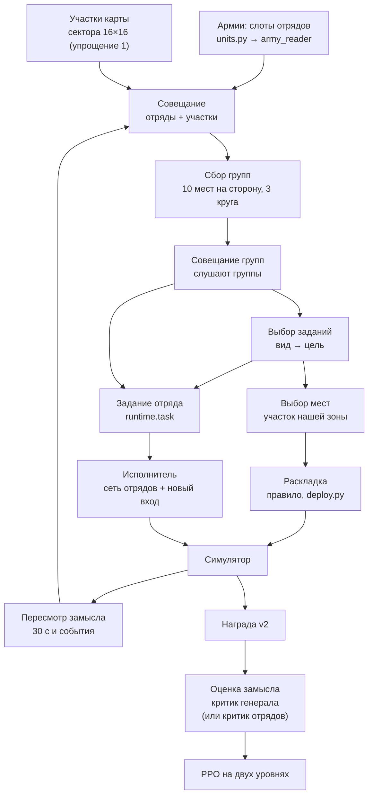

# Сеть генерала (S28)

[← Назад](README.md) · [Документация](../README.md) › [Данные для обучения](README.md) › Сеть генерала · [English](../../en/training/general.md)

Генерал — сеть, которая строит план боя для всей армии: делит армию на группы, даёт каждой группе задание и место
расстановки, а отряды (нынешняя сеть отрядов — «исполнитель») выполняют его сами. Утверждённая архитектура (с
блоками «почему так и что отвергли») — страница `design/general/index.html`; здесь — что из неё есть в коде
(`tools/nn/general/`) и как оно учится.

**Сейчас:** весь круг собран «скелетом» — от замысла до обновления весов, в симуляторе. Включается флагом
`run.py --general` (или шагом цепочки `general`, [ниже](#запуск)). Часть блоков упрощена — [список](#упрощения-скелета),
каждое упрощение — настройка, а не зашитый код. В настоящей игре генерал играет через помощника тем же кодом
([ниже](#в-игре)); расстановка там пока скриптовая.

## Весь круг



| Блок схемы | Код | Что делает |
|---|---|---|
| Армии | `units.py` (+ `army_input.py`) | слоты всех отрядов боя: 49 чисел и 3 метки (как во входе «Армии»); «пришло» = сколько осталось сейчас; состояние (мораль, дрогнул, усталость, патроны) — сейчас: свои и видимые враги |
| Где стоит отряд | `runtime.pos_of_obs` / `pos_of_state`, `net.POS_FEATURES` | 7 чисел на отряд в системе стороны, как в токене сети отрядов: вперёд и вбок / 500 м, куда смотрит (cos, sin), скорость вперёд и вбок / 5 м/с, «известно». При пересмотре — из токенов наблюдения стороны (враг — где его видели последний раз; невиданный — нули), при расстановке — из состояния (скорость 0). Ничего нового от игры не нужно: в игре те же поля (`x`, `z`, `b` состояния моста) |
| Анализ армий | `army_reader.py` | одна сеть на все слоты → карточка отряда (ширина `card`) |
| Участки карты | `tiles.py` | 256 секторов по 100 м с их 8 числами, проекция в ширину карточки + место участка + его центр (тем же слоем, что положение отрядов: отряд и участок сравнимы по месту). `--general-tile-feats v2` (умолчание): три числа, которые в симуляторе всегда 0 (враг, виденный раньше; бегущие свои и чужие), заменены силой своих стрелков, стрелков врага и быстрых отрядов врага в секторе (`tiles.extra`, та же шкала, что у силы). `--general-tile-norm 1` (умолчание): каждое число нормируется по карте — минус среднее по участкам, делить на разброс, в пределах ±5 (`General.tile_numbers`) |
| Совещание | `net.General.cards` | трансформер: отряды (карточка + положение) и участки, каждый спрашивает каждого; метка «свой / враг / участок»; пустые слоты и участки вне карты не участвуют |
| Сбор групп | `groups.py`, `net.SlotGroups` | **по умолчанию — правило** (`--general-groups rule`, [ниже](#сбор-групп-правилом)): роли, внутри роли — кластеры по месту, не больше 10 групп на сторону, обе стороны одинаково; карточка группы — из её отрядов (`SlotGroups.fixed`: среднее значений отрядов через GRU и слой сбора; ключи, запросы, резкость, вычитание среднего и «держаться за группу» не участвуют и не учатся). `--general-groups net` — выученный сбор: slot attention (ключи и запросы через LayerNorm, × выученная резкость `--general-sharp`, старт 15 — у свежего генерала доля главного места ~0,9): 10 мест наших + 10 врага, у каждого своя стартовая карточка; отряд делит себя на 100 % между местами своей стороны (маска стороны); 3 круга; бегущие и мёртвые — вне групп. Группа — место, которое главное хотя бы у одного отряда. Из ключей отрядов вычитается выученная доля среднего ключа своей стороны (`--general-center`, старт 1): места спорят за отряды по тому, чем отряды отличаются ([почему](#ещё-отличия-от-схемы)). К ключу отряда прибавляется его положение (свой слой `k_pos`): группы собираются и по месту, а не только по типу |
| Номера групп | `net.match_groups`, `net.renumber`, `SlotGroups.stick` | при пересмотре отряд держится за прошлую группу (выученная поправка к её логиту, `--general-stick`); затем новые группы сопоставляются со старыми по общим отрядам (жадно: сначала пара с наибольшим числом общих отрядов; без подсказки место сохраняет свой номер) и перенумеровываются — номер `gN` держится, пока группа держит свои отряды; prev-карточка, задание и лог идут по этому номеру. Нумерация (`perm`) хранится в плане: обновление пересчитывает план с ней же |
| Совещание групп | `net.Listen` | группы слушают участки и все группы; участки не меняются |
| Виды заданий | `General.kinds`, `General.exec_kinds`, `config.MISSION_KINDS` | таблица выученных карточек без входа — **две**: `kinds` у генерала (ключи выбора вида), `exec_kinds` у исполнителя (вход задания; `--general-split-kinds 1`, умолчание; при старте — копия `kinds`): эпохи исполнителя не двигают выбор генерала. 6 видов со смыслом ([ниже](#задания)): номер, имя, типы целей, что значит «выполнено» — в одном месте, `config.py` `MISSION_KINDS` |
| Выбор заданий | `General.decide` | по шагам: вид (сравнение карточки группы с видами) → одна цель; цели — наши группы (не сама), их группы, участки грубой сетки 4 × 4 (`--general-target-grid`, участок 400 м = среднее 16 секторов после совещания; хоть один сектор внутри карты): ≤ 36 кандидатов; вражеские группы не выбирают. Вид берёт только свои типы целей (маска `pair_ok`: остальные пары — логиты −∞); вид, для которого цели нет (прикрыть, когда другой нашей группы нет), не выбирается. При пересмотре к логиту прошлого вида группы — +B (`--general-kind-stick`, [ниже](#ещё-отличия-от-схемы)). `--general-threat 1` (умолчание): к карточке нашей группы перед выбором вида и цели прибавляются её числа угрозы через линейный слой с нулевого старта (`General.threat`): расстояние до ближайшей вражеской группы (/ 500 м, до 3), логарифм отношения сил своя : та группа (стоимость × доля здоровья, ±3), доля стрелков в своей и в той группе (стрелок — только с патронами: `army_input.armed`), доля отрядов в соприкосновении (враг ближе 40 м), «враг есть»; и вторым слоем с нуля (`General.fight`) — доля отрядов группы **под обстрелом** (стоящий враг не в рукопашной стреляет, и его цель — этот отряд: флаг стрельбы `fire` и цель `target` состояния; в симуляторе флаг горит с прицеливания, в игре — `IsFiringMissiles` и цель движка `t`) и доля **в рукопашной** (флаг `m`) — вход `fight` у каждого отряда (`Runtime.fight_of`). `--general-group-tiles 1` (умолчание): к карточке **каждой** группы (нашей — перед выбором вида и цели, вражеской — как ключ цели) прибавляются числа участков под её центром — те же 8 чисел, что читает совещание (после нормировки), участки в 1,5 участка от центра с весом exp(−d²/2), слоем с нуля (`General.group_tiles`). Путь от участков к выбору прямой, мимо совещания |
| Выполнение заданий | `mission.py`, `runtime.execute` | каждое решение — мера 0…1 у каждого отряда с заданием, по состоянию симулятора ([ниже](#задания)); доплата исполнителю — в преимущество отряда |
| Учитель | `teacher.py` | (`--general-teacher P`) в доле боёв задания даёт правило, а не сеть; генерал учится подражать ему (`--general-imitate`) ([ниже](#учитель)) |
| Выбор мест | `General.decide` | только в первом плане боя: указатель на участок нашей зоны |
| Раскладка | `deploy.py` | правило: линия по ширине строя на участке группы, лицом к центру врага; группы на одном участке — одна за другой; всё внутри зоны |
| Задание отряда | `runtime.Runtime.task` | на каждый наш отряд: карточка группы (смесь карточек мест по долям состава; по умолчанию — нули, `--general-task-group 0`: исполнитель её не слушал, KL 0,003; ширина входа та же, старые точки грузятся), карточка вида задания его группы (из таблицы исполнителя), цель группы (направление от того, куда смотрит отряд, cos и sin; расстояние / 100 м, не больше 20; флаг «нет») — 2 × card + 4 числа |
| Исполнитель | `executor.GeneralActor` | нынешняя сеть отрядов; задание проходит линейный слой с нулевыми весами и прибавляется к токену отряда (как вход обязательства); врагам — ничего |
| Пересмотр замысла | `runtime.Runtime.replan` | раз в 30 с боя; раньше — если группа разбита (больше половины её отрядов бежит или уничтожено) или погиб лорд (наш или их), но не раньше 3 с после плана. Между планами группы, задания и цели заперты |
| Награда | `tools/nn/train/reward.py` | как сейчас (v2); доплата за выполнение задания в награду не входит (только в преимущество отрядов исполнителя) |
| Оценка замысла | `General.value` | по карточкам плана (отсоединённым) предсказывает отдачу плана; с `--general-return critic` база преимущества — критик отрядов, а она учится рядом |
| Различимость заданий | `distinct.py`, `runtime.behave` | (`--general-distinct W`) классификатор угадывает вид задания группы по поведению её отрядов; доплата исполнителю в единицах разброса его преимущества |
| Ветки заданий | `branch.py` | (`--general-branches P`) копия боя «тот же план, но у одной группы другой вид задания»; разница размена — цена выбора вида ([ниже](#ветки-заданий)) |
| Обучение | `learn.py`, `tools/nn/train/ppo.py` | [ниже](#обучение) |

Размер при ширине карточки 128 (шаг цепочки): 1,14 млн весов, при 64 — 308 тыс. (сеть отрядов — 3,5 млн).

## Сбор групп правилом

`tools/nn/general/groups.py`, `--general-groups rule` (умолчание). Выученный сбор выродился (атлас g17r,
`build/diag_atlas2/atlas.md`: первый план — одна группа на всю армию, карточки групп одинаковые, стрелки вперемешку с
пехотой как при случайном делении), поэтому, пока генерал учится выбирать вид по бою, группы собирает правило. Оно
видит только вход генерала (слоты армий и места отрядов) и одно для обеих сторон:

1. **Роли** по карточке отряда: лорд и герои (каста lord / hero); быстрые (каста кавалерии или колесниц, или бег
   ≥ 7 м/с); стрелки (есть дальность стрельбы); ближний бой — остальные.
2. **Внутри роли — по месту:** два кластера одной стороны и роли с ближайшими центрами сливаются, пока центры ближе
   `--general-group-r` (100 м); по одной паре за раз.
3. **Одинокий лорд или герой** (кластер из одного) присоединяется к ближайшей группе ближнего боя своей стороны, если
   её центр ближе `--general-lord-join-m` (60 м); иначе — своя группа.
4. **Не больше 10 групп на сторону** (`places`): пока больше — сливаются два ближайших кластера стороны (сначала одной
   роли).

Участвуют свободные отряды (живые, не бегущие); невиданный враг стоит в своих нулях. Номера групп между пересмотрами —
тем же `match_groups` по общим отрядам. Карточка группы читает значения своих отрядов за вычетом среднего по своей
стороне (`--general-group-centre 1`, умолчание): карточки отрядов после совещания почти одинаковые, и без вычитания
карточки групп тоже. Совещание групп, выбор вида и цели работают поверх правила как раньше.

## В бою

`tools/nn/general/runtime.py` — план каждой стороны, которой играет сеть с генералом (ученик или прошлая версия из
пула с генералом), хранится по строкам боя (как у `rollout.Battles`).

- **Расстановка** (начало боя): генерал планирует на армиях и участках расстановки скриптом (`place.py`) — группы,
  задания, места; правило ставит отряды на участки их групп. Скриптовые стороны и старые сети без генерала стоят как
  раньше. Если отряды стороны стоят не в своей зоне (бои «кайта», учения) — расстановка остаётся скриптовой, генерал
  только строит группы и задания.
- **Пересмотр:** сеть проходит всю схему заново: армии «сейчас» (сколько бойцов и здоровья осталось), положение
  отрядов и участки — из наблюдения стороны (те же числа, что у токенов и секторов сети отрядов), места групп стартуют
  со своих прошлых карточек; новые группы получают старые номера по общим отрядам (`match_groups`).
- **Задание отряда** считается каждое решение (цель движется, отряд поворачивается): точка цели-группы — центр её
  отрядов сейчас (как их видит сторона), участка — его центр (неподвижная точка плана). Это функция состояния, не шум:
  у отряда, который стоит, задание не меняется.
- **Обе стороны** в бою с собой и с пулом (если у версии из пула есть генерал) используют генерала; против скриптов —
  только наша сторона.

## В игре

Помощник (`tools/nn/companion/`, [мост](../apps/bridge.md)) сам видит, что в точке есть генерал, и играет с ним. Код
генерала тот же, что в симуляторе (`runtime.Runtime`), не копия: `tools/nn/companion/general.py` (`GameBattles`)
делает из состояния моста «пачку симулятора из одного боя» — отряды в порядке файла состояния и ровно те поля, которые
читает `Runtime`:

- положение, направление (`b`), бойцы, доля здоровья, состояние морали, видимость, точная мораль (`mp`), состояние
  усталости (`fat`), снарядов осталось (`a`) — из состояния игры; нет показания — прежнее (до первого — свежий отряд:
  мораль 1, свеж, полный боезапас); бойцы есть, а положения нет — отряд ушёл с карты (как читает скрипт врага). Положение отрядов для генерала
  при пересмотре берётся из того же наблюдения, что у сети отрядов (скорость — из него же);
- здоровье на старте, цена, строй — числа симулятора для ключа отряда;
- лорд пал (погиб, разбит или ушёл с карты) — как `lord_dead_s` симулятора.

Как идёт бой:

- **Замысел** — на первом состоянии боя, по армиям и участкам этого состояния. Расстановка остаётся мостовой, как
  раньше: `deploy` в игре всегда `script` (мост пока не переставляет отряды), значение из точки перекрывается.
  Генерал делит армию на группы и даёт задания, мест не выбирает.
- **Пересмотр** — те же правила: раз в 30 с **времени боя** (поле `t` состояния, поэтому ускорение игры x3–x10
  ничего не меняет), разбитая группа, павший лорд; не раньше 3 с после прошлого плана.
- **Задание отряда** — каждое решение (раз в секунду боя); идёт в исполнитель вместе с обычным входом.
- Без генерала в точке (или с `--no-general`) помощник работает как раньше, до бита.
- Меры выполнения заданий в игре не считаются (обучения там нет), учителя нет.

Запуск — как обычно ([watch](../launch/watch.md), экзамен): точка с генералом включает его сама. Флаги помощника:
`--no-general` — играть без генерала (исполнитель без задания); `--general-set KEY=VALUE` — поле настройки генерала
поверх точки, например `replan_s=20` (`deploy=net` — ошибка).

Лог помощника — строка на каждый замысел:

```
general plan 2 t 30.0 s (timer): 4 groups, enemy 3 | g0 [lord, spear_1, spear_2] kind withdraw -> g1 | g1 [...] kind hold -> tile 2_1 | ...
```

Номер замысла, время боя, повод (`deploy` — начало боя, `timer`, `broken`, `lord`), число групп наших и врага, по
каждой нашей группе `gN`: её отряды, вид задания (имя из `MISSION_KINDS`), цель — наша группа `gN`, группа врага `eN` (в скобках — сколько в ней
отрядов) или участок `tile ряд_столбец` грубой сетки 4 × 4 стороны (ряд — вперёд). Номер группы держится между
замыслами, пока она держит свои отряды. В `companion.jsonl` у решения, на котором составлен замысел, — поле `general`:
то же целиком (у группы ещё `kind_name` — имя вида из `MISSION_KINDS`), плюс группы врага `enemy` с их отрядами. Если у отряда
нет паспорта — строка `general off: ...`, и этот бой идёт без генерала.

## Обучение

PPO на двух уровнях (`learn.py`):

- **Исполнитель** учится как раньше. Карточки задания в обновлении считаются заново из таблицы планов куска
  (`learn.task_for`) — с градиентом, поэтому ошибка исполнителя доходит до совещания групп, сбора групп, совещания и
  читателей армий. В начале каждого куска карточки идущих планов пересчитываются нынешними весами — вероятности
  решений при игре и в обновлении совпадают (тест).
- **Генерал:** выборы (вид, цель, место) дискретные, сэмплируются; каждая наша группа — агент со своим отношением
  вероятностей, все группы плана делят его преимущество = отдача плана − «Оценка замысла» в момент плана (нормировано
  по планам обновления). Отдача — сумма награды от решения до следующего пересмотра или конца боя
  (`--general-return span`; в шаге цепочки — `critic`, ниже). Плюс энтропийная премия — отдельно на каждую голову:
  `--general-entropy-kind`, `--general-entropy-target`, `--general-entropy-place` (по 0,001). «Оценка замысла» учится на
  отдаче. Шаги генерала — **до** эпох исполнителя, тот же Adam (`--general-lr-mult` — свой множитель шага); 2 эпохи по
  512 планов. До — потому что эпохи исполнителя тоже двигают веса генерала (градиент через карточки задания доходит до
  83 из 108 его тензоров, а Adam шагает на ~lr при любом малом градиенте): после них отношение вероятностей планов
  стартовало не с 1 (clip 0,3–0,5 при `kl_plan` 0,02–0,06, `build/diag_clip`). Цена порядка: эпохи исполнителя
  начинают с карточек задания уже после шага генерала (вероятности исполнителя в первом шаге — чуть не те, что при
  игре); шаг генерала ограничен KL 0,03 его выборов. Доля обрезанных — отдельно у планов, начатых в этом куске
  (`clip_fresh`), и у старых (`clip_old`). План хранит логарифм вероятности, с которой он выбран (`lp_plan`, сумма по
  головам вид + цель + место). **Старые планы.** План живёт до 30 с, кусок — 64 с, поэтому ~40 % кончившихся планов
  начаты в прошлом куске, то есть прошлой политикой (до прошлого обновления). Если считать их отношение от `lp_plan`,
  оно с первого шага далеко от 1, и PPO обрезает их почти все (g10: `clip_old` 0,6–0,8 при `clip_fresh` 0–0,06) —
  ~40 % данных генерала пропадает. Поэтому отношение считается от `lp0` — вероятности **политики в начале обновления**
  (один раз, без градиента, перед эпохами): у старого плана оно стартует с 1. А отставание старого плана — отдельный
  усечённый вес на его преимущество: `c = min(1, exp(lp0 − lp_plan))` (как в V-trace: данные не выбрасываются,
  перекос ограничен; вес на группу, на ту же сумму голов, что и отношение). У плана, начатого в этом куске, `lp0` и
  `lp_plan` — от одних весов: берётся сам `lp_plan` и `c = 1`, то есть обычный PPO до бита (тест). Средний `c` старых
  планов — в логе `stale_w`. Эпохи обрываются, когда KL на группу от политики в начале обновления больше 0,03; KL считается оценкой k3,
  (r − 1) − log r, r = вероятность сейчас / в начале обновления (`--general-kl k3`, умолчание; `learn.kl_est`): она
  не бывает отрицательной. Прежняя оценка — среднее log r (`k1`) — уходила в минус, когда политика резко
  сосредотачивалась (атлас: −0,40), и стоп не срабатывал;
  разрыв между ней и вероятностями планов — в логе `kl_plan`.
- **Отдача по критику отрядов** (`--general-return critic`, по умолчанию выключено). Зачем: при `span` почти весь
  разброс отдачи (98,6 % в разборе точек g1) — у последних планов боя (±1 за победу), у расстановки разброс ~0,004, и
  «Оценка замысла» объясняет ~0 — генералу нечем учиться. Критик отрядов объясняет 0,995 разброса, поэтому:
  преимущество плана = награда за время плана (каждое решение k — с множителем γ^k) + γ^n · V(конец) − V(начало).
  V — оценка критика сети отрядов для своей стороны (одно число на сторону: критик так устроен), γ — та же, что у
  PPO, n — решений за план. V(начало) — в момент плана; у плана расстановки — в первое решение боя. V(конец) — в
  решение пересмотра, который оборвал план; если бой кончился — 0, а последняя награда (победа) уже в сумме.
  «Оценка замысла» учится на ту же цель рядом, но в преимущество идёт разность критика. Формулы — `signal.py`
  (без torch), ценность критика в момент решения — `runtime.note_value` (её считают до пересмотров решения).
- **Доплата исполнителю за выполнение задания** (`--general-exec W`, по умолчанию 1; `--general-exec-decay N` —
  W убывает до 0 за N обновлений цепочки, по умолчанию 0 — без убывания). Зачем: пока вид задания — номер без смысла,
  исполнителю незачем его слушать, а раз он глух, выбор генерала ни на что не влияет и его сигнал — шум (замкнутый
  круг). Как: каждое решение, после шагов симулятора, у каждого нашего отряда с заданием — мера выполнения m от 0 до 1
  ([ниже](#задания)); доплата решения = W × (m − b), b — скользящее среднее меры этого вида (каждое решение
  b ← b + 0,01 · (среднее решения − b); первое решение вида — его среднее): платим за выполнение лучше обычного, а не
  за лёгкие задания. Доплата идёт **только в преимущество отряда**: в PPO к общему (нормированному) преимуществу
  стороны прибавляется своё у каждого отряда — (1 − γλ) · Σ (γλ)^j · доплата[t + j] до конца боя или куска
  (`signal.exec_advantage`, γλ — те же, что у PPO исполнителя: горизонт ~10 решений). Множитель (1 − γλ): ровная
  доплата считается один раз, W = 1 даёт отряду один разброс преимущества (преимущество стороны нормировано) за меру
  на 1 выше среднего; это и есть «W × (m − b) × σ» в единицах разброса. В награду доплата не входит: ни критик
  отрядов, ни отдача генерала её не видят, генералу нет выгоды выбирать лёгкие виды (тест: с доплатой награда,
  ценности, цели и базы планов генерала, шаг критика — до бита те же, что без неё). Плата — каждому отряду своя
  (раньше доплата за различимость шла всей стороне). Меры считаются и пишутся в лог при любом W (W = 0 — без платы).
- **Учитель** (`--general-teacher P`) — [ниже](#учитель).
- **Подражание учителю** (`--general-imitate W`, по умолчанию 0,3; `--general-imitate-decay N` — W убывает за N
  обновлений, по умолчанию 300, свой счётчик в `train` точки с первого обновления с подражанием, до пола
  `--general-imitate-min M`, по умолчанию 0,15, — не до нуля; M хранится в `train` точки, флаг в командной строке
  перекрывает сохранённое; W = 0 — подражание выключено, пол его не включает; `signal.imitate_weight`). Пол — потому
  что собственный сигнал генерала пока слабее учителя: без опоры генерал уходит в худшие планы
  ([«Пробовали и отказались»](#пробовали-и-отказались)). Зачем подражание вообще: в g10
  генерал получал от боя только шум, его выбор вида дрейфовал (46 % `flank` — вид с самым низким выполнением 0,13;
  связь выбора с обстановкой ≈ 0). Как: на планах учителя известны его вид и цель у каждой группы, которой он дал
  задание. Группы у учителя — те же, что собрала сеть (учитель меняет только вид и цель), поэтому сопоставляется всё:
  сеть генерала всё равно прогоняется на этих обстановках, их входы (армии, участки, prev-карточки, состав, нумерация)
  хранятся в записи, как у своих планов. В каждом шаге PPO генерала к потере прибавляется W × средний NLL сети на
  выборе учителя: −(log π(вид учителя) + log π(цель учителя | вид учителя)) по группам, которым учитель дал задание
  (`learn.imitate_term`; место не подражается — его учитель не выбирает). Пары, которые сеть выбрать не может
  (маска), не считаются. Градиент — только в веса генерала (исполнителя в этой потере нет, тест). Для PPO,
  «Оценки замысла», классификатора и веток планы учителя по-прежнему не идут. Точность и NLL считаются до шагов, при
  любом W (W = 0 — только лог).
- **Малая доплата генералу за выполнение** (`--general-exec-general S`, по умолчанию 0,2). У каждой нашей группы
  плана к преимуществу плана прибавляется S × её центрированная мера за план: среднее по решениям плана и отрядам
  группы (мера − скользящее среднее вида), то же центрирование, что у доплаты исполнителю. Центрирование по виду
  снимает выгоду «лёгких» видов: остаётся только «выполнимо ли это здесь». Прибавляется к нормированному
  преимуществу плана (разброс 1), то есть в единицах его разброса; на старые планы — тот же вес `c`. S = 0 — обычный
  PPO до бита (тест). В пробном прогоне (свежий генерал) — 0,01–0,04 разброса на группу.
- **Доплата исполнителю за различимость заданий** (`--general-distinct W`, по умолчанию 0 — выключено; при видах со
  смыслом её место заняла доплата за выполнение, осталась для сравнения). Зачем:
  исполнитель почти не слушает задание (веса входа 0 → 0,39 случайным блужданием; подмена вида задания меняет
  решения на KL 0,0006). Как: за время плана суммируется поведение отрядов каждой нашей группы (`runtime.behave`):
  доли видов приказов, доля бега, смещение центра группы вперёд и вбок (от направления «наш центр → центр врага» в
  начале плана, / 100 м), длина пути центра, длина плана — 10 чисел (`runtime.BEH`). Маленький классификатор
  (`distinct.py`: 2 слоя по 64, свой Adam, вне сети) по ним угадывает вид задания группы. Когда план кончается,
  каждая группа даёт W × (log q(вид | поведение) − log(1/K)) × σ (K видов; в пределах ±ln K до умножения): 0, если
  классификатор угадывает не лучше случая, до W · ln K · σ — если уверен и прав. σ — разброс преимущества исполнителя
  до нормировки (среднее `adv_std_attack` и `adv_std_defend` PPO, скользящее: 0,7 · старое + 0,3 · новое, не меньше
  0,005; до первого обновления 0,06 — число из логов g1–g8): доплата в единицах сигнала исполнителя, W = 1 платит
  группе один разброс преимущества за каждый нат угадывания. Доплата идёт в награду стороны в решении конца плана; в
  отдачу генерала — нет. Это причина делать разное при разных видах, а не плата за выполнение задания. W убывает
  линейно до 0 за `--general-distinct-decay N` обновлений цепочки (по умолчанию 600; счётчик продолжается через
  части); σ хранится с классификатором в точке. Классификатор учится
  после каждого обновления на кончившихся планах и дальше, когда W = 0 (его точность — мера того, насколько
  поведение зависит от вида). Его веса, Adam и счётчик — в `train` чекпойнта. Оговорка: вид связан с тем, кому генерал
  его даёт (например, конница чаще получает один вид), поэтому часть угадывания — по типу группы, а не по поведению;
  точность выше случая ещё не значит, что исполнитель слушает задание — смотреть вместе с нормой весов входа.
- **Ветки заданий** (`--general-branches P`, по умолчанию 0 — выключено) — [ниже](#ветки-заданий).
- **Свой сигнал головы вида** (`--general-kind-own-signal 1`, умолчание) — [ниже](#свой-сигнал-головы-вида).
- **Старт:** исполнитель берёт веса последней сети отрядов, новый вход с нулевыми весами — играет как раньше
  (тест: выходы до бита равны); генерал с нуля.

Таблица планов куска: планы, действовавшие в куске (перешедшие из прошлого и новые), — их входы, состав, выборы.
В переходе хранятся только геометрия задания, флаг «есть задание» и номер плана (не карточки: ~90 МБ на кусок
1024 боя × 64 решения вместо гигабайтов).

## Задания

Виды — `config.py` `MISSION_KINDS` (номер = строка таблицы карточек видов; новый вид — в конец). Мера выполнения —
`mission.py` (`measure`), каждое решение после шагов симулятора, у каждого нашего отряда, который решал, в группе с
заданием. Это определение «выполнено», а не механика игры: по правде состояния симулятора (в нём скрытых нет). Цель-
группа — её отряды, которые стоят сейчас (живы, на карте, не бегут), её точка — их центр; участка — его центр.
near(d, R) = 1 в пределах R, линейно до 0 к 3R.

| Вид | Цель | Мера 0…1 |
|---|---|---|
| `attack` атаковать | группа врага | 1 — в ближнем бою с отрядом цели (поля `m` и `target` состояния); иначе 0,5 × (1 − d / 300 м) до её **центра** (не до ближайшего отряда: отставший беглец — не группа; мера по ближайшему оплачивала погоню двух отрядов и лорда за одним арбалетчиком на 700 м, `build/diag_skv`) |
| `hold` держать | участок, наша группа | near(d до точки цели, R): R участка — половина его стороны (200 м: сам участок), группы — 100 м вокруг центра |
| `flank` обойти с фланга | группа врага | как `attack` (сближение — до центра), но засчитывается только удар не в перед цели. В рукопашной (`--general-flank-measure contact`, умолчание) — по стороне, с которой **начался** контакт отряда с отрядом группы-цели: поле состояния `hit_sec` (то же, что даёт морали симулятора «атакован с фланга / тыла»): фланг или тыл — 1, перед — 0. Угол сейчас для этого не годится: ударенный отряд разворачивается к атакующему, и удачный удар во фланг через пару секунд выглядит как «в перед». Стороны контакта нет (поле 0 или его нет — так в игре, где меры не считаются), `angle` и до рукопашной — по углу: отряд стоит больше 45° от направления отряда цели, с которым бьётся (или ближайшего) — стороны удара, как в симуляторе (`config/nn/sim.json` contact.front_deg 45: перед ±45° у CA) |
| `screen` прикрыть | наша группа | на отрезке от центра цели до ближайшего к нему стоящего врага (проекция 0…1 пути) × near(расстояние от отрезка, 50 м) |
| `shoot` обстреливать | группа врага | стрелок (дальность и боезапас): 0 в ближнем бою, 1 — стреляет по отряду цели, 0,5 — цель в его дальности, иначе 0; без стрельбы: 0 в ближнем бою, 1 — в 50–250 м от ближайшего отряда цели |
| `withdraw` отойти | участок, наша группа | 0 в ближнем бою, иначе 0,5 × near(d до точки цели, R) + 0,5 × (расстояние до ближайшего стоящего врага / 300 м, не больше 1) |

- **Маска пар** «вид × цель»: вид выбирается только с целями своих типов (столбец «Цель»); остальные пары — логиты
  −∞ (`net.General.pair_ok`), а не «нулевое выполнение». Вид, для которого целей нет (прикрыть без другой нашей
  группы), не выбирается. Каждый тип цели берут ≥ 2 вида (нужно веткам заданий). Доля замаскированных пар — в логе.
- **Сплочённость:** каждая мера × множитель отрыва от своей группы — 1 в пределах 150 м от центра её стоящих отрядов,
  линейно до 0 к 300 м (`COHESION_M`): отряд, ушедший от своих, задание группы не выполняет.
- **Веса видов в доплате** (`--general-exec-kind`, по умолчанию `withdraw=2,screen=2`): доплата исполнителю × вес
  вида — «отойти» и «прикрыть» исполнитель выполнял хуже всего, они вдвое дороже; не названные — 1.
- **«Стрелять» — только группе стрелков** (`GeneralConfig.task_mask`): вид `shoot` открыт генералу, только если
  отряды с дальностью стрельбы в карточке и с патронами (`army_input.armed`: `range` > 0 и доля патронов > 0, как
  симулятор решает «может стрелять» — `battle.py`, `a` > 0) — не меньше половины отрядов группы
  (`--general-shoot-share 0.5`, правило, хранится в точке); иначе логит −∞ (`net.General.shoot_ok`). В разборе боя
  `shoot` получала пехота без стрелков — 28 % отрядо-секунд; с правилом «хотя бы один стрелок» под `shoot` всё равно
  было 61–66 % отрядов без стрельбы. В логе `shoot_noshooter` (должно быть 0) и `shoot_units_nomissile`.
- **Не считается** отряд, у цели которого нет смысла сейчас: группа-цель без стоящих отрядов, участок вне карты,
  `screen` без стоящего врага.
- Мера — среднее по отрядам группы и по решениям плана — в логе по видам (`exec_<вид>`).

## Маски задания

Код — `tools/nn/general/taskmask.py`, флаг `--general-task-mask 1` (по умолчанию; поле `GeneralConfig.task_mask`,
хранится в точке, точка без поля — 1). Зачем: исполнителя не уговаривают доплатой, а **ограничивают** — задание режет
пространство его действий. В разборе проигранного боя (`build/diag_skv`) под «отойти» отряды шли к врагу (косинус
−0,44, 32 % времени в рукопашной), а под сменяющимися заданиями гонялись за одним арбалетчиком. Маска — логиты −∞
(`NEG` голов) перед softmax, как у генерала (вид × цель), у каждого нашего отряда с заданием, по частям цепных голов
(`tools/nn/model/chain.py`: вид приказа → цель → сектор → клетка):

Каждая маска — отдельная часть, её включают списком `--general-task-mask-parts` (поле `GeneralConfig.task_mask_parts`,
хранится в точке; `all` — все, `none` — ни одной). **По умолчанию включены только безвредные** (столбец «по умолч.»),
вредные выключены — почему, в таблице ниже и в [«Пробовали и отказались»](#пробовали-и-отказались).

| Задание | Часть | Что закрыто | По умолч. |
|---|---|---|---|
| `withdraw` | `withdraw_attack` | атака (и «продолжать», пока в силе приказ атаки) | нет |
| `withdraw` | `withdraw_move` | секторы движения — только те, чей центр не ближе к ближайшему видимому врагу, чем отряд сейчас, или ближе к точке задания при 300 м от врага | да |
| `shoot` | `shoot_melee` | отряду без стрелков (у жетона `ammo` 0) — атака (и «продолжать» атаку в силе): приказ атаки стрелка в симуляторе — стрелять со своей дальности (`battle.py` close_in), остальных — рукопашная | нет |
| `shoot` | `shoot_target` | стрелку — цель атаки только из группы-цели; движение свободно | нет |
| `attack`, `flank` | `attack_target` | цель атаки — только отряды группы-цели (видимые; ни одного не видно — цели свободны, это откат) | нет |
| `attack`, `flank` | `attack_move` | секторы — не дальше от центра группы-цели, чем отряд сейчас (но не меньше 150 м): заряд не режется | да |
| `hold` | `hold_move` | секторы — в досягаемости точки (как в мере: половина стороны участка, 100 м у группы) | да |
| `hold` | `hold_target` | атака — только врагов в 3 × досягаемости от точки (где мера уже 0) | да |
| `screen` | `screen_move` | секторы — у отрезка от центра группы-цели до ближайшего к нему видимого врага (50 м вбок, между концами) | да |
| (генерал) | `shoot_group` | вид `shoot` — только группе, где стрелков не меньше доли `--general-shoot-share` | да |
| `shoot` | `shoot_volley` | **замок залпа**: стрелку, который стреляет или целится, — всё, кроме «продолжать» (ни движения, ни другой цели, ни «стоять»), пока не выйдет залп (ниже) | да |

**Нет «отойти» дерущимся** (отдельный флаг `--general-melee-stay 1`, по умолчанию; поле `GeneralConfig.melee_stay`,
точка без поля — 1). Генерал не может дать `withdraw` группе, которая дерётся и держится: хотя бы один её отряд в
рукопашной (флаг рукопашной состояния, вход `fight`), и ни один не дрогнул (мораль «дрогнул» и хуже, столбец входа
`num`; бегущие в группы не входят). Остальные виды открыты. Учитель держит то же правило (`taskmask.fighting` — один
код на двоих), так что подражание не встречает закрытой пары. Зачем: в бое человека против g31
(`build/diag_human_g31`) «отойти» получила вся пехота посреди рукопашной — лорд по правилу групп стоит в одной группе с
пехотой, и угроза лорду отводила всех (46 приказов); такие отряды убивали 0,03 чел./с вместо 0,19. Порог — «хотя бы
один отряд»: отход группы из рукопашной отдаёт врагу удары в спину у всех, кто дерётся, а дрогнувшую группу отвести
можно. Исполнитель под `withdraw` атаку не теряет: часть `withdraw_attack` по умолчанию выключена (тест).

**Замок залпа** (`shoot_volley`). В игре любой новый приказ сбрасывает прицел стрелка (в симуляторе так же,
`missile.aim_reset_on_order`). В бою g15 за Империю (зерно 1000920026, 0:10) исполнитель под `shoot` каждую секунду
давал ~10 стрелкам новое движение или другую цель: они целились 1–3 с и до залпа не доходили. Замок:
- **когда включается:** отряд под `shoot`, у него есть боезапас и перезарядка в карточке, и он стреляет или целится —
  признак `firing` жетона (в симуляторе и в игре он горит с момента, когда стоящий стрелок взял цель в дальности и
  целится: `IsFiringMissiles` игры). Не в рукопашной и без видимого врага ближе `VOLLEY_FREE_M` = 50 м (центр к
  центру): тогда отряд свободен — может отойти или развернуться (это правило маски, не число игры);
- **что закрыто:** все виды приказа, кроме «продолжать» (KEEP): приказ в силе идёт дальше, движку ничего не уходит;
- **сколько держится:** с первого решения, где отряд стреляет, до решения, где виден залп (`volley_ready` жетона: боезапас
  упал на этом решении) — это решение свободно: приказ сразу после залпа стоит меньше всего (люди и так перезаряжаются).
  Со следующего решения — новый цикл. Залпа нет — замок снимается через цикл `cycle_s`: прицел (большее из первого
  прицела и тишины после новой цели, `passport.aim`, числа симулятора из `sim.json`) + 1,3 × перезарядка карточки
  (`reload_s` из базы игры; 1,3 — люди симулятора заряжены полностью через 1,1–1,3 перезарядки, `observation.py`
  VOLLEY) + одно решение. У лучника (перезарядка 10 с, тишина 8,5 с) — 22,5 с;
- **часы** — у `Runtime` (`vl_t0` на отряд; время боя — из `replan`, который зовётся каждое решение до исполнителя),
  замок идёт с наблюдением как `task_lock`, и обновление считает маску из той же записи. Второй вызов в то же время
  (строки прошлых слотов) даёт тот же замок; бой начался заново — часы сначала. Компаньон зовёт тот же `Runtime`, так что
  в игре замок тот же. Мост на «продолжать» ничего не отдаёт (`nn_keeps`), а атаку на ту же цель стреляющему стрелку и так
  не отдаёт (`nn_aim_kept`, [мост](../apps/bridge.md)); свои вмешательства моста (стоящему стрелку без цели, стрелку без
  дела) остаются как были.
- **Проверка в симуляторе** (точка g15 m40, обучена без замка; на процессоре, только `ai_like`, одни и те же бои без и с
  замком; `build/diag_volley`): 24 боя — рейтинг +0,68 → +0,94, победы 63 → 71 %; 48 других боёв — +1,23 → +1,30,
  победы 75 → 77 % (шум ±0,4–0,5: разница не различима — замок не вредит). Под замком 2–3 % решений отрядов; доля
  стрельбы стрелков та же (0,54 / 0,51): в симуляторе исполнитель дёргает стреляющих стрелков реже, чем в игре, — замок
  нужен прежде всего для игры.

**Проверка частей на нулевой минуте** (точка g13 m40, обучена без масок; оценка `mandatory` на 256 боях на
противника вместо 512, одинаково для всех; шум рейтинга ±0,16, но варианты играют одни и те же бои; доля — решений
отрядов ученика под маской; откат — доля их, где маска закрыла всё):

| Вариант | Рейтинг | Δ к «без масок» | Обмен с ai_like | Под маской | Откат |
|---|---|---|---|---|---|
| без масок | +0,77 | — | ×1,54 | 0 | 0 |
| все части | −1,31 | −2,08 | ×0,40 | 98 % | 0,08 % |
| `withdraw_*` (обе) | −0,37 | −1,15 | ×0,80 | 39 % | 0 |
| `withdraw_move` | +0,84 | +0,07 | ×1,61 | 32 % | 0 |
| `shoot_*` | +0,58 | −0,19 | ×1,34 | 12 % | 0 |
| `attack_target` | +0,16 | −0,61 | ×1,06 | 50 % | 0,11 % |
| `attack_move` | +0,82 | +0,05 | ×1,58 | 52 % | 0,38 % |
| `hold_target` | +0,82 | +0,05 | ×1,55 | 0,8 % | 0 |
| `hold_move` | +0,80 | +0,03 | ×1,59 | 0,6 % | 0 |
| `screen_move` | +0,96 | +0,19 | ×1,60 | 3,5 % | 1,8 % |
| `shoot_group` | +0,84 | +0,07 | ×1,58 | — | — |
| безвредные без `withdraw_move` | +0,81 | +0,04 | ×1,49 | 62 % | 0,38 % |
| **умолчание** (безвредные с `withdraw_move`) | +0,78 | +0,01 | ×1,47 | 96 % | 0,29 % |
Итого вредят те части, что **запрещают драться** (атака закрыта или цель только из одной группы), а ограничения
движения безвредны (и у `withdraw`: вред — от `withdraw_attack`, секторы прочь от врага ничего не стоят). Ошибки в коде не нашлось (системы координат точки, отрядов и центров секторов одни и те же —
система стороны; маски проверены тестами на собранных руками наблюдениях); вред — от поведения: генерал выбирает вид
почти независимо от боя (в g10 MI выбора и обстановки 0,03 нат), а исполнитель без масок его не слушал и этим
спасал армию. С масками плохой выбор генерала исполняется буквально: под `withdraw` (21 % планов, 39 % отрядо-решений)
отряд в рукопашной не может ответить и бежит под ударами, под `attack X` не бьёт врага, который рядом и бьёт его,
под `shoot` пехота без стрелкового оружия стоит без дела. Вредные части имеет смысл включать, когда генерал научится
выбирать вид по бою (например, от учителя), а не со старта.

Сектор судится по центру с запасом в полдиагонали (сектор 100 м — 71 м); клетка внутри сектора свободна. Указатель
цели общий с заклинаниями: маска цели так же ограничивает заклинания отряда.

- **Откат.** Часть, у которой маска закрыла всё, что у отряда было, не маскируется (`mask_fallback` в логе). Маска
  цели, оставившая атаке ни одной цели, закрывает атаку (держать: рядом с точкой драться не с кем); у `attack`/`flank`/
  `shoot` невидимая группа-цель оставляет цели свободными (тоже откат).
- **Те же маски в обучении.** Числа задания на отряд идут с наблюдением решения (`Runtime.task`: `task_mk` вид или −1,
  `task_pt` точка в системе стороны, `task_reach` досягаемость, `task_tg` цель, `task_main` номера групп всех слотов,
  `task_lock` замок залпа),
  хранятся в записи куска, и обновление считает маски из той же записи: старая вероятность PPO — вероятность выбора под
  маской (тест: вероятности обновления = роллаута). Игра (компаньон) получает их так же — один код.
- **Код голов.** `taskmask.MaskedChainHeads` — `ChainHeads` с тремя строками масок (исполнитель меняет класс своих
  голов, веса те же); `tools/nn/model` не трогается (он в версии симулятора). Тест держит копию по исходнику
  оригинала (`SOURCE_SHA`): изменился `ChainHeads.forward` — перенести в копию.
- **Выключено** (`--general-task-mask 0`): ни чисел маски в наблюдении, ни маски `shoot` у генерала — исполнитель
  считает то же, что раньше, до бита (тест). Часть, которой нет в списке, ничего не закрывает, и отряд под этим видом
  не считается «под маской».
- **Время обновления.** Маски почти не стоят времени: в g14 первые 12 обновлений — 25–38 с (g13 без масок — 22–32 с),
  сбор боёв 48–62 с против 47–49 с. Рост до 160–250 с с 13-го обновления — не от масок: пиковая память видеокарты та же
  (12,4–12,5 ГБ), и в то же время оценка «после» шла 816 с вместо ~300 с — видеокарту занимало что-то постороннее.
- **Ветки заданий** меняют вид группы вместе с её маской (`branch.swap_kind`).

## Учитель

Код — `tools/nn/general/teacher.py`, флаг `--general-teacher P` (по умолчанию 0). Зачем: свежий генерал выбирает
виды почти равномерно, исполнитель учится слушать задания на случайных замыслах; учитель даёт осмысленные. В доле P
боёв (жребий в начале боя своим генератором — при P = 0 случайные числа обучения те же) задания нашей стороны ученика
даёт правило, группы — сети. Правило (по стоящим отрядам групп), позднее перекрывает раннее:

- каждая группа сначала **ждёт**: `hold` участка, на котором стоит, пока ближайший стоящий отряд врага дальше 250 м от
  её центра (`--general-teacher-hold-m`) и наши стрелки стреляют меньше 30 с (`--general-teacher-fire-s`; время
  первого залпа — `fire_t0` строки); потом — `attack` ближайшей группы врага (по центрам групп). S27 ждал и встречал
  (80 приказов «стоять» за первые 100 с против 8 у генерала, `build/diag_skv`); прежний учитель слал всех в атаку с
  первой секунды. Переход случится на ближайшем пересмотре (раз в 30 с или по событию);
- группа, где больше половины — стрелки (дальность и боезапас), — `shoot` той группы врага, по которой её выстрел
  отнимает больше всего здоровья: среднее по парам «наш стрелок — отряд группы-цели» ожидаемого урона попадания по
  правилу симулятора (`melee.per_hit`, как в `missile.volley`: урон и бронебойность снаряда против брони, здоровья
  человека и сопротивлений цели — снаряд и физическое, вместе не больше 90 %; лишний урон по убитому теряется; щит
  цели режет стрелковое оружие — учитель считает, что бьёт в лоб); пара дальше дальности стрелка + 100 м
  (`APPROACH_M`: короткий подход, ~20–25 с шагом — внутри одного пересмотра) — 0. Значит, оценка = урон выстрела ×
  доля целей в досягаемости. Равные (в пределах 0,1 %) — ближайшая; ни одной в досягаемости — ближайшая. Зачем: в бое
  человека против g31 по ближайшей группе 96 % огня пращей (бронебойность 1) ушло в двуручников с бронёй 95;
- одна группа — не стрелки, без лорда, ближайшая к нашей самой большой группе стрелков — `screen` её;
- группа лорда, если стоящий враг ближе 150 м к лорду, — `withdraw` к нашей самой большой другой группе, но только
  если группа не дерётся в рукопашной (или в ней кто-то дрогнул). Дерётся и держится — `hold` участка, на котором стоит
  (лорд по правилу групп обычно в группе с пехотой; выделить его отдельно учитель не может — группы даёт сеть).
  Правило то же, что маска генерала `--general-melee-stay` ([«Маски задания»](#маски-задания));
- **обход** (`--general-teacher-flank 1`, умолчание): (1) если две и больше наших групп (не быстрых) атакуют одну
  группу врага, атакует (сковывает) та, что ближе к точке перед целью (100 м вперёд от её центра по среднему направлению
  её отрядов), остальные получают `flank` той же группы, если она ближе 300 м к их центру; (2) группа быстрых (роль
  «быстрые» из `groups.py`: кавалерия, колесницы, бег от 7 м/с; не стрелковая) вместо `attack`/`withdraw` получает
  `flank` ближайшей к ней группы врага, которую сковывает наша группа не быстрых и не стрелков: атакует её или держит
  (`hold`/`screen`) центром ближе 150 м к её центру. На 32 сгенерированных боях проверки (учитель 1.0) кавалерии нет ни
  у одной стороны, правило (2) не срабатывает; `flank` — в 2,3 % планов учителя (2,9 % планов с тремя и больше
  группами), мера `flank` 0,20. Без этого правила учитель `flank` не давал никогда, генерал выбирал его для 1–2 % групп
  (и тех, что до боя не доходят), мера `flank` была 0,00 (`build/diag_flank`); при принудительном `flank` мера 0,20–0,30
  и удары сбоку и сзади вдвое чаще, чем под `attack`, — исполнитель обходить умеет, ему не хватало примеров.

Нет группы врага — остаётся выбор сети. Все пары учителя генерал может выбрать сам (тип цели — по виду; `shoot` —
только группе, где стрелков не меньше половины; `hold` — участку, который есть), так что подражание не встречает закрытых пар (тест). Планы учителя (`teach`) учат исполнителя: в таблице куска они есть —
карточки задания исполнителя считаются из них, как у всех. Генералу они дают только подражание (`--general-imitate`,
[выше](#обучение)): кончившийся план учителя — запись с его входами, видами и целями и пометкой групп, которым он
дал задание (`use`; `batch["general"]["teach"]`). PPO генерала, «Оценка замысла», классификатор и ветки их не видят. В лог-числах генерала (`kinds`, `kind_share_*`, цели, маска) — только
его собственные планы; меры выполнения — все планы ученика. Доля планов учителя — `teach_share`.

## Ветки заданий

Код — `tools/nn/general/branch.py` (по образцу веток способностей, `tools/nn/train/ability_branch.py`), флаг
`--general-branches P`. Зачем: выбор вида задания учится по выгоде всего плана, одной на все группы плана, и вклад вида
одной группы в ней мал. Ветка даёт честную цену выбора: «тот же план, но у этой группы другой вид».

- **Снимок.** Каждый новый план ученика (пересмотр или расстановка) помечается; в его первое решение с вероятностью P
  берётся снимок боя (как у веток способностей: состояние до шагов симулятора, памяти сетей после решения, приказы
  решения, планы генерала). Не больше `--general-branch-cap` (128) снимков на обновление, поровну по решениям куска и
  по видам боя (против скрипта, против прошлой версии, сам с собой — их доли в пачке веток как у основной пачки). Из
  наших групп плана случайно берётся одна, для каждой копии — другой вид. `--general-branch-kinds all` (умолчание):
  любой вид, который генерал мог дать этой группе в этом плане (не замаскирован), каждый со своей целью
  (`branch.alt_targets`): цель группы, если вид её берёт, иначе естественная цель его типа — атаковать, обойти,
  обстреливать ближайшую вражескую группу; держать участок, где группа стоит; прикрыть ближайшую другую нашу группу;
  отойти к ближайшей другой нашей группе, а без неё — к участку в 300 м позади. `target` (прежнее) — только виды,
  берущие цель группы как есть (вражеская группа — атаковать, обойти, обстреливать; наша — держать, прикрыть, отойти;
  участок — держать, отойти): атлас g17r показал смещение — «отойти» сравнивался только с «держать»/«прикрыть» (у
  которых маска не даёт драться далеко от участка), с «атакой» никогда, и ветки тянули к «отойти». Выбор вида:
  `--general-branch-alt teacher` (умолчание) — вид и цель, которые дал бы этой группе учитель в этом бою сейчас
  (правило [учителя](#учитель), `Runtime.teacher_choice`; его часы «стрелки уже стреляют» идут и без
  `--general-teacher`), во всех копиях. Тогда цена = «насколько мой выбор лучше учительского здесь»: одно сравнение
  с разумной заменой, разброс ниже, чем у случайной. Если учитель группе ничего не даёт, даёт тот же вид, что выбрала
  сеть, или вид, закрытый маской, — копии берут замену как `uniform` (доля таких — `branch_alt_fallback` в логе;
  «второй вид по правилам учителя» не берём: у правила нет порядка вторых вариантов). `uniform` — поровну из
  кандидатов, `policy` — по вероятностям генерала среди них, множитель цены — 1 − π(выбранного) среди них. `same` —
  проверка, а не сигнал: «другой» = тот же вид с той же целью, но со второго решения копия «другой вид» идёт с другим
  зерном (другие выборки сетей и симулятора), то есть группа играет свой вид ещё раз, по-другому. В открытой петле
  средняя сырая цена (`branch_price_raw_mean`) — это смещение самой петли, без петли она ~0. Такие ветки только
  пишутся в лог: член вида, критик видов и масштаб по виду их не берут.
- **Игра.** В конце куска, до обновления, каждый снимок в `--general-branch-copies` (4) копиях, две пачки: «как
  выбрано» и «другой вид» (у отрядов группы карточка вида = карточка другого вида, цель — его цель; группы, места —
  те же),
  `--general-branch-horizon` (60) с вперёд. План в копиях заперт (пересмотров нет: открытая петля для генерала).
  Первое решение — приказы снимка в обеих (они сделаны при выбранном виде): другой вид действует со второй
  секунды. Общая случайность — как у веток способностей (одно место в двух пачках одной формы, одно зерно на
  решение, один номер боя): замена на тот же вид даёт цену ровно 0 (тест). `--general-branch-greedy` — сети в ветках
  берут самое вероятное действие (меньше хаоса боя в цене).
- **Частичная открытая петля** (`--general-branch-openloop 1`, умолчание). Зачем: в закрытой петле (все отряды обеих
  сторон в обеих копиях каждую секунду решают заново) копии расходятся за 10–20 с — одна другая выборка, и дальше
  всё разное; цена за 60 с почти вся шум (g20–g22: реальная доля 0 в 5 из 9 обновлений, в остальных 0,2–0,37). Как:
  каждое решение сначала играет «как выбрано», его приказы записываются (сеть ученика, прошлые версии, скрипты, шаг
  прихода приказа — `ability_branch._recording_play`); «другой вид» решает как обычно (своё наблюдение, свои сети),
  но играет приказы «как выбрано» у всех отрядов, кроме отрядов изменённой группы (её состав на снимке), — у них
  остаются свои новые приказы (`branch._openloop_play`, `branch.group_units`). Решает заново только изменённая
  группа; враг и остальная наша армия делают то же, что в «как выбрано». Полная открытая петля, как у веток
  способностей (там «не нажал» не решает ничего), здесь невозможна: вид действует только через то, что исполнитель
  группы с ним делает. `0` — прежняя закрытая петля. Замер (CPU, точка g22, 32 боя, одни и те же 64 снимка, 4 копии,
  60 с): реальная доля цены 0,56 против 0,075 в закрытой петле, шум по копиям 0,008 против 0,013 бюджета; это снимки
  расстановки (первый кусок). В следующих кусках того же прогона (планы посреди боя, 64–72 снимка) — 0,18, 0,0, 0,37:
  шум остаётся от выборок самой изменённой группы (её исполнитель сэмплирует по-разному при разных видах) — следующий
  шаг, если доля не держится ≥ 0,4 на 1024 боях: `--general-branch-greedy` и/или горизонт 30 с.
- **Цена** (доля бюджета, со стороны генерала) = среднее по копиям («как выбрано» − «другой вид»):
  `--general-branch-price trade` — размен в конце горизонта, (золото уничтоженного врага − своё) / бюджет, как в
  награде v2 и в ветках способностей; `reward` — сумма награды стороны за горизонт. Цена > 0 — выбранный вид лучше
  замены.
- **Центрирование цены** (`--general-branch-center 1`, умолчание; `signal.RunningMean`). Зачем: в частичной открытой
  петле «как выбрано» выигрывает у «другого» в среднем на 0,0027 ± 0,0003 бюджета при любой паре видов (разбор
  `build/diag_kind_critic`: сумма m[a, b] + m[b, a] < 0 в 28 из 30 клеток). Причина — сама петля: в «другом» группа
  решает заново, а враг и остальная армия повторяют приказы, сделанные под «как выбрано», и ответить ей не могут. Это
  смещение, а не свойство видов: из-за него «лучше/хуже» в открытой петле 0,2/0,35 вместо ~0,5/0,5 в закрытой и «сеть
  хуже учителя» 0,36 против 0,16. Как: скользящее среднее цены по всем парам (суммы × 0,9 каждое обновление, ~10
  обновлений; строки обновления добавляются до чтения) вычитается из цены каждой копии до выгоды, до критика видов и
  до «лучше/хуже» и «против учителя» в логе; сырые числа пишутся рядом (`branch_price_raw_mean`, `branch_better_raw`,
  `branch_vs_teacher_price_raw` …), само среднее — `branch_center`. Хранится в `train` точки (`general_kind`); буфер
  критика видов с ценами другого рода (центрированные или нет) при продолжении начинается заново. `0` — цены как
  измерены.
- **Выгода выбора вида** = цена; при `policy` — цена × (1 − π(выбранного)). При `teacher` выгода = Q(вид) − Q(вид
  учителя): база не зависит от выбора, кроме планов, где сеть уже выбрала вид учителя (там замена случайная), —
  это смещение тянет к виду учителя там, где он лучше остальных, т. е. в ту же сторону, что подражание. При `uniform`
  и `policy` — честная выгода: при `uniform`
  среднее цены = K/(K−1) × (Q(вид) − среднее Q по видам), при `policy` — ровно Q(вид) − V (формулы и проверка —
  `signal.py`, тест без torch). Цены делятся на масштаб и обрезаются до ±5. Масштаб — **свой у каждого вида**
  (`--general-kind-norm per-kind`, умолчание; `signal.KindNorm`, как `--ability-norm per-ability`): скользящее
  среднеквадратичное цен этого вида (выбранного) примерно за 10 обновлений (суммы × 0,9 каждое обновление), вид с
  малым числом строк дополняется до 32 строк средним квадратом всех цен обновления, не меньше 0,005 бюджета; хранится
  в `train` точки (`general_kind`). Зачем: 64–128 строк на обновление на 6 видов — 10–20 строк на вид, среднеквадратичное
  куска по ним — почти шум, а масштабы видов разные. `chunk` — прежнее: среднеквадратичное всех цен куска.
- **Обучение.** В каждом шаге PPO генерала к потере добавляется член PPO с обрезкой на
  логарифм вероятности вида этой группы (вес `--general-branch-weight`, 1, без своего сигнала головы вида; со своим —
  `--general-kind-weight` и строки критика видов, [ниже](#свой-сигнал-головы-вида)) (`learn.branch_term`: план считается заново из его записи, градиент идёт в
  карточки, совещания и читателей армий, как у PPO генерала; цели и места этот член не трогает). Старая вероятность —
  та, с которой план сделан (отношение стартует с 1, тест). Ветки берут только планы, сделанные в этом куске, кроме
  одного случая: расстановка на последнем шаге прошлого куска ловится в первом решении этого. Такая ветка — старый
  план и считается как старые планы выше: отношение от `lp0` вида, вес `c` (`branch_stale_w`). Шагов столько же,
  ранний стоп по KL — тот же. `branch_clip` 0,15–0,40 в g9 — не от старых планов: член веток — до 64 строк, и
  каждый шаг генерала (10–14 за обновление) снова учит на тех же строках, отношение уходит за обрезку уже внутри
  обновления. KL члена — оценка k3 (`--general-kl`, как у KL-стопа: не бывает отрицательной; прежняя k1 уходила в
  минус, −0,009 в g22).
- **P = 0** — веток нет, ничего не меняется (тест: с ветками и весом члена 0 пачка, бои и веса после обновления — до
  бита те же, что без веток).

Что учесть. Исполнитель изменённой группы играет по-своему (иначе вид ни на что не влияет); у веток способностей
цена в «закрытой петле» за 60 с почти вся шум (реальная доля 0,07; за 30 с — 0,16, за 20 с — 0,52; [ветки
способностей](training.md#способности-по-их-действию-ветки)), в открытой — 0,46–0,59. Смотреть `branch_price_rel` в
логе: цель частичной открытой петли — ≥ 0,4; если меньше ~0,2 — горизонт 30 с (это и длина плана: план
пересматривается раз в 30 с) и/или `--general-branch-greedy`.

## Свой сигнал головы вида

Цель — чтобы генерал мог учиться выбору вида без подражания учителю. Рецепт — тот же, что сделал рабочими ветки
способностей ([там](training.md#способности-по-их-действию-ветки)): честная цена (частичная открытая петля, выше),
критик-«шумодав» поверх цен, своя голова со своим сигналом, масштаб по виду.

- **Критик видов** (`--general-kind-critic 1`, умолчание; `tools/nn/general/kind_critic.py`, по образцу
  `ability_critic.py`). Маленькая отдельная сеть (2 слоя по 64, dropout 0,2, свой AdamW; ничего от неё не идёт в сеть
  генерала) по числам группы даёт Q каждого вида (доля бюджета). Вход — то, что генерал видит о группе, в виде
  неизменных чисел, а не его выученной карточки (строки буфера остаются сравнимыми, пока генерал учится): числа
  угрозы и боя (`net.THREAT`, `net.FIGHT`), участки под центром группы (`net.group_tiles`), размер группы, число наших и
  вражеских групп, расстановка — 20 чисел. Цена ветки = Q(выбранный) − Q(другой), поэтому регрессия (Huber) — на эту
  разность, по каждой копии (у копии свой другой вид). Буфер — последние `--general-kind-critic-buffer` (25 000) цен,
  хранится в `train` точки (`general_kind`; цены другой петли — открытой/закрытой — не берутся). Каждое обновление —
  32 шага; каждая 10-я цена — проверочная: по ней «сжатие» s ∈ [0, 1] (прогноз = s × Q — где сеть знает мало, оценка
  падает к 0, «ни один вид не лучше») и ev. Включается (`critic_on`), когда цен ≥ `--general-kind-critic-warmup`
  (1000, ~8 обновлений при 128 строках) и ошибка на проверочных ниже, чем у «нуля», на 2 %. Тогда каждая наша группа
  каждого кончившегося плана (~8 500 групп на обновление вместо 64–128 строк) получает выгоду вида = Q(выбранный) −
  Σ π0(k) Q(k) (π0 — политика генерала в начале обновления по видам, которые он мог выбрать: база не зависит от
  выбора, как у COMA), делённую на масштаб вида (`KindNorm`) и обрезанную до ±5.
  На ценах веток критик не учится (`build/diag_kind_critic`): ev ≤ 0,015 при любых настройках при потолке 0,43 (реальная
  доля цены); в 20 числах нет части цены, зависящей от вида, а устройство Q(a) − Q(b) не может представить
  постоянный сдвиг открытой петли (выше, «Центрирование»). Поэтому он учится и работает только при `--general-kind-q branch`.
- **Q по исходам** (`--general-kind-q outcome`, умолчание, или `both`; `tools/nn/general/kind_q.py`). Зачем: ветка
  оценивает одну группу ~5 % планов (~124 строки на обновление, шум одной копии 0,022 бюджета; для прямого сигнала
  нужно ~500 веток за обновление — дорого), а здесь образец — каждая наша группа каждого кончившегося плана (~2 500
  планов × ~3 группы), и исход берётся из самого записанного боя, без переигрывания.
  - *Исход* — размен стороны за `--general-kind-q-horizon` (60) с боя от начала плана: (золото уничтоженного врага −
    своё) / бюджет, как цена веток `trade` (`Runtime.side_trade` = `ability_branch.trade`). В окне идут и следующие
    планы того же боя (это Q политики). Если бой кончился раньше — размен в конце боя (он уже окончательный), с
    пометкой `ended`. Учёт ведёт `Runtime` (`q_h`): размен в начале плана, размен на горизонте, если план ещё идёт;
    кончившийся план получает номер `qid` и ждёт, пока пройдёт горизонт или кончится бой; `end_chunk` отдаёт
    известные исходы куска (`q_out`) с номером боя `bid` (каждый начатый бой получает свой номер, обе стороны —
    один). Бой, начатый заново в том же месте пачки, меняет свою «эпоху»: исход старого боя там отбрасывается.
    Признаки плана ждут свой исход не дольше горизонта в кусках + 2 куска (`kind_q.wait_chunks`: при 60 с и 64
    решениях — 3); не дождавшиеся — `kind_q_lost` в логе. Бои и пачка — до бита те же, что без учёта (тест).
  - *Вход* — всё, что видит голова вида при выборе, иначе выбор зависит от того, чего Q не видит, и Q(выбранного)
    смещено: карточка группы, которую читает голова вида (`decide` → `query`: после совещания групп и слоёв угрозы,
    боя и участков), отсоединённая от градиента; те же 20 чисел критика видов; инерция вида (прошлый вид группы,
    если она сохранила его отряды, `General.prev_kind_hot` — то, к чему прибавляется `kind_stick`); допустимые
    виды группы (`kind_ok`, 6 чисел: Q(атака) не учится вперемешку на группах, где стрелять можно и нельзя). Выбрано
    отдельной сетью на этом входе, а не головой на теле генерала: сеть генерала, её точки и игра не меняются, буфер
    даёт за обновление ~4 обновления данных вместо одного, а устаревание карточек в буфере ограничено его длиной
    (`--general-kind-q-buffer` 30 000 групп ≈ 4 обновления).
  - *Сеть* — 2 слоя по 128, dropout 0,1, свой AdamW; входы нормируются по первой подгонке и дальше не
    подстраиваются (известное ограничение: карточки генерала со временем сдвигаются, нормировка — нет), цель — в
    единицах среднеквадратичного исхода первой подгонки. Каждое обновление — 64 шага Huber по Q(выбранного) ≈ исход.
    Проверочный — каждый 10-й **бой** целиком (`kind_q.held_out`): все его планы и обе стороны. Не по плану: план
    пересматривается каждые 30 с при окне 60 с, и соседний план той же группы делит с проверочным пол-окна и часто
    вид (инерция), а в бою сети с собой вторая сторона даёт тот же исход с обратным знаком — ev и сжатие выходили
    завышенными.
  - *Ворота*: Q включается (`kind_q_on`), когда групп ≥ `--general-kind-q-warmup` (10 000, ~1,5 обновления) и на
    проверочных ev ≥ `--general-kind-q-ev-min` (0,05). *Сжатие* s (`--general-kind-q-shrink 1`): на проверочных
    коэффициент c при A в регрессии исход ~ 1 + V + A (V = Σ π Q, A = Q(выбранный) − V) минус две его
    погрешности (`kind_q_coef_se`, по боям: планы, группы и стороны боя связаны), в [0, 1] — насколько часть Q,
    зависящая от вида, подтверждается исходами (почти весь ev — часть обстановки V, которую голова вида не видит).
    Точечный c при малой части вида скачет на ±0,3, и шум иногда получал сжатие ~1.
  - *Выгода* — как у критика видов: Q(выбранный) − Σ π0(k) Q(k) (COMA), Q × s, делённая на масштаб вида —
    скользящее среднеквадратичное A его групп за ~10 обновлений (`KindNorm` по выгодам, `--general-kind-norm
    per-kind`; `chunk` — по всем группам обновления), не меньше 1·10⁻⁴; обрезка ±5. Голова получает выгоду порядка s.
  - *Согласие с ветками* (`kind_q_agree`): для строк веток обновления — корреляция Q(выбранный) − Q(другой)
    (среднее по видам копий) с центрированной ценой ветки. > 0 — Q и ветки говорят одно.
- **Источник сигнала вида** (`--general-kind-q`): `outcome` (умолчание) — только Q; ветки (если включены)
  играются, центрируются и пишутся в лог (согласие, режим `same`), но не учат; пока Q не включён, член вида пуст
  (голову учит только подражание). `both` — член вида = среднее по группам Q + `--general-branch-weight` × среднее по
  строкам веток (у веток свой вес; пока Q не включён — только ветки). `branch` — прежнее: строки веток и группы
  критика видов вместе, среднее по всем строкам; критик видов учится только здесь.
- **Член вида** — PPO с обрезкой на логарифм вероятности вида: строки веток (их измеренная цена) и группы кончившихся
  планов (оценка Q или критика) — как сказано выше. (Ветка — это ещё и группа плана, который потом кончится: такая
  группа считается дважды; это ~2–5 % групп.)
- **Голова вида вне PPO плана** (`--general-kind-own-signal 1`, умолчание). Логарифм вероятности вида вынут из
  отношения вероятностей PPO плана: выгода плана (одно число на все группы) учит только цель и место. Вид учат член
  вида с весом `--general-kind-weight` (1, без затухания) и подражание (пока оно есть). Голова вида (`kind_q`, `kinds`)
  шагает с `--general-kind-lr-mult` (2) × шаг генерала (своя группа в Adam, `run.optimizer`), и
  `--general-kind-epochs` (2): после эпох PPO ещё один проход по члену вида, где двигается только голова вида (тест:
  остальные веса до бита те же), со своим KL-стопом (k3 > 0,03). `0` — прежнее: вид в PPO плана + `--general-branch-weight`
  × член веток.

## Упрощения скелета

Каждое — значение настройки (`GeneralConfig`, флаги `run.py`); значения полной версии, которой ещё нет, отвергаются
с ошибкой `NotBuilt` (сеть не думает, что у неё есть то, чего нет).

| № | Упрощение | Флаг (сейчас) | Полная версия |
|---|---|---|---|
| 1 | участки карты — нынешние сектора 16 × 16 по 100 м (8 чисел), проекция в ширину карточки | `--general-tiles sectors` | `cnn`: 1024 участка анализа карты (`map_cnn.py`) |
| 2 | эффекты не подключены: карточки эффектов — нули | `--general-effects off` | `on`: анализ эффектов |
| 3 | маленькие ширины: совещание 2 слоя, совещание групп 1 слой, карточка 128 (шаг цепочки; по умолчанию `run.py` — 64), 4 головы | `--general-card 128 --general-council-layers 2 --general-group-layers 1 --general-heads 4` | подобрать по проверкам |
| 4 | доплата за выполнение заданий включена (исполнителю и малая — генералу), подражание учителю включено (действует, когда учитель включён); ветки заданий, доплата за различимость и учитель собраны, но по умолчанию выключены; энтропийная премия на выборы включена, по головам | `--general-exec 1 --general-exec-general 0.2 --general-imitate 0.3 --general-imitate-decay 300 --general-teacher 0 --general-branches 0 --general-distinct 0 --general-entropy-kind 0.001 --general-entropy-target 0.001 --general-entropy-place 0.001` | ветки — `--general-branches P` ([выше](#ветки-заданий)); доплата за различимость — `--general-distinct W` ([выше](#обучение)); учитель — `--general-teacher P` ([выше](#учитель)) |
| 5 | зона расстановки — область, где `place.py` ставит армию (вперёд от −260 до +40 м от линии стороны, вбок ±150 м); участок в зоне — его центр в ней; раскладка внутри группы — правило | `--general-zone place`, `--general-deploy net` (`script`: расстановка скриптом, как раньше) | `map`: зоны из слоёв карты |

Ещё отличия от схемы (тоже скелет):

- **ключи сбора групп минус доля среднего ключа стороны** (`--general-center 0.7`, доля учится; `0` — без вычитания).
  Без этого свежий генерал клал почти все отряды в одну-две группы (общая часть ключей отрядов одной армии перевешивала
  различия). Решение — моё, на странице схемы его нет;
- **резкость сбора групп** (`--general-sharp 15`): ключи и запросы через LayerNorm без своих весов, их произведение /
  √card × выученная резкость (хранится логарифмом, старт 15). Замер на настоящих армиях (`build/gfix/slotproto.py`, 96
  сторон, свежий генерал): доля главного места у отряда 0,87–0,92 (при 10 — 0,79–0,82), косинус карточек групп плана
  0,76–0,88, ~3,4 группы на сторону по ~3,6 отряда (с центрированием 1 — ~6 групп по ~2, 46 % из одного отряда; без
  центрирования — ~2,3 группы по ~5);
- **инерция групп при пересмотре** (`--general-stick 1`): к логиту прошлой группы отряда (место, стартующее с её
  карточки) прибавляется выученная поправка — отряд остаётся, пока внимание не предпочтёт другое место явно. В пробном
  прогоне (6 обновлений) `group_churn` 0,47 → 0,13;
- **инерция вида при пересмотре** (`--general-kind-stick B`, по умолчанию 1; правило, не вес: хранится в точке с
  `GeneralConfig`, флаг его перекрывает): к логиту прошлого вида группы прибавляется +B (`net.General.kind_bonus`).
  «Та же группа» — тот же номер и хотя бы один общий отряд с прошлой группой этого номера (номер, доставшийся новому
  месту по умолчанию, — не та же группа). Прошлый вид — вход `prev_kind` плана (хранится в записи, поэтому обновление
  пересчитывает вероятности с той же прибавкой). Вид выбирается раньше цели, поэтому условие «прошлый вид допустим»
  — это маска вида: если для него сейчас нет цели его типов, он остаётся закрыт. Зачем: в g10 вид у той же группы
  менялся при 57 % пересмотров. B = 1 у почти равномерного выбора из 6 видов даёт прошлому виду ~0,35 (свежий генерал
  в пробе: `kind_switch` 0,55–0,69), B = 2 — ~0,6. B = 0 — как раньше до бита (тест). Код один для симулятора и игры
  (`Runtime.inputs`);
- слоты — собственные слоты боя (до 80, порядок не важен: сеть не зависит от порядка — тест), а не «40 своих + 40 врага»;
- скрытый враг считается полным (в симуляторе скрытых нет);
- поводы пересмотра — только 30 с, разбитая группа, гибель лорда («задание выполнено» и «подкрепления» — нет);
- «разбита» считает и уничтоженные отряды, не только бегущие;
- в ветках способностей и заданий план заморожен (без пересмотров за 60 с ветки);
- в ветке задания у группы меняется только вид; цели и место, выбранные при прежнем виде, остаются;
- строй (ширина, глубина) не выбирается — как у скриптовой расстановки;
- критик отрядов замысла не видит.

## Метрики в логе

`log.jsonl` прогона, поле `general` (и строка `general:` в выводе):

| Число | Что |
|---|---|
| `groups_own`, `groups_enemy` | групп на план на сторону (места, главные хотя бы у одного отряда) |
| `kinds`, `kind_entropy` | доли видов заданий у наших групп и энтропия этой гистограммы (максимум ln 6 = 1,79) |
| `kind_share_<вид>` | то же по именам видов |
| `masked_pairs` | доля пар «вид × цель», закрытых маской, из всех видов × целей, что есть |
| `exec_<вид>` | средняя мера выполнения вида на отряд и решение (0…1; все планы ученика, и учителя) |
| `exec_base`, `exec_units`, `exec_weight` | скользящие средние мер по видам (база доплаты), отрядо-решений с мерой, нынешний W |
| `exec_bonus`, `exec_bonus_abs` | доплата за выполнение на отрядо-решение: со знаком (≈ 0 по построению) и по модулю |
| `exec_adv_mean`, `exec_adv_std`, `exec_paid` | своя часть преимущества отряда от доплаты (в единицах нормированного преимущества стороны, у которого разброс 1) и доля оплаченных отрядо-решений |
| `teach_share` | (`--general-teacher`) доля планов ученика, сделанных учителем |
| `mask_share` | доля решающих отрядо-решений ученика, на которые действует маска задания |
| `mask_fallback`, `mask_fallback_n` | доля их, где маска закрыла всё и откатилась (и число) |
| `volley_lock` | доля решающих отрядо-решений ученика под замком залпа (`shoot_volley`) |
| `shooters_firing` | доля решений наших стрелков с боезапасом, когда они стреляют или целятся (признак `firing`) |
| `shoot_noshooter` | доля групп с видом `shoot` без единого стрелка (все планы ученика; с маской должно быть 0) |
| `shoot_units_nomissile` | доля отрядо-решений под `shoot` у отрядов без стрельбы (пехота в группе стрелков) |
| `imitate_nll`, `imitate_acc_kind`, `imitate_acc_target` | (`--general-teacher`) на кончившихся планах учителя, до шагов: средний NLL сети на выборе учителя (вид + цель), доля групп, где самый вероятный вид сети — вид учителя, и где самая вероятная цель (при виде учителя) — его цель |
| `imitate_groups`, `imitate_rows`, `imitate_w`, `imitate_loss` | групп и планов учителя в подражании, нынешний W, член подражания (среднее по шагам; только при W > 0) |
| `exec_general_term`, `exec_general_mean` | (`--general-exec-general`) средняя прибавка S × центрированная мера к преимуществу группы: по модулю и со знаком, в единицах разброса преимущества плана |
| `target_group`, `target_own`, `target_enemy`, `target_tile` | доли целей: группа (наша или их), наша группа, группа врага, участок 4 × 4 |
| `group_churn` | доля наших отрядов, сменивших номер группы при пересмотре (из тех, кто в группе и до, и после) |
| `kind_switch` | доля наших групп (номер жив и до, и после пересмотра), у которых сменился вид задания (с планами учителя) |
| `places_top` | самые частые участки расстановки (`ряд_столбец` сетки 16 × 16 стороны: ряд — вперёд) |
| `deploy_net_share` | доля расстановок, сделанных генералом (остальные — скриптом: зона не подошла) |
| `replans_per_battle`, `replan_reasons` | пересмотров за бой (у боёв, кончившихся за обновление) и по поводам (таймер, разбита группа, лорд). Растёт с длиной боя: все бои начинаются вместе, в первых обновлениях кончаются только короткие (g10: 10 за бой при боях ~5 мин, 20–22 при ~10–11 мин; предел боя — 3600 с, не 600) |
| `replans_per_min`, `battle_min` | пересмотров за минуту тех же боёв (~2 при плане 30 с, выше — события) и их средняя длина в минутах |
| `value_mse`, `value_ev` | ошибка «Оценки замысла» на планах обновления (до шага) и объяснённая доля |
| `critic_ev` | (`--general-return critic`) объяснённая доля цели плана оценкой критика отрядов в начале плана |
| `return_mean`, `return_std` | среднее и разброс цели плана (отдачи) |
| `adv_mean`, `adv_std` | среднее и разброс преимущества плана до нормировки (цель − база: критик или «Оценка замысла») |
| `task_in_w`, `task_in_group`, `task_in_kind`, `task_in_geo` | норма весов входа задания у исполнителя: всего, столбцы карточки группы, карточки вида, геометрии целей — насколько исполнитель слушает задание |
| `distinct_acc`, `distinct_chance`, `distinct_gain`, `distinct_loss` | (`--general-distinct`) точность классификатора видов по поведению на планах обновления (до его шагов) и случайная (1/K); среднее log q + ln K (доплата без W); его потеря |
| `distinct_bonus`, `distinct_weight`, `distinct_scale` | средняя выплаченная доплата на группу, текущий W и σ (разброс преимущества исполнителя) |
| `pl`, `ent`, `kl`, `clip` | PPO генерала: потеря, энтропия выборов на группу (сумма голов), KL от политики в начале обновления, доля обрезанных |
| `clip_fresh`, `clip_old`, `fresh_share` | доля обрезанных у планов, начатых в этом куске, и у начатых раньше; доля первых среди кончившихся |
| `stale_w`, `branch_stale_w` | средний вес `c = min(1, exp(lp0 − lp_plan))` старых планов (их групп) и старых веток; 1 — план не отстал |
| `ent_kind`, `ent_target`, `ent_place` | энтропия по головам на группу (максимум вида ln 6 = 1,79, цели ~ln 36 = 3,6 без маски; места — только у расстановки) |
| `kl_plan` | KL от вероятностей, с которыми планы выбраны, до политики в начале обновления (насколько планы «старше» политики) |
| `branch_plans`, `branch_branches`, `branch_taken_share` | (`--general-branches`) новых планов ученика за кусок, сколько из них сыграно ветками, их доля |
| `branch_price_mean`, `branch_price_std`, `branch_price_rms`, `branch_price_se`, `branch_gold_mean` | цена выбора вида (доля бюджета): средняя, разброс между ветками, среднеквадратичная, шум по копиям; средняя в золоте |
| `branch_price_rel` | реальная доля разброса цен: 1 − шум среднего по копиям / разброс цен (потолок того, что в цене не шум) |
| `branch_better`, `branch_worse` | доля веток, где выбранный вид лучше замены (цена > 0,002 бюджета) и хуже (< −0,002) |
| `branch_alt_fallback` | (`--general-branch-alt teacher`) доля веток, где замена не учительская, а случайная (учитель группе ничего не дал, дал тот же вид или закрытый маской) |
| `branch_vs_teacher_better`, `branch_vs_teacher_worse`, `branch_vs_teacher_n`, `branch_vs_teacher_price` | среди веток против учителя: доля, где выбор сети лучше учительского (цена > 0,002 бюджета) и хуже (< −0,002), их число, средняя цена |
| `branch_battles`, `branch_battle_s`, `branch_seconds`, `branch_weight_mean` | боёв в ветках, секунд боя, сколько секунд заняли; средний множитель цены (1, при `policy` — 1 − π) |
| `branch_loss`, `branch_kl`, `branch_clip`, `branch_rows` | член веток в PPO генерала: потеря, KL вида (k3), доля обрезанных, строк |
| `branch_norm_rms_<k>` | (`--general-kind-norm per-kind`) масштаб цен вида k (номер вида) после обновления, доля бюджета |
| `branch_critic_samples`, `branch_critic_on`, `branch_critic_ev`, `branch_critic_shrink`, `branch_critic_val`, `branch_critic_base`, `branch_critic_train`, `branch_critic_s` | критик видов: цен в буфере, включён ли, объяснённая доля разброса проверочных цен, сжатие, ошибка на проверочных и у «нуля», ошибка обучения, секунд |
| `kind_loss`, `kind_kl`, `kind_critic_groups`, `kind_critic_adv_std`, `kind_critic_adv_mean` | член вида с группами критика: потеря, KL вида (k3), групп с оценкой, разброс и среднее их выгоды |
| `kind_own`, `kind_extra_kl`, `kind_extra_steps` | свой сигнал головы вида (1/0); лишний проход по голове вида: KL, шагов |
| `branch_center`, `branch_price_raw_mean`, `branch_better_raw`, `branch_worse_raw`, `branch_vs_teacher_*_raw` | (`--general-branch-center 1`) скользящее среднее цены, которое вычитается; сырая средняя цена и сырые «лучше/хуже», «против учителя» (без `_raw` — центрированные) |
| `branch_same` | (`--general-branch-alt same`) 1: ветки — проверка петли; смещение петли — `branch_price_raw_mean` |
| `kind_q_samples`, `kind_q_matured`, `kind_q_waiting`, `kind_q_ended_share`, `kind_q_span_s` | Q по исходам: групп в буфере; планов, чей исход пришёл за обновление; планов, ждущих исхода; доля исходов, где бой кончился раньше горизонта; средняя длина окна, с |
| `kind_q_lost`, `kind_q_orphans` | планов, чьи признаки не дождались исхода; исходов, пришедших без признаков (после продолжения с точки) |
| `kind_q_held`, `kind_q_ev`, `kind_q_ev_kind`, `kind_q_coef`, `kind_q_coef_se`, `kind_q_shrink`, `kind_q_on` | на проверочных боях: групп; объяснённая доля разброса исхода (ворота); доля того, что оставляет V, объяснённая A; коэффициент при A и его погрешность по боям; сжатие (c − 2 погрешности); включён ли |
| `kind_q_agree`, `kind_q_agree_n` | корреляция Q(выбранный) − Q(другой) с центрированной ценой веток обновления (> 0 — согласны), строк |
| `kind_q_y_mean`, `kind_q_y_std`, `kind_q_train`, `kind_q_val`, `kind_q_base`, `kind_q_adv_rms`, `kind_q_scale_<k>`, `kind_q_seconds` | исходы буфера (среднее, разброс); ошибка обучения, на проверочных и у среднего; среднеквадратичная выгода A групп обновления; масштаб вида k; секунд |

Обязательные (рейтинг, золото пар, гибель лорда) — в проверках `test5` как раньше.

## Цена шага

Замер на видеокарте (RTX 5070 Ti; опции линии S27 с лабораторией бойцов и ветками способностей; 1024 боя, 64 решения
на обновление; в обоих прогонах одни и те же бои): обновление (сбор + шаг PPO) **48,3 с без генерала, 54,1 с с
генералом (карточка 128) — +12 %**; пока бои не кончаются +14 %, когда бои кончаются и расставляются заново +10,5 %.
Сбор 27,8 → 30,5 с, шаг 20,5 → 23,6 с, пик памяти видеокарты 11,5 → 12,3 ГБ. С карточкой 64 — столько же (+11,6 %):
цена почти вся постоянная (маленькие операции, чтения с видеокарты, раскладка на процессоре), не ширина, поэтому в
шаге цепочки — 128. Прогоны `build/nn-train/runs/gen_cost_*` (не в Git).

В пробном обучении (10 и 12 мин, от `itS27_4`): без NaN и пропущенных шагов; групп на сторону 3,6–4,0 (с вычитанием
среднего ключа), видов заданий в ходу — все 10 (энтропия 2,18–2,29 из 2,30); пересмотров ~20 за бой (таймер ~80 %,
разбитые группы ~17 %, лорд ~3 %); KL генерала 0,005–0,018; «Оценка замысла» пока ничего не объясняет (доля ≈ 0:
отдача за 30 с — почти шум; см. `--general-return critic`).

**Ветки заданий — оценка, не замер.** Дорого число решений подряд, а не число боёв (шаг на видеокарте — запуск
операций: 64 и 512 боёв стоят почти одинаково). Пачка веток — 2 × горизонт / 1 с решений подряд; при
`--general-branch-cap` ≤ `--general-branch-batch` — одна пачка на обновление, и P на цену почти не влияет (новых
планов ученика — несколько тысяч на обновление, ~50–90 за решение; при P ≥ ~0,05 предел уже набран). Ветки способностей на той же машине: 2 × 60
решений, 5,6–7,8 с на обновление (1024 боя); у веток заданий при 64 снимках × 4 копии — 512 боёв на пачку, решение
дороже на ~14 % (задание исполнителя) → **~6,5–9 с, +12–17 % к 54 с** при горизонте 60 с, **~3,5–4,5 с (+6–8 %)** при
30 с. Первое обновление — ещё ~50 с на компиляцию новой формы пачки (один раз за запуск).

## Запуск

Шаг цепочки `general` в `config/train-chain.json` (`steps.general`): опции линии S27 (`build/steps/v2_iterW.sh` +
`train_extra_S.txt`: награда v2, армии v2, ветки способностей со своим сигналом, лаборатория бойцов, пул сетей S)
поверх протокола `test5` (его `--small`, шаг, энтропия и якорь отменены) и генерал. Противник экзамена `itS27_4`
закреплён в своём слоте: 0,65 боёв с прошлыми версиями, ~31 % всех (`--past-pin`, вне пула:
[закреплённый противник](training.md#прошлые-версии)). Проверки — обязательный набор и на последней точке шага
[прокси экзамена](training.md#прокси-экзамена) (профиль `mandatory,exam`: сеть против `itS27_4` на 6 зёрнах экзамена,
обороняясь, с бойцами; ~7 мин). Команда от последней точки сети отрядов:

```bash
.venv/Scripts/python -m tools.ops.step --label g1_general --from build/v2/itS27_4.pt --step general
```

Шаг цепочки уже идёт с `--general-return critic` (преимущество по критику отрядов) и с доплатой за выполнение
заданий (`--general-exec 1` — умолчание флага; сильнее — `--set general-exec=2`; учитель — `--set general-teacher=0.3`;
с учителем генерал подражает ему, `--general-imitate 0.3` за 300 обновлений до `--general-imitate-min 0.15` —
умолчание; ветки (`--set general-branches=0.2`) по умолчанию сравнивают выбор сети с учительским
(`--general-branch-alt teacher`); малая доплата генералу
`--general-exec-general 0.2` и инерция вида `--general-kind-stick 1` — умолчания; маски задания
`--general-task-mask 1`, веса видов в доплате `--general-exec-kind withdraw=2,screen=2`, ожидание учителя
`--general-teacher-hold-m 250 --general-teacher-fire-s 30`, обход учителя `--general-teacher-flank 1` и мера обхода по
стороне контакта `--general-flank-measure contact` — тоже умолчания).
Точки g1–g9 (10 абстрактных видов) с нынешним кодом не грузятся (видов 6): новая линия — от `build/v2/itS27_4.pt`.
Доплата за различимость —
поверх шага: `--set general-distinct=1` (W 1 убывает до 0 за 600 обновлений). Масштаб: ~20 планов за бой × ~4 группы ×
выигрыш классификатора × W × σ — при выигрыше 0,3 и σ 0,06 это ~1,4 за бой против разброса отдачи боя ~0,8, и
~0,3σ на группу в решении конца плана; смотреть `distinct_bonus` и `distinct_scale` в логе.

Ветки заданий: `--set general-branches=0.2` (остальное по умолчанию: 4 копии, 60 с, до 128 снимков на обновление,
частичная открытая петля, другой вид — учительский, цена — размен, центрированная, масштаб по виду, свой сигнал головы
вида с весом 1, шагом × 2 и 2 проходами, голову учит Q по исходам за 60 с — `--general-kind-q outcome`, ветки только
измеряют; учить и ветками — `--set general-kind-q=both`). Короче и
дешевле — `--set general-branch-horizon=30`. Проверка смещения петли — `--set general-branch-alt=same` (сырая цена в
логе; ничему не учит). Прежнее поведение — `--set general-kind-q=branch general-branch-center=0` (и ещё раньше —
`general-branch-openloop=0 general-kind-critic=0 general-kind-norm=chunk general-kind-own-signal=0
general-branch-cap=64`).

`--from <файл>.pt` (новое): точка линии вне `test5` — она же `--init`, `--reference` и `--critic-init` (Adam и
счётчики продолжаются). `--step NAME` (новое): опции именованного шага поверх постоянных.

**Точка, где генерал уже есть.** Его настройки (`GeneralConfig`) сохранены в точке и берутся оттуда. Флаг
правила, явно заданный в командной строке, перекрывает сохранённое: `--general-deploy`, `--general-replan-s`,
`--general-replan-min-s`, `--general-rounds`, `--general-zone`, `--general-kind-stick` (точка без этого поля — 1),
`--general-task-mask` (точка без поля — 1), `--general-shoot-share` (точка без поля — 0,5), `--general-melee-stay` (точка без поля — 1), правки атласа
`--general-groups`, `--general-group-r`, `--general-lord-join-m`, `--general-split-kinds`, `--general-tile-feats`,
`--general-tile-norm`, `--general-threat`, `--general-task-group`, `--general-group-tiles` (точка без этих полей — g15–g17r и раньше — играет
как раньше: `net`, 0, `v1`, 0, 0, 1; при загрузке — строка `general: a checkpoint saved before the atlas's repairs`;
новые веса — таблица исполнителя `exec_kinds` (копия `kinds` точки) и слой угрозы (нули) — грузятся свежими, Adam
для них — с нуля; слои чисел боя `fight_in` и участков под группой `gtile_in` у точки без них — нули, при загрузке — строка `general: a checkpoint without the layers …`: точка играет как раньше, пока слои не выучатся); не заданный — остаётся как в точке (умолчание флага
точку не перекрывает). Флаг размера (`--general-card`, `-hidden`, `-council-layers`, `-heads`, `-group-layers`,
`-places`, `-kinds`, `-target-grid`, `-center`, `-tiles`, `-effects`) с другим значением, чем в точке, останавливает
запуск: веса не подойдут. В логе при старте — строка `general: from the checkpoint …; overridden by flags: deploy 'net' -> 'script'`
(или `none`); следующие точки сохраняют уже новые правила. Настройки обучения генерала (`--general-entropy-*`,
`-return`, `-branch-*`, `-distinct*`, `-epochs`…) в точке не хранятся и всегда берутся из флагов. Точки g1–g8 (до
положения отрядов, грубых целей и одной цели) с нынешним кодом не грузятся (другая форма генерала): новая линия
стартует от сети отрядов (`build/v2/itS27_4.pt`) — генерал новый, исполнитель = S27 + нулевой вход задания.

**Учится только генерал** (`--general-only 1`, умолчание 0; к шагу — `--set general-only=1`). Для опыта
«исполнитель зафиксирован, генерал учится сам». Заморожено всё вне модуля генерала (`general.*`): исполнитель (сеть
отрядов и её вход задания `task_in`) и критик отрядов — у них нет градиента, Adam их не двигает (тест: после
обновлений они равны стартовым до бита), их моменты Adam переходят в новые точки как были — следующий шаг без флага
продолжит их. Не считаются: PPO исполнителя, обучение критика, энтропия голов и подстройка её весов, ветки
способностей с их критиком (выключаются сами, их сохранённое состояние переходит в новые точки как было), доплата
исполнителю за выполнение, наблюдение (`--observe-dir`), прогрев критика. Работают как обычно: PPO плана генерала
(преимущество — по оценкам замороженного критика), подражание учителю, Q по исходам, ветки заданий; сбор боёв, пул,
закреплённый противник и оценка не меняются. Цена: у генерала пропадает второй источник градиента — ошибка
исполнителя через карточки задания (она доходила до совещаний и читателей армий); он учится только от своего PPO
плана (и подражания, Q). Без генерала (нет `--general`, и в `--init` его нет) запуск останавливается с ошибкой. В логе
при старте — строка `general only: N weights frozen, M trainable (general)` (на точке g26: 6 609 897 и 1 012 486); в
строках лога нет `policy_loss`, `entropy`, `kl` исполнителя (в печати — `nan`), `minibatches` 0.

## Пробовали и отказались

Атлас модулей на точке g17r m10 (`build/diag_atlas2/atlas.md`, 1536 боёв на режим): генерал ничего не добавлял к бою
(с ним +0,88, без него +0,89). Отказались:

- **Выученный сбор групп** (slot attention, `--general-groups net`): первый план боя — одна группа на всю армию во
  всех 1536 боях, дальше в среднем 1,6; карточки групп плана одинаковые (косинус 0,995); по роли не группирует
  (смешанные «стрелки + не стрелки» 0,52 при случайном делении 0,53), по месту почти нет (разброс в группе 115 м
  против 125 м при случайном); у 31 % отрядов главное место < 0,5 — отряд прыгает между группами от пачки к пачке.
  Теперь — правило ([выше](#сбор-групп-правилом)).
- **Одна таблица видов у генерала и исполнителя:** градиент эпох исполнителя через карточку вида двигал ключи
  выбора генерала (−0,21 доли «отойти» за одно обновление), мимо KL-стопа генерала. Теперь у исполнителя своя
  таблица, карточка группы отсоединена.
- **KL-стоп по среднему log r:** уходил в минус (−0,40), шаг генерала шёл все шаги без тормоза. Теперь — k3.
- **Ветки только с видами той же цели:** «отойти» сравнивался только с «держать»/«прикрыть» и выигрывал (цена
  +0,09…+0,63), ветки — главная сила за «отойти» (77 % видов). Теперь — все допустимые виды со своими целями.
- **Сырые числа участков:** разброс 0,03–0,11, три из восьми всегда 0; содержимое участка — 2 % его токена,
  обнуление участков меняло выбор вида на KL 0,00002. Теперь — нормировка по карте и три новых числа.
- **Участки только через совещание:** и после нормировки и v2 обнуление участков меняло выбор вида на KL ~1e-7 —
  выбор не читал участки через совещание. Теперь — участки под центром группы прямо на её карточке.
- **Карточка группы во входе задания исполнителя:** исполнитель её не слушал (подмена — KL 0,003), а через неё в
  генерала шёл градиент исполнителя. Теперь — нули.
- **Выбор вида без чисел угрозы:** связь вида с угрозой 0,003 нат, с силой рядом 0,006 — генерал не видел обстановку
  группы явно. Теперь — числа угрозы на карточке группы.

- **Ветки в закрытой петле** (все отряды обеих сторон в обеих копиях решают заново): реальная доля цены 0 в 5 из 9
  обновлений g22, 0,2–0,37 в остальных; на одних и тех же 64 снимках — 0,075 против 0,56 в частичной открытой петле.
  Теперь — частичная открытая петля ([выше](#ветки-заданий)).
- **Масштаб цен по куску** (среднеквадратичное 63 строк на все виды): 10–20 строк на вид, масштаб — почти шум. Теперь —
  свой масштаб у вида за ~10 обновлений.
- **Критик видов на ценах веток как источник сигнала** (g23, 3103 цены): ev ≤ 0,015 при потолке 0,43 при любых
  настройках (MLP 32–128, 1–2 слоя, dropout, lr, Huber/MSE, ранний стоп; ridge; таблица пар × обстановок), кривая по
  числу образцов плоская (часть вида 0,004 → 0,010); устройство Q(a) − Q(b) не может представить постоянный сдвиг
  открытой петли (−0,0027), и он протекал в Q видов (±1–2·10⁻³ — того же размера, что настоящие отличия). Теперь —
  центрированные цены и Q по исходам самого боя; критик — только при `--general-kind-q branch`.
- **Подражание учителю до нуля** (g18–g21, `--general-imitate 0.3`, затухание за 300 обновлений до 0): пока W был
  0,3–0,18 (g18–g19), рейтинг рос до +1,21; когда W упал 0,18 → 0,065 (g20–g21), рейтинг упал +0,97 → +0,56, хотя
  выполнение заданий и «слушает ли исполнитель» росли. Собственный сигнал генерала (преимущество плана по критику,
  ~3300 планов на обновление, одно число на план) пока слабее учителя. Теперь — пол `--general-imitate-min 0.15`.
- **Все маски задания сразу** (g14 от точки g13): рейтинг на нулевой минуте +0,86 → −1,25 (обмен с ai_like ×1,57 →
  ×0,45), за 19 обновлений — только до +0,04. Проверка по частям ([Маски задания](#маски-задания)): вредят
  `withdraw_attack` (с секторами −1,15, секторы одни +0,07), `attack_target` (−0,61) и `shoot_*` (−0,19) — всё, что запрещает отряду драться; они
  выключены по умолчанию, включаются `--general-task-mask-parts`.

Линия g1–g8 (8 шагов по 40 мин, ~280 обновлений, от `itS27_4`) на прежнем устройстве ничего не выучила:

- **Сбор групп обычным скалярным произведением** (ключ · запрос / √card) с вычитанием среднего ключа (доля 1): после
  вычитания от ключа оставалось ~10 % длины, каждый отряд делился ровно по 0,100 на 10 мест (разброс логитов 0,01), группа
  выбиралась по шуму в третьем знаке, 65 % групп — из одного отряда, карточки групп одного плана одинаковые (косинус
  0,995), веса сбора групп за ночь не сдвинулись со старта (атлас g8, `build/diag_atlas/atlas.md`): градиента к сбору
  групп не было — корень замкнутого круга. Теперь — LayerNorm ключей и запросов и выученная резкость (выше).

- **Цели — один softmax по ~262 кандидатам** (≤ 20 групп + 256 участков 16 × 16), **две цели** на группу. Равномерный
  старт почти никогда не выбирал группу: в игре g8 все 24 цели за 12 замыслов — участки, разбросанные по всей сетке;
  энтропия выборов на группу 14,5 → 13,2–13,4 при максимуме ≈ 13,4 (ln 10 + 2 × ln 262) — выборы равномерные. Теперь —
  одна цель из ≤ 36 (группы + 4 × 4).
- **Одна энтропийная премия 0,01 на сумму энтропий голов** (~13 нат): при почти нулевом сигнале тянула к
  равномерности, на 256 участках — большая премия за «случайную цель». Теперь — по головам, 0,001.
- **Слоты без положения отрядов:** группы собирались по типу (все мечники в одной, лорд отдельно), а участки с
  отрядами не связаны. Теперь положение — во входе совещания и в ключах сбора групп.
- **Номера групп без сопоставления:** prev-карточки тождество не держали — в игре g8 лорд g0 → g4, мечники g3 → g5 → g1,
  состав менялся без событий боя. Теперь — `match_groups` и метрика `group_churn`.
- **Абстрактные виды заданий** (10 номеров без смысла, `abstract_0…9`): исполнителю незачем было слушать вид, раз он
  ничего не значит, а раз исполнитель глух, выбор вида ни на что не влиял и сигнал генерала был шумом — замкнутый
  круг. Теперь 6 видов со смыслом, мерой выполнения и доплатой исполнителю ([выше](#задания)).
- **Перезапись вероятностей планов в начале куска** нынешней политикой (отношение PPO стартовало с 1 и у плана,
  выбранного до обновления; KL генерала 0,0001–0,005, `clip` ≈ 0). Это смещение: отставание плана терялось совсем.
- **Отношение старого плана от его собственной вероятности** (обычный PPO на всех планах): старые планы (~40 %)
  обрезались почти все (g10: `clip_old` 0,6–0,8, `clip_fresh` 0–0,06) — их данные пропадали. Теперь — от `lp0` и вес
  `c` ([выше](#обучение)).
- **Доплата за различимость без нормировки** (W 0,003, затухание за 150 обновлений): ~0,0002 на группу при разбросе
  отдачи боя ~0,8 — на 3–4 порядка ниже сигнала, к g6 убыла до 0; `distinct_acc` 0,13–0,31 при случае 0,1. Исполнитель
  задание не слушал: подмена задания нулями меняла решения на KL 0,0023 (шум 0,0002), подмена вида — 0,0006, целей —
  на уровне шума; норма весов входа задания росла 0,3 → 1,08 блужданием. Теперь доплата — в единицах разброса
  преимущества исполнителя, затухание по умолчанию 600.

## Карта

Вход «Ландшафт» — `map_input.py` (6 слоёв на сетке 128×128 клеток по 16 м, всегда «от своей стороны») и
`map_batch.py` (те же слои для многих боёв сразу); «Анализ карты» — `map_cnn.py` (свёрточная сеть: 1024 участка
по 64 м, у каждого 32 числа, кэш сводки на карту); проверки — `map_probe.py`, тесты `tests/tools/test_general_map_*.py`.
В скелете генерал их пока не читает (упрощение 1).

## Вход «Армии»

Код — `tools/nn/general/army_input.py`, без torch.

- **80 слотов**: 0–39 — своя армия, 40–79 — враг; один слот — один отряд. Всё «от своей стороны»: для стороны 2
  армии меняются местами (как слои карты). Порядок слотов ничего не значит, лорд может стоять где угодно.
  Пустой слот — флаг `empty`, в нём нули. Больше 40 отрядов на сторону — ошибка.
- **В слоте 49 чисел и 3 метки** (группы и порядок — как в таблице «Слот отряда» на странице проекта; группа
  «состояние» — в конце):

| группа | чисел | что и как |
|---|---|---|
| сторона | 1 | свой 1 / чужой 0 |
| цена | 1 | цена в сетевой игре, логарифм (5000 → 1) |
| размер и здоровье | 5 | бойцов в полном отряде (лог 200), пришло бойцов — доля, здоровье полного отряда (лог 20000), пришло здоровья — доля, здоровье бойца (лог 10000) |
| тело и скорость | 4 | масса (лог 10000), шаг / 5, бег / 10, натиск / 10 (м/с) |
| ближний бой | 10 | атака, защита, бонус натиска / 100; урон и бронебойная часть (лог 500); бонусы против больших и пехоты / 50; время между ударами, с / 6; целей удара / 10; магические атаки — флаг |
| защита и мораль | 8 | броня / 200; щит, % / 100; лидерство / 100; сопротивления всему, физическому, снарядам, магии, огню, % / 100 (огонь бывает < 0) |
| стрельба | 12 + метка | дальность, м / 500; боезапас (лог 100); урон снаряда и бронебойная часть (лог 500); перезарядка, с / 20; **разброс на 100 м**, м / 10; снарядов в выстреле / 10; пуль за залп / 20; скорость снаряда, м/с / 100; дуга огня в каждую сторону, ° / 180; прицеливание до первого выстрела и молчание после смены цели, с / 10 |
| свойства | 4 | флаги: расходный, отражение натиска, несокрушимый, стрельба на ходу |
| состояние | 4 | **сейчас** (`units.dynamic`): мораль `MoralePercent` / 2 (в пределах ±1,5, как в токене); дрогнул или хуже (состояние морали 5–7) — флаг; усталость (состояние 0 свеж … 5 изнурён) / 5; доля патронов (снарядов осталось / полный боезапас отряда; 0 без стрельбы) |
| метки | 3 | тип траектории (настильная / навесная / настильная с навесом через своих; 0 — нет стрельбы), каста (12), размер (4) |

  Нормировки — те же, что в паспорте сети отрядов (`tools/nn/model/passport.py`), где поле там есть
  (тест `test_the_scales_are_the_passports`). Новые: доли «пришло» (уже 0…1), разброс на 100 м / 10 м
  (аркебузиры 0,30, арбалеты 0,44, пращи 0,60, метательные звёзды 0,78), пуль за залп / 20 и время прицеливания / 10 —
  как в токене сети отрядов. На всех наших отрядах числа лежат в −1…1,5 (тест `test_numbers_span`).
- **Варианта «другое» нет.** Каста, размер или траектория не из списка — ошибка `UnknownVariant` при сборке.
  Траектории базы игры: `low` → настильная, `fixed` → навесная (мортиры), `dual_low_fixed` → настильная с навесом;
  `high` в базе только у заклинаний — пока ошибка. Новый вариант дописывается в конец списка.
- **Откуда числа** (`final_stats`). Будущий мост будет читать итоговые числа с карточки отряда в игре (ранг,
  предметы, навыки уже внутри) и передавать их как `card` (разрешённые имена — `CARD_KEYS`, другое имя — ошибка);
  чего на карточке нет, берётся из паспорта (`config/nn/units.json`) или считается. Сейчас карточки нет: в
  симуляторе и наших боях числа паспорта и есть итоговые (ранг 0). Считаем сами:
  - **разброс на 100 м** — так же, как его считает симулятор (`tools/nn/sim/missile.py` `square_side`,
    `config/nn/sim.json` `missile.accuracy.spread` = `square`): сторона равномерного квадрата в плоскости цели
    √(зона калибровки / p), p = меткость / 100 × (дистанция калибровки / 100)² × (1 − угол вылета / 180°),
    p в пределах 0,01…1; меткость = меткость отряда + меткость снаряда + 3 за каждый ранг
    (`game_rules.json` `experience_bonus.stat_accuracy`). Формула страницы проекта «разброс × (1 − меткость / 100)» —
    старое гауссово прочтение; при `spread` = `gauss` код даёт сторону квадрата той же дисперсии (√12 σ), так что
    число значит одно и то же. Совпадение с симулятором — тест `test_spread_agrees_with_the_simulator`;
  - шаг и натиск = база × (бег с карточки / бег базы) — сейчас множитель 1;
  - пришло в бой = сейчас / полное (в наших боях 1; при пересмотре — сколько осталось сейчас).
- **Состояние** (4 последних числа). До боя — свежий отряд: мораль 1 (число 0,5), не дрогнул, свеж, патроны полные
  (1; 0 без стрельбы). В бою `units.dynamic` ставит сейчашние из полей симулятора `mp`, `ms`, `fat`, `a` (в игре —
  те же поля состояния моста, `companion/general.py`): свои — всегда, враг — пока виден; невидимый враг и поле без
  показания (NaN) — числа свежего отряда (как «пришло» = 1). Игра показывает всё это у выбранного отряда (полоса
  морали, значок усталости, боезапас) — у врага тоже, на сложности «Нормальная».
- **Стрелок — только с патронами** (`army_input.armed`: дальность > 0 и доля патронов > 0, как симулятор: стреляет,
  пока `a` > 0). Так считают доли стрелков в числах угрозы, маска «стрелять» генерала (`shoot_group`), сила стрелков
  на участках (`tiles.with_extra`) и счётчик `shoot_noshooter`. Сбор групп правилом (`groups.py`) по-прежнему кладёт
  в «стрелков» по дальности: пустой стрелок остаётся в своей группе, но вид «стрелять» ей закрыт, если стрелков с
  патронами меньше половины.

В бою скелет собирает те же числа из симулятора одной таблицей на все паспорта (`units.py`: `UnitTable`, тест —
совпадение с `army_input`).

## Анализ армий

Код — `tools/nn/general/army_reader.py` (torch). Одна общая сеть из двух полносвязных слоёв на все слоты —
одни веса для своих и врага:

- слой 1: ReLU(W1 · 49 чисел + b1 + вектор траектории + вектор касты + вектор размера), ширина 256 (в скелете 128);
- слой 2: карточка = W2 · h + b2, 256 чисел (в скелете — ширина карточки), без функции включения;
- к карточке прибавляются карточки эффектов (`effects`, вход «Эффекты» ещё не спроектирован; по умолчанию 0).

Метка — выученный вектор первого слоя (`nn.Embedding`), то же, что флаги варианта с их весами. «Нет стрельбы» —
вектор, навсегда равный нулю. Весов 83 712 при 256 (49 × 256 + 256 + 20 × 256 + 256 × 256 + 256). Точка, чей первый слой читал 45 чисел
(до группы «состояние»), грузится с нулевыми весами для 4 новых (`ArmyReader._load_from_state_dict`): карточки и план
не меняются, пока генерал не дообучится (меняется только правило «стрелок — с патронами»: пустой стрелок больше не
стрелок). Пустые слоты в сеть не
попадают (их вынимают до неё), их карточка 0. Новый вариант метки — `add_variant`: новый вектор из нулей, старые
карточки не меняются до бита. Ширина слоя и карточки — параметры (`hidden`, `card`).

Скорость на процессоре (6 ядер): 1024 боя × 80 слотов (47 тыс. занятых) — 99 мс без градиента, 272 мс вперёд и
назад (`python -m tools.nn.general.army_reader --bench`).

## Проверки

Тесты при сборке (группа 1 страниц «Проверки»):

- `test_general_army_input.py`, `test_general_army_reader_torch.py` — вход и анализ армий: порядок слотов не важен,
  пустые слоты не мешают, одна сеть на всех, зеркало стороны 2, новый вариант с нулевыми весами, неизвестная
  каста / размер / траектория — ошибка, размах чисел.
- `test_general_state_input_torch.py` — группа «состояние»: мораль, дрогнул, усталость, патроны своих и видимых врагов
  из полей состояния, невидимый враг и поле без показания — свежий отряд; стрелок без патронов не стрелок (числа угрозы,
  маска `shoot`); точка с 45 числами грузится с нулями для новых, её карточки и план не зависят от состояния.
  В `test_companion_general_torch.py` — те же 4 числа у помощника в игре и у симулятора на каждом плане.
- `test_general_net_torch.py` — сеть генерала: маска стороны в сборе групп и доли состава в сумме 1; бегущие, мёртвые,
  пустые — вне групп; свежий генерал (резкость) даёт отряду явное главное место (доля > 0,8) и разные карточки групп (косинус < 0,9), без резкости — ~0,1; инерция при пересмотре держит отряды в их группах; пустые слоты ничего не меняют; перестановка слотов переставляет отряды и не меняет остального
  (группы, выборы, вероятности, оценку); одинаковые отряды в разных местах различаются по месту; номера групп
  (`match_groups`: без прошлого плана — по порядку, те же отряды под другими номерами — номера возвращаются, при
  делении номер берёт бо́льшая часть, стороны не смешиваются); пересмотр получает старые номера и пересчитывается с
  нумерацией плана до бита; грубая сетка 4 × 4 из секторов; список видов `MISSION_KINDS`; вид — только со своими
  типами целей, вид без цели (прикрыть одной группой) не выбирается; инерция вида: + B к логиту прошлого вида у группы,
  сохранившей номер и отряды (разрывы логарифмов вероятностей до других видов растут ровно на B), без `prev_kind` или
  без общих отрядов — до бита как без неё, большая B держит вид, закрытый маской вид остаётся закрыт; правила выборов (выбирают
  только наши группы; цель — живая группа, не сама, или участок 4 × 4 внутри карты; свежий генерал выбирает и группы;
  место — только участок зоны и только при расстановке);
  вероятность выбора, данного заново, равна сэмплированной; градиент от карточек задания доходит до сбора групп,
  совещаний и читателей; пересмотр стартует с прошлых мест; несобранные упрощения отвергаются.
- `test_general_executor_torch.py` — нулевой новый вход = старая сеть до бита (с заданием и без); обученный вход
  меняет решение; без заданий у отрядов — снова старая сеть; чекпойнт хранит генерала, старая сеть грузится в
  исполнителя, новые веса — последние (Adam продолжается).
- `test_general_runtime_torch.py` — таблица отрядов = вход «Армии»; участки из состояния = сектора наблюдения;
  положение отрядов из состояния = из токенов наблюдения; план хранит вероятность, с которой выбран (начало куска её
  не трогает); доли целей, `group_churn`, `kind_switch` в логе; цель-группа — центр её отрядов;
  расстановка — генерала и в зоне, скриптовая сторона не сдвинута; план заперт между пересмотрами; пересмотр по
  таймеру, по разбитой группе (не раньше 3 с), по гибели лорда (обе стороны); задание — только своим отрядам в группе;
  направление и расстояние до цели от взгляда отряда; карточки обновления = карточки игры (вероятности совпадают),
  крошечное обновление учит все части генерала; сужение пакета и ветка способностей сохраняют планы; пересмотр
  получает прошлые виды групп (`prev_kind`), при большой инерции вида группы с общими отрядами его сохраняют.
- `test_general_signal.py` (без torch) — формулы: доплата за выполнение = W × (мера − среднее), её часть
  преимущества — отдача вперёд с γλ, ровная доплата считается один раз, конец боя её обрывает; каждый тип цели берут
  ≥ 2 вида; цель и преимущество плана по критику на игрушечных числах; конец
  боя — V(конец) = 0 и последняя награда; верный критик — преимущество 0; доплата 0 при угадывании «как случай»,
  растёт с угадыванием, снизу ограничена; убывание W; ветки заданий: другой вид не равен выбранному и покрывает
  остальные поровну, выгода — Q(вид) минус база, не зависящая от вида (при `policy` с множителем 1 − π — ровно
  Q − V), нормировка, нижний предел и обрезка.
- `test_general_signal_torch.py` — в боях: цель плана, оборванного пересмотром, = награда + γ^n · V в момент
  пересмотра, база = V в начале плана; конец боя — без V(конец); план расстановки берёт V первого решения боя;
  классификатор стартует со случая и учится, доплата — × σ; поведение группы (доли приказов, бег, смещение вперёд и
  вбок, путь);
  доплата попадает в награду решения, но не в отдачу генерала; крошечное обновление пишет новые числа; доплата за
  выполнение: награда, ценности, цели и базы планов генерала и шаг критика — до бита те же, что без неё, а шаг
  исполнителя — другой; меры по видам, доли видов, маска — в логе; планы учителя учат исполнителя (есть в таблице
  куска), но записей генералу не дают; обновление генерала в `ppo.update` идёт до эпох исполнителя (его числа — до
  бита те же, что у `learn.update` одного); `clip_fresh` и `clip_old` пишутся раздельно; вес старого плана — 1 у
  свежих и `min(1, exp(lp0 − lp_plan))` у старых; только свежие планы — обновление до бита то же, что без пометки
  (обычный PPO); веса генерала сдвинуты после планов — старые не обрезаются в первом шаге (их отношение от `lp0`),
  свежие обрезаются, `stale_w` < 1 и равен посчитанному вручную; пересмотры считаются на кончившийся бой и на его
  минуту; подражание: кончившиеся планы учителя приходят с его видами и целями на группах сети и пометкой `use`; при
  W = 0 веса до бита те же, что без них (только лог), при W > 0 двигаются только веса генерала; шаги подражания
  приближают сеть к выбору учителя (NLL падает); малая доплата генералу: центрированная мера группы конечна, в
  пределах ±1, 0 у групп без меры; S = 0 — до бита обычный PPO, S > 0 — `exec_general_term` = среднее |S × мера|.
- `test_general_branch_torch.py` — ветки заданий: замена меняет карточку вида только у отрядов группы; замена на тот же
  вид — цена ровно 0, ветки повторяются, общая случайность восстановлена; исполнитель, не слушающий задание (и без масок
  задания), — любая замена 0; другой вид никогда не выбранный и только из видов, берущих цель группы, вес при `policy` = 1 − π;
  против учителя (`teacher`, умолчание) копии играют вид и цель правила учителя в этом бою, где он дал другой вид,
  иначе случайную замену из допустимых (не выбранную); учитель, согласный с сетью везде, — все замены случайные;
  в логе `alt_fallback` и доли better / worse против учителя; с ветками (вес члена 0) пачка, бои и веса
  после обновления до бита те же, что без веток; старая вероятность члена — плановая (KL 0), градиент идёт в вид,
  совещание и читателей, но не в цели, места и оценку; при P = 0 веток нет, флаги доходят до настройки.
- `test_general_mission_torch.py` — меры выполнения на собранных руками состояниях: `attack` (ближний бой с целью — 1,
  с другой группой — меньше, вдали — половина близости к центру цели), сплочённость (225 м от центра своей группы —
  мера × 0,5, 350 м — 0), `flank` (перед цели — 0, бок — 1, тыл вдали — половина
  близости; в рукопашной по стороне начала контакта `hit_sec`: фланг и тыл — 1, перед — 0 при любом угле сейчас, контакт
  с другой группой не в счёт, поля нет — по углу), `hold` (участок и группа, участок вне карты не считается), `screen` (на отрезке — 1, позади — 0, в
  стороне — спад), `shoot` (стреляет по цели, в дальности, в ближнем бою, без стрельбы — дистанция), `withdraw`,
  цель без стоящих отрядов не считается; учитель: атака ближайшей группы, стрелки стреляют, одна группа прикрывает
  стрелков, лорд под угрозой отходит; все пары учителя разрешены маской; ожидание: группы держат свой участок
  (стрелки стреляют), пока враг дальше 250 м и стрелки не отстреляли 30 с, потом атакуют; обход: из двух групп на одну
  цель атакует ближняя к её переду (с направлением цели и без него), другая получает `flank`, дальше 300 м — атакует;
  флаг 0 — обе атакуют; быстрые обходят группу врага, которую атакует наша пехота, без неё — атакуют.
- `test_general_taskmask_torch.py` — маски задания на собранных руками наблюдениях: `withdraw` (атака и «продолжать»
  атаку закрыты, секторы к врагу закрыты, назад открыты), `shoot` (без стрелков — без атаки, стрелку — цели группы),
  `attack` (цели — группа X, секторы не дальше от X; X не видна — откат), `hold` (секторы у точки, атака только рядом),
  `screen` (секторы у отрезка), откат при закрытых секторах; копия голов совпадает с исходником `ChainHeads.forward`;
  в бою все группы «отходят» — ни одной атаки, вероятности обновления = роллаута под масками, доля под маской в логе;
  выключено — чисел маски нет, исполнитель до бита как без генерала; генерал даёт `shoot` только группе, где стрелков не
  меньше доли `shoot_share` (1 из 2 — да, 1 из 3 — нет, при 0,3 — да);
  веса видов доплаты.
- `test_general_deploy.py` (без torch) — раскладка остаётся в зоне (200 случайных армий на сторону, края зоны, все на
  одном участке), линия лицом к врагу, вторая группа на участке — рядом позади, широкая линия — во второй ряд.
- `test_general_flags_torch.py` — флаги над точкой с генералом: точка с `deploy='net'` + `--general-deploy script` →
  script; без флага — net; флаг, заданный равным умолчанию, тоже перекрывает; флаг размера против точки — остановка;
  правила доходят до сети (круги сбора групп) и сохраняются в следующей точке; `--general-kind-stick` — правило
  (перекрывает точку; точка без поля — 1); умолчания подражания и малой доплаты.
- `test_companion_general_torch.py` — генерал в помощнике: бой симулятора 240 с (на 75 с падает лорд врага, на 140 с
  бежит наша большая группа), на каждом решении документ моста того же момента — замысел (группы каждого отряда,
  виды, цели) и задание каждого отряда те же, что у `Runtime` на самом состоянии симулятора (задание до 1e-4),
  пересмотры в те же моменты и по тем же поводам (та же сверка с обученной точкой g8 — и жадно, и с выбором по
  вероятностям при тех же случайных числах: расхождение задания ≤ 2e-6); пересмотр по времени боя (состояния
  приходят с любой скоростью), по павшему лорду (один раз), по разбитой группе (не раньше 3 с), бегущие вне групп,
  новый бой — свой замысел; запись замысла и строка лога; лог `companion.jsonl`; без генерала в точке — генерала нет, а
  генерал с нулевым входом задания даёт приказы старой сети до бита; настройки (`deploy` только `script`); отряд без
  паспорта — бой без генерала.

Группы 2 и 3 (мёртвые нейроны, похожесть карточек, новые отряды) — после обучения.
