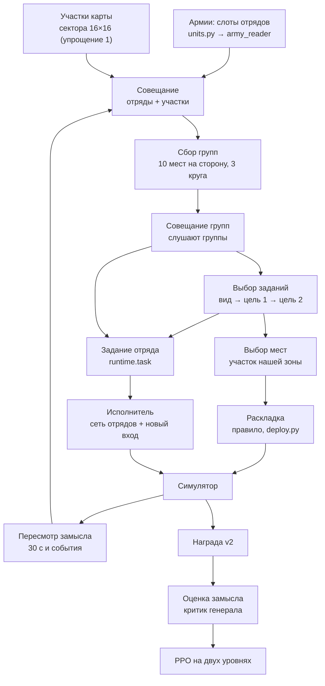

# Сеть генерала (S28)

[← Назад](README.md) · [Документация](../README.md) › [Данные для обучения](README.md) › Сеть генерала · [English](../../en/training/general.md)

Генерал — сеть, которая строит план боя для всей армии: делит армию на группы, даёт каждой группе задание и место
расстановки, а отряды (нынешняя сеть отрядов — «исполнитель») выполняют его сами. Утверждённая архитектура (с
блоками «почему так и что отвергли») — страница `design/general/index.html`; здесь — что из неё есть в коде
(`tools/nn/general/`) и как оно учится.

**Сейчас:** весь круг собран «скелетом» — от замысла до обновления весов, в симуляторе. Включается флагом
`run.py --general` (или шагом цепочки `general`, [ниже](#запуск)). Часть блоков упрощена — [список](#упрощения-скелета),
каждое упрощение — настройка, а не зашитый код.

## Весь круг



| Блок схемы | Код | Что делает |
|---|---|---|
| Армии | `units.py` (+ `army_input.py`) | слоты всех отрядов боя: 45 чисел и 3 метки (как во входе «Армии»); «пришло» = сколько осталось сейчас |
| Анализ армий | `army_reader.py` | одна сеть на все слоты → карточка отряда (ширина `card`) |
| Участки карты | `tiles.py` | 256 секторов по 100 м с их 8 числами, проекция в ширину карточки + место участка |
| Совещание | `net.General.cards` | трансформер: отряды и участки, каждый спрашивает каждого; метка «свой / враг / участок»; пустые слоты и участки вне карты не участвуют |
| Сбор групп | `net.SlotGroups` | slot attention: 10 мест наших + 10 врага, у каждого своя стартовая карточка; отряд делит себя на 100 % между местами своей стороны (маска стороны); 3 круга; бегущие и мёртвые — вне групп. Группа — место, которое главное хотя бы у одного отряда. Из ключей отрядов вычитается выученная доля среднего ключа своей стороны (`--general-center`, старт 1): места спорят за отряды по тому, чем отряды отличаются ([почему](#ещё-отличия-от-схемы)) |
| Совещание групп | `net.Listen` | группы слушают участки и все группы; участки не меняются |
| Виды заданий | `General.kinds` | таблица 10 выученных карточек без входа |
| Выбор заданий | `General.decide` | по шагам: вид (сравнение карточки группы с видами) → цель 1 → цель 2 или «нет»; цели — наши группы (не сама), их группы, участки внутри карты; вражеские группы не выбирают |
| Выбор мест | `General.decide` | только в первом плане боя: указатель на участок нашей зоны |
| Раскладка | `deploy.py` | правило: линия по ширине строя на участке группы, лицом к центру врага; группы на одном участке — одна за другой; всё внутри зоны |
| Задание отряда | `runtime.Runtime.task` | на каждый наш отряд: карточка группы (смесь карточек мест по долям состава), карточка вида задания главной группы, 2 цели (направление от того, куда смотрит отряд, cos и sin; расстояние / 100 м, не больше 20; флаг «нет») — 2 × card + 8 чисел |
| Исполнитель | `executor.GeneralActor` | нынешняя сеть отрядов; задание проходит линейный слой с нулевыми весами и прибавляется к токену отряда (как вход обязательства); врагам — ничего |
| Пересмотр замысла | `runtime.Runtime.replan` | раз в 30 с боя; раньше — если группа разбита (больше половины её отрядов бежит или уничтожено) или погиб лорд (наш или их), но не раньше 3 с после плана. Между планами группы, задания и цели заперты |
| Награда | `tools/nn/train/reward.py` | как сейчас (v2); награды за выполнение задания нет |
| Оценка замысла | `General.value` | по карточкам плана (отсоединённым) предсказывает отдачу плана |
| Обучение | `learn.py`, `tools/nn/train/ppo.py` | [ниже](#обучение) |

Размер при ширине карточки 128 (шаг цепочки): 1,14 млн весов, при 64 — 308 тыс. (сеть отрядов — 3,5 млн).

## В бою

`tools/nn/general/runtime.py` — план каждой стороны, которой играет сеть с генералом (ученик или прошлая версия из
пула с генералом), хранится по строкам боя (как у `rollout.Battles`).

- **Расстановка** (начало боя): генерал планирует на армиях и участках расстановки скриптом (`place.py`) — группы,
  задания, места; правило ставит отряды на участки их групп. Скриптовые стороны и старые сети без генерала стоят как
  раньше. Если отряды стороны стоят не в своей зоне (бои «кайта», учения) — расстановка остаётся скриптовой, генерал
  только строит группы и задания.
- **Пересмотр:** сеть проходит всю схему заново: армии «сейчас» (сколько бойцов и здоровья осталось), участки — из
  наблюдения стороны (те же числа, что у секторов сети отрядов), места групп стартуют со своих прошлых карточек.
- **Задание отряда** считается каждое решение (цели движутся): точка цели-группы — центр её отрядов сейчас (как их
  видит сторона), участка — его центр.
- **Обе стороны** в бою с собой и с пулом (если у версии из пула есть генерал) используют генерала; против скриптов —
  только наша сторона.

## Обучение

PPO на двух уровнях (`learn.py`):

- **Исполнитель** учится как раньше. Карточки задания в обновлении считаются заново из таблицы планов куска
  (`learn.task_for`) — с градиентом, поэтому ошибка исполнителя доходит до совещания групп, сбора групп, совещания и
  читателей армий. В начале каждого куска карточки идущих планов пересчитываются нынешними весами — вероятности
  решений при игре и в обновлении совпадают (тест).
- **Генерал:** выборы (вид, цель 1, цель 2, место) дискретные, сэмплируются; каждая наша группа — агент со своим
  отношением вероятностей, все группы плана делят его преимущество = отдача плана − «Оценка замысла» в момент плана
  (нормировано по планам обновления). Отдача — сумма награды от решения до следующего пересмотра или конца боя
  (`--general-return span`). Плюс энтропийная премия на выборы (`--general-entropy`, 0,01). «Оценка замысла» учится на
  отдаче. Шаги генерала — после эпох исполнителя, тот же Adam (`--general-lr-mult` — свой множитель шага); 2 эпохи по
  512 планов, эпохи обрываются, когда KL на группу больше 0,03. В начале куска вероятности выборов идущих планов
  пересчитываются нынешними весами (план, сделанный до прошлого обновления, оценивается как политика сейчас: отношение
  вероятностей стартует с 1; без этого KL генерала был 0,05–0,07 на обновление, доля обрезанных 0,5–0,6).
- **Старт:** исполнитель берёт веса последней сети отрядов, новый вход с нулевыми весами — играет как раньше
  (тест: выходы до бита равны); генерал с нуля.

Таблица планов куска: планы, действовавшие в куске (перешедшие из прошлого и новые), — их входы, состав, выборы.
В переходе хранятся только геометрия задания, флаг «есть задание» и номер плана (не карточки: ~90 МБ на кусок
1024 боя × 64 решения вместо гигабайтов).

## Упрощения скелета

Каждое — значение настройки (`GeneralConfig`, флаги `run.py`); значения полной версии, которой ещё нет, отвергаются
с ошибкой `NotBuilt` (сеть не думает, что у неё есть то, чего нет).

| № | Упрощение | Флаг (сейчас) | Полная версия |
|---|---|---|---|
| 1 | участки карты — нынешние сектора 16 × 16 по 100 м (8 чисел), проекция в ширину карточки | `--general-tiles sectors` | `cnn`: 1024 участка анализа карты (`map_cnn.py`) |
| 2 | эффекты не подключены: карточки эффектов — нули | `--general-effects off` | `on`: анализ эффектов |
| 3 | маленькие ширины: совещание 2 слоя, совещание групп 1 слой, карточка 128 (шаг цепочки; по умолчанию `run.py` — 64), 4 головы | `--general-card 128 --general-council-layers 2 --general-group-layers 1 --general-heads 4` | подобрать по проверкам |
| 4 | ветки заданий и доплата за различимость заданий выключены; энтропийная премия на выборы включена | `--general-branches 0 --general-distinct 0 --general-entropy 0.01` | ветки как у способностей; доплата |
| 5 | зона расстановки — область, где `place.py` ставит армию (вперёд от −260 до +40 м от линии стороны, вбок ±150 м); участок в зоне — его центр в ней; раскладка внутри группы — правило | `--general-zone place`, `--general-deploy net` (`script`: расстановка скриптом, как раньше) | `map`: зоны из слоёв карты |

Ещё отличия от схемы (тоже скелет):

- **ключи сбора групп минус доля среднего ключа стороны** (`--general-center 1`, доля учится; `0` — обычный slot
  attention). Без этого свежий генерал в пробе клал почти все отряды в одну группу: 1,0–1,3 группы на сторону (общая
  часть ключей отрядов одной армии перевешивала различия); с ним — 4,3–4,6 на старте (в армии ~14 отрядов), в пробном
  обучении 3,6–4,0. Решение — моё, на странице схемы его нет;
- слоты — собственные слоты боя (до 80, порядок не важен: сеть не зависит от порядка — тест), а не «40 своих + 40 врага»;
- скрытый враг считается полным (в симуляторе скрытых нет);
- поводы пересмотра — только 30 с, разбитая группа, гибель лорда («задание выполнено» и «подкрепления» — нет);
- «разбита» считает и уничтоженные отряды, не только бегущие;
- в ветках способностей план заморожен (без пересмотров за 60 с ветки);
- строй (ширина, глубина) не выбирается — как у скриптовой расстановки;
- критик отрядов замысла не видит.

## Метрики в логе

`log.jsonl` прогона, поле `general` (и строка `general:` в выводе):

| Число | Что |
|---|---|
| `groups_own`, `groups_enemy` | групп на план на сторону (места, главные хотя бы у одного отряда) |
| `kinds`, `kind_entropy` | доли видов заданий у наших групп и энтропия этой гистограммы (максимум ln 10 = 2,30) |
| `places_top` | самые частые участки расстановки (`ряд_столбец` сетки 16 × 16 стороны: ряд — вперёд) |
| `deploy_net_share` | доля расстановок, сделанных генералом (остальные — скриптом: зона не подошла) |
| `replans_per_battle`, `replan_reasons` | пересмотров за бой и по поводам (таймер, разбита группа, лорд) |
| `value_mse`, `value_ev` | ошибка «Оценки замысла» на планах обновления (до шага) и объяснённая доля |
| `pl`, `ent`, `kl`, `clip` | PPO генерала: потеря, энтропия выборов, KL, доля обрезанных |

Обязательные (рейтинг, золото пар, гибель лорда) — в проверках `test5` как раньше.

## Цена шага

Замер на видеокарте (RTX 5070 Ti; опции линии S27 с лабораторией бойцов и ветками способностей; 1024 боя, 64 решения
на обновление; в обоих прогонах одни и те же бои): обновление (сбор + шаг PPO) **48,3 с без генерала, 54,1 с с
генералом (карточка 128) — +12 %**; пока бои не кончаются +14 %, когда бои кончаются и расставляются заново +10,5 %.
Сбор 27,8 → 30,5 с, шаг 20,5 → 23,6 с, пик памяти видеокарты 11,5 → 12,3 ГБ. С карточкой 64 — столько же (+11,6 %):
цена почти вся постоянная (маленькие операции, чтения с видеокарты, раскладка на процессоре), не ширина, поэтому в
шаге цепочки — 128. Прогоны `build/nn-train/runs/gen_cost_*` (не в Git).

В пробном обучении (10 и 12 мин, от `itS27_4`): без NaN и пропущенных шагов; групп на сторону 3,6–4,0 (с вычитанием
среднего ключа), видов заданий в ходу — все 10 (энтропия 2,18–2,29 из 2,30); пересмотров ~20 за бой (таймер ~80 %,
разбитые группы ~17 %, лорд ~3 %); KL генерала 0,005–0,018; «Оценка замысла» пока ничего не объясняет (доля ≈ 0:
отдача за 30 с — почти шум; см. `--general-return td`).

## Запуск

Шаг цепочки `general` в `config/train-chain.json` (`steps.general`): опции линии S27 (`build/steps/v2_iterW.sh` +
`train_extra_S.txt`: награда v2, армии v2, ветки способностей со своим сигналом, лаборатория бойцов, пул сетей S)
поверх протокола `test5` (его `--small`, шаг, энтропия и якорь отменены) и генерал. Проверки — только обязательный
набор. Команда от последней точки сети отрядов:

```bash
.venv/Scripts/python -m tools.ops.step --label g1_general --from build/v2/itS27_4.pt --step general
```

`--from <файл>.pt` (новое): точка линии вне `test5` — она же `--init`, `--reference` и `--critic-init` (Adam и
счётчики продолжаются). `--step NAME` (новое): опции именованного шага поверх постоянных.

## Карта

Вход «Ландшафт» — `map_input.py` (6 слоёв на сетке 128×128 клеток по 16 м, всегда «от своей стороны») и
`map_batch.py` (те же слои для многих боёв сразу); «Анализ карты» — `map_cnn.py` (свёрточная сеть: 1024 участка
по 64 м, у каждого 32 числа, кэш сводки на карту); проверки — `map_probe.py`, тесты `tests/tools/test_general_map_*.py`.
В скелете генерал их пока не читает (упрощение 1).

## Вход «Армии»

Код — `tools/nn/general/army_input.py`, без torch.

- **80 слотов**: 0–39 — своя армия, 40–79 — враг; один слот — один отряд. Всё «от своей стороны»: для стороны 2
  армии меняются местами (как слои карты). Порядок слотов ничего не значит, лорд может стоять где угодно.
  Пустой слот — флаг `empty`, в нём нули. Больше 40 отрядов на сторону — ошибка.
- **В слоте 45 чисел и 3 метки** (группы и порядок — как в таблице «Слот отряда» на странице проекта):

| группа | чисел | что и как |
|---|---|---|
| сторона | 1 | свой 1 / чужой 0 |
| цена | 1 | цена в сетевой игре, логарифм (5000 → 1) |
| размер и здоровье | 5 | бойцов в полном отряде (лог 200), пришло бойцов — доля, здоровье полного отряда (лог 20000), пришло здоровья — доля, здоровье бойца (лог 10000) |
| тело и скорость | 4 | масса (лог 10000), шаг / 5, бег / 10, натиск / 10 (м/с) |
| ближний бой | 10 | атака, защита, бонус натиска / 100; урон и бронебойная часть (лог 500); бонусы против больших и пехоты / 50; время между ударами, с / 6; целей удара / 10; магические атаки — флаг |
| защита и мораль | 8 | броня / 200; щит, % / 100; лидерство / 100; сопротивления всему, физическому, снарядам, магии, огню, % / 100 (огонь бывает < 0) |
| стрельба | 12 + метка | дальность, м / 500; боезапас (лог 100); урон снаряда и бронебойная часть (лог 500); перезарядка, с / 20; **разброс на 100 м**, м / 10; снарядов в выстреле / 10; пуль за залп / 20; скорость снаряда, м/с / 100; дуга огня в каждую сторону, ° / 180; прицеливание до первого выстрела и молчание после смены цели, с / 10 |
| свойства | 4 | флаги: расходный, отражение натиска, несокрушимый, стрельба на ходу |
| метки | 3 | тип траектории (настильная / навесная / настильная с навесом через своих; 0 — нет стрельбы), каста (12), размер (4) |

  Нормировки — те же, что в паспорте сети отрядов (`tools/nn/model/passport.py`), где поле там есть
  (тест `test_the_scales_are_the_passports`). Новые: доли «пришло» (уже 0…1), разброс на 100 м / 10 м
  (аркебузиры 0,30, арбалеты 0,44, пращи 0,60, метательные звёзды 0,78), пуль за залп / 20 и время прицеливания / 10 —
  как в токене сети отрядов. На всех наших отрядах числа лежат в −1…1,5 (тест `test_numbers_span`).
- **Варианта «другое» нет.** Каста, размер или траектория не из списка — ошибка `UnknownVariant` при сборке.
  Траектории базы игры: `low` → настильная, `fixed` → навесная (мортиры), `dual_low_fixed` → настильная с навесом;
  `high` в базе только у заклинаний — пока ошибка. Новый вариант дописывается в конец списка.
- **Откуда числа** (`final_stats`). Будущий мост будет читать итоговые числа с карточки отряда в игре (ранг,
  предметы, навыки уже внутри) и передавать их как `card` (разрешённые имена — `CARD_KEYS`, другое имя — ошибка);
  чего на карточке нет, берётся из паспорта (`config/nn/units.json`) или считается. Сейчас карточки нет: в
  симуляторе и наших боях числа паспорта и есть итоговые (ранг 0). Считаем сами:
  - **разброс на 100 м** — так же, как его считает симулятор (`tools/nn/sim/missile.py` `square_side`,
    `config/nn/sim.json` `missile.accuracy.spread` = `square`): сторона равномерного квадрата в плоскости цели
    √(зона калибровки / p), p = меткость / 100 × (дистанция калибровки / 100)² × (1 − угол вылета / 180°),
    p в пределах 0,01…1; меткость = меткость отряда + меткость снаряда + 3 за каждый ранг
    (`game_rules.json` `experience_bonus.stat_accuracy`). Формула страницы проекта «разброс × (1 − меткость / 100)» —
    старое гауссово прочтение; при `spread` = `gauss` код даёт сторону квадрата той же дисперсии (√12 σ), так что
    число значит одно и то же. Совпадение с симулятором — тест `test_spread_agrees_with_the_simulator`;
  - шаг и натиск = база × (бег с карточки / бег базы) — сейчас множитель 1;
  - пришло в бой = сейчас / полное (в наших боях 1; при пересмотре — сколько осталось сейчас).

В бою скелет собирает те же числа из симулятора одной таблицей на все паспорта (`units.py`: `UnitTable`, тест —
совпадение с `army_input`).

## Анализ армий

Код — `tools/nn/general/army_reader.py` (torch). Одна общая сеть из двух полносвязных слоёв на все слоты —
одни веса для своих и врага:

- слой 1: ReLU(W1 · 45 чисел + b1 + вектор траектории + вектор касты + вектор размера), ширина 256 (в скелете 128);
- слой 2: карточка = W2 · h + b2, 256 чисел (в скелете — ширина карточки), без функции включения;
- к карточке прибавляются карточки эффектов (`effects`, вход «Эффекты» ещё не спроектирован; по умолчанию 0).

Метка — выученный вектор первого слоя (`nn.Embedding`), то же, что флаги варианта с их весами. «Нет стрельбы» —
вектор, навсегда равный нулю. Весов 82 688 при 256 (45 × 256 + 256 + 20 × 256 + 256 × 256 + 256). Пустые слоты в сеть не
попадают (их вынимают до неё), их карточка 0. Новый вариант метки — `add_variant`: новый вектор из нулей, старые
карточки не меняются до бита. Ширина слоя и карточки — параметры (`hidden`, `card`).

Скорость на процессоре (6 ядер): 1024 боя × 80 слотов (47 тыс. занятых) — 99 мс без градиента, 272 мс вперёд и
назад (`python -m tools.nn.general.army_reader --bench`).

## Проверки

Тесты при сборке (группа 1 страниц «Проверки»):

- `test_general_army_input.py`, `test_general_army_reader_torch.py` — вход и анализ армий: порядок слотов не важен,
  пустые слоты не мешают, одна сеть на всех, зеркало стороны 2, новый вариант с нулевыми весами, неизвестная
  каста / размер / траектория — ошибка, размах чисел.
- `test_general_net_torch.py` — сеть генерала: маска стороны в сборе групп и доли состава в сумме 1; бегущие, мёртвые,
  пустые — вне групп; пустые слоты ничего не меняют; перестановка слотов переставляет отряды и не меняет остального
  (группы, выборы, вероятности, оценку); правила выборов (выбирают только наши группы; цель — живая группа, не сама,
  или участок внутри карты, или «нет»; цели 1 и 2 разные; место — только участок зоны и только при расстановке);
  вероятность выбора, данного заново, равна сэмплированной; градиент от карточек задания доходит до сбора групп,
  совещаний и читателей; пересмотр стартует с прошлых мест; несобранные упрощения отвергаются.
- `test_general_executor_torch.py` — нулевой новый вход = старая сеть до бита (с заданием и без); обученный вход
  меняет решение; без заданий у отрядов — снова старая сеть; чекпойнт хранит генерала, старая сеть грузится в
  исполнителя, новые веса — последние (Adam продолжается).
- `test_general_runtime_torch.py` — таблица отрядов = вход «Армии»; участки из состояния = сектора наблюдения;
  расстановка — генерала и в зоне, скриптовая сторона не сдвинута; план заперт между пересмотрами; пересмотр по
  таймеру, по разбитой группе (не раньше 3 с), по гибели лорда (обе стороны); задание — только своим отрядам в группе;
  направление и расстояние до цели от взгляда отряда; карточки обновления = карточки игры (вероятности совпадают),
  крошечное обновление учит все части генерала; сужение пакета и ветка способностей сохраняют планы.
- `test_general_deploy.py` (без torch) — раскладка остаётся в зоне (200 случайных армий на сторону, края зоны, все на
  одном участке), линия лицом к врагу, вторая группа на участке — рядом позади, широкая линия — во второй ряд.

Группы 2 и 3 (мёртвые нейроны, похожесть карточек, новые отряды) — после обучения.
