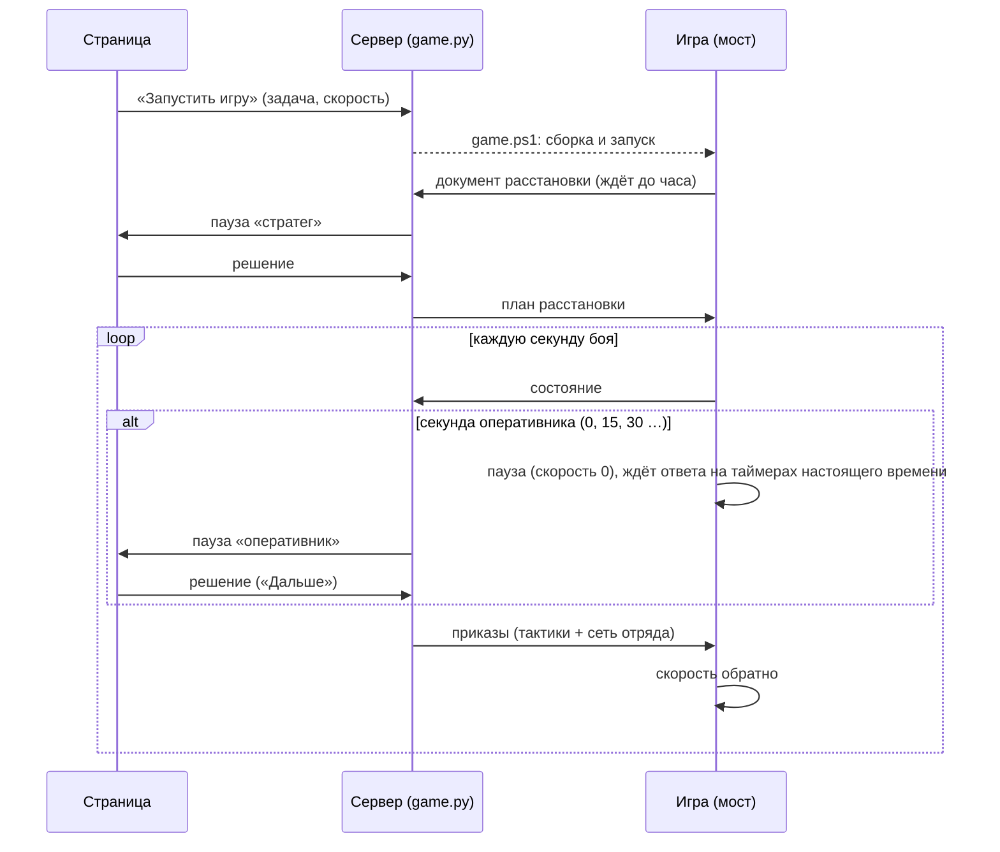

# Разметка: человек играет за уровень сети

[← Назад](README.md) · [Документация](../README.md) › [Данные для обучения](README.md) › Разметка

Разметка — графический симулятор в браузере, где человек сам играет за один уровень сети (оперативник, тактик или
стратег), а каждое его решение пишется образцом для обучения подражанием. Бой идёт в нашем симуляторе; на периоде
уровня бой встаёт на паузу, экран показывает ровно то, что видит этот уровень, человек правит решение мышью или
оставляет как есть. Код — `tools/label/`, числа — `config/label.json`, проект — `build/diag_label/plan.md`.

## Запуск

```
bash tools/label/serve.sh
```

Потом открыть **http://localhost:8790**. Один раз до первого запуска — картинки отрядов и русские названия из паков
игры: `py -3.14 -m tools.label.gameart` (кладёт их в `build/label_icons/`, не в git; без них — значок рода войск и
ключ отряда). Сервер — в контейнере `label` (нужен torch, на хосте его нет), только
процессор (4 ядра, `DOCK_CPUS=…` меняет), порт открыт только на localhost. Стоп — Ctrl+C или `docker stop label`.
Порт 8765 занят сервером страниц design, поэтому 8790 (`LABEL_PORT=…` меняет).

## Как пользоваться

**Подготовка — пять шагов** (кнопки сверху):

1. **Армии** — две колонки «Мои войска / Враг»: фракция, золото армии, отряды с карточкой из игры и русским
   названием, «−» — убрать, поиск и «+» — добавить. Справа — **готовые примеры** (`tools/label/examples/*.json`: «Пехота
   против пехоты», «Две угрозы», «Река Кислева») — начать одним щелчком, и сохранённые матчапы.
2. **Карта** — ровное поле или снятая карта (рельеф, лес, вода, «нельзя встать»), предел боя.
3. **Расстановка** — поле с подписанными зонами расстановки в настоящую величину; отряд — строй настоящей ширины и
   глубины (формула строя `geometry.dims`: ряды = ширина / шаг бойца, глубина = бойцы / ряды × шаг). Тащить отряд,
   Q / E — поворот, **тянуть чёрную точку на краю строя — ширина** (глубина пересчитывается), Del — убрать.
4. **Роль** — за кого играю (одна строка о каждом уровне), пауза каждые N с, кто над / под, приказ сверху, поведение
   врага, «бойцы поштучно».
5. **В бой** — сводка, сохранить матчап, «В бой».

**Пауза.** Сверху крупно: «Ты — оперативник. Пауза, t = 15 с. Что меняем?» и две кнопки — «Оставить как есть» и
«Поменять» (на первом решении — «Принять подсказку» и «Поменять»; подсказка формулы уже нарисована полупрозрачно).
После «Поменять» — шаги с галочками: выделить свои рамкой → кнопка-цвет группы (или 1–6), щелчок по врагу — цель,
**тянуть прямоугольник зоны**, **тянуть ручку стрелки — поворот**, «Дальше». «Показать подсказку формулы» рисует её
решение полупрозрачно, «Принять подсказку» берёт его одной кнопкой. Тактик тащит рамки отрядов, размер — в таблице.
Ошибка проверки — по-русски: что не так и как поправить («Так нельзя: …»). Внизу — строка горячих клавиш.

**Отряды на поле:** строй в масштабе поля с поворотом; бойцы — точками (с лабораторией бойцов — каждый на своём месте:
видно ряды, разрывы и потери; без неё — ряды и шеренги по формуле строя); над строем карточка из игры (у лордов
карточки нет — звезда), под ней полоска здоровья и у стрелков — снарядов; номер отряда; обводка — цвет группы. Наведи
мышь — подсказка: имя, род войск, бойцы, здоровье, снаряды, что делает (стоит, идёт, стреляет, в рукопашной, бежит).
Свои — синие, враг — красные. Сетка 50 / 100 / 200 м и линейка масштаба.

**Бойцы поштучно** (включено по умолчанию): бой идёт с лабораторией бойцов (`tools/nn/fighters`, `installed` на время
боя; в `session.json` — `fighters_lab`). На процессоре бой считается примерно в 3 раза дольше (3 на 3: 0,47 с на
секунду боя против 0,15). Уровни учились без лаборатории: формат решений тот же, а бой ближе к игре.

**После боя:** «Победа / Поражение / Время вышло», потери в бойцах обеих сторон, кто стоит, сколько решений записано,
папка, ползунок записи боя, «Ещё раз этот матчап».

## Как устроено

```
браузер (tools/label/web: index.html + app.js, canvas)
   │  JSON по HTTP
   ▼
server.py ── matchup.py, pool.py (матчап, пул, карты)
   │
   ▼
session.py: секунда боя = порядок operative/env.play
   начало секунды → оперативник (раз в 15 с) → тактик (раз в 5 с) → секунда сети отряда и симулятора
   на уровне человека — пауза: pending (что видит уровень, что в силе, подсказка формулы)
   │
   ▼
human.py / strategist.py: правка человека → выборы обхода уровня (act) → обход с головами-нулями
   (те же запреты, тот же код после, parcel.check) → ошибка назад на страницу или запись
   │
   ▼
record.py: build/label/<дата_время>_<имя>/
```

| Уровень | Когда пауза | Что видит на экране | Что правит человек | Кто над / под ним |
|---|---|---|---|---|
| Оперативник | раз в 15 с | все свои, видимые враги, группы, зоны, цели | состав групп (рамка мышью → 1–6), цель (щелчок по врагу; цель растит код), куда зона (правая кнопка / тащить кружок; шаг к ней — код), форма, поворот 16, глагол и темп (закрытые серые) | над — команда из матчапа; под — формула тактика или сеть run4, сеть отряда |
| Тактик | раз в 5 с | зоны групп плитками, ближнее окно, отряды в строках тактика (прочие тусклые, невидимые враги не рисуются) | рамка каждого отряда: тащить, размер 48 / 64 / 80 по ширине и глубине, «оставить» | над — формула оперативника или сеть run5; под — сеть отряда |
| Стратег | один раз до боя | свои, обе зоны расстановки, состав врага без мест | состав групп, куда зона группы (внутри своей зоны), форма, поворот, команда оперативнику | под — формула оперативника или сеть run5, формула тактика |

Период человек может сменить при старте (поле «период»); тогда уровень решает с этим периодом, и это записано в
`session.json` — такие образцы не того распределения, что у сети.

**Решение человека проходит те же проверки, что решение сети.** Правка переводится в выборы обхода уровня (формат
`act`, который даёт выборка сети и берут метки учителя), обход идёт с головами-нулями (`operative/net.NullHeads`,
`ZeroZoneHeads`, `strategist/net.NullHeads`). Запрет обхода — это `NEG` в маске; страница следит за `_pick` обхода и
называет запрещённый выбор: полная группа или отряды дальше 600 м, цель не видимый враг, поворот, при котором цель
несвязна, зона за полем или ближе 240 м к зоне группы с другой целью, закрытый глагол; у тактика — «должен сменить
рамку» и закрытая клетка; у стратега — зона не в своей зоне расстановки или наезжает на соседнюю. Потом
`parcel.check` на каждой посылке (у стратега — ещё `strategist/deploy.errors` на расставленном бое). Ошибка
показывается красным, «Дальше» не нажимается, ничего не пишется.

**«Оставить как есть»** — прежние посылки: оперативнику «оставить» на все группы (групп нет — ошибка), тактику — каждый
отряд держит свою рамку (у кого рамки нет — ошибка). На первом решении правка заполнена подсказкой формулы; кнопка
«Подсказка формулы» подставляет её в любой момент.

**Враг** — скрипт симулятора: шагом или бегом на ближайшего (`sim/replay.nearest_attack`, раз в 5 с), или стоит.
**Конец боя:** у стороны нет стоящих (убиты, бегут, ушли), предел матчапа или кнопка «закончить».

## Разметка в игре

Бой идёт не в симуляторе, а в настоящей игре против ИИ игры: арена 7 на 7 Империи с лордом, «Нормальная». Человек
играет за двух. На расстановке он стратег: группы и их зоны. Потом каждые 15 с он оперативник. Под ним — цепочка
помощника ([мост, «Цепочка»](../apps/bridge.md#цепочка-оперативник--тактики--сеть-отряда)): тактики (формула) и сеть
отряда. Код — `tools/label/game.py`, мост — `src/apps/battle/label_pause.lua`.

**Запуск** (Docker Desktop запущен, игра закрыта):

```powershell
powershell -NoProfile -ExecutionPolicy Bypass -File tools/label/game.ps1
```

Скрипт поднимает сервер разметки в контейнере `label` с папкой игры, открывает http://localhost:8790 и ждёт.
На странице: вкладка «▶ Игра» → задача («держать» — враг атакует, «уничтожить» — враг защищается) → скорость игры
между паузами (×1, ×3, ×10) → «Запустить игру». Скрипт собирает арену (`tools.build nn-arena --own-ai net --deploy
strategist --label-game`) и запускает игру через `launch.ps1`: сложность «Нормальная», настройки игрока потом
возвращаются. После боя в окне PowerShell — Enter, сервер закрывается.



- **В игре** с расстановки выключены: приказы игрока (`bm:disable_orders`), клавиша паузы, кнопки и клавиши скорости.
  Камера остаётся. Паузу ставит и снимает только мост: на каждой секунде оперативника он ставит скорость 0 и ждёт
  ответ на этот ход. Ответ приходит только после «Дальше». Ожидание — на таймерах настоящего времени, раз в 100 мс,
  без предела. Расстановку мост ждёт до часа, бой ограничен 3 часами настоящего времени.
- **Окно** показывает ровно то, что в симуляторе: вход стратега из документа расстановки (помощник
  `strategist_input`, один в один с симулятором), вход оперативника из снимка игры (`operative_input`). Подсказка
  формулы, «Оставить как есть», «Поменять», проверки те же: обход уровня с головами-нулями, `parcel.check`,
  ошибки расстановки. Неверное решение не пишется, игра стоит дальше.
- **Запись** — тот же формат (`label_v1`): `samples.pt`, `decisions.jsonl`, `replay.json`, `result.json`.
  Пометка «игра»: `"where": "game"` в `session.json`, в каждом образце и в строке решения. Ещё `plan.txt` — план
  расстановки, ушедший в игру, и `chain.jsonl` — приказы и поля цепочки каждой секунды.
- **Тактик** в игре — только формула. Человеком вместо тактика в игре играть нельзя.

**Проверка** (07.11.2026). Тест `tests/tools/test_label_game_torch.py`: подставная папка игры с документами боя
симулятора. Проверено: пауза стратега, неверный план не пишется, ответа на секунду оперативника нет до решения,
запись, вход из образца совпадает с живым. Сценарий в браузере — `python -m tools.label.game_check` (безголовый
Chrome, решения «человека»). Ход сценария:

1. «Игра», «Запустить игру».
2. На расстановке «Принять подсказку».
3. На 0 с «Оставить как есть».
4. На 15 с пауза держится 5 с, потом подсказка.
5. На 30 с «Поменять»: щелчок по лучникам, клавиша 2 — они переходят в группу 2.
6. Дальше «Оставить как есть».

Два боя в игре, ×10, по 300 с:

| | Бой 1, «держать» | Бой 2, «уничтожить» |
|---|---|---|
| прогон | `build/nn-arena/runs/20261107-130155` | `20261107-130553` |
| решений записано | 21 (стратег + 20 оперативника) | 21 |
| пауз; ожидание, мс настоящего | 20; 195–5757 | 20; 199–5746 |
| время боя за паузу | 300 мс | 200–300 мс |
| запреты (`disable_orders` и ещё 3) | все `ok` | все `ok` |
| ответов / пропусков / ошибок посылок | 300 / 0 / 0 | 300 / 0 / 0 |
| расстановка: отклонение центра | до 2,1 м | до 1,8 м |

Игра встаёт не сразу: за паузу бой проходит ещё 200–300 мс, смена скорости действует со следующего шага движка.
Человек видит состояние на начало паузы.

**Метки в самой игре** (`src/apps/battle/label_overlay.lua`, разведка — `build/diag_chain/ingame_ui.md`):
- над каждым своим отрядом — кружок цвета группы с её номером;
- над целью группы — кольцо с номером группы;
- углы зоны каждой группы — жёлтые метки на земле;
- внизу экрана — строка «Ты — оперативник. Пауза, t = 30 с. Реши в окне разметки»;
- слева сверху — окно ✔ / ✖. ✔ значит «Оставить как есть» (на первом решении — подсказка формулы); страница видит
  такое решение и закрывает паузу.

Правка в окне разметки видна в игре сразу, до «Дальше». После решения метки показывают новые группы и остаются до
следующей паузы. На расстановке — то же для плана стратега. Помощник пишет файл `tww3_bai_nn_overlay.txt`, мост
читает его раз в 250 мс настоящего времени (идёт и на паузе). Картинки значков — `tools/label/icons.py`, кладутся в пак
сборкой `--label-game`. Линий и залитых областей скрипт боя рисовать не умеет. 3 боя со снимками окна игры:
`build/diag_chain/ingame_*.png`.

**Не проверено (нужен человек у игры):** не слушаются ли отряды мыши и клавиш игрока под `disable_orders`; нельзя
ли снять паузу пробелом, кнопками или через Esc. Как проверить — `build/diag_chain/part2.md`.

## Разметка вживую

Обычный бой в игре: человек сам командует отрядами, без пауз, скорость свою. Паузу он тоже ставит сам. Заодно он
размечает уровень оперативника — группы. Код: `tools/label/live.py`, `tools/label/live.ps1`, мост
`src/apps/battle/live_label.lua` и `enemy_cards.lua`.

**Запуск:** `powershell -NoProfile -ExecutionPolicy Bypass -File tools/label/live.ps1`.
- Армии: генератор боя 25.10 (`--army-seed 1000702579 --army-swap --armies v3`): 20 на 20, Империя против скавенов,
  ИИ игры, «Нормальная».
- Пул с тех пор изменился: состав не тот же, что в бою 25.10.
- Записывающий помощник работает в контейнере `label-live`, окна браузера нет.

**Как размечать:**
- **Свои группы — родные группы игры:** выделить отряды и нажать Ctrl+G или кнопку «группа» на панели приказов.
  Мост раз в секунду читает их из панели карточек: рамка `group_frameN` над карточками группы; карточки названы по
  номеру отряда. CCO-функций групп у игры нет.
- **Вражеские группы — на карточках врага.** Они стоят в той же нижней полосе, что свои, после золотого
  разделителя. Карточки — родные по виду: картинка отряда, число бойцов, полоска здоровья. Заполняет их скрипт раз в
  секунду: родную карточку игра наполняет только для своих отрядов, контекст отряда она не подхватывает.
  - щелчок по карточке врага добавляет его в набор или убирает, карточка подсвечена;
  - Ctrl+G или кнопка «группа» делают из набора вражескую группу N — следующий свободный номер, до 6;
  - щелчок по разделителю очищает набор.
- **Своя группа N целит во вражескую группу N** — тот же номер.
- **Метки в игре:** над своими отрядами — номер группы, над вражескими — кольцо с номером.
- **Приказов врагу нет:** набор на вражеских карточках не входит в выделение игрока (`SelectionContext` — только
  свои).
- **Ширина полосы — по правилу самой игры** (`hud_battle.twui.xml`, `review_DY`): не шире экрана минус 510 px,
  между портретом и кругом. Не влезает — вражеский ряд над своим.
- **Ctrl+1…9** в интерфейсе и CCO не видны. Мост пишет событие `live_shortcut`: имя нажатой клавиши и выделение в
  этот миг. Так находим имена этих клавиш и составы групп.

**Запись** (`build/label/<дата>_live/`, формат `label_v1`, `"mode": "live"`, `"where": "game"`), окна по 15 с:
- группы за окно поменялись — решение `human`. Отряды вне групп код добавляет группами «остаток» по ≤ 10: обходу
  оперативника нужен каждый свой отряд в группе;
- не поменялись — пропуск `keep`;
- групп ещё нет — `none`, только текст;
- в образце: вход оперативника на начало окна (`record.rebuild`), группы человека как есть (`human_groups`), выборы
  обхода (`act`) или ошибки;
- `orders.jsonl` — приказы игрока каждую секунду: место, точка приказа, цель, бег, движение, рукопашная, ширина.

Тест `tests/tools/test_label_live_torch.py`: окна `none` / `human` / `keep`, поток приказов, метки.
Бой в игре `build/diag_chain/live_rec/`, 07.11:
- щелчки — только скриптом внутри игры (`SimulateLClick`), без клавиш и мыши на рабочем столе;
- своя группа — щелчок по карточке и кнопка «группа»; вражеская группа — набор на карточках и та же кнопка;
- 7 окон: 2 `human`, 5 `keep`;
- приказ движения скриптом виден в потоке: точка приказа сменилась, отряд пошёл;
- снимки окна игры `build/diag_chain/ingame_live_*.png`.

### Лента боя и выгрузка для обучения

`python -m tools.label.digest build/label/<дата>_live [--export]` (лента и кадры — на хосте; `--export` — в
контейнере, нужен torch) кладёт в `<запись>/digest/`:
- `digest.md` — лента по окнам 15 с: свои группы (состав, центр, куда фронт, ширина), вражеские группы, что
  изменилось, приказы за окно сжато («группа 1: Тяжелые мечники ×2 идут к (−180, 130) бегом»), слова из чата,
  потери, рукопашная, бегущие; в начале армии и карта, в конце итог. Бой на 4 мин — ~16 КБ;
- `digest_<окно>.png` — кадр на окно (`tools/label/replay.py`): строи или бойцы точками, свои группы цветом, вражеские
  рамкой, стрелки приказов (атака — красная), подпись с окном и чатом; `battle.gif` — кадр каждые 3 с;
- `samples.pt` и `export.json` — выгрузка в формате записи разметки (`record.load`):
  - оперативник — образцы записи, каждый один раз пересобран `record.rebuild`;
  - `unit_order` — смена приказа отряда. Один в один: цель (слот), поворот (64 сектора, из `ob` прогона), бег
    (`is_moving_fast` — состояние, не сам приказ), ширина в метрах. Не хватает области отряда (рамки тактика):
    без неё нет клетки «куда» и вида отряда. Цель — `current_target` игры: стрелки сами меняют её без приказа;
  - тактик — образцов нет: человек не задаёт ни зону группы, ни рамки отрядов.

Состояние каждой секунды обеих сторон берётся из прогона (`build/human/runs/<прогон>/events.jsonl`: `nn_sample`,
`nn_soldiers`, `result`) — его находят по `batch` записи. Тесты: `tests/tools/test_label_digest.py` (хост),
`test_label_digest_torch.py`.

## Подготовка: матчап

Армии — из пула (`config/nn/pools.json`: лорд, units, units_v2, units_v3; список с поиском), до 20 на сторону, генерал
один. Карта — ровное поле или снятая (`build/maps/*`, картинка — `mapimg.py`: высота, вода, лес, «нельзя встать»,
стволы). Расстановка мышью в полосе своей стороны (свои снизу, враг сверху; `config/label.json deploy`): Q / E —
поворот на 15°, Del — убрать, «разложить» — сеткой. Ещё: предел боя, команда сверху (глагол и темп), поведение врага.
Матчап сохраняется в `build/label/matchups/<имя>.json`, чтобы разметить его несколько раз.

## Запись

| Файл | Что |
|---|---|
| `matchup.json`, `session.json` | матчап; кто какой уровень играл, период, уровни над и под, сети, слоты и ключи отрядов, лаборатория бойцов |
| `matchup_deployed.json` | только у стратега: матчап с отрядами на его местах |
| `samples.pt` | образец на решение: **сырые числа, из которых вход уровня собирается без расхождения** (как хранит PPO): оперативник — raw, группы до решения, оси, карточки, команда, K; тактик — raw, посылка, плитки, прошлые рамки, приказ, K; стратег — raw, обе зоны, команда, K. Плюс выборы человека `act` (формат обхода), выборы формулы в тот же момент, источник (`human` / `keep` / `hint`) |
| `decisions.jsonl` | то же текстом: секунда, источник, правка, что из неё сделал код (группы, зоны, рамки, места) |
| `replay.json`, `result.json` | снимок в секунду (все отряды, скрытые помечены; места бойцов — раз в 5 с) — смотреть бой ползунком; итог: почему, время, победитель, размен в золоте, потери в бойцах, кто стоит, решений, ошибок посылок |

Чтение: `record.load(папка)`; `record.rebuild(образец)` — вход оперативника `(inp, ctx, act)` или тактика
`(inp, order, parcel, tiles, act, prev)`; `strategist.rebuild` — вход стратега; `record.labels(образец)` — метки
оперативника для `net.choose(labels=...)` (слагаемое учителя с человеком в роли учителя; цель — one-hot строки зерна).

## Проверка

Тесты: `tests/tools/test_label_matchup.py` (хост), `tests/tools/test_label_torch.py` (контейнер): пауза ровно на периоде
(15 с, свой 20 с, тактик 5 с), «оставить» = прежние посылки (группы и тактики не меняются, посылок нет), запрещённое
решение не пишется (без группы, `zone_sep_m`, чужой отряд, закрытый глагол), вход из записи совпадает с живым бит в бит
(оперативник, тактик, стратег), слагаемое учителя на образце конечно, стратег расставляет и бой идёт сам;
с лабораторией бойцов у каждого живого бойца своя точка, а её подмена шага снимается с концом боя.

Сценарий в браузере: `python -m tools.label.browser_check` (хост, безголовый Chrome через DevTools, без сторонних
библиотек; сервер должен работать) — пять шагов подготовки кнопками и мышью (пример, отряд поиском и «+», карта,
перетаскивание и ширина строя за край, роль, «В бой»); оперативник: «Принять подсказку» на 0 с, на 15 с «Поменять»,
рамка на два отряда → клавиша 2, зона тянется мышью, стрелка поворачивается (поворот, при котором цель не влезает,
отклонён с текстом «Так нельзя: …»), до конца «Оставить как есть»; тактик на карте реки: рамка тянется и уменьшается;
стратег: зона группы тянется. Снимки — `build/diag_label/v2_*.png`.

Картинки и названия: `tools/label/gameart.py` читает паки игры (Python 3.14, zstd): карточка — `ui.pack`
`ui\units\icons\<card>.png`, имя карточки — строка `db.pack` `unit_variants_tables` после ключа отряда (схемы
этой таблицы в `config/db_schema.json` нет, строка читается по строкам с длиной); название — `local_ru.pack`
`text\localisation__.loc`, ключ `land_units_onscreen_name_<ключ>`. Из 59 отрядов пула названия у всех, карточки у
57 — у двух лордов карточки в `ui\units\icons` нет.

## Не сделано в первой версии

- Враг под формулой или сетью уровня (сейчас скрипт); подкрепления; магия и способности по кнопке человека.
- В игре: тактик человеком, другие армии и карты (только арена 7 на 7 Империи на ровном поле).
- Тактик видит рамки своих отрядов, но не правит глагол и темп (у тактика их нет на выходе).
- Обучение подражанием на записях — отдельная задача; формат и чтение готовы.
- Карточки лордов (Имперский полководец, Предводитель воинов) — звезда вместо картинки.
- Зоны расстановки снятых карт — свои полосы: в `build/maps` лежат зоны сценария съёмки (200 × 120 м бок о бок).
