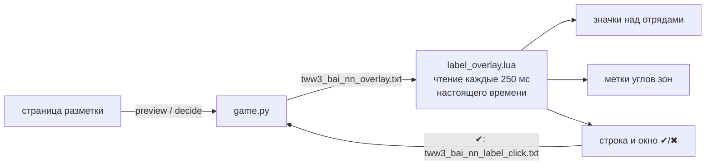

# Интерфейс разметки в самой игре: что умеет скрипт боя TWW3

Цель: поверх настоящего поля показать, что решает оперативник (и стратег на расстановке). Решение человек принимает
в окне разметки. В игре — только метки и строка, плюс кнопка «оставить как есть».

## Главное

В игре работает (3 боя, 07.11.2026):
- **значок с номером группы** над каждым своим отрядом — наша картинка из нашего пака;
- **значок цели** — кольцо с номером группы над вражеским отрядом;
- **углы зоны группы** — метки на земле;
- **строка внизу экрана**: «Ты — оперативник. Пауза, t = 15 с. Реши в окне разметки»;
- **окно с кнопками** ✔ / ✖;
- **перенос камеры** скриптом.

Ни один вызов не упал. Линий и залитых областей на земле скрипт рисовать не умеет. Эффекты (vfx) в произвольной точке
— тоже нет.

## Что есть и что проверено

| Что | Вызов | Источник | Проверено в бою |
|---|---|---|---|
| Метка на земле в точке | `bm:add_ping_icon(x, y, z, тип, is_waypoint, поворот)`, `bm:remove_ping_icon(x, y, z)` | `lib_battle_manager.lua:4462`; CA: `intro_battles/wh2_intro_battle.lua` (типы 8, 9, 11, 13) | да: 504 метки, 508 снятий, 0 ошибок. Тип 8 — жёлтый «глаз со стрелками вниз». Картинки типов из `common.PingIconPath`: 8/12 look_at, 9/13 move_to, 10/14 select, 11 attack, 15 точка захвата, 16 ловушка, 0–7 пусто |
| Значок над отрядом | `unit_id_holder` → id отряда → `script_ping_parent:CreateComponent(имя, "ui/battle ui/unit_ping_indicator.twui.xml")`, ребёнок `icon:SetImagePath(картинка)` | `lib_battle_script_unit.lua:1855` (`script_unit:add_ping_icon`); макет — `ui3.pack` | да: 294 своих и 683 вражеских значка, 949 снятий (`Destroy`), 0 ошибок |
| Своя картинка | `SetImagePath("ui/bai/label/g2.png")` — PNG из нашего пака | `tools/label/icons.py`, сборка `--label-game` кладёт 12 картинок | да: цветной круг с цифрой (свои) и кольцо с цифрой (цели) |
| Строка текста на экране | `core:get_ui_root():CreateComponent(имя, "UI/Common UI/scripted_subtitles.twui.xml")`, ребёнок `text_child:SetStateText(текст, ключ)` | `lib_battle_manager.lua:3248` (`show_subtitle`) | да: строка внизу, кириллица видна |
| Окно с кнопками | `CreateComponent(имя, "UI/Common UI/dialogue_box")`, текст `DY_text`, клик — `core:add_listener("…", "ComponentLClickUp", …)` с `context.string == "button_tick"`; `MoveTo(x, y)` | кампания: `wh2_dlc17_bloodgrounds.lua:677` | показ и перенос в угол — да. Клик мышью скриптом не проверен: путь «клик → файл → решение» проверен тестом |
| Камера | `bm:camera():move_to(позиция, цель, время, false, 0)` | `lib_battle_cutscene.lua:1577` | да, на расстановке и на паузе |
| Подсветка карточки отряда | `script_unit:highlight_unit_card` | `lib_battle_script_unit.lua:1791` | не пробовали: это карточка внизу, не отряд на поле |
| Сцены и эффекты | `bm:start_terrain_composite_scene(ключ)` | `lib_battle_manager.lua:4908` | не подходит: сцены заданы в данных карты по ключу, своей точки нет |
| Цели и подсказки туториала | `bm:set_objective(ключ)`, `add_infotext`, `queue_advisor` | `lib_objectives.lua`, `lib_infotext.lua` | не пробовали: нужны ключи локализации, произвольный текст проще через subtitles |
| Линии, круги, области на земле | — | в библиотеке CA боя нет; путь `ui\3dui\textures\default\spline_ping_path_land_diffuse.dds` — путь движения пинга игрока, скриптом не вызывается | нет |

## Чего игра не умеет (из скрипта)

- **Линий и залитых областей на земле.** Зона показана метками по углам. Цвет у меток на земле один — жёлтый «глаз».
  Чья это зона, видно только по номерам отрядов рядом.
- **Эффектов (vfx) в произвольной точке.** Composite scenes — только заранее поставленные в карте.
- **Своего макета (.twui.xml) мы не делали.** Берём готовые: значок отряда, строку субтитров, окно диалога. Свой
  макет в паке возможен, но его формат большой — отдельная работа.
- **Подписи у меток на земле:** у `add_ping_icon` текста и цвета нет, только тип.

## Как устроено

- Мост: `src/apps/battle/label_overlay.lua`. Файл обмена `tww3_bai_nn_overlay.txt` идёт тем же каналом, что план и
  посылки: файл в папке игры, запись через временный. Новая версия файла убирает старые метки и рисует новые.
- Помощник (`tools/label/game.py`) пишет файл в пяти случаях:
  - на паузе стратега и оперативника: группы в силе, строка, кнопка;
  - на каждой правке в окне (`preview`): правку видно в игре сразу, до «Дальше»;
  - после решения: новые группы без строки, метки остаются до следующей паузы;
  - когда группы меняются в бою;
  - в конце боя: всё стёрто.
- Кнопка ✔ в игре пишет файл клика. Сервер принимает «Оставить как есть», а где оставлять нечего — подсказку формулы.
  Страница видит это и закрывает решение.
- Глобальные объекты скрипта боя (`core`, `UIComponent`, `find_uicomponent`, `cco`) из окружения нашего модуля не
  видны: бой 1 дал `attempt to index field 'core' (a nil value)`. Теперь их передаёт сборка
  (`tools/pack/bundle.py`), как раньше `common`.

## Бои

Ход в каждом бою один: расстановка — подсказка; 0 с — «оставить»; 15 с — пауза 5 с, подсказка; 30 с — лучники
в группу 2; дальше «оставить».

| Бой | Прогон | Что вышло |
|---|---|---|
| 1 | `build/nn-arena/runs/20261107-143607` | метки на земле и камера работают; значки, строка и окно — нет (`core` не виден); снимки экрана целиком — удалены |
| 2 | `20261107-144013` | всё работает. Камера сдвинута (3D-вектор строился из 2 чисел); окно посередине поля. Снимки — `build/diag_chain/ingame_battle2/` |
| 3 | `20261107-144305` | всё работает: 42 версии файла, 0 ошибок вызовов, окно в углу, камера на армии; 21 решение, пауз 20 |

Снимки окна игры (`tools/label/game_check.py --shots`, PowerShell `CopyFromScreen` по окну игры), бой 3:
- `build/diag_chain/ingame_1_deploy.png` — расстановка: номера групп 1–3 над отрядами, жёлтые метки углов трёх зон
  и строка внизу;
- `build/diag_chain/ingame_2_pause_0s.png`, `ingame_3_pause_15s.png` — пауза оперативника: свои ①②③, цели — кольца
  над врагом, окно ✔/✖ слева сверху, строка внизу;
- `build/diag_chain/ingame_4_edit_preview.png` — правка в окне разметки (лучники → группа 2) видна в игре до «Дальше»;
- `build/diag_chain/ingame_5_after_edit.png` — следующая пауза: группы после правки.
